# Agent: use conversation to assist debugging

> Draft for `v0.1.1-alpha.1`; real local-demo model steps are illustrated, with other branches marked image pending. Neither this chapter nor item9 is complete. Model capability, price and availability belong to its provider; no credentials or correctness guarantee are supplied.

[Guide directory](../README.en.md) · [Tool permissions](tool-permissions.md) · [MCP](mcp.md)

<!-- recorded-walkthrough:start -->

## Recorded walkthrough: actual product steps

These images show the published <code>0.1.1-alpha.1</code> on macOS x64, retaining the App language <code>zh-CN</code>. Every recorded step has its own native-window screenshot; open an image at full size to inspect values.

Loopback addresses, ports and generated IDs belong to this recording, not a public service. Use your own authorized test environment. The actual values below match the screenshots. Advanced branches not shown here still need their own step images and acceptance.

> This keyless local model returns fixed public demonstration replies. The walkthrough shows real configuration and chat controls, not a commercial model benchmark or bill. Never enter real credentials for this demo endpoint.

| Example field | Actual recorded value |
| --- | --- |
| <code>profileName</code> | <code>Guide local demo</code> |
| <code>modelId</code> | <code>guide-demo-model</code> |
| <code>baseUrl</code> | <code>http://127.0.0.1:54446/guide/v1</code> |
| <code>contextWindow</code> | <code>131072</code> |
| <code>maximumOutput</code> | <code>8192</code> |
| <code>prompt</code> | <code>Explain Pause and Clear. Do not change settings.</code> |
| <code>pausePrompt</code> | <code>Pause recording after asking me.</code> |
| <code>answer</code> | <code>Demo response: Pause stops recording new requests. Clear removes captured records. Neither restores the system proxy.</code> |
| <code>modelKind</code> | <code>deterministic local demonstration, not a commercial model acceptance</code> |

### 01 · Open Settings

### 02 · Open Agent settings

### 03 · Add a model

### 04 · Choose Custom

### 05 · Name the profile

### 06 · Enter the local demo URL

### 07 · Enter the model ID

### 08 · Set the context window

### 09 · Set maximum output

### 10 · Test the actual connection

### 11 · Save the verified model

### 12 · Open the Agent panel

### 13 · Create a Chat

### 14 · Enter a scoped question

### 15 · Send and read the demo response

### 16 · Inspect context usage

### 17 · Inspect Auto mode

### 18 · Restore Ask

### 19 · Request a Tool requiring approval

### 20 · Deny one Tool call

### 21 · Request again and review the target

### 22 · Allow actual Recording pause

### 23 · Start a stoppable demonstration

### 24 · Stop while retaining history

### 25 · Retry as a new attempt

The complete reference follows. Only operations with matching real step images and checked input values count as illustrated acceptance.
<!-- recorded-walkthrough:end -->

## Decide whether you need AI

Agent is an optional side panel, not a capture prerequisite. Capture, Rules, Breakpoints and Composer work without a model account.

The internal Agent uses App-configured models; external MCP hosts use their own model configuration. Sharing business tools does not make their login or permissions identical.

## Add and verify a model

**Prerequisites:** authorized provider access and awareness of possible charges. Enter credentials only in the product's configuration dialog.

This uses a deterministic local demonstration service without a key, not commercial-model acceptance. `54446` is its recording-only dynamic port. The App does not create that service; prepare your own compatible test service first. Context/output numbers are configured examples, not measured model capacity.

1. Open Settings, then Agent.

   

   

2. Add a model.

   

3. Select Custom OpenAI-compatible. DeepSeek uses its fixed official endpoint and needs your own key and Model ID; that paid-service branch is image pending / blocked, not certified by this local demo.

   

4. Enter Profile name `Guide local demo`.

   

5. Enter Base URL `http://127.0.0.1:54446/guide/v1`, with no key for this local service. Credential input for an authenticated service remains image pending.

   

6. Enter Model ID `guide-demo-model`.

   

7. Enter Context Window `131072`.

   

8. Enter Maximum Output `8192`.

   

9. Test connection and wait for the actual HTTP model request.

   

10. Save after success and inspect identity/status in Configured models.

    

11. Retest after changing connection fields; do not reuse the earlier test result.

    These accurately reuse the separate `agent-management` example: change `Guide model two` to Model ID `guide-two-edited`, then Test and Save. This is not silently changing the preceding `Guide local demo` into another configuration.

    

    

    

**Expected result:** the saved configuration is the one you tested and appears in the model selector.

**Notes**

- Test connection makes a real model request, not only a URL-format check.
- Remote Custom endpoints require HTTPS; HTTP is limited to supported loopback addresses.
- “OpenAI-compatible” does not guarantee every provider extension. Use its actual Base URL and Model ID.
- Context/output values must match real support; larger numbers do not expand server capacity.
- Resolve secure-storage errors instead of saving keys in plaintext to bypass them.

## Edit, choose defaults and remove models

This section uses the two key-free profiles created and tested in the [management recording](#walkthrough-agent-management). `51439` is this local service's dynamic port, not a fixed replacement for the earlier `54446`, nor commercial-model acceptance.

| Profile | Base URL | Model ID |
| --- | --- | --- |
| `Guide model one` | `http://127.0.0.1:51439/guide-one/v1` | `guide-one` |
| `Guide model two` | `http://127.0.0.1:51439/guide-two/v1` | Initially `guide-two`; Edit below changes it to `guide-two-edited` |

1. Edit the second profile in Configured models and change Model ID to `guide-two-edited`.

   

2. Test connection again instead of reusing the initial add-model test.

   

3. Save after success.

   

4. First create a Chat using the first default model.

   

5. Rename it `Guide chat one` to distinguish it later.

   

6. Set `Guide model two` as the global default. This affects subsequent new Chats, without automatically switching existing `Guide chat one`.

   

7. To change existing `Guide chat one`, separately operate its Model Select and inspect the selected entry. This changes the current Chat, not the global default again.

   

8. Create a second Chat and inspect its new default configuration; naming and selection follow below.

   

9. Later cleanup removes only the first unnecessary demo Provider. Review its confirmation and any chats still using it first.

   

10. Confirm removal of `Guide model one`, retaining the second profile.

    

11. For a credentialed Custom service, still explicitly retain, replace or remove the stored key; DeepSeek requires a valid key.

    **Image pending / blocked:** neither local profile has a key. They do not cover credential management or commercial-model connections.

12. Removing the final model requires configuration again before model calls can continue.

    This separate example uses `Guide session demo`, not `Guide model two` above. The [final-model removal steps](#walkthrough-agent-model-removal) retains the safe Settings ending of the earlier source recording. A later [complete restart walkthrough](#walkthrough-agent-session-restart) has its own source; their images are not mixed.

    

    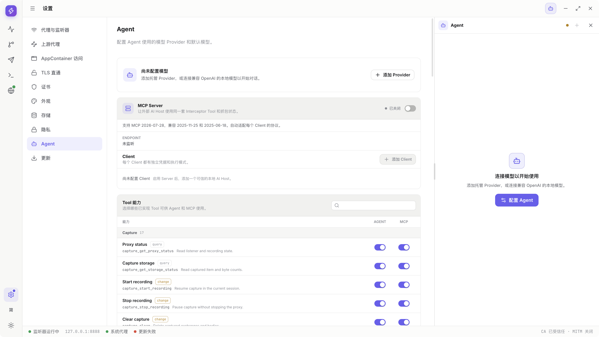

**Expected result:** global defaults and current-chat selection remain separate, without silently reordering model rows.

**Notes:** deleting local configuration does not revoke a provider account/key. Revoke leaked credentials at the provider.

## Start a well-scoped conversation

1. Open Agent using the button near window controls.

   

2. Create a Chat and inspect model and Ask/Auto mode.

   

3. Enter the actual prompt `Explain Pause and Clear. Do not change settings.` This asks for an explanation, not traffic queries or modifications.

   

4. Click Send and read the answer starting with `Demo response:`. `Ctrl+Enter` / macOS `Command+Enter` is also available; keyboard sending remains image pending.

   

5. If a task produces Tool calls, inspect calls/results and effects before approving.

   This read-only question requests explanation, not a business Tool. The Pause approval below uses a separate, explicit prompt and is not presented as an effect of this reply.

6. Verify results in the relevant product workspace.

   An explanation has no configuration mutation to verify. See the Pause example below and the [Tool lifecycle recording](#walkthrough-agent-tool-lifecycle) for actual operations and state checks.

**Expected result:** a conversation with an explicit scope, where explanation and actual execution are distinguishable.

**Notes**

- Selecting a request or changing workspace does not implicitly attach it to model context.
- Read current records through authorized tools; do not ask the model to invent IDs.
- Instructions contained in captured pages, bodies or logs are untrusted data, not your authorization.

## Manage chats and restore history

This continues `agent-management`, not the earlier single `Guide local demo` Chat. The two sessions are `Guide chat one` and `Guide chat two`.

1. Create the first Chat before the preceding section's global-default change.

   

2. Rename it `Guide chat one`.

   

3. After the separate default/current-model operations above, use New Chat for a second task instead of reusing the first.

   

4. Rename it `Guide chat two`.

   

5. Use Chat selector to return to `Guide chat one` and verify the selected target.

   

6. Open Delete confirmation and inspect the session name.

   

7. Cancel first, retaining that Chat.

   

8. Later in this recording, after capability checks and Provider cleanup, open Delete for `Guide chat one` again.

   

9. Confirm deletion of `Guide chat one` and inspect the remaining sessions. The cancellation image is not deletion.

   

10. When deleting an actively executing Chat, wait for its cancellation cleanup.

    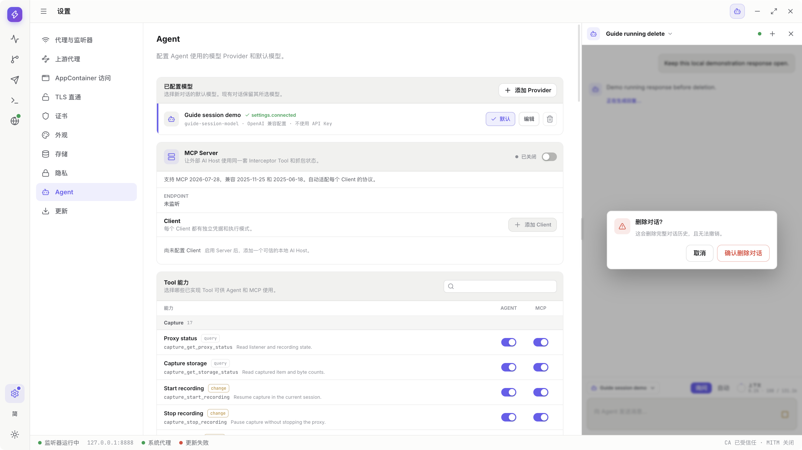

    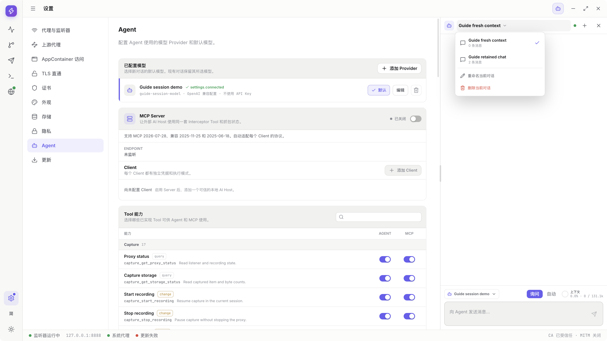

11. Restart normally, reopen Agent and inspect retained sessions/state.

    The [session actions](#walkthrough-agent-session-lifecycle) and [restart clip](#walkthrough-agent-session-restart) now come from the same successful two-generation App run. Settings is opened before restart recording starts, showing only the public demo Chats rather than background Capture traffic.

    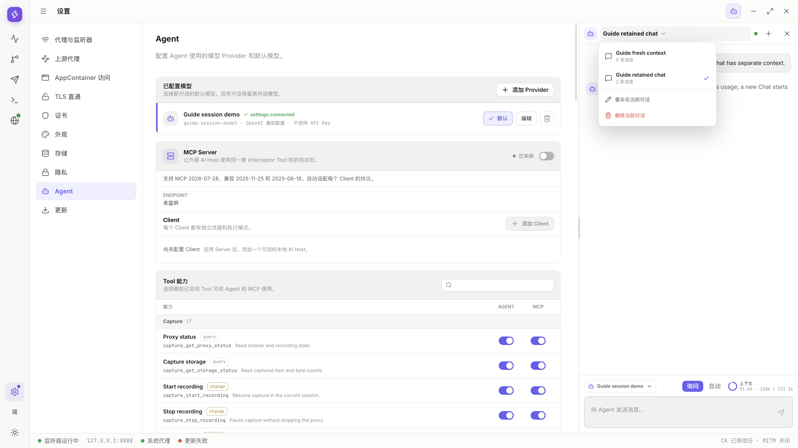

    

    `Guide running delete` is absent; `Guide retained chat` and `Guide fresh context` remain. No model-request replay is verified through that run's local-service count, not inferred from a static picture alone.

**Expected result:** history persists locally. Navigating workspaces does not close the panel, and closing the panel does not delete a Chat.

**Notes:** restoring history does not replay prior side effects. Old Capture IDs can become invalid after Core restarts.

## Read context and usage

1. Inspect the Context ring and details above the input: current context, window limit and available input, output, total and cache figures.

   

2. Hover or keyboard focus reveals the explanation. The preceding image uses hover; the following image independently records `Shift+Tab` from the message input to Context.

   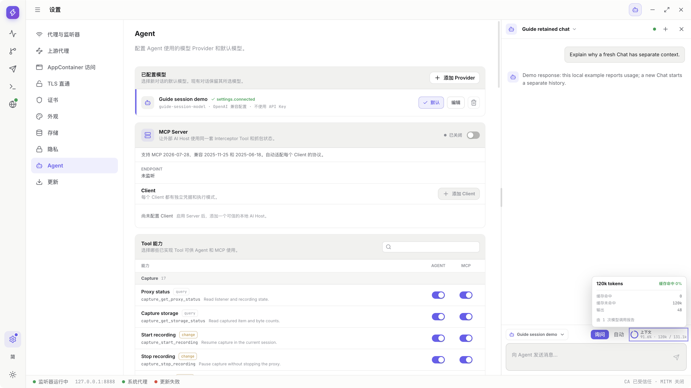

3. Decide whether a separate Chat would reduce unrelated context.

   

**Expected result:** distinguish current/recent request context from cumulative session consumption.

**Notes**

- Current Context is not the visible App workspace or cumulative token count.
- Cache hit/miss are parts of input, not extra tokens to add again.
- Missing provider metrics are unavailable, not zero.
- Remaining context must also accommodate output; it is not a guaranteed generation length.
- Token usage is not automatically a monetary bill or automatic spending stop.

## Let Agent use product tools

1. First inspect enforcement using `agent-management`: find `capture_stop_recording` in Tool capabilities and disable its Agent column, not `capture_clear` or the MCP column.

   

2. Have the local demo model request that disabled Tool and inspect the actual `unknown_tool` refusal, not a successful pause. This is unavailable capability, not a user clicking Deny in Ask or a model connection failure.

   

3. Restore the Agent capability to its pre-exercise state. Restoring the switch does not replay the rejected call.

   

4. The following accurately reuses `Guide local demo` from the original `agent` clip to demonstrate approval for an enabled capability. Keep Ask in that Chat.

   

5. Enter `Pause recording after asking me.` Inspect `capture_stop_recording` and its effect on new recording, not Clear or proxy restoration.

   

6. Deny the first request and inspect the refusal.

   

7. Request the same scoped action again and review the new target. A past denial is not the new approval.

   

8. Allow and inspect actual execution and the Recording state.

   

9. For other tools needing native file/system prompts, finish them after Allow and inspect the terminal state.

   The [Diagnostics export recording](#walkthrough-agent-tool-lifecycle-10-export-request) includes native Save after approval. Cancelling does not start export; saving again still requires checking completion. This does not replace Windows system authorization.

   

**Expected result:** authorized actions use formal product operations and update the relevant UI.

**Notes:** see [permissions](tool-permissions.md) for query/change types and independent entry points. “Done” in model text is not a substitute for Tool results or real state.

## Stop, inspect failure and retry

1. Start the stoppable local streaming demonstration and observe the active turn.

   

2. Stop when no longer needed, wait for cancellation and inspect preserved history.

   

3. Inspect actual state, then use the offered Retry for a new attempt. A network-failure branch was not recorded here.

   

4. Before retrying a possibly sent request, export or setting change, verify what already happened.

   The [actual Tool recording](#walkthrough-agent-tool-lifecycle) allows Pause before stopping the model reply; Recording remains paused. This demo model's Retry continues explanation only, not a promise that another model will never request the Tool again.

   

5. Send a new message to clarify the allowed scope when needed.

   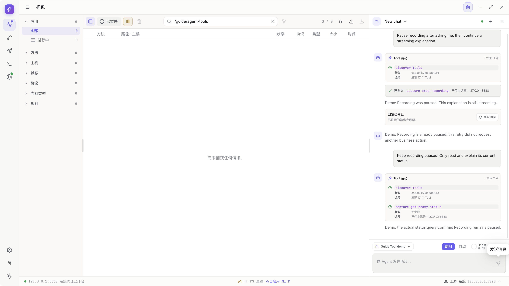

**Expected result:** stopping preserves the Chat and completed history. Failures stay visible.

**Notes**

- Stop is not undo or Breakpoint Continue.
- The formal Chat UI does not expose a general Continue for an active turn merely because an internal runtime supports checkpoints.
- Switching to Auto does not approve an already-pending question.
- A stream that already displayed content is not assumed safe to replay automatically.

## Understand the model-data boundary

- Local configuration/history does not mean conversation stays on the device.
- Prompts and Tool results included in context go to the configured model service.
- Enable only needed capabilities and avoid sending personal traffic, keys or sensitive bodies.
- Redaction does not recognize every possible business secret.
- Captured webpages/logs are data, not authorization to expand the task.
- Disabling Agent access does not disable MCP or revoke provider credentials.

<!-- recorded-walkthrough:agent-management:start -->

## Recorded walkthrough: models, Chats and capability enforcement

These images show the published <code>0.1.1-alpha.1</code> on macOS x64, retaining the App language <code>zh-CN</code>. Every recorded step has its own native-window screenshot; open an image at full size to inspect values.

Loopback addresses, ports and generated IDs belong to this recording, not a public service. Use your own authorized test environment. The actual values below match the screenshots. Advanced branches not shown here still need their own step images and acceptance.

> This keyless local model returns fixed public demonstration replies. The walkthrough shows real configuration and chat controls, not a commercial model benchmark or bill. Never enter real credentials for this demo endpoint.

| Example field | Actual recorded value |
| --- | --- |
| <code>firstProfile</code> | <code>Guide model one</code> |
| <code>secondProfile</code> | <code>Guide model two</code> |
| <code>firstModel</code> | <code>guide-one</code> |
| <code>editedModel</code> | <code>guide-two-edited</code> |
| <code>firstEndpoint</code> | <code>http://127.0.0.1:51439/guide-one/v1</code> |
| <code>secondEndpoint</code> | <code>http://127.0.0.1:51439/guide-two/v1</code> |
| <code>firstChat</code> | <code>Guide chat one</code> |
| <code>secondChat</code> | <code>Guide chat two</code> |
| <code>tool</code> | <code>capture_stop_recording</code> |
| <code>credentials</code> | <code>none</code> |

### 01 · Open Agent settings

### 02 · Add Guide model one

### 03 · Enter Guide model one

### 04 · Enter the local demo endpoint

### 05 · Enter guide-one

### 06 · Test the connection

### 07 · Save verified configuration

### 08 · Add Guide model two

### 09 · Enter Guide model two

### 10 · Enter the local demo endpoint

### 11 · Enter guide-two

### 12 · Test the connection

### 13 · Save verified configuration

### 14 · Edit the second Model ID

### 15 · Retest changed configuration

### 16 · Save the edit

### 17 · Create a Chat with the first default

### 18 · Rename Guide chat one

### 19 · Make the second model the default

### 20 · Change only the current Chat model

### 21 · Create a second Chat

### 22 · Rename Guide chat two

### 23 · Return to Guide chat one

### 24 · Review Chat deletion

### 25 · Cancel deletion

### 26 · Disable the Agent stop-recording Tool

### 27 · Verify a disabled Tool cannot execute

### 28 · Restore the original capability

### 29 · Review removing an unused Provider

### 30 · Remove the first demo Provider

### 31 · Review deleting the demo Chat

### 32 · Delete Guide chat one

The complete reference follows. Only operations with matching real step images and checked input values count as illustrated acceptance.
<!-- recorded-walkthrough:agent-management:end -->

<!-- recorded-walkthrough:agent-session-lifecycle:start -->

## Keyboard, Context, new Chats and running deletion

These images show the published <code>0.1.1-alpha.1</code> on macOS x64, retaining the App language <code>zh-CN</code>. Every recorded step has its own native-window screenshot; open an image at full size to inspect values.

Loopback addresses, ports and generated IDs belong to this recording, not a public service. Use your own authorized test environment. The actual values below match the screenshots. Advanced branches not shown here still need their own step images and acceptance.

> This keyless local model returns fixed public demonstration replies. The walkthrough shows real configuration and chat controls, not a commercial model benchmark or bill. Never enter real credentials for this demo endpoint.

| Example field | Actual recorded value |
| --- | --- |
| <code>profileName</code> | <code>Guide session demo</code> |
| <code>modelId</code> | <code>guide-session-model</code> |
| <code>endpoint</code> | <code>http://127.0.0.1:52300/guide-session/v1</code> |
| <code>prompt</code> | <code>Explain why a fresh Chat has separate context.</code> |
| <code>answer</code> | <code>Demo response: this local example reports usage; a new Chat starts a separate history.</code> |
| <code>reportedInputTokens</code> | <code>120000 (deliberately reported by the local demo, not commercial billing)</code> |
| <code>retainedChat</code> | <code>Guide retained chat</code> |
| <code>freshChat</code> | <code>Guide fresh context</code> |
| <code>deletedRunningChat</code> | <code>Guide running delete</code> |
| <code>closeImage</code> | <code>Before the actual Close; the driver verifies the real shutdown between App generations</code> |

### 01 · Open the Agent panel

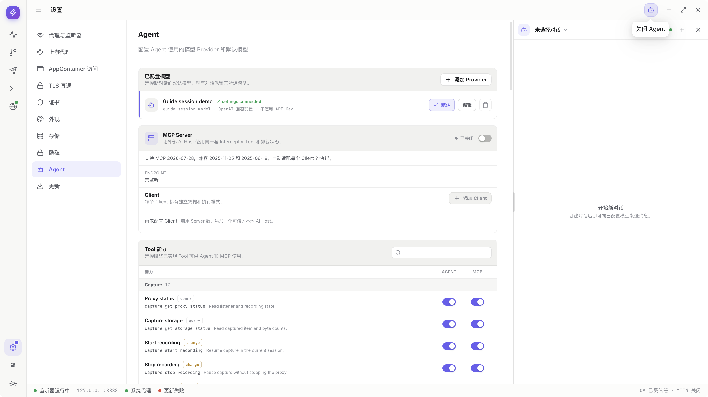

### 02 · Create the Chat to retain

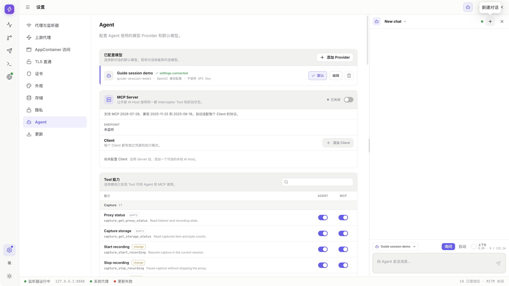

### 03 · Name it Guide retained chat

### 04 · Enter this run’s public prompt

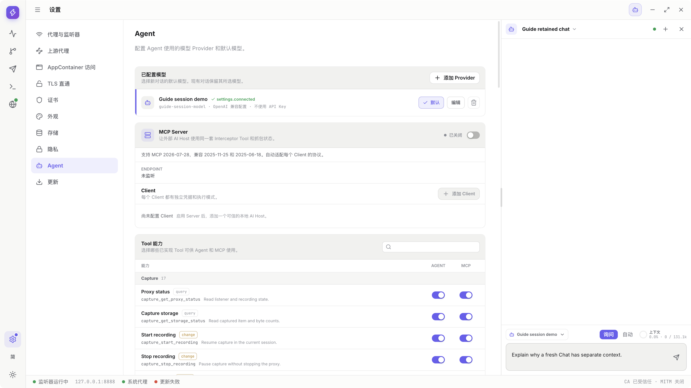

### 05 · Send with Command+Enter

### 06 · Use actual Tab navigation to read Context

### 07 · Move focus away from Context

### 08 · Start a separate Chat after reviewing usage

### 09 · Name it Guide fresh context

### 10 · Create the running-deletion example

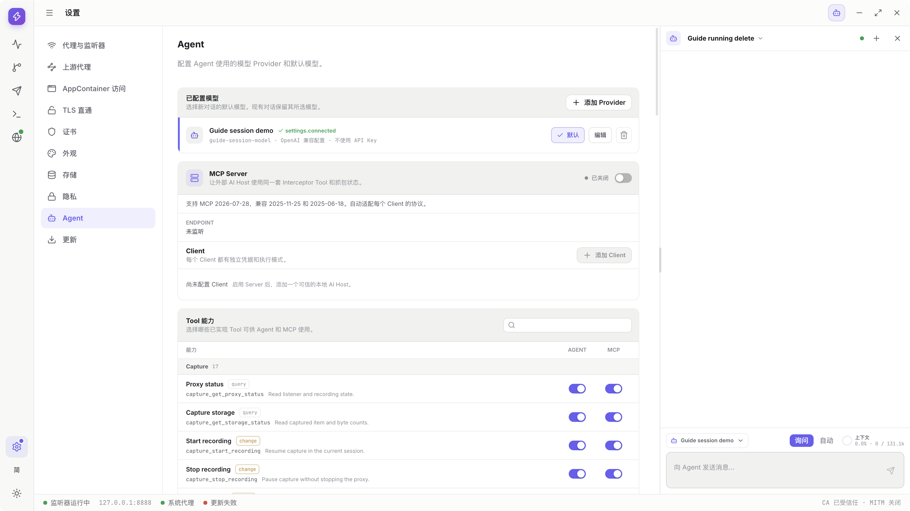

### 11 · Start the local held-stream example

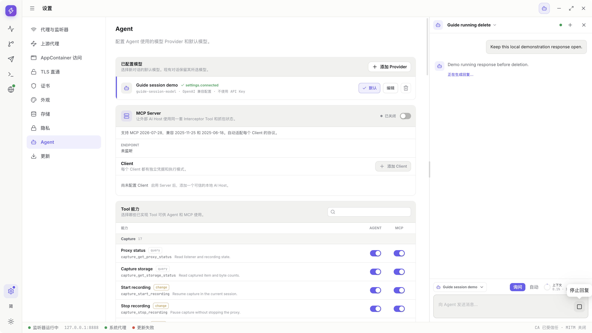

### 12 · Open deletion confirmation while running

### 13 · Confirm deletion and cancel that stream

### 14 · Return to the retained Chat

### 15 · Confirm persistent content before normal Close

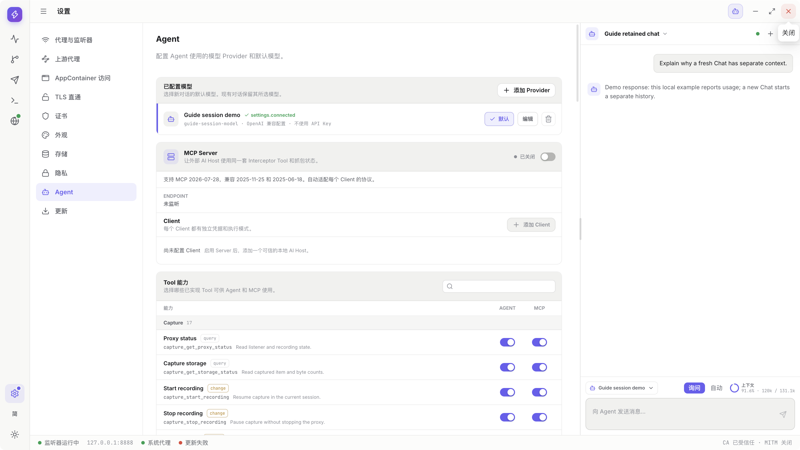

The complete reference follows. Only operations with matching real step images and checked input values count as illustrated acceptance.
<!-- recorded-walkthrough:agent-session-lifecycle:end -->

<!-- recorded-walkthrough:agent-tool-lifecycle:start -->

## Completed Tools, Stop, Retry and native file approval

These images show the published <code>0.1.1-alpha.1</code> on macOS x64, retaining the App language <code>zh-CN</code>. Every recorded step has its own native-window screenshot; open an image at full size to inspect values.

Loopback addresses, ports and generated IDs belong to this recording, not a public service. Use your own authorized test environment. The actual values below match the screenshots. Advanced branches not shown here still need their own step images and acceptance.

> This keyless local model returns fixed public demonstration replies. The walkthrough shows real configuration and chat controls, not a commercial model benchmark or bill. Never enter real credentials for this demo endpoint.

| Example field | Actual recorded value |
| --- | --- |
| <code>model</code> | <code>Guide Tool demo; deterministic local keyless endpoint</code> |
| <code>endpoint</code> | <code>http://127.0.0.1:55719/guide-tool-lifecycle/v1</code> |
| <code>pausePrompt</code> | <code>Pause recording after asking me, then continue a streaming explanation.</code> |
| <code>clarification</code> | <code>Keep recording paused. Only read and explain its current status.</code> |
| <code>queryTools</code> | <code>diagnostics_get_recent, diagnostics_get_trace</code> |
| <code>exportTool</code> | <code>diagnostics_export</code> |
| <code>taskQuery</code> | <code>capture_get_transfer_job</code> |
| <code>canceledFile</code> | <code>guide-cancelled.jsonl</code> |
| <code>savedFile</code> | <code>guide-agent-diagnostics.jsonl</code> |
| <code>stopBoundary</code> | <code>A completed Recording pause remains applied after stopping the later model reply</code> |
| <code>retryBoundary</code> | <code>This retry requests explanation only; other models may propose new actions and require fresh review</code> |

### 01 · Open Agent and create a Chat

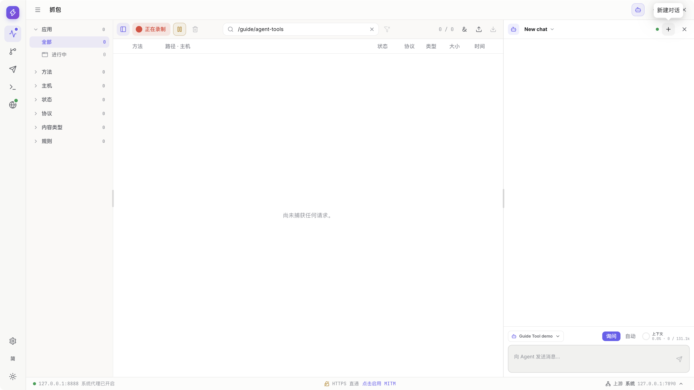

### 02 · Explicitly choose Ask

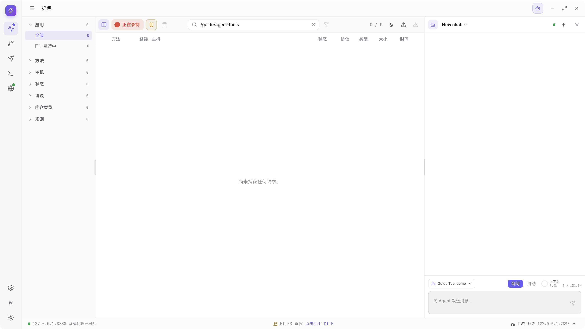

### 03 · Ask to pause Recording and then continue explaining

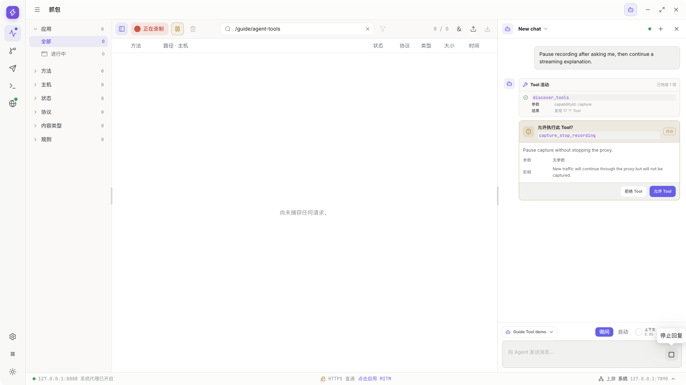

### 04 · Allow the explicit pause operation

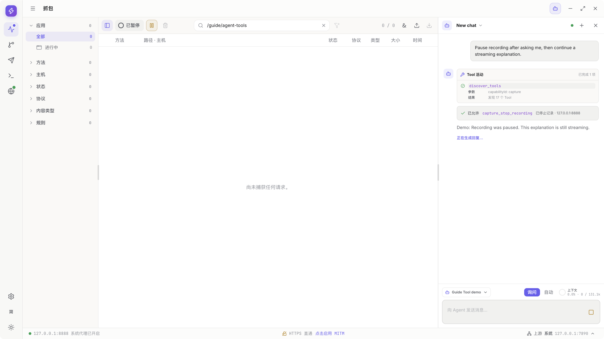

### 05 · Stop the response without undoing the completed Tool

### 06 · Retry with explanation only in this example

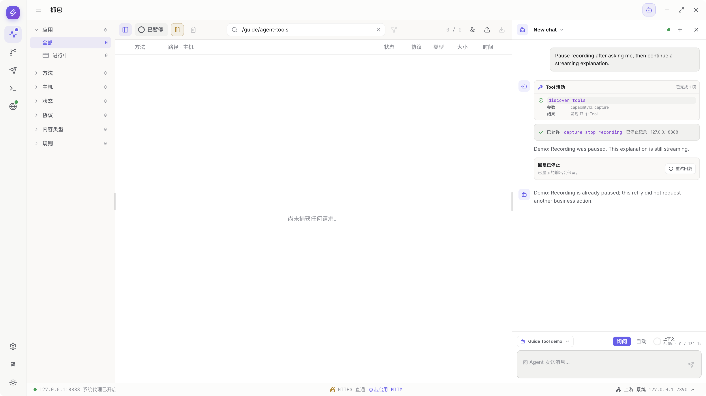

### 07 · Restate a read-only goal

### 08 · Execute a real Diagnostics Recent query

### 09 · Query related records using the returned traceId

### 10 · Request a Diagnostics export requiring approval

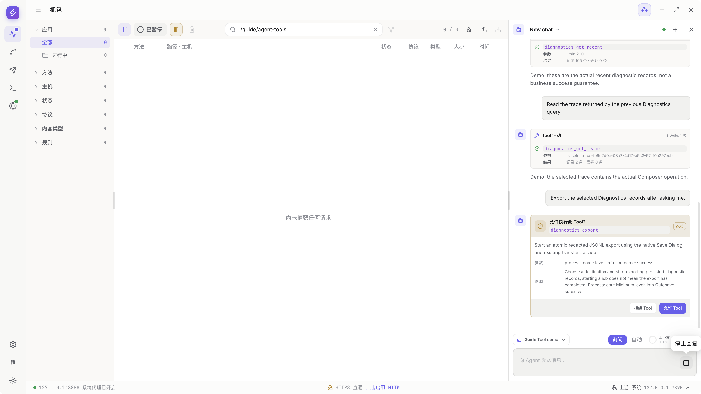

### 11 · Approval still leads to a real Save window

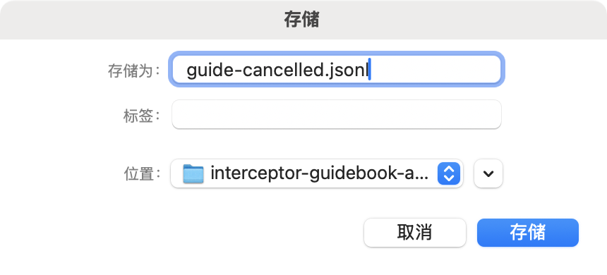

### 12 · Cancel native saving without replacing its return value

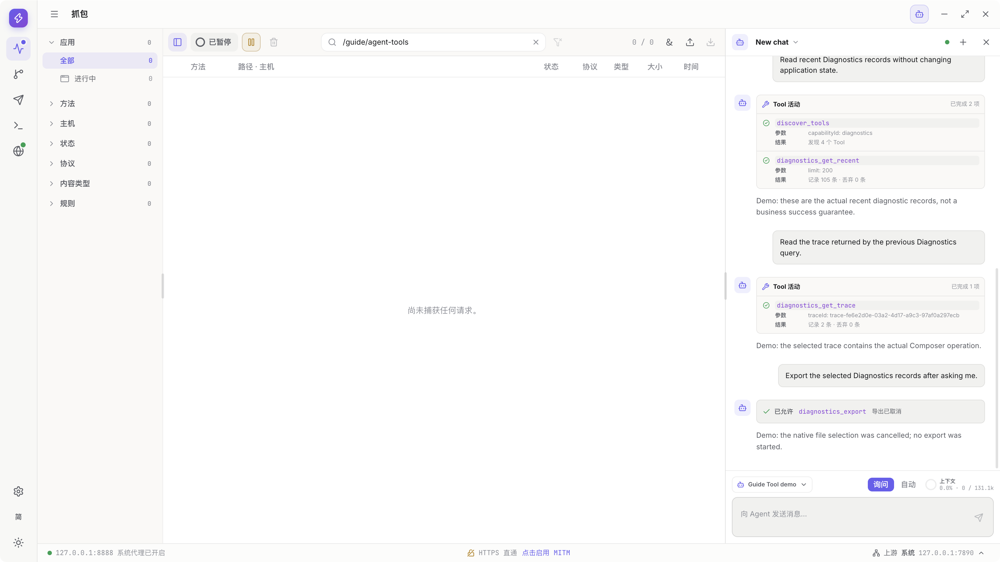

### 13 · Request export again and review parameters

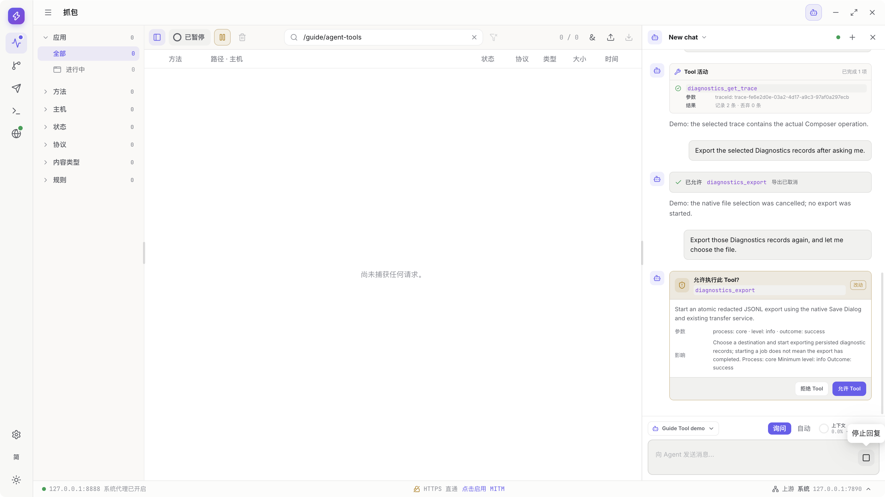

### 14 · Save guide-agent-diagnostics.jsonl

### 15 · Distinguish a started job from completion

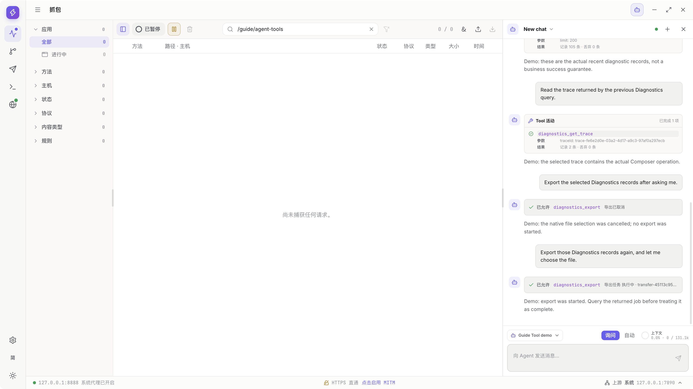

### 16 · Query the actual file task for completion

### 17 · Retain the paused state and verify the actual result

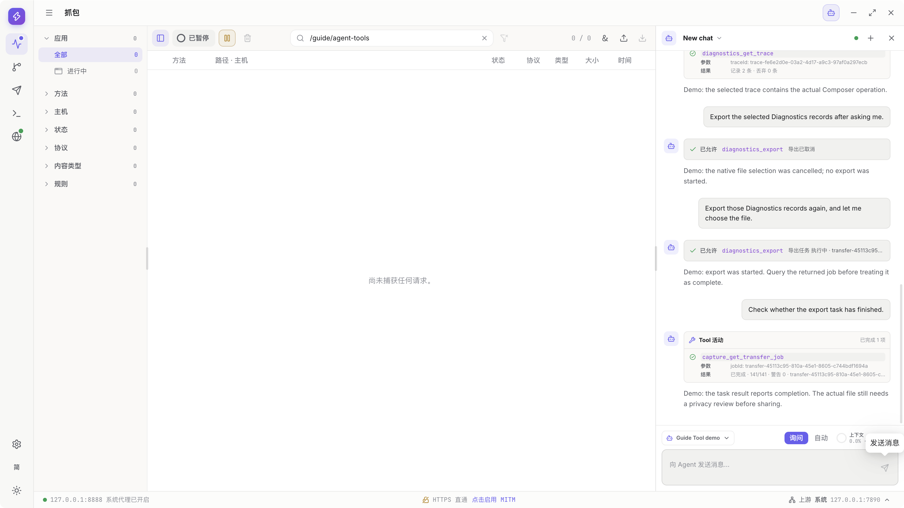

The complete reference follows. Only operations with matching real step images and checked input values count as illustrated acceptance.
<!-- recorded-walkthrough:agent-tool-lifecycle:end -->

<!-- recorded-walkthrough:agent-model-removal:start -->

## Recorded walkthrough: removing the final model (native recording excerpt)

These images show the published <code>0.1.1-alpha.1</code> on macOS x64, retaining the App language <code>zh-CN</code>. Every recorded step has its own native-window screenshot; open an image at full size to inspect values.

Loopback addresses, ports and generated IDs belong to this recording, not a public service. Use your own authorized test environment. The actual values below match the screenshots. Advanced branches not shown here still need their own step images and acceptance.

> These step images come from the same actual App run as <code>agent-session-restart</code>. Original PNGs are unchanged; this does not establish acceptance of branches not shown.
> This keyless local model returns fixed public demonstration replies. The walkthrough shows real configuration and chat controls, not a commercial model benchmark or bill. Never enter real credentials for this demo endpoint.

| Example field | Actual recorded value |
| --- | --- |
| <code>profileName</code> | <code>Guide session demo</code> |
| <code>initialState</code> | <code>One existing model in Settings &gt; Agent; configuration and restart are outside this excerpt</code> |
| <code>finalModelState</code> | <code>No provider remains; the panel is unconfigured</code> |
| <code>recordingScope</code> | <code>Only the final Settings steps are published; earlier Capture/history images are not published</code> |

### 01 · Inspect the retained model configuration

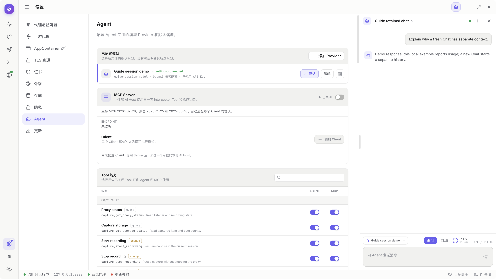

### 02 · Open deletion confirmation for the last model

### 03 · Remove the last model and inspect the unconfigured state

The complete reference follows. Only operations with matching real step images and checked input values count as illustrated acceptance.
<!-- recorded-walkthrough:agent-model-removal:end -->

<!-- recorded-walkthrough:agent-session-restart:start -->

## Recorded walkthrough: actual restart, restored history and final-model removal

These images show the published <code>0.1.1-alpha.1</code> on macOS x64, retaining the App language <code>zh-CN</code>. Every recorded step has its own native-window screenshot; open an image at full size to inspect values.

Loopback addresses, ports and generated IDs belong to this recording, not a public service. Use your own authorized test environment. The actual values below match the screenshots. Advanced branches not shown here still need their own step images and acceptance.

> This keyless local model returns fixed public demonstration replies. The walkthrough shows real configuration and chat controls, not a commercial model benchmark or bill. Never enter real credentials for this demo endpoint.

| Example field | Actual recorded value |
| --- | --- |
| <code>profileName</code> | <code>Guide session demo</code> |
| <code>retainedChat</code> | <code>Guide retained chat</code> |
| <code>freshChat</code> | <code>Guide fresh context</code> |
| <code>deletedRunningChat</code> | <code>Guide running delete</code> |
| <code>retainedPrompt</code> | <code>Explain why a fresh Chat has separate context.</code> |
| <code>retainedAnswer</code> | <code>Demo response: this local example reports usage; a new Chat starts a separate history.</code> |
| <code>modelCallsOnRestart</code> | <code>0</code> |
| <code>finalModelState</code> | <code>No provider remains; the panel is unconfigured</code> |
| <code>evidenceGeneration</code> | <code>agent-reopened</code> |

### 01 · Reopen the Agent panel

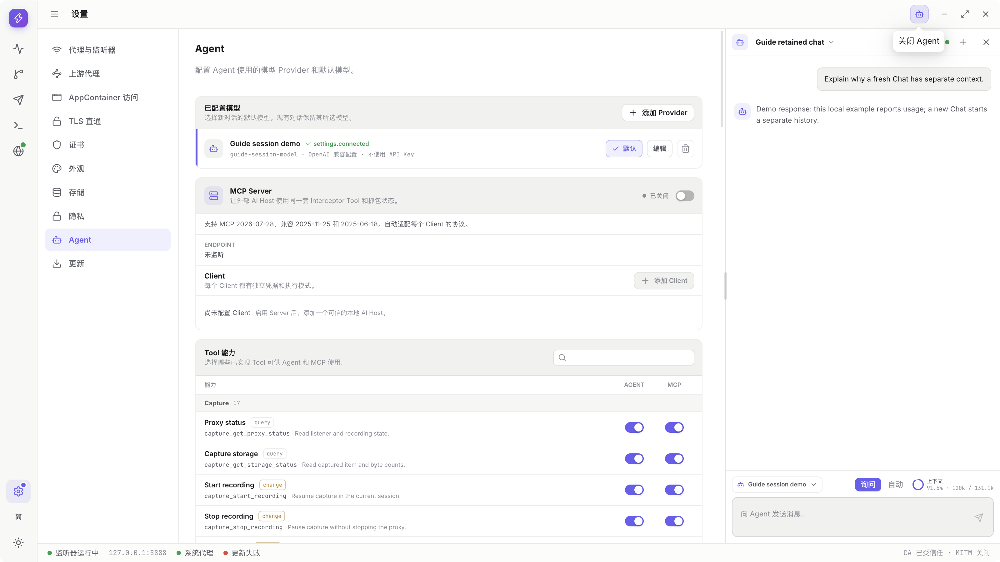

### 02 · Inspect the actually restored Chat list

### 03 · Read the retained history

### 04 · Inspect the retained model configuration

### 05 · Open deletion confirmation for the last model

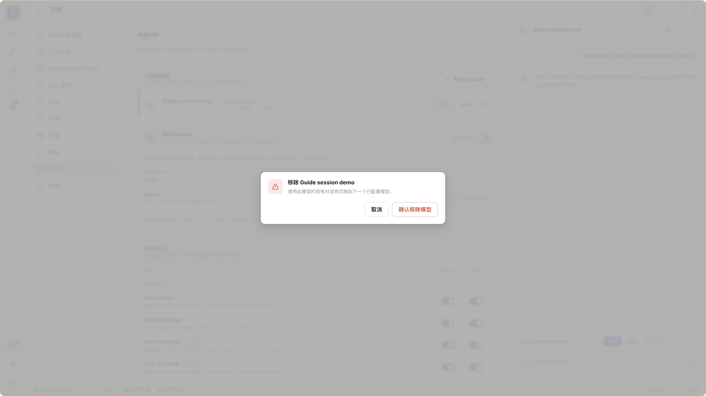

### 06 · Remove the last model and inspect the unconfigured state

The complete reference follows. Only operations with matching real step images and checked input values count as illustrated acceptance.
<!-- recorded-walkthrough:agent-session-restart:end -->
