# Capture: find and understand traffic

> Draft for `v0.1.1-alpha.1`. Recorded operations have matching step images; unrecorded branches remain explicitly pending. Neither this chapter nor item9 is complete, and the text alone is not protocol or platform acceptance.

[Guide directory](../README.en.md) · [Getting started](getting-started.md)

<!-- recorded-walkthrough:start -->

## Recorded walkthrough: actual product steps

These images and video show the published <code>0.1.1-alpha.1</code> on macOS x64, retaining the App language <code>zh-CN</code>. Every recorded step has its own native-window screenshot; open an image at full size to inspect values.

Loopback addresses, ports and generated IDs belong to this recording, not a public service. Use your own authorized test environment. The actual values below match the screenshots and video. Advanced branches not shown here still need their own step images and acceptance.

| Example field | Actual recorded value |
| --- | --- |
| <code>filter</code> | <code>/guide/capture</code> |
| <code>url</code> | <code>http://127.0.0.1:58377/guide/capture/orders</code> |
| <code>response</code> | <code>{&quot;orderId&quot;:&quot;guide-001&quot;,&quot;message&quot;:&quot;Hello Interceptor&quot;,&quot;status&quot;:&quot;ready&quot;}</code> |
| <code>protocolFilter</code> | <code>/playground</code> |
| <code>h2Path</code> | <code>/playground/h2-json</code> |
| <code>websocketPath</code> | <code>/playground/ws/text</code> |
| <code>websocketPayload</code> | <code>hello from client</code> |
| <code>grpcPath</code> | <code>/playground.Capture/UnaryJson</code> |
| <code>grpcRequest</code> | <code>{&quot;message&quot;:&quot;hello&quot;}</code> |
| <code>grpcResponse</code> | <code>{&quot;message&quot;:&quot;world&quot;}</code> |
| <code>originException</code> | <code>localhost (removed after the demonstration)</code> |

<video controls preload="metadata" playsinline lang="en" src="../media/v0.1.1-alpha.1/capture/capture.mp4" poster="../media/v0.1.1-alpha.1/capture/capture-01-filter.png">
<track kind="captions" srclang="zh-CN" label="Steps / 步骤" src="../media/v0.1.1-alpha.1/capture/capture.vtt" default>
</video>

### 01 · Filter owned traffic

[Video 00:00](../media/v0.1.1-alpha.1/capture/capture.mp4#t=0.338) · [Back to the video](#walkthrough-video)

### 02 · Start Recording

[Video 00:03](../media/v0.1.1-alpha.1/capture/capture.mp4#t=3.147) · [Back to the video](#walkthrough-video)

### 03 · Send the example GET

[Video 00:05](../media/v0.1.1-alpha.1/capture/capture.mp4#t=5.996) · [Back to the video](#walkthrough-video)

### 04 · Select the orders request

[Video 00:08](../media/v0.1.1-alpha.1/capture/capture.mp4#t=8.851) · [Back to the video](#walkthrough-video)

### 05 · Inspect Headers

[Video 00:11](../media/v0.1.1-alpha.1/capture/capture.mp4#t=11.898) · [Back to the video](#walkthrough-video)

### 06 · Read the JSON response

[Video 00:14](../media/v0.1.1-alpha.1/capture/capture.mp4#t=14.746) · [Back to the video](#walkthrough-video)

### 07 · Switch to Tree

[Video 00:17](../media/v0.1.1-alpha.1/capture/capture.mp4#t=17.752) · [Back to the video](#walkthrough-video)

### 08 · Switch to Raw

[Video 00:20](../media/v0.1.1-alpha.1/capture/capture.mp4#t=20.652) · [Back to the video](#walkthrough-video)

### 09 · Open the body fullscreen

[Video 00:23](../media/v0.1.1-alpha.1/capture/capture.mp4#t=23.547) · [Back to the video](#walkthrough-video)

### 10 · Return with Escape

[Video 00:26](../media/v0.1.1-alpha.1/capture/capture.mp4#t=26.455) · [Back to the video](#walkthrough-video)

### 11 · Inspect Hex bytes

[Video 00:29](../media/v0.1.1-alpha.1/capture/capture.mp4#t=29.398) · [Back to the video](#walkthrough-video)

### 12 · Inspect Timing

[Video 00:32](../media/v0.1.1-alpha.1/capture/capture.mp4#t=32.300) · [Back to the video](#walkthrough-video)

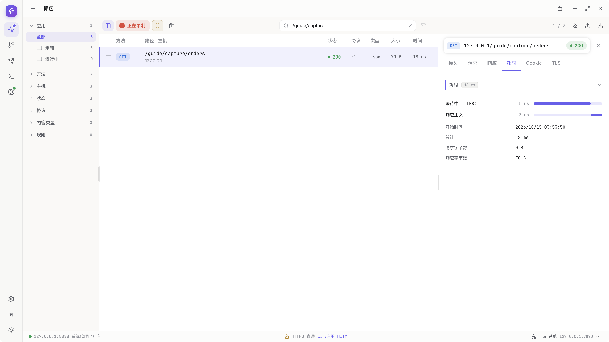

### 13 · Pause Recording

[Video 00:35](../media/v0.1.1-alpha.1/capture/capture.mp4#t=35.198) · [Back to the video](#walkthrough-video)

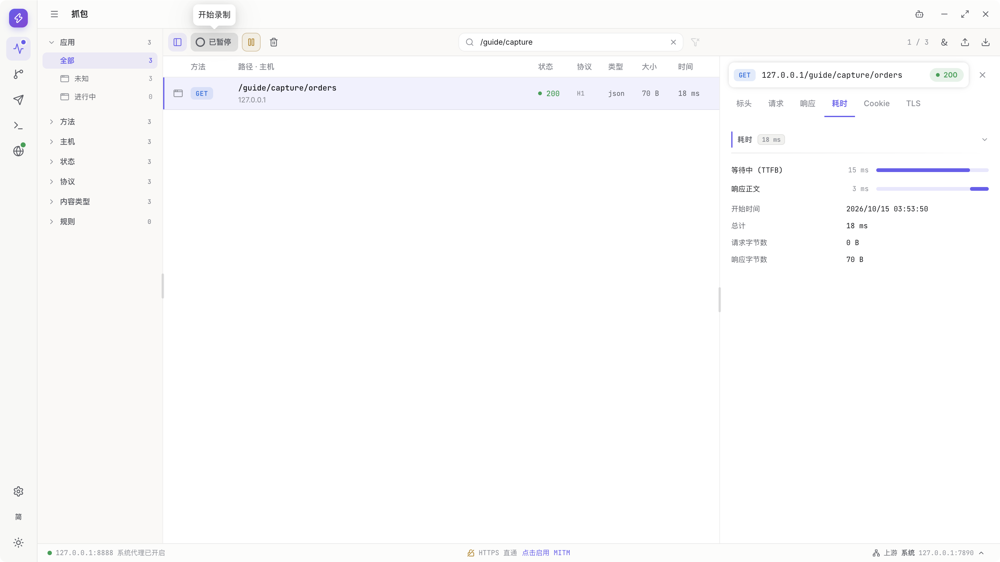

### 14 · Forward while paused

[Video 00:38](../media/v0.1.1-alpha.1/capture/capture.mp4#t=38.098) · [Back to the video](#walkthrough-video)

### 15 · Resume Recording

[Video 00:40](../media/v0.1.1-alpha.1/capture/capture.mp4#t=40.948) · [Back to the video](#walkthrough-video)

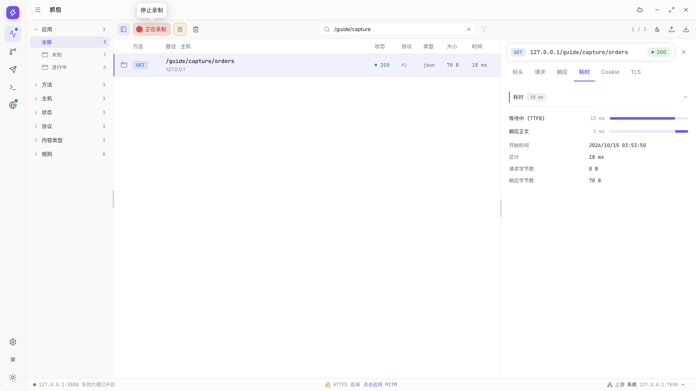

### 16 · Capture a new request after Resume

[Video 00:43](../media/v0.1.1-alpha.1/capture/capture.mp4#t=43.899) · [Back to the video](#walkthrough-video)

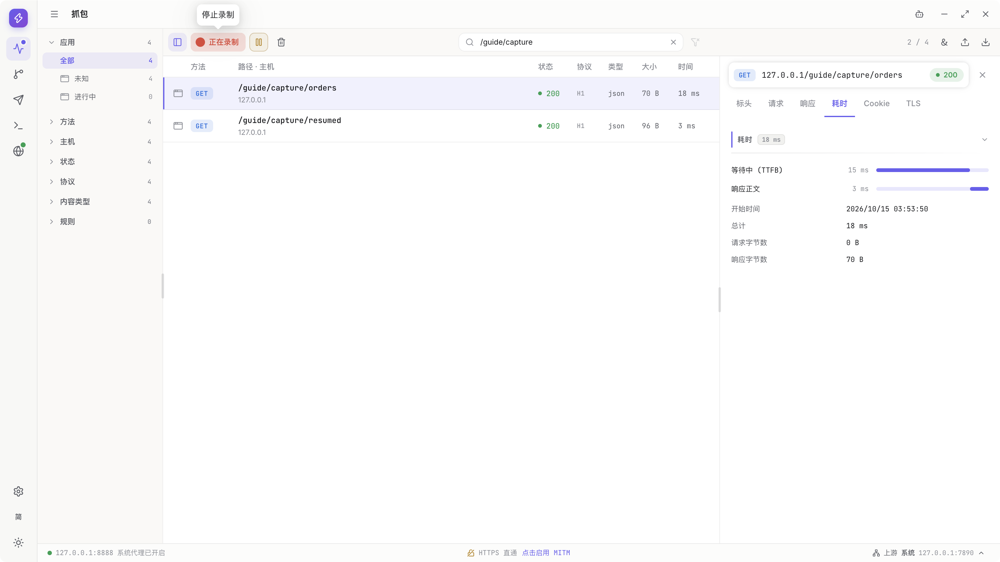

### 17 · Narrow search to orders

[Video 00:46](../media/v0.1.1-alpha.1/capture/capture.mp4#t=46.806) · [Back to the video](#walkthrough-video)

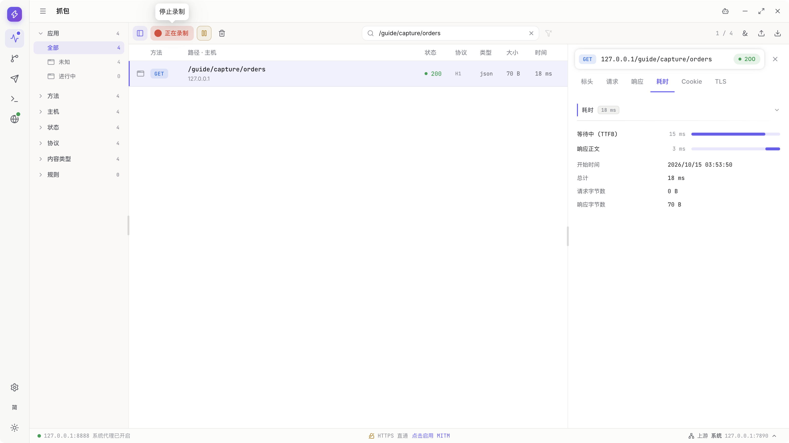

### 18 · Restore the example scope

[Video 00:49](../media/v0.1.1-alpha.1/capture/capture.mp4#t=49.699) · [Back to the video](#walkthrough-video)

### 19 · Clear disposable example records

[Video 00:52](../media/v0.1.1-alpha.1/capture/capture.mp4#t=52.549) · [Back to the video](#walkthrough-video)

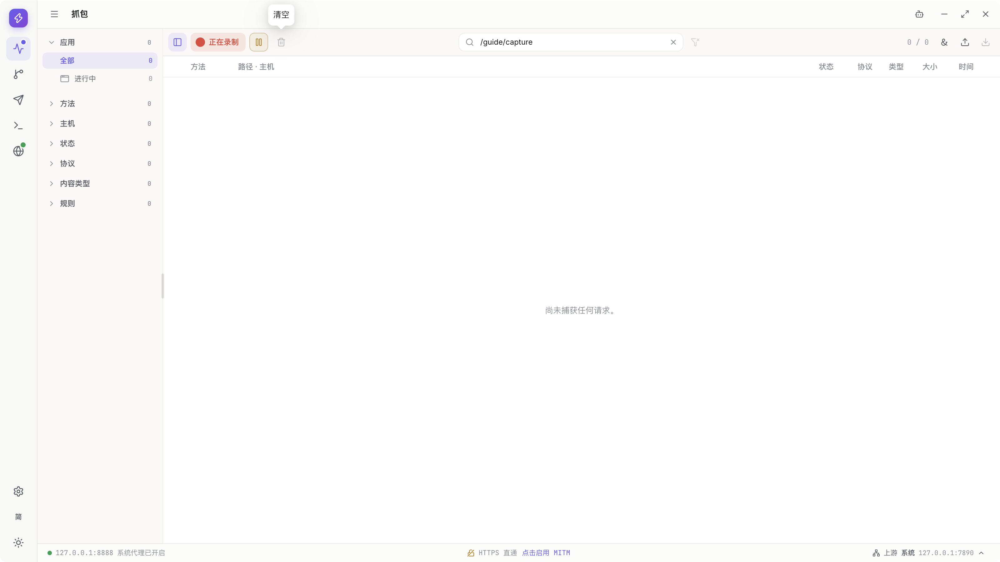

### 20 · Inspect the existing trusted CA

[Video 00:55](../media/v0.1.1-alpha.1/capture/capture.mp4#t=55.500) · [Back to the video](#walkthrough-video)

### 21 · Add only the demo localhost exception

[Video 00:58](../media/v0.1.1-alpha.1/capture/capture.mp4#t=58.448) · [Back to the video](#walkthrough-video)

### 22 · Enable HTTPS decryption

[Video 01:01](../media/v0.1.1-alpha.1/capture/capture.mp4#t=61.398) · [Back to the video](#walkthrough-video)

### 23 · Filter the protocol examples

[Video 01:04](../media/v0.1.1-alpha.1/capture/capture.mp4#t=64.449) · [Back to the video](#walkthrough-video)

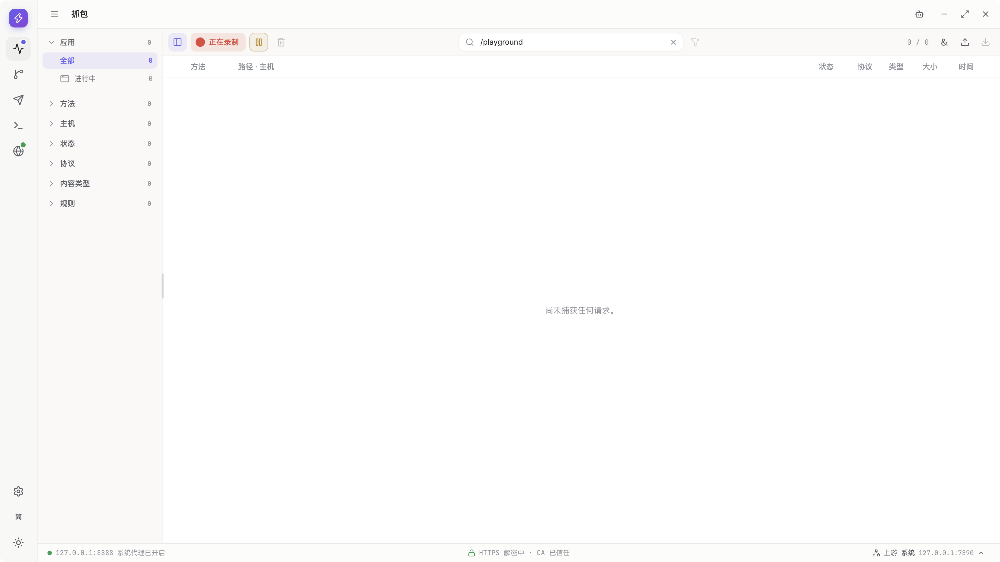

### 24 · Capture real HTTP/2

[Video 01:07](../media/v0.1.1-alpha.1/capture/capture.mp4#t=67.500) · [Back to the video](#walkthrough-video)

### 25 · Expand HTTP/2 trailers

[Video 01:10](../media/v0.1.1-alpha.1/capture/capture.mp4#t=70.750) · [Back to the video](#walkthrough-video)

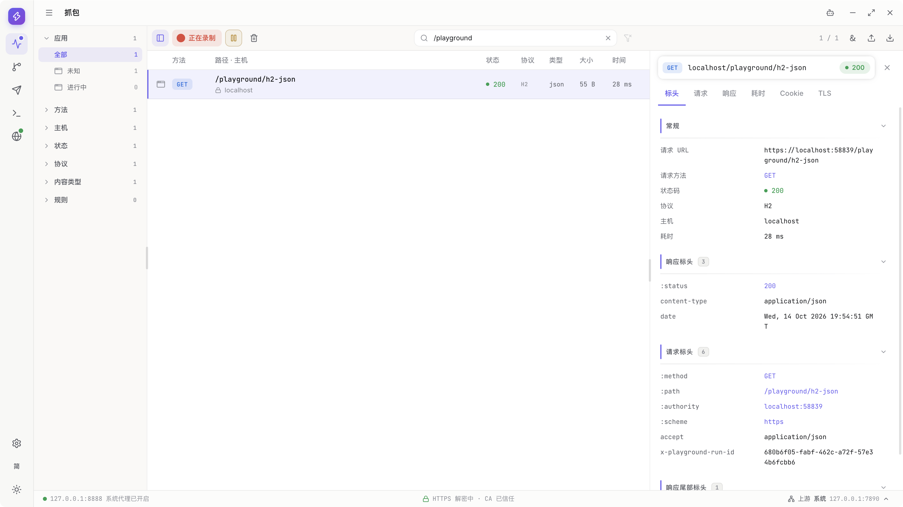

### 26 · Read the HTTP/2 JSON body

[Video 01:13](../media/v0.1.1-alpha.1/capture/capture.mp4#t=73.599) · [Back to the video](#walkthrough-video)

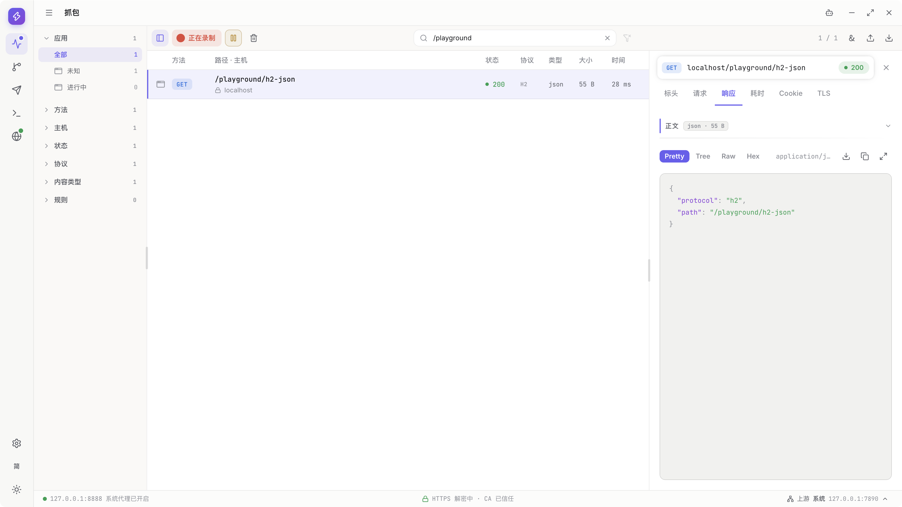

### 27 · Capture WebSocket text

[Video 01:16](../media/v0.1.1-alpha.1/capture/capture.mp4#t=76.649) · [Back to the video](#walkthrough-video)

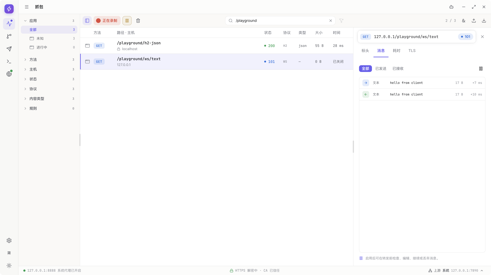

### 28 · Inspect a sent payload

[Video 01:19](../media/v0.1.1-alpha.1/capture/capture.mp4#t=79.699) · [Back to the video](#walkthrough-video)

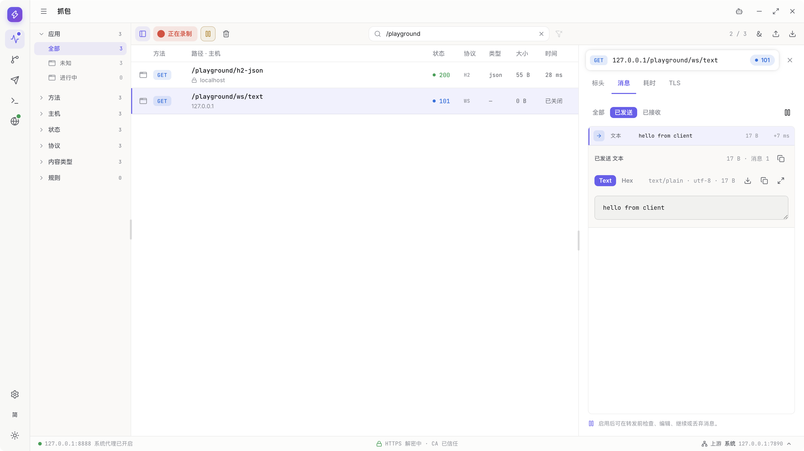

### 29 · Capture gRPC JSON

[Video 01:22](../media/v0.1.1-alpha.1/capture/capture.mp4#t=82.700) · [Back to the video](#walkthrough-video)

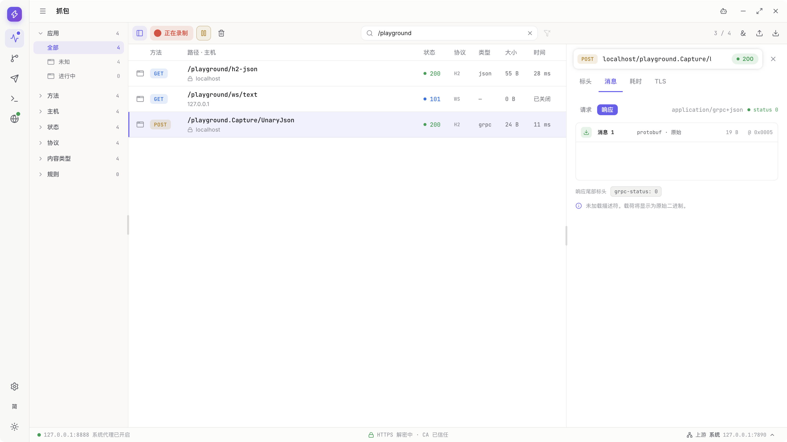

### 30 · Inspect the gRPC response message

[Video 01:25](../media/v0.1.1-alpha.1/capture/capture.mp4#t=85.957) · [Back to the video](#walkthrough-video)

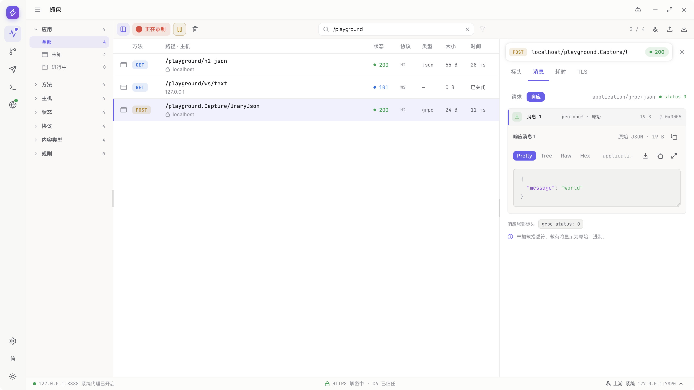

### 31 · HTML source

[Video 01:28](../media/v0.1.1-alpha.1/capture/capture.mp4#t=88.903) · [Back to the video](#walkthrough-video)

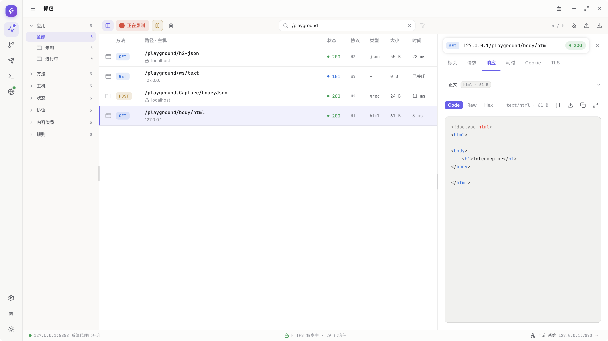

### 32 · Markdown preview

[Video 01:32](../media/v0.1.1-alpha.1/capture/capture.mp4#t=92.050) · [Back to the video](#walkthrough-video)

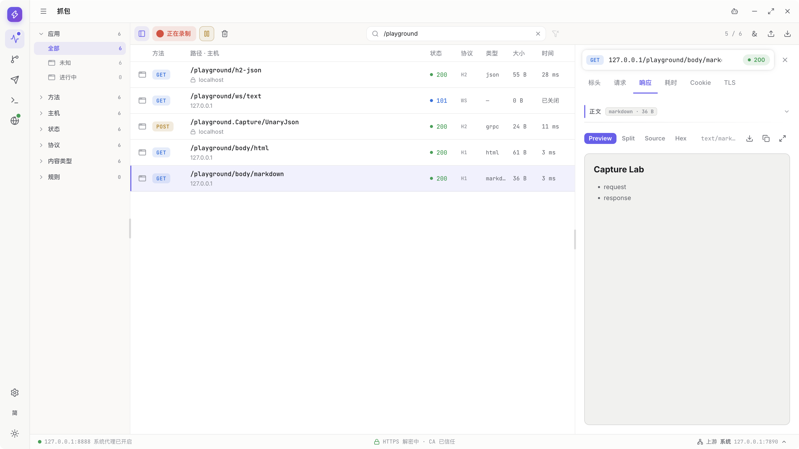

### 33 · Form fields

[Video 01:35](../media/v0.1.1-alpha.1/capture/capture.mp4#t=95.098) · [Back to the video](#walkthrough-video)

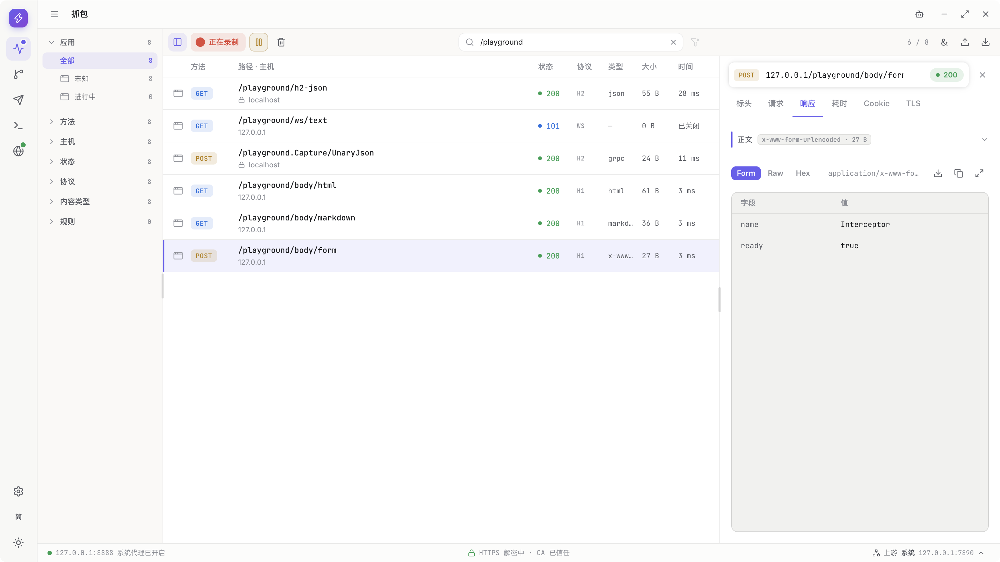

### 34 · PNG image

[Video 01:38](../media/v0.1.1-alpha.1/capture/capture.mp4#t=98.152) · [Back to the video](#walkthrough-video)

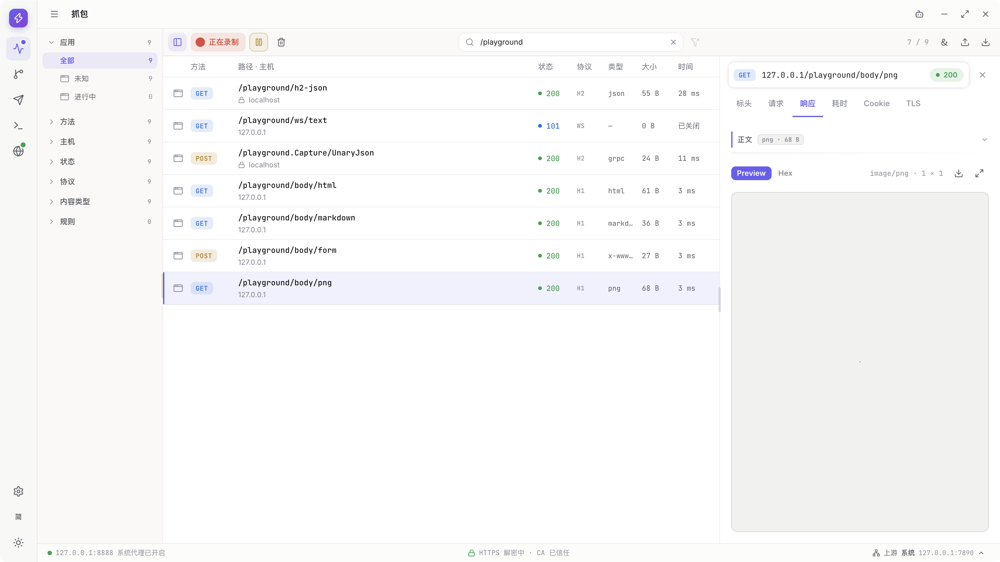

### 35 · Binary Hex

[Video 01:41](../media/v0.1.1-alpha.1/capture/capture.mp4#t=101.149) · [Back to the video](#walkthrough-video)

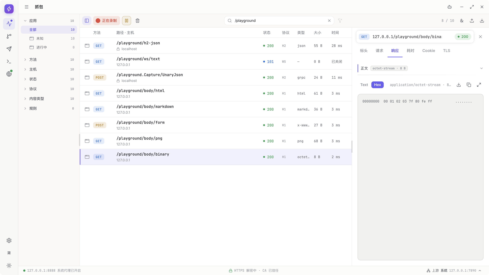

### 36 · Audio metadata

[Video 01:44](../media/v0.1.1-alpha.1/capture/capture.mp4#t=104.449) · [Back to the video](#walkthrough-video)

### 37 · Video metadata

[Video 01:47](../media/v0.1.1-alpha.1/capture/capture.mp4#t=107.505) · [Back to the video](#walkthrough-video)

### 38 · gzip decoding

[Video 01:50](../media/v0.1.1-alpha.1/capture/capture.mp4#t=110.547) · [Back to the video](#walkthrough-video)

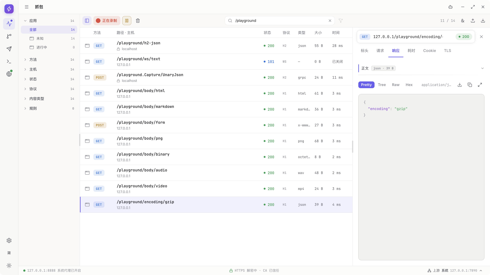

### 39 · Actual corrupt-encoding notice

[Video 01:53](../media/v0.1.1-alpha.1/capture/capture.mp4#t=113.660) · [Back to the video](#walkthrough-video)

### 40 · Disable this run’s decryption

[Video 01:56](../media/v0.1.1-alpha.1/capture/capture.mp4#t=116.798) · [Back to the video](#walkthrough-video)

### 41 · Remove the demo origin exception

[Video 02:00](../media/v0.1.1-alpha.1/capture/capture.mp4#t=120.049) · [Back to the video](#walkthrough-video)

The complete reference follows. Only operations with matching real step images and checked input values count as illustrated acceptance.
<!-- recorded-walkthrough:end -->

## Start and pause recording

**Purpose and prerequisites**

Record requests passing through the proxy. Complete proxy readiness first, then generate authorized traffic with an external client.

**Steps**

1. Open Capture and enable Recording. This section reuses the `capture` recording. The `58377` in `http://127.0.0.1:58377/guide/capture/orders` is a recording-only dynamic port; use your own test service.

   

2. Send that GET through the proxy with an external client and wait for its row. This is not Composer Send.

   

3. Pause Recording.

   

4. Send again while paused; compare the client still receiving a result with the absence of a new capture row.

   

5. Resume Recording.

   

6. Send a new request and inspect its new record, rather than waiting for paused traffic to be backfilled.

   

**Expected result**

Existing records remain. Requests started while paused are not backfilled; new requests started after resuming are recorded.

**Notes**

- Pause does not stop forwarding or restore the system proxy.
- Already-started requests can finish; Pause does not truncate a response.
- WebSocket recording is decided at its handshake. A previously recorded connection continues recording messages; a connection opened while paused does not start recording halfway through when you resume. Reconnect the client to capture a new connection.

## Search and combine filters

**Purpose:** locate relevant requests without deleting source records.

**Steps**

1. Search for `/guide/capture` to limit the list to this demonstration.

   

2. Narrow the search to `orders`.

   

3. Combined filtering uses the separate `capture-filters` recording: search `/guide/filters` starts with four demonstration records, not renamed orders from above.

   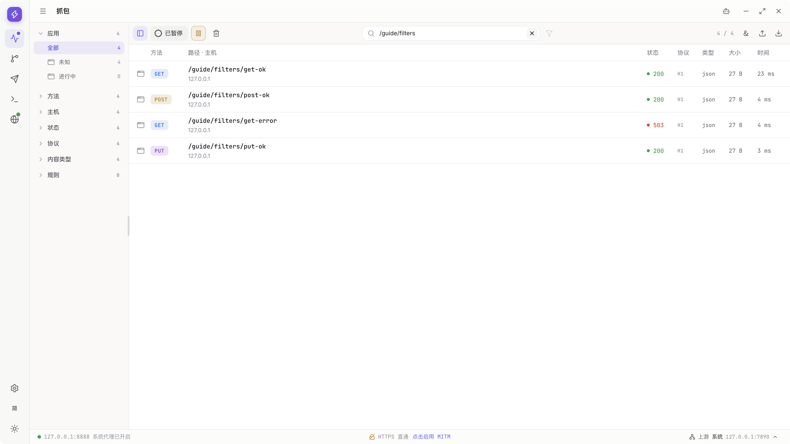

4. Expand Method.

   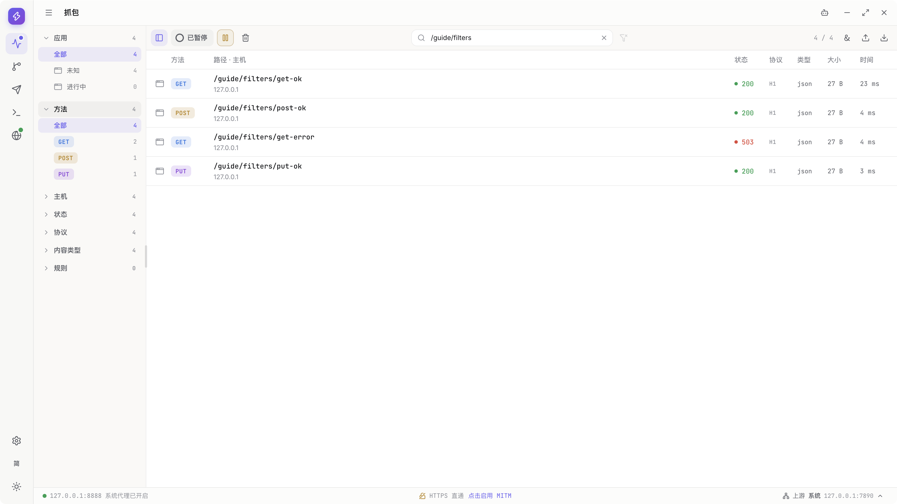

5. Select `GET` first.

   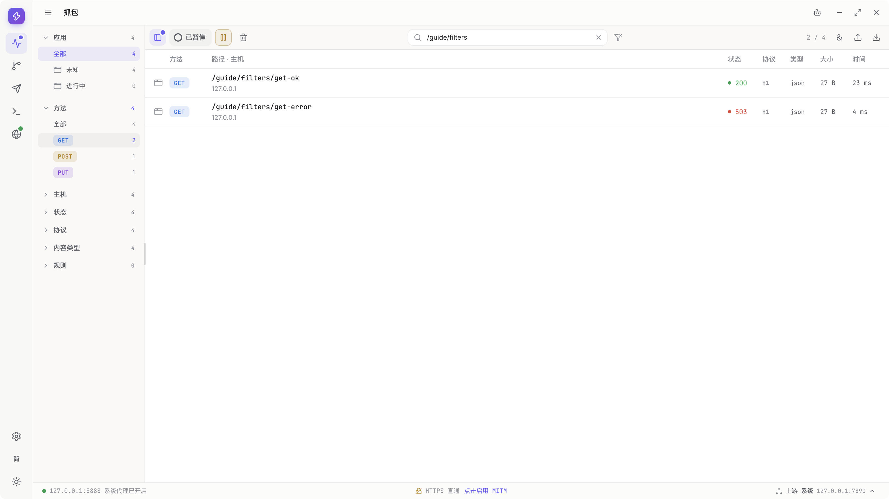

6. Also select `POST` in that group. The two methods are OR; three records remain in this example.

   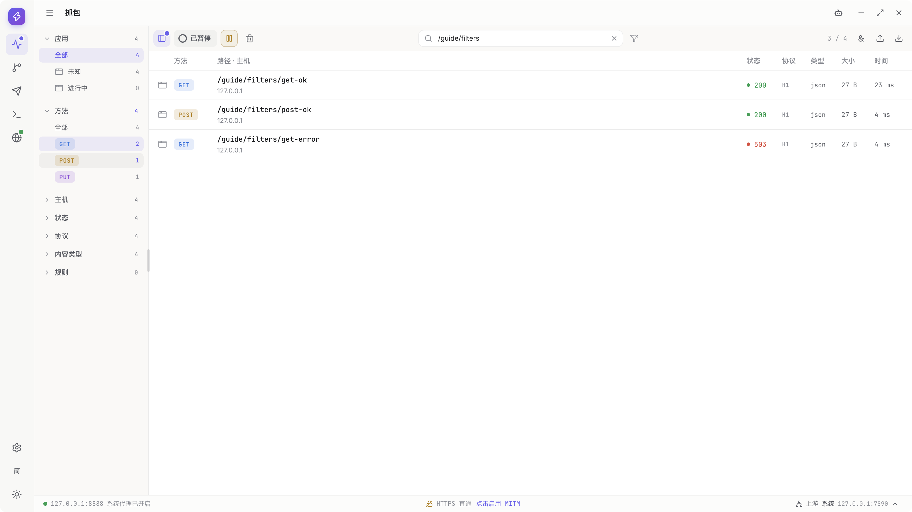

7. Expand Status while keeping the Method conditions.

   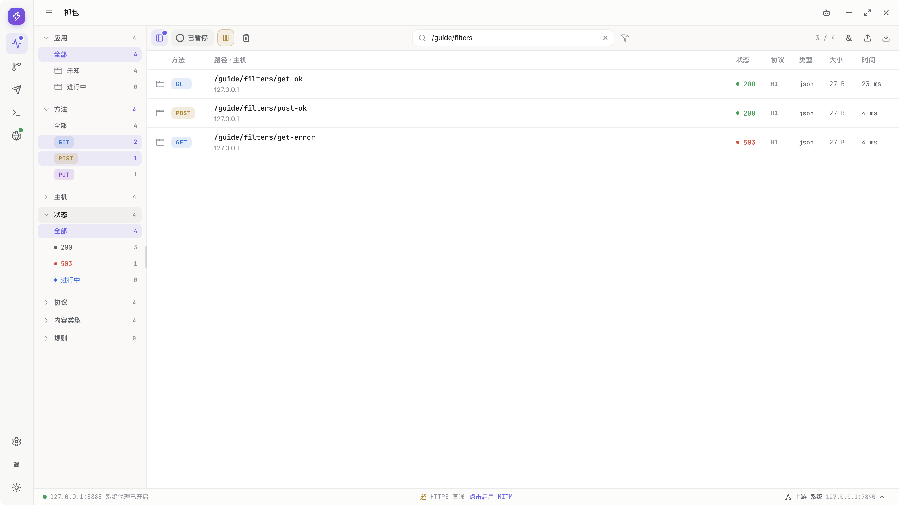

8. Select `200`. This ANDs with Method across groups, leaving two records.

   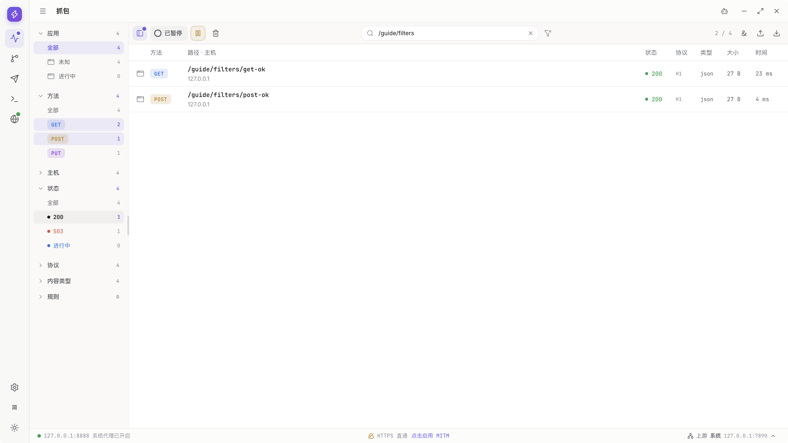

9. Search `/guide/filters/post-ok` as an additional condition; one record remains.

   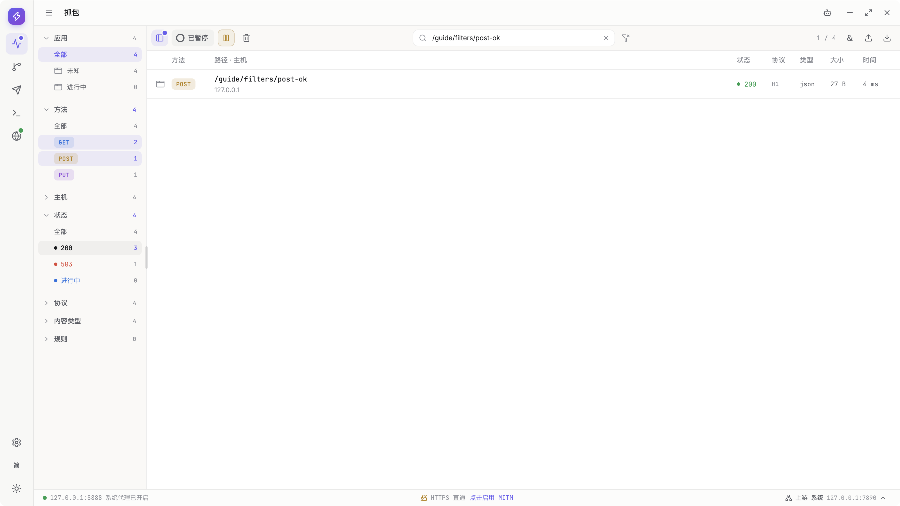

10. Restore search to `/guide/filters`, retaining Method and Status.

    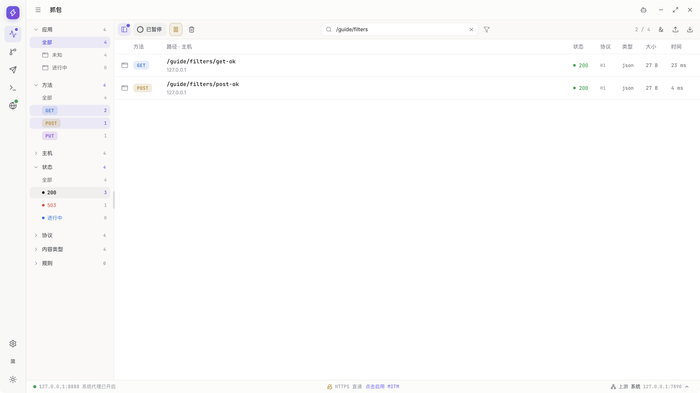

11. Remove the `200` Status selection.

    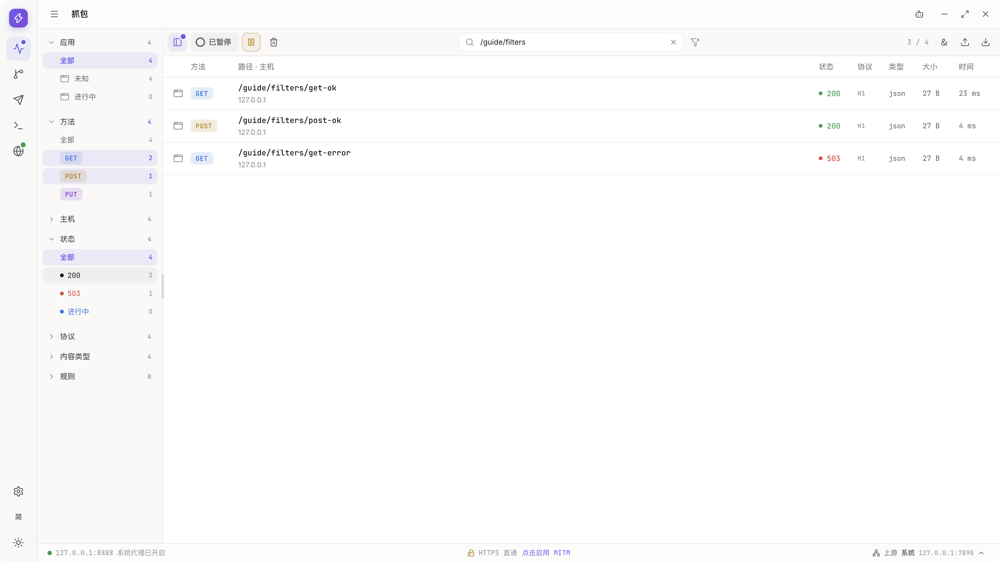

12. Remove `POST` from Method.

    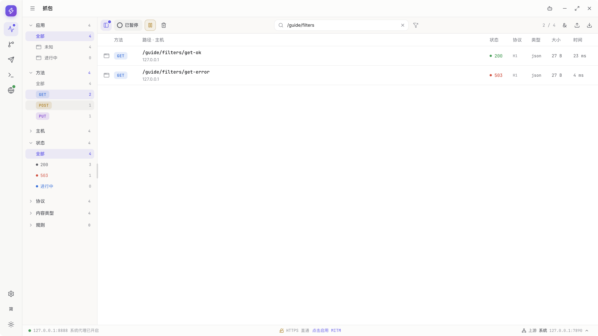

13. Remove `GET` too, restoring all four original records within `/guide/filters`. None were deleted.

    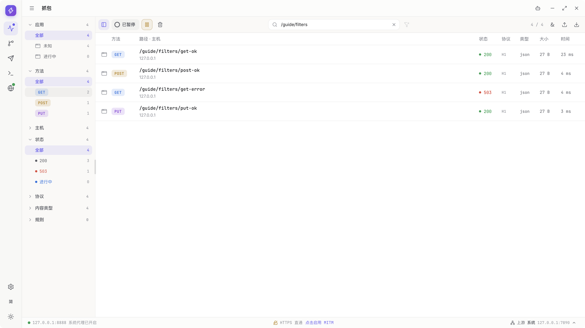

14. Click the group heading to collapse it; only expansion changes.

    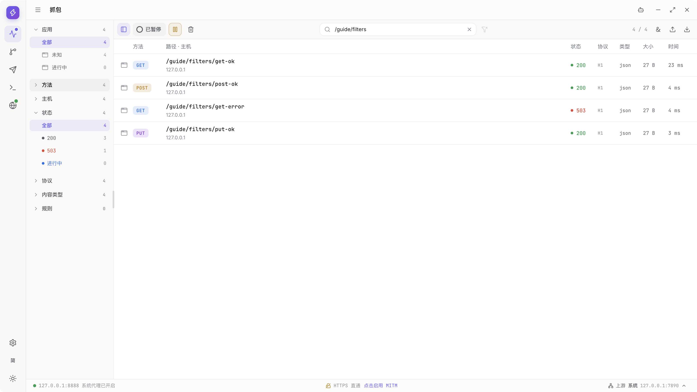

15. Use the clear button inside the search field to remove `/guide/filters`, not Capture Clear. The field is now empty, all four records remain, and Recording is still paused. [Video step](#walkthrough-capture-filters-13-clear-search)

    

16. Select Application, Host, Protocol, Content type or Rule when those dimensions are needed.

    The [separate complete-facet recording](#walkthrough-capture-facets) starts with two captured public requests, `/guide/facets/selected-json` and `/guide/facets/other-text`. The applied `Guide facets` Rule matches only the first; follow [Rules](rules.md#first-rule) for rule preparation. This is not the earlier four-request recording.

    Follow the individual steps for [Application](#walkthrough-capture-facets-01-application), [Host](#walkthrough-capture-facets-03-host-group), [Protocol](#walkthrough-capture-facets-05-protocol-group), [Content type](#walkthrough-capture-facets-07-type-group) and [Rule](#walkthrough-capture-facets-09-rule-group). Every expansion and selection has its own image and video time. This macOS recording reports Unknown attribution, not Windows process identification.

    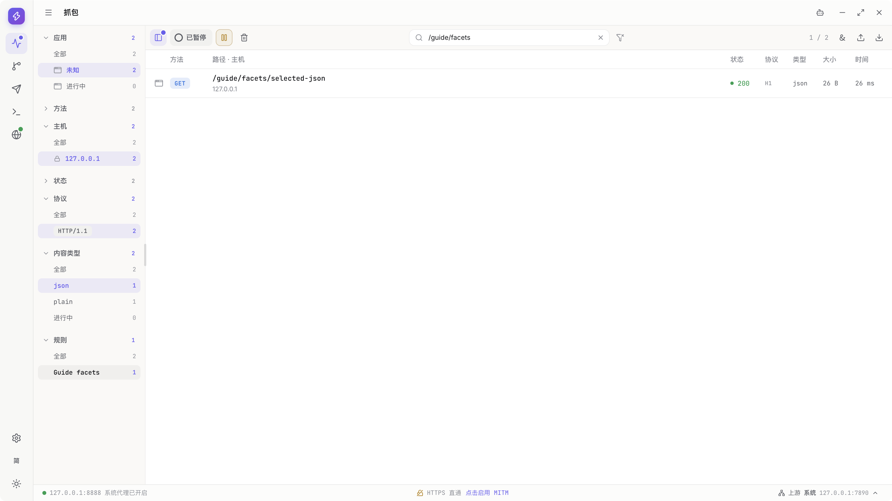

    Removing json still leaves one request through the Rule filter. [Clearing facet selections](#walkthrough-capture-facets-12-clear-facets) restores both while preserving `/guide/facets` search. [Hiding and showing the panel](#walkthrough-capture-facets-13-hide-filters) also preserves records. Disable and Apply `Guide facets` when finished.

**Expected result:** selections within one group are OR; different groups, and search combined with groups, are AND.

**Notes**

- Search matches Host and Path, not the port, arbitrary headers or body text. For the local TLS example, search `localhost` and verify the actual port in details; `localhost:63604` is not an equivalent search.
- Group counts refer to the complete current recording, not necessarily the currently visible filtered rows.
- Pending means the relevant information is not yet available; it does not automatically mean failure.
- Selecting a value leaves the group expanded. Its title controls expansion.
- Clearing filters is not Clear capture. Do not delete records merely to reset filters.
- Application attribution is platform-dependent. Windows attribution does not guarantee equivalent results everywhere.

## Inspect a request

**Steps**

1. Select `/guide/capture/orders` and review URL, method, protocol, status and size.

   

2. Open Headers to inspect request and response headers; expand the relevant groups when needed.

   

3. Open Response and check `orderId: guide-001`, `message: Hello Interceptor` and `status: ready`.

   

4. Open Timing.

   

5. Open Request for a request with a body. The separate [body-inspection recording](#walkthrough-capture-inspection) uses `POST /guide/inspection/body`, with `requestId: guide-request`, 96 entries and 24 Query fields. It is not the earlier GET. [Video step](#walkthrough-capture-inspection-09-request)

   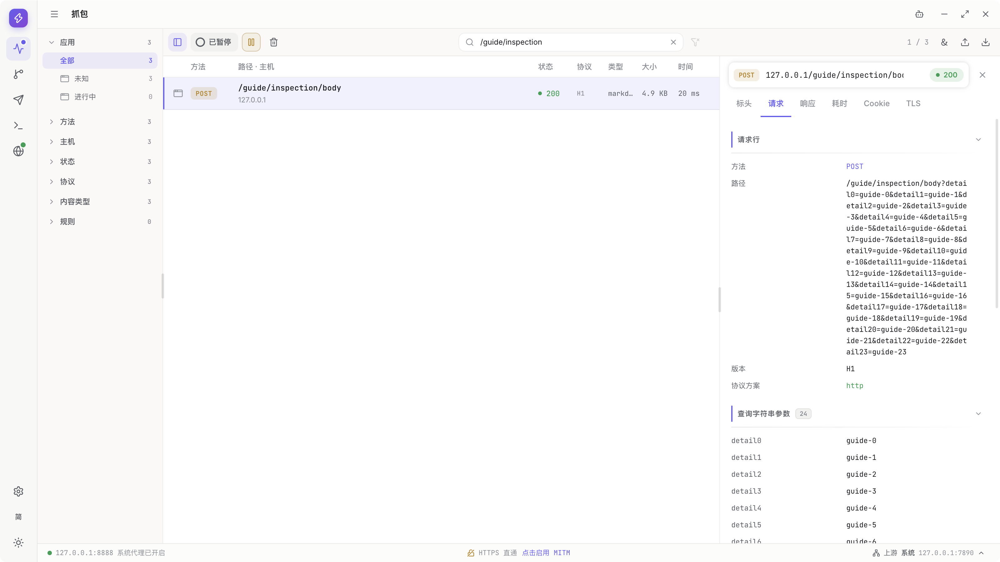

6. Select Raw to read the same request body. [Video step](#walkthrough-capture-inspection-10-raw)

   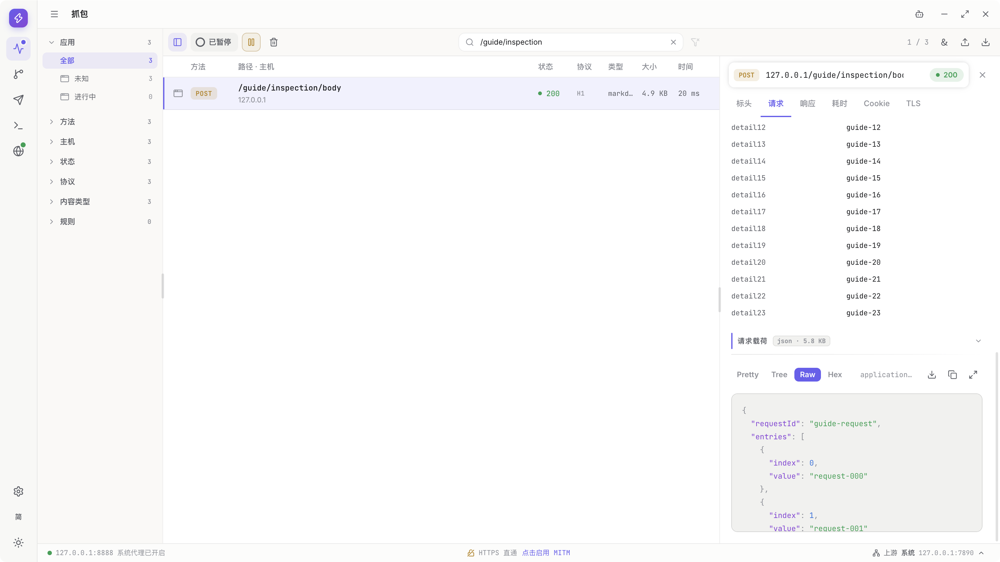

7. Drag the list/detail divider to widen the Inspector. This example moves it 240px left and restores it later. [Video step](#walkthrough-capture-inspection-11-widen)

   

**Expected result:** viewing another tab does not resend or modify traffic. Collapsing one section does not collapse all the others.

**Notes**

- A request can appear before its response completes. Streaming sizes and status continue changing.
- A server can return an early response while the client is still uploading.
- Distinguish failed, cancelled and complete exchanges using their actual state, not merely the presence of a row.

## Choose a body view

**Steps**

1. Open the JSON Response above.

   

2. Select Tree to inspect field structure.

   

3. Select Raw for the original textual view. Other content may provide Source.

   

   The separate `/guide/inspection/body` response is Markdown titled `Guide response source`. Focus its mode control in [Preview](#walkthrough-capture-inspection-17-preview), use ArrowRight for [Split](#walkthrough-capture-inspection-18-split), then ArrowRight again for [Source](#walkthrough-capture-inspection-19-source). Each operation has a screenshot; JSON Raw is not presented as Markdown Source.

   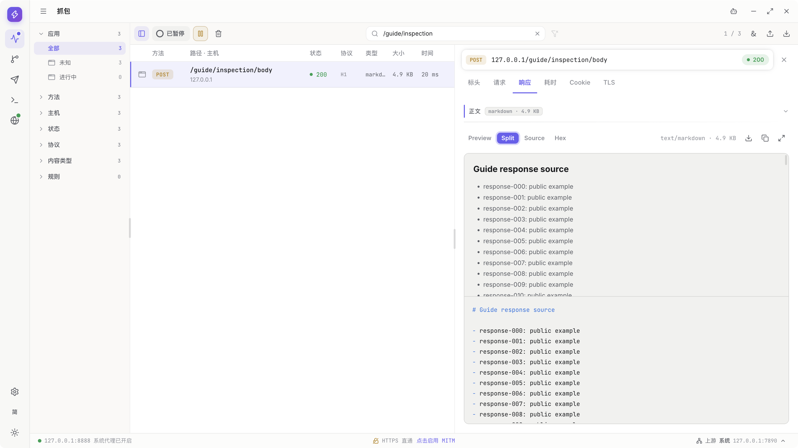

   

   [Copy Source](#walkthrough-capture-inspection-20-copy-source) copies the original Markdown. Fullscreen and Escape retain Source; the same recording includes the complete sequence.

4. Open the body's fullscreen view.

   

5. Press Escape to return to details.

   

6. Select Hex for exact bytes.

   

7. Scroll or resize the pane to access overflow.

   Use the [actual wheel](#walkthrough-capture-inspection-12-inner-scroll) inside the long request body, then `Command+ArrowDown` to reach `guide-request-end`. Scroll upward at the Inspector edge, move back over the body already at its end, and continue the wheel to scroll outer details. [Scroll-handoff steps](#walkthrough-capture-inspection-14-outer-up)

   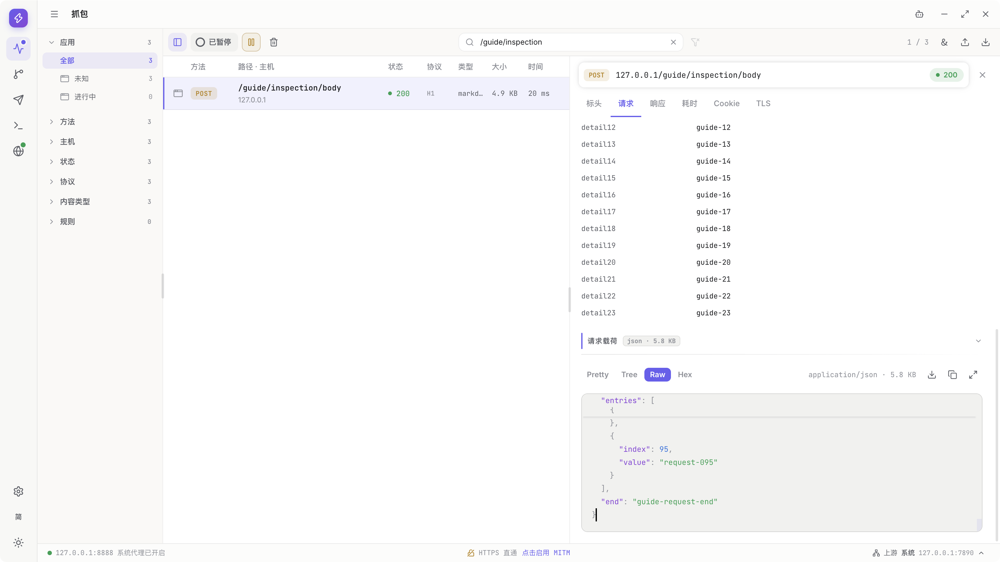

   

   Markdown Source also has recorded [wheel and keyboard end navigation](#walkthrough-capture-inspection-21-source-scroll), ending at `guide-response-end`. Scrolling and resizing neither resend the POST nor modify wire content.

| Content | Typical views |
| --- | --- |
| JSON, NDJSON | Pretty, Tree, Raw, Hex |
| HTML, CSS, JavaScript, XML, SVG | Code, Raw, Hex |
| Plain text | Text, Hex |
| Images | Preview, Hex |
| Markdown | Preview, Split, Source, Hex |
| URL-encoded form | Form, Raw, Hex |
| Binary | Hex; Text when useful |
| Audio or video | Metadata and Save body |

**Expected result:** views present the same body differently. HTML/SVG is not executed as a webpage and changing modes does not resend a request.

**Notes**

- Text, WebSocket and gRPC read-only previews are limited to `2 MiB`. Images have a separate `16 MiB` read/decode budget.
- Complete bodies up to `1 MiB` can format automatically. Complete `1–2 MiB` bodies require Format. Truncated or incomplete captures must not be formatted.
- The [large-body recording](#walkthrough-capture-body-limits) shows [manual Format](#walkthrough-capture-body-limits-07-format) above 1 MiB, a [3 MiB source previewed/copied only up to 2 MiB](#walkthrough-capture-body-limits-11-preview), and native saving of complete `guide-full-response.json`. Its actual input sizes and every step image are included; ordinary small JSON images are not substituted.
- Format only changes presentation; failures retain source text. A mode without Format is not necessarily unreadable.
- Copy uses the viewer's currently available content, not necessarily an entire large file.
- Save body exports the complete captured body, not just the preview. It cannot recover bytes never received before a network interruption.
- `multipart/form-data` is not currently presented as a structured upload-part list.

## Distinguish Original and Final

**Purpose:** identify content changed by rules or breakpoint editing.

**Steps**

Use `Guide response and body` from the [separate Rules recording](rules.md#walkthrough-rules-response-evidence). Complete its creation, Apply and POST steps first. The request path is `/guide/response-evidence/request-body`; the client sends `{"message":"guide-original"}`, while the origin actually receives `{"message":"guide-final"}`.

1. Select the `request-body` request in Capture. [Video step](rules.md#walkthrough-rules-response-evidence-32-body-select)

   

2. Open Request and inspect the body-rule effect and Text source. Final initially shows `guide-final`. [Video step](rules.md#walkthrough-rules-response-evidence-33-final)

   

3. Select Original and read `guide-original`. [Video step](rules.md#walkthrough-rules-response-evidence-34-original)

   

4. Choose Raw. The selected version remains Original rather than changing with the display mode. [Video step](rules.md#walkthrough-rules-response-evidence-35-raw)

   

5. Click Copy to copy the current Original. [Video step](rules.md#walkthrough-rules-response-evidence-36-copy-original)

   

6. Open Fullscreen. The enlarged body still contains `guide-original`. [Video step](rules.md#walkthrough-rules-response-evidence-37-fullscreen)

   

7. Press Escape to return to details and move the pointer away before selecting another version. [Video step](rules.md#walkthrough-rules-response-evidence-38-close-fullscreen)

   

8. Select Final again and confirm `guide-final`. [Video step](rules.md#walkthrough-rules-response-evidence-39-final-again)

   

9. Click Copy. This copies Final, not the previous Original. [Video step](rules.md#walkthrough-rules-response-evidence-40-copy-final)

   

10. Click Save body, choose your example directory in the native panel and save as `guide-final.json`. [Video step](rules.md#walkthrough-rules-response-evidence-41-save-dialog)

    

11. Return to the same request after saving. Final is still selected; the file was checked to contain `{"message":"guide-final"}`. [Video step](rules.md#walkthrough-rules-response-evidence-42-saved)

    

12. Click the body-rule effect to return to its writer, `Guide response and body`. [Video step](rules.md#walkthrough-rules-response-evidence-43-body-rule)

    

The [remaining steps in the same recording](rules.md#walkthrough-rules-response-evidence-44-response-body) cover the response phase: Final becomes `{"message":"guide-response-final"}`, with Original explicitly unavailable, not empty. [Disable and Apply](rules.md#walkthrough-rules-response-evidence-52-disable) when finished.

**Expected result:** these actions apply to the selected body version rather than silently using another one.

**Notes**

- Empty Original and unavailable Original are different states.
- A response replaced at the header stage may never have exposed its original body. “Unavailable” does not mean an empty response.
- A rule hit alone does not prove that complete original bytes or a diff exist.

## HTTPS and TLS tunnels

**Prerequisites:** authorized HTTPS traffic, a usable CA, correct trust and decryption settings.

**Steps**

1. Send HTTPS through the proxy. If it appears only as TLS tunnel, distinguish proxy routing from decryption readiness.

   The [TLS recording](settings.md#walkthrough-settings-tls-passthrough) first searches for `localhost` and starts Recording. Its port is `63604`; use your own actual port. These are the same connection's [request](settings.md#walkthrough-settings-tls-passthrough-03-opaque-request), [selection](settings.md#walkthrough-settings-tls-passthrough-04-tunnel-select) and [Tunnel details](settings.md#walkthrough-settings-tls-passthrough-05-tunnel), not an unrelated successful HTTP request.

   

   

   

2. Check existing CA trust in Settings. This is the recording machine's already-trusted CA, not first installation or native authorization.

   

3. Enable HTTPS decryption once trust is ready. This recording also added an origin-certificate exception only for its controlled `localhost` demo service; do not copy that as a general Internet configuration.

   

   

4. Check whether TLS passthrough excludes the destination; follow [Settings](settings.md#tls-passthrough) if a change is required.

   The new [complete Settings procedure](settings.md#tls-passthrough) adds exact `localhost`, reconnects, inspects the match, locates and removes the entry, then reconnects to restore decryption. Global MITM is enabled in this image, but the matched connection is still a Tunnel; that alone is not a decryption failure.

   

5. Establish a new connection and inspect subsequent traffic. This image is the recorded `/playground/h2-json` HTTP/2 request, not the earlier HTTP orders request.

   

6. After the demonstration, disable the decryption enabled for this exercise and remove its `localhost` exception. Preserve the existing CA and others' settings.

   

   

**Expected result:** an undecrypted tunnel exposes connection metadata, not encrypted HTTP bodies. Only suitable new connections can show decrypted HTTP details.

**Notes**

- Pinning, independent trust stores and explicit passthrough can prevent normal interception.
- Passthrough preserves encryption; it does not conceal an already-decrypted response.
- A confirmed passthrough tunnel can link to its matching setting. Do not weaken certificate checks globally to see content.
- Follow [Settings](settings.md#https-decryption) for actual certificate/native authorization steps and platform limitations.

## Inspect HTTP/2 and connection endings

**Prerequisites:** client and origin actually use HTTP/2. HTTPS also needs the relevant decryption conditions.

**Steps**

1. Search for `/playground` to scope the recorded protocol examples.

   

2. Use an HTTP/2 client to request `/playground/h2-json`; select the record and inspect its protocol.

   

3. Select HTTP/2 in Protocol if needed.

   The [separate HTTP/2 recording](#walkthrough-capture-http2-10-protocol-group) actually expands Protocol and selects HTTP/2. It owns `/guide/h2` requests rather than renaming the older `/playground` footage.

   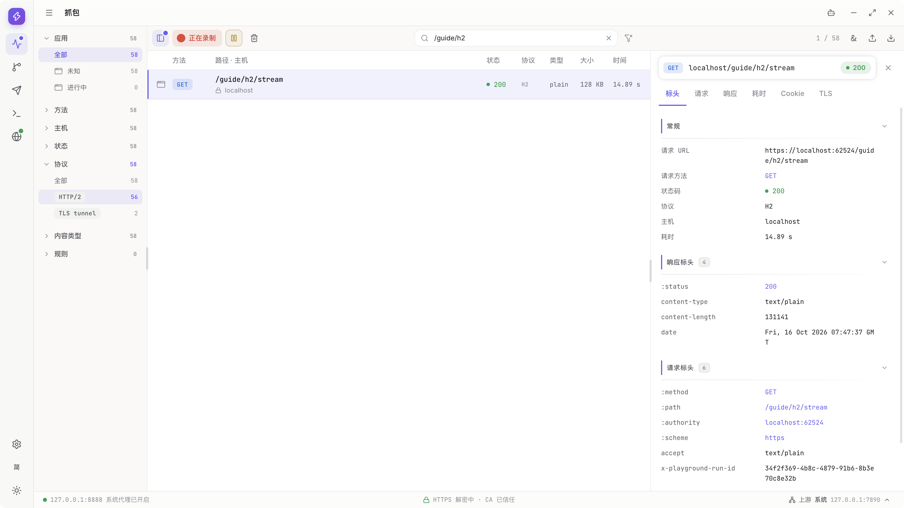

4. Expand the available trailers in Headers.

   

5. Open Response to inspect this HTTP/2 JSON.

   

6. For streaming responses, observe received data and final state in the same record instead of treating a visible prefix as complete.

   The new `/guide/h2/stream` receives a first part, then a second part, before ending. [The complete progress sequence](#walkthrough-capture-http2-03-first-part) checks real received bytes. While receiving, row sizes update but this release does not yet expose the normal HTTP body for reading; an unavailable body does not mean traffic bypassed the proxy.

   

   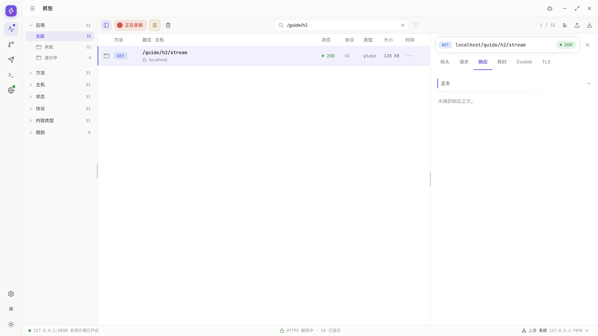

   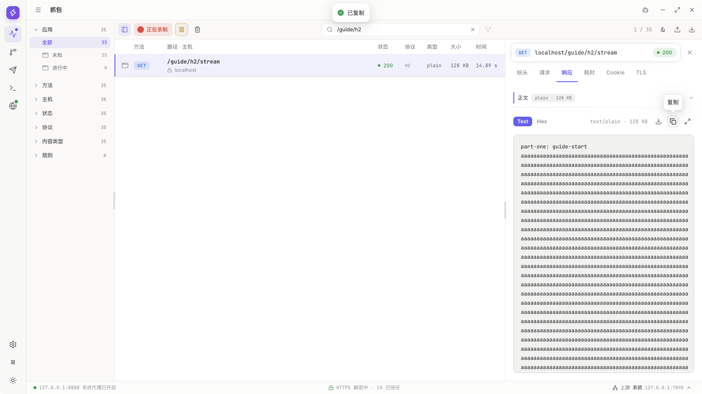

   The [completion trailer](#walkthrough-capture-http2-09-trailers) is `x-guide-end: complete`. These are stages of one GET, not repeated requests.

7. When a connection ends, compare request completion, client-received bytes and whether a new connection can serve another request.

   [Client error GOAWAY](#walkthrough-capture-http2-client-01-interrupt) and [origin error GOAWAY](#walkthrough-capture-http2-origin-01-interrupt) each have an actual sequence. The original POST declares `524288` bytes but only `262144` are captured; a separate `/recovered` GET then uses a new connection, without replaying the POST. The experiment affects only its owned origin, never someone else's service.

   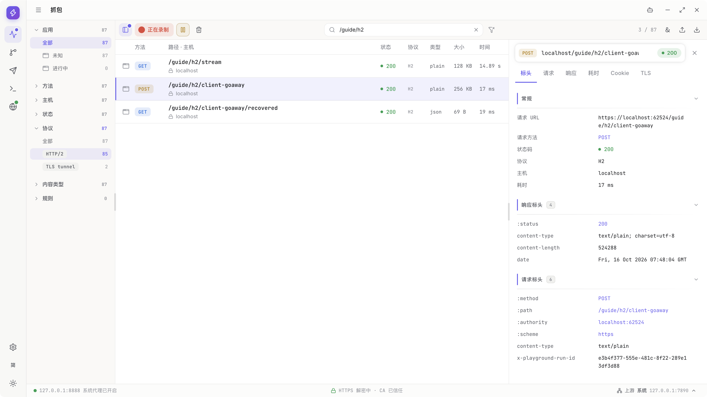

   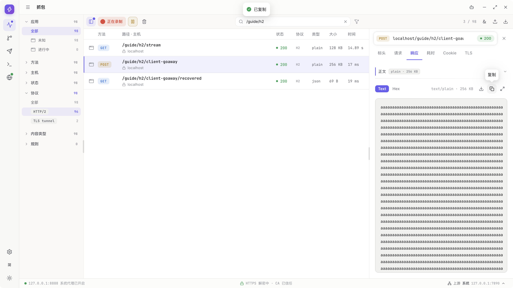

   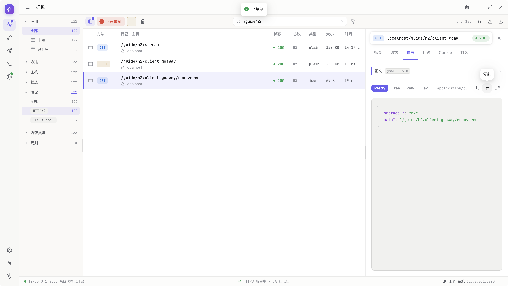

   These two error cases do not certify all normal-GOAWAY multi-stream endings, reset types or retry strategies.

**Expected result:** evaluate each request, not every stream collectively from one connection event.

**Notes:** normal GOAWAY may drain accepted streams before a new connection is used; it does not necessarily truncate responses. Distinguish reset, interruption and normal completion. Diagnostics is not a complete HTTP/2 frame analyzer. HAR is not a lossless trailer backup.

## Read WebSocket and gRPC messages

**Steps**

1. Keep Recording enabled, connect to your own `/playground/ws/text` service, select that connection and open Messages.

   

2. Select the outgoing message and check `hello from client`, direction, type and time.

   

3. Call `/playground.Capture/UnaryJson` with a gRPC client and request JSON `{"message":"hello"}`; select its record.

   

4. Select the gRPC response message and check `{"message":"world"}`.

   

5. Expand, copy or use fullscreen for long messages.

   The [WebSocket message recording](#walkthrough-capture-websocket-messages) owns `/guide/messages/websocket/detail`, containing public `guide-short`, `guide-long` and subsequent messages. [Height resizing](#walkthrough-capture-websocket-messages-12-resize), wheel/keyboard end navigation, [list scroll handoff](#walkthrough-capture-websocket-messages-15-scroll-out), Copy and Fullscreen each have their own step images.

   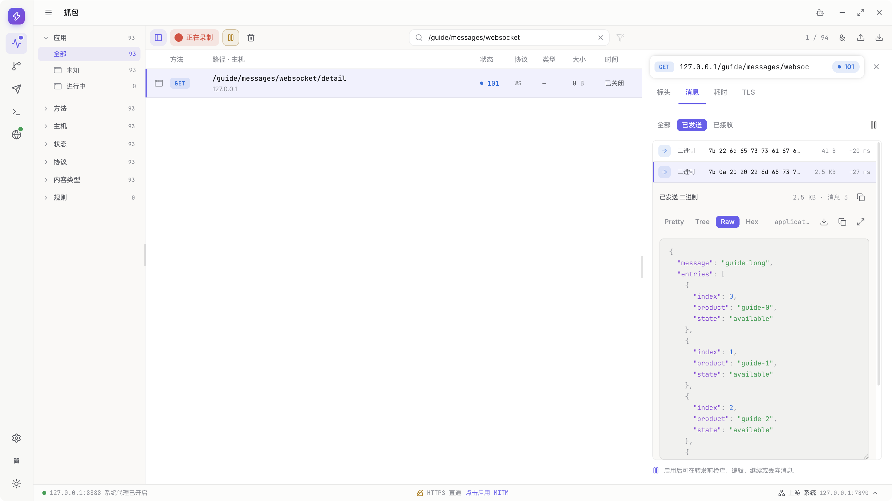

   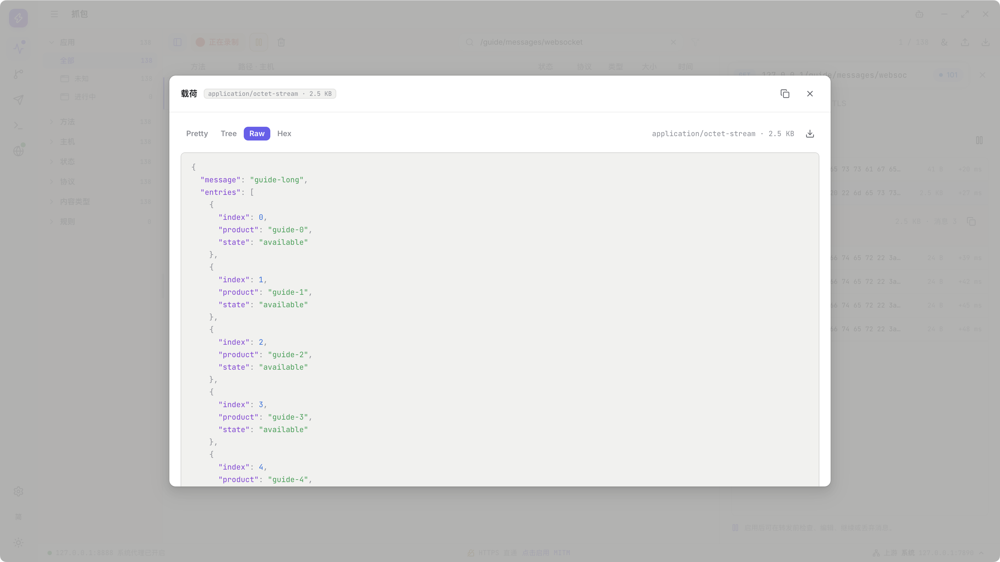

   The long message is binary JSON: Raw-body Copy returns UTF-8, while [message-specific Copy](#walkthrough-capture-websocket-messages-17-payload-copy) returns original binary Hex. Do not treat these as identical formats.

   gRPC has its own [complete message recording](#walkthrough-capture-grpc-messages), using six JSON messages at `/guide/messages/grpc/detail`. It independently shows expansion, Raw, copying, height resizing, inner/outer scrolling and fullscreen. Follow the [HTTPS prerequisites](settings.md#https-decryption) for the existing CA and owned localhost exception; this is not a new CA-installation recording.

   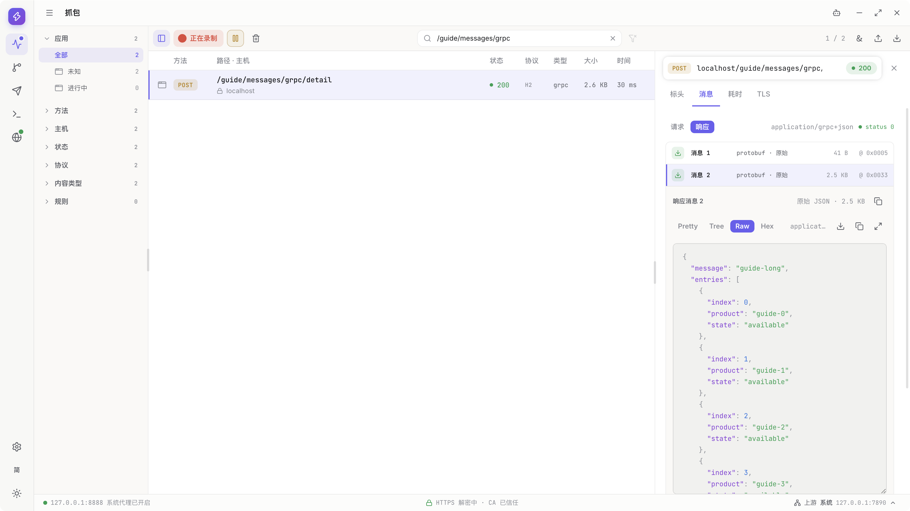

   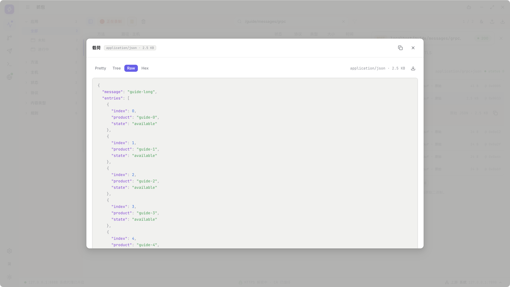

6. Scroll or paginate longer message lists; the visible screen is not the entire session.

   Another connection, `/guide/messages/websocket/pages`, actually sends 205 text messages. After [switching connections and loading further pages](#walkthrough-capture-websocket-messages-20-paged-input), expand and copy the last `{"index":204,"message":"guide-page-204"}`. Displayed message number 205 differs from the JSON example's zero-based index 204.

   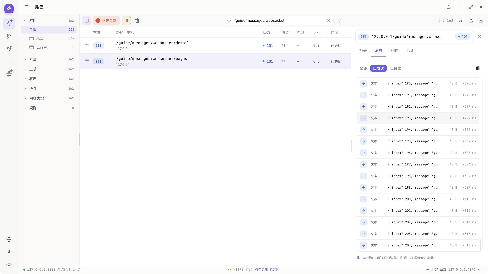

   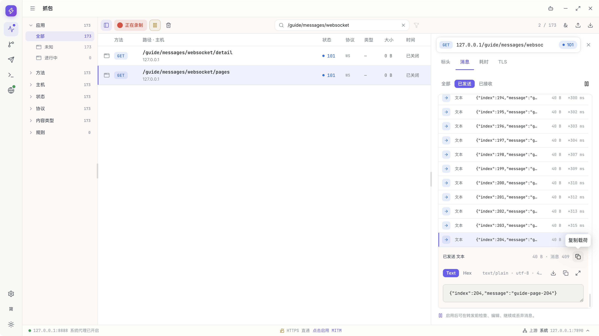

   gRPC also owns `/guide/messages/grpc/pages`: [send 205 messages](#walkthrough-capture-grpc-messages-20-paged-input), scroll through pages, expand the last, select Raw and scroll until its whole body is visible, then Copy and verify index 204. A page number or a mounted DOM node alone does not prove the text is readable in the viewport.

   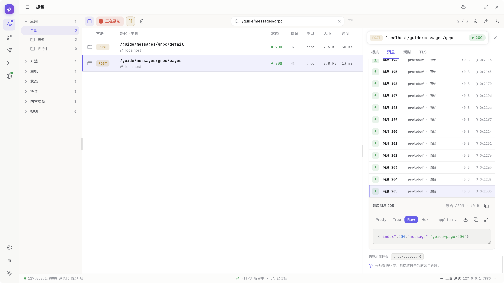

   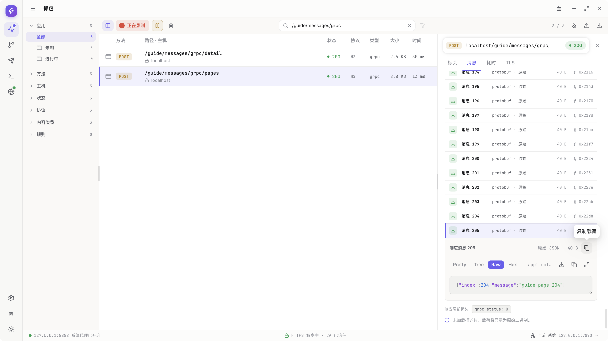

**Expected result:** distinguish client-to-server from server-to-client data and observe new messages.

**Notes**

- Undecrypted WSS or encrypted gRPC can show only tunnels, not fully parsed messages.
- gRPC uses HTTP/2. Protocol and content type are separate dimensions.
- Pause obeys recording boundaries; it does not close the connection. Clear removes records, not necessarily the connection.
- Distinguish half-messages, decoding failure, interrupted connections and preview limits.

## Save records and bodies

**Steps**

These file-operation images explicitly reuse [Transfer](transfer.md#har). Its request is `http://127.0.0.1:55059/guide/transfer/order`; `55059` is that recording's dynamic port. It is not a renamed version of the orders request above.

1. Open Export.

   

2. Choose HAR. Native Archive retains more Interceptor details; Save body retains one payload. They are different formats for different purposes.

   

3. Choose the intended scope. This recording selects the current request; the [separate three-scope walkthrough](transfer.md#walkthrough-transfer-scopes) owns three `/guide/export-scopes` requests and verifies actual files with all 3, filtered 2 and selected 1 entries. One selected-request image is not used to stand for all three scopes.

   

4. Review body and privacy options.

   

5. Save as `guide-recording.har` in the real native dialog.

   

6. Wait for completion before Clear or quitting. See the [format-specific chapter](transfer.md#archive) for archive and body steps.

   

**Expected result:** retain a deliberate output file rather than just a screenshot or truncated clipboard text.

**Notes**

- HAR cannot losslessly preserve HTTP/2 pseudo-headers, trailers, WebSocket messages, TLS details or rule history.
- HAR masking covers selected Authorization/Cookie fields, not arbitrary query parameters, business fields or every header.
- Native archives retain sensitive original data; they do not inherit HAR masking or replace Rules configuration backups.
- Export is a snapshot. Do not assume later traffic appears in an already-started export.
- Use trusted inputs and follow [Import and export](transfer.md) for full procedures.

## Clear captured records

**Steps**

1. Export anything you need to retain.

   This reuses Transfer's `guide-recording.har` completion checkpoint; other recordings are not automatically saved.

   

2. Wait for body/HAR/archive tasks and any cancellation cleanup.

   The [running archive cancellation](transfer.md#walkthrough-transfer-cancel) owns a 128 MiB response and records actual running progress, Cancel, retained source data, completed file cleanup and only then Clear. It is not native file-dialog cancellation.

   

   **Image pending:** this proves Clear after cancellation cleanup. Rejecting Clear through another entry while work is still running, and waiting during exit, remain separate cases.

3. Clear the unneeded demonstration records, complete any product confirmation and inspect list, selection and counts. This image returns to the `capture` recording's actual Clear operation.

   

4. The complete post-Clear comparison comes from the separate [body-inspection recording](#walkthrough-capture-inspection-29-clear). It pauses first and clears this run's temporary records, remaining paused afterward; an earlier Resume image is not reused as this action.

   

5. Resume Recording. [Video step](#walkthrough-capture-inspection-30-resume)

   

6. Send new `/guide/inspection/after-clear` and verify a new record appears. [Video step](#walkthrough-capture-inspection-31-new-request)

   

7. Select it and open Response to read `{"afterClear":"guide-visible"}`. [Video step](#walkthrough-capture-inspection-32-new-body)

   

**Expected result:** old records disappear without late events restoring them. If Recording is still enabled, newly started requests can appear.

**Notes**

- Clear is neither Pause nor Stop forwarding.
- Active file operations can reject Clear. Do not work around that by deleting storage directories.
- Filter reset, Capture Clear, proxy restoration and App shutdown are distinct actions.

## Create controls from captured traffic

This is `capture-shortcuts`, using `http://127.0.0.1:52315/guide/shortcuts/order`. `52315` is a recording-only dynamic port, not an App constant. Block and Breakpoint have different save behavior; keep the two flows separate.

1. Select the captured example request. Selecting history does not resend it.

   

2. Open its context menu.

   

3. Choose Block under Control and inspect the disabled draft.

   

4. Name the draft `Guide quick block`.

   

5. Enable the rule.

   

6. Apply and wait for it to take effect.

   

7. Request the same test address again with the external client and check that the new request is blocked.

   

8. Disable `Guide quick block` so it does not interfere with the breakpoint exercise.

   

9. Apply the disabled state.

   

10. Return to the example request's context menu and open the Breakpoint submenu.

    

11. Select Endpoint. This derives conditions and **creates both request- and response-phase breakpoints, enabled and applied immediately**. Do not repeat the ordinary draft's enable/Apply sequence.

    

12. Send a new matching request and inspect its first, request-phase wait.

    

13. Continue request phase unchanged. Response phase will pause separately afterward; one click does not finish the entire exchange.

    

14. Check that the current phase is response, continue it unchanged and inspect client completion.

    

15. After the exercise, inspect and disable the shortcut-created breakpoint matching.

    **Image pending:** this clip ends after both continuations, without disabling those breakpoint rules. Resolving waits is not disabling matching. Other scopes and left/right menu placement remain unrecorded.

**Expected result:** Block affects future traffic only after enable and Apply. This Endpoint breakpoint applies immediately, and the same new request needs separate request- and response-phase decisions.

**Notes:** menus can open left when space is limited. Escape/outside click dismisses the menu but does not disable an applied rule. Follow [Breakpoints](breakpoints.md) to manage matching and existing waits separately.

Next: [Composer](composer.md).

<!-- recorded-walkthrough:capture-filters:start -->

## Recorded walkthrough: OR, AND and search without clearing records

These images and video show the published <code>0.1.1-alpha.1</code> on macOS x64, retaining the App language <code>zh-CN</code>. Every recorded step has its own native-window screenshot; open an image at full size to inspect values.

Loopback addresses, ports and generated IDs belong to this recording, not a public service. Use your own authorized test environment. The actual values below match the screenshots and video. Advanced branches not shown here still need their own step images and acceptance.

| Example field | Actual recorded value |
| --- | --- |
| <code>search</code> | <code>/guide/filters</code> |
| <code>methods</code> | <code>GET + POST</code> |
| <code>status</code> | <code>200</code> |
| <code>addedSearch</code> | <code>/guide/filters/post-ok</code> |
| <code>initialRecords</code> | <code>4</code> |
| <code>afterOr</code> | <code>3</code> |
| <code>afterAnd</code> | <code>2</code> |
| <code>afterSearch</code> | <code>1</code> |
| <code>finalRecords</code> | <code>4</code> |
| <code>finalSearch</code> | <code>(empty; cleared through the search control, not Capture Clear)</code> |

<video controls preload="metadata" playsinline lang="en" src="../media/v0.1.1-alpha.1/capture-filters/capture-filters.mp4" poster="../media/v0.1.1-alpha.1/capture-filters/capture-filters-01-records.png">
<track kind="captions" srclang="zh-CN" label="Steps / 步骤" src="../media/v0.1.1-alpha.1/capture-filters/capture-filters.vtt" default>
</video>

### 01 · Inspect four example requests

[Video 00:00](../media/v0.1.1-alpha.1/capture-filters/capture-filters.mp4#t=0.325) · [Back to the video](#walkthrough-capture-filters-video)

### 02 · Expand Method

[Video 00:03](../media/v0.1.1-alpha.1/capture-filters/capture-filters.mp4#t=3.149) · [Back to the video](#walkthrough-capture-filters-video)

### 03 · Select GET

[Video 00:06](../media/v0.1.1-alpha.1/capture-filters/capture-filters.mp4#t=6.002) · [Back to the video](#walkthrough-capture-filters-video)

### 04 · Also select POST in the same group

[Video 00:08](../media/v0.1.1-alpha.1/capture-filters/capture-filters.mp4#t=8.857) · [Back to the video](#walkthrough-capture-filters-video)

### 05 · Expand Status

[Video 00:11](../media/v0.1.1-alpha.1/capture-filters/capture-filters.mp4#t=11.750) · [Back to the video](#walkthrough-capture-filters-video)

### 06 · Select 200 for an AND across groups

[Video 00:14](../media/v0.1.1-alpha.1/capture-filters/capture-filters.mp4#t=14.601) · [Back to the video](#walkthrough-capture-filters-video)

### 07 · Add a post-ok search

[Video 00:17](../media/v0.1.1-alpha.1/capture-filters/capture-filters.mp4#t=17.501) · [Back to the video](#walkthrough-capture-filters-video)

### 08 · Restore the example search scope

[Video 00:20](../media/v0.1.1-alpha.1/capture-filters/capture-filters.mp4#t=20.399) · [Back to the video](#walkthrough-capture-filters-video)

### 09 · Remove Status selection

[Video 00:23](../media/v0.1.1-alpha.1/capture-filters/capture-filters.mp4#t=23.251) · [Back to the video](#walkthrough-capture-filters-video)

### 10 · Remove POST selection

[Video 00:26](../media/v0.1.1-alpha.1/capture-filters/capture-filters.mp4#t=26.100) · [Back to the video](#walkthrough-capture-filters-video)

### 11 · Remove GET without deleting records

[Video 00:28](../media/v0.1.1-alpha.1/capture-filters/capture-filters.mp4#t=28.960) · [Back to the video](#walkthrough-capture-filters-video)

### 12 · Collapse only the group

[Video 00:31](../media/v0.1.1-alpha.1/capture-filters/capture-filters.mp4#t=31.850) · [Back to the video](#walkthrough-capture-filters-video)

### 13 · Clear search without deleting requests

[Video 00:34](../media/v0.1.1-alpha.1/capture-filters/capture-filters.mp4#t=34.751) · [Back to the video](#walkthrough-capture-filters-video)

The complete reference follows. Only operations with matching real step images and checked input values count as illustrated acceptance.
<!-- recorded-walkthrough:capture-filters:end -->

<!-- recorded-walkthrough:capture-shortcuts:start -->

## Recorded walkthrough: Capture Block and two-phase breakpoint shortcuts

These images and video show the published <code>0.1.1-alpha.1</code> on macOS x64, retaining the App language <code>zh-CN</code>. Every recorded step has its own native-window screenshot; open an image at full size to inspect values.

Loopback addresses, ports and generated IDs belong to this recording, not a public service. Use your own authorized test environment. The actual values below match the screenshots and video. Advanced branches not shown here still need their own step images and acceptance.

| Example field | Actual recorded value |
| --- | --- |
| <code>url</code> | <code>http://127.0.0.1:52315/guide/shortcuts/order</code> |
| <code>blockName</code> | <code>Guide quick block</code> |
| <code>breakpointScope</code> | <code>endpoint</code> |
| <code>blockBehavior</code> | <code>disabled draft; enable and Apply required</code> |
| <code>breakpointBehavior</code> | <code>created, enabled and applied immediately for request and response phases</code> |

<video controls preload="metadata" playsinline lang="en" src="../media/v0.1.1-alpha.1/capture-shortcuts/capture-shortcuts.mp4" poster="../media/v0.1.1-alpha.1/capture-shortcuts/capture-shortcuts-01-source.png">
<track kind="captions" srclang="zh-CN" label="Steps / 步骤" src="../media/v0.1.1-alpha.1/capture-shortcuts/capture-shortcuts.vtt" default>
</video>

### 01 · Select the captured source request

[Video 00:00](../media/v0.1.1-alpha.1/capture-shortcuts/capture-shortcuts.mp4#t=0.333) · [Back to the video](#walkthrough-capture-shortcuts-video)

### 02 · Open the context menu

[Video 00:03](../media/v0.1.1-alpha.1/capture-shortcuts/capture-shortcuts.mp4#t=3.345) · [Back to the video](#walkthrough-capture-shortcuts-video)

### 03 · Block creates a disabled draft

[Video 00:06](../media/v0.1.1-alpha.1/capture-shortcuts/capture-shortcuts.mp4#t=6.295) · [Back to the video](#walkthrough-capture-shortcuts-video)

### 04 · Name the Block draft

[Video 00:09](../media/v0.1.1-alpha.1/capture-shortcuts/capture-shortcuts.mp4#t=9.252) · [Back to the video](#walkthrough-capture-shortcuts-video)

### 05 · Enable Block

[Video 00:12](../media/v0.1.1-alpha.1/capture-shortcuts/capture-shortcuts.mp4#t=12.095) · [Back to the video](#walkthrough-capture-shortcuts-video)

### 06 · Apply before taking effect

[Video 00:14](../media/v0.1.1-alpha.1/capture-shortcuts/capture-shortcuts.mp4#t=14.945) · [Back to the video](#walkthrough-capture-shortcuts-video)

### 07 · Verify a new request is blocked

[Video 00:17](../media/v0.1.1-alpha.1/capture-shortcuts/capture-shortcuts.mp4#t=17.804) · [Back to the video](#walkthrough-capture-shortcuts-video)

### 08 · Disable this Block Rule

[Video 00:20](../media/v0.1.1-alpha.1/capture-shortcuts/capture-shortcuts.mp4#t=20.795) · [Back to the video](#walkthrough-capture-shortcuts-video)

### 09 · Apply the disabled state

[Video 00:23](../media/v0.1.1-alpha.1/capture-shortcuts/capture-shortcuts.mp4#t=23.745) · [Back to the video](#walkthrough-capture-shortcuts-video)

### 10 · Open the actual Breakpoint submenu

[Video 00:26](../media/v0.1.1-alpha.1/capture-shortcuts/capture-shortcuts.mp4#t=26.645) · [Back to the video](#walkthrough-capture-shortcuts-video)

### 11 · Select Endpoint and apply immediately

[Video 00:30](../media/v0.1.1-alpha.1/capture-shortcuts/capture-shortcuts.mp4#t=30.094) · [Back to the video](#walkthrough-capture-shortcuts-video)

### 12 · Send again and inspect the wait

[Video 00:33](../media/v0.1.1-alpha.1/capture-shortcuts/capture-shortcuts.mp4#t=33.095) · [Back to the video](#walkthrough-capture-shortcuts-video)

### 13 · Continue the request phase

[Video 00:36](../media/v0.1.1-alpha.1/capture-shortcuts/capture-shortcuts.mp4#t=36.145) · [Back to the video](#walkthrough-capture-shortcuts-video)

### 14 · Continue the response phase separately

[Video 00:39](../media/v0.1.1-alpha.1/capture-shortcuts/capture-shortcuts.mp4#t=39.249) · [Back to the video](#walkthrough-capture-shortcuts-video)

The complete reference follows. Only operations with matching real step images and checked input values count as illustrated acceptance.
<!-- recorded-walkthrough:capture-shortcuts:end -->

<!-- recorded-walkthrough:capture-inspection:start -->

## Recorded walkthrough: request bodies, Markdown Source and scrolling

These images and video show the published <code>0.1.1-alpha.1</code> on macOS x64, retaining the App language <code>zh-CN</code>. Every recorded step has its own native-window screenshot; open an image at full size to inspect values.

Loopback addresses, ports and generated IDs belong to this recording, not a public service. Use your own authorized test environment. The actual values below match the screenshots and video. Advanced branches not shown here still need their own step images and acceptance.

| Example field | Actual recorded value |
| --- | --- |
| <code>url</code> | <code>http://127.0.0.1:55601/guide/inspection/body?detail0=guide-0&amp;detail1=guide-1&amp;detail2=guide-2&amp;detail3=guide-3&amp;detail4=guide-4&amp;detail5=guide-5&amp;detail6=guide-6&amp;detail7=guide-7&amp;detail8=guide-8&amp;detail9=guide-9&amp;detail10=guide-10&amp;detail11=guide-11&amp;detail12=guide-12&amp;detail13=guide-13&amp;detail14=guide-14&amp;detail15=guide-15&amp;detail16=guide-16&amp;detail17=guide-17&amp;detail18=guide-18&amp;detail19=guide-19&amp;detail20=guide-20&amp;detail21=guide-21&amp;detail22=guide-22&amp;detail23=guide-23</code> |
| <code>search</code> | <code>/guide/inspection</code> |
| <code>requestId</code> | <code>guide-request</code> |
| <code>requestEntries</code> | <code>request-000 through request-095</code> |
| <code>queryFields</code> | <code>detail0=guide-0 through detail23=guide-23</code> |
| <code>requestEnd</code> | <code>guide-request-end</code> |
| <code>responseTitle</code> | <code>Guide response source</code> |
| <code>responseEntries</code> | <code>response-000 through response-159</code> |
| <code>responseEnd</code> | <code>guide-response-end</code> |
| <code>responseMime</code> | <code>text/markdown</code> |
| <code>inspectorDrag</code> | <code>240px wider, then restored</code> |
| <code>afterClearPath</code> | <code>/guide/inspection/after-clear</code> |
| <code>afterClearBody</code> | <code>{&quot;afterClear&quot;:&quot;guide-visible&quot;}</code> |

<video controls preload="metadata" playsinline lang="en" src="../media/v0.1.1-alpha.1/capture-inspection/capture-inspection.mp4" poster="../media/v0.1.1-alpha.1/capture-inspection/capture-inspection-01-filter.png">
<track kind="captions" srclang="zh-CN" label="Steps / 步骤" src="../media/v0.1.1-alpha.1/capture-inspection/capture-inspection.vtt" default>
</video>

### 01 · Scope the inspection path

[Video 00:00](../media/v0.1.1-alpha.1/capture-inspection/capture-inspection.mp4#t=0.418) · [Back to the video](#walkthrough-capture-inspection-video)

### 02 · Start Recording

[Video 00:03](../media/v0.1.1-alpha.1/capture-inspection/capture-inspection.mp4#t=3.213) · [Back to the video](#walkthrough-capture-inspection-video)

### 03 · Send the long-body POST

[Video 00:05](../media/v0.1.1-alpha.1/capture-inspection/capture-inspection.mp4#t=5.968) · [Back to the video](#walkthrough-capture-inspection-video)

### 04 · Pause before inspecting the captured request

[Video 00:08](../media/v0.1.1-alpha.1/capture-inspection/capture-inspection.mp4#t=8.764) · [Back to the video](#walkthrough-capture-inspection-video)

### 05 · Select the body request

[Video 00:11](../media/v0.1.1-alpha.1/capture-inspection/capture-inspection.mp4#t=11.606) · [Back to the video](#walkthrough-capture-inspection-video)

### 06 · Inspect Headers

[Video 00:14](../media/v0.1.1-alpha.1/capture-inspection/capture-inspection.mp4#t=14.657) · [Back to the video](#walkthrough-capture-inspection-video)

### 07 · Collapse General

[Video 00:17](../media/v0.1.1-alpha.1/capture-inspection/capture-inspection.mp4#t=17.469) · [Back to the video](#walkthrough-capture-inspection-video)

### 08 · Expand General again

[Video 00:20](../media/v0.1.1-alpha.1/capture-inspection/capture-inspection.mp4#t=20.306) · [Back to the video](#walkthrough-capture-inspection-video)

### 09 · Open the Request body

[Video 00:23](../media/v0.1.1-alpha.1/capture-inspection/capture-inspection.mp4#t=23.156) · [Back to the video](#walkthrough-capture-inspection-video)

### 10 · Select request Raw

[Video 00:26](../media/v0.1.1-alpha.1/capture-inspection/capture-inspection.mp4#t=26.913) · [Back to the video](#walkthrough-capture-inspection-video)

### 11 · Drag the splitter to widen details

[Video 00:29](../media/v0.1.1-alpha.1/capture-inspection/capture-inspection.mp4#t=29.907) · [Back to the video](#walkthrough-capture-inspection-video)

### 12 · Scroll inside the body with the wheel

[Video 00:39](../media/v0.1.1-alpha.1/capture-inspection/capture-inspection.mp4#t=39.008) · [Back to the video](#walkthrough-capture-inspection-video)

### 13 · Reach the request end with the keyboard

[Video 00:42](../media/v0.1.1-alpha.1/capture-inspection/capture-inspection.mp4#t=42.007) · [Back to the video](#walkthrough-capture-inspection-video)

### 14 · Scroll up at the Inspector edge

[Video 00:44](../media/v0.1.1-alpha.1/capture-inspection/capture-inspection.mp4#t=44.907) · [Back to the video](#walkthrough-capture-inspection-video)

### 15 · Continue scrolling the outer pane at the body boundary

[Video 00:47](../media/v0.1.1-alpha.1/capture-inspection/capture-inspection.mp4#t=47.856) · [Back to the video](#walkthrough-capture-inspection-video)

### 16 · Copy the complete request body

[Video 00:50](../media/v0.1.1-alpha.1/capture-inspection/capture-inspection.mp4#t=50.915) · [Back to the video](#walkthrough-capture-inspection-video)

### 17 · Open Markdown Preview

[Video 00:53](../media/v0.1.1-alpha.1/capture-inspection/capture-inspection.mp4#t=53.808) · [Back to the video](#walkthrough-capture-inspection-video)

### 18 · Use ArrowRight to switch to Split

[Video 00:56](../media/v0.1.1-alpha.1/capture-inspection/capture-inspection.mp4#t=56.710) · [Back to the video](#walkthrough-capture-inspection-video)

### 19 · Press ArrowRight again for Source

[Video 00:59](../media/v0.1.1-alpha.1/capture-inspection/capture-inspection.mp4#t=59.608) · [Back to the video](#walkthrough-capture-inspection-video)

### 20 · Copy Markdown Source

[Video 01:02](../media/v0.1.1-alpha.1/capture-inspection/capture-inspection.mp4#t=62.463) · [Back to the video](#walkthrough-capture-inspection-video)

### 21 · Scroll the long Source

[Video 01:05](../media/v0.1.1-alpha.1/capture-inspection/capture-inspection.mp4#t=65.307) · [Back to the video](#walkthrough-capture-inspection-video)

### 22 · Use the keyboard to inspect the Source end

[Video 01:08](../media/v0.1.1-alpha.1/capture-inspection/capture-inspection.mp4#t=68.219) · [Back to the video](#walkthrough-capture-inspection-video)

### 23 · View Source fullscreen

[Video 01:11](../media/v0.1.1-alpha.1/capture-inspection/capture-inspection.mp4#t=71.057) · [Back to the video](#walkthrough-capture-inspection-video)

### 24 · Return to Source with Escape

[Video 01:13](../media/v0.1.1-alpha.1/capture-inspection/capture-inspection.mp4#t=73.957) · [Back to the video](#walkthrough-capture-inspection-video)

### 25 · Return to Markdown Preview

[Video 01:16](../media/v0.1.1-alpha.1/capture-inspection/capture-inspection.mp4#t=76.912) · [Back to the video](#walkthrough-capture-inspection-video)

### 26 · Inspect Hex for the same response

[Video 01:19](../media/v0.1.1-alpha.1/capture-inspection/capture-inspection.mp4#t=79.756) · [Back to the video](#walkthrough-capture-inspection-video)

### 27 · Restore the original detail width

[Video 01:22](../media/v0.1.1-alpha.1/capture-inspection/capture-inspection.mp4#t=82.608) · [Back to the video](#walkthrough-capture-inspection-video)

### 28 · Close details and return to the list

[Video 01:26](../media/v0.1.1-alpha.1/capture-inspection/capture-inspection.mp4#t=86.207) · [Back to the video](#walkthrough-capture-inspection-video)

### 29 · Clear this run’s temporary records

[Video 01:29](../media/v0.1.1-alpha.1/capture-inspection/capture-inspection.mp4#t=89.006) · [Back to the video](#walkthrough-capture-inspection-video)

### 30 · Resume Recording after Clear

[Video 01:31](../media/v0.1.1-alpha.1/capture-inspection/capture-inspection.mp4#t=91.858) · [Back to the video](#walkthrough-capture-inspection-video)

### 31 · Send a new request after Clear

[Video 01:34](../media/v0.1.1-alpha.1/capture-inspection/capture-inspection.mp4#t=94.707) · [Back to the video](#walkthrough-capture-inspection-video)

### 32 · Verify the new request body is readable

[Video 01:37](../media/v0.1.1-alpha.1/capture-inspection/capture-inspection.mp4#t=97.515) · [Back to the video](#walkthrough-capture-inspection-video)

The complete reference follows. Only operations with matching real step images and checked input values count as illustrated acceptance.
<!-- recorded-walkthrough:capture-inspection:end -->

<!-- recorded-walkthrough:capture-facets:start -->

## Recorded walkthrough: Application, Host, Protocol, Type and Rule filters

These images and video show the published <code>0.1.1-alpha.1</code> on macOS x64, retaining the App language <code>zh-CN</code>. Every recorded step has its own native-window screenshot; open an image at full size to inspect values.

Loopback addresses, ports and generated IDs belong to this recording, not a public service. Use your own authorized test environment. The actual values below match the screenshots and video. Advanced branches not shown here still need their own step images and acceptance.

| Example field | Actual recorded value |
| --- | --- |
| <code>search</code> | <code>/guide/facets</code> |
| <code>ruleName</code> | <code>Guide facets</code> |
| <code>rulePath</code> | <code>/guide/facets/selected-json</code> |
| <code>host</code> | <code>127.0.0.1</code> |
| <code>protocol</code> | <code>HTTP/1.1</code> |
| <code>application</code> | <code>Unknown (actual macOS result, not Windows attribution)</code> |
| <code>prerequisite</code> | <code>Two captured owned requests and one applied Guide facets Rule; recording is paused before filming</code> |
| <code>jsonPath</code> | <code>/guide/facets/selected-json</code> |
| <code>textPath</code> | <code>/guide/facets/other-text</code> |
| <code>header</code> | <code>x-guide-facet: selected</code> |
| <code>initialRecords</code> | <code>2</code> |
| <code>afterJson</code> | <code>1</code> |
| <code>afterRule</code> | <code>1</code> |
| <code>afterClearFacets</code> | <code>2</code> |

<video controls preload="metadata" playsinline lang="en" src="../media/v0.1.1-alpha.1/capture-facets/capture-facets.mp4" poster="../media/v0.1.1-alpha.1/capture-facets/capture-facets-01-application.png">
<track kind="captions" srclang="zh-CN" label="Steps / 步骤" src="../media/v0.1.1-alpha.1/capture-facets/capture-facets.vtt" default>
</video>

### 01 · Expand Application

[Video 00:00](../media/v0.1.1-alpha.1/capture-facets/capture-facets.mp4#t=0.370) · [Back to the video](#walkthrough-capture-facets-video)

### 02 · Select this run’s Unknown attribution

[Video 00:03](../media/v0.1.1-alpha.1/capture-facets/capture-facets.mp4#t=3.318) · [Back to the video](#walkthrough-capture-facets-video)

### 03 · Expand Host

[Video 00:06](../media/v0.1.1-alpha.1/capture-facets/capture-facets.mp4#t=6.320) · [Back to the video](#walkthrough-capture-facets-video)

### 04 · Select 127.0.0.1

[Video 00:09](../media/v0.1.1-alpha.1/capture-facets/capture-facets.mp4#t=9.318) · [Back to the video](#walkthrough-capture-facets-video)

### 05 · Expand Protocol

[Video 00:12](../media/v0.1.1-alpha.1/capture-facets/capture-facets.mp4#t=12.372) · [Back to the video](#walkthrough-capture-facets-video)

### 06 · Select HTTP/1.1

[Video 00:15](../media/v0.1.1-alpha.1/capture-facets/capture-facets.mp4#t=15.372) · [Back to the video](#walkthrough-capture-facets-video)

### 07 · Expand Content type

[Video 00:18](../media/v0.1.1-alpha.1/capture-facets/capture-facets.mp4#t=18.369) · [Back to the video](#walkthrough-capture-facets-video)

### 08 · Select json to keep one request

[Video 00:21](../media/v0.1.1-alpha.1/capture-facets/capture-facets.mp4#t=21.370) · [Back to the video](#walkthrough-capture-facets-video)

### 09 · Expand Rule

[Video 00:24](../media/v0.1.1-alpha.1/capture-facets/capture-facets.mp4#t=24.373) · [Back to the video](#walkthrough-capture-facets-video)

### 10 · Select the matched Guide facets Rule

[Video 00:27](../media/v0.1.1-alpha.1/capture-facets/capture-facets.mp4#t=27.380) · [Back to the video](#walkthrough-capture-facets-video)

### 11 · Remove json while the Rule still keeps one request

[Video 00:30](../media/v0.1.1-alpha.1/capture-facets/capture-facets.mp4#t=30.420) · [Back to the video](#walkthrough-capture-facets-video)

### 12 · Clear facet selections while keeping search

[Video 00:33](../media/v0.1.1-alpha.1/capture-facets/capture-facets.mp4#t=33.419) · [Back to the video](#walkthrough-capture-facets-video)

### 13 · Hide the filter panel

[Video 00:36](../media/v0.1.1-alpha.1/capture-facets/capture-facets.mp4#t=36.451) · [Back to the video](#walkthrough-capture-facets-video)

### 14 · Show the filter panel again

[Video 00:39](../media/v0.1.1-alpha.1/capture-facets/capture-facets.mp4#t=39.418) · [Back to the video](#walkthrough-capture-facets-video)

### 15 · Return to the example Rule

[Video 00:42](../media/v0.1.1-alpha.1/capture-facets/capture-facets.mp4#t=42.416) · [Back to the video](#walkthrough-capture-facets-video)

### 16 · Disable Guide facets

[Video 00:45](../media/v0.1.1-alpha.1/capture-facets/capture-facets.mp4#t=45.485) · [Back to the video](#walkthrough-capture-facets-video)

### 17 · Apply the disabled state

[Video 00:48](../media/v0.1.1-alpha.1/capture-facets/capture-facets.mp4#t=48.474) · [Back to the video](#walkthrough-capture-facets-video)

The complete reference follows. Only operations with matching real step images and checked input values count as illustrated acceptance.
<!-- recorded-walkthrough:capture-facets:end -->

<!-- recorded-walkthrough:capture-websocket-messages:start -->

## Recorded walkthrough: WebSocket message bodies, copying, fullscreen and paging

These images and video show the published <code>0.1.1-alpha.1</code> on macOS x64, retaining the App language <code>zh-CN</code>. Every recorded step has its own native-window screenshot; open an image at full size to inspect values.

Loopback addresses, ports and generated IDs belong to this recording, not a public service. Use your own authorized test environment. The actual values below match the screenshots and video. Advanced branches not shown here still need their own step images and acceptance.

| Example field | Actual recorded value |
| --- | --- |
| <code>protocol</code> | <code>websocket</code> |
| <code>filter</code> | <code>/guide/messages/websocket</code> |
| <code>detailPath</code> | <code>/guide/messages/websocket/detail</code> |
| <code>pagePath</code> | <code>/guide/messages/websocket/pages</code> |
| <code>firstMessage</code> | <code>{&quot;message&quot;:&quot;guide-short&quot;,&quot;state&quot;:&quot;ready&quot;}</code> |
| <code>longMessage</code> | <code>guide-long with 28 entries; ending guide-message-end</code> |
| <code>firstCount</code> | <code>6</code> |
| <code>pagedCount</code> | <code>205</code> |
| <code>finalMessage</code> | <code>{&quot;index&quot;:204,&quot;message&quot;:&quot;guide-page-204&quot;}</code> |
| <code>detailEncoding</code> | <code>binary JSON; body Copy is text, message Copy is Hex</code> |
| <code>pagedEncoding</code> | <code>WebSocket text</code> |
| <code>tlsScope</code> | <code>plain WebSocket; no CA changes</code> |

<video controls preload="metadata" playsinline lang="en" src="../media/v0.1.1-alpha.1/capture-websocket-messages/capture-websocket-messages.mp4" poster="../media/v0.1.1-alpha.1/capture-websocket-messages/capture-websocket-messages-01-filter.png">
<track kind="captions" srclang="zh-CN" label="Steps / 步骤" src="../media/v0.1.1-alpha.1/capture-websocket-messages/capture-websocket-messages.vtt" default>
</video>

### 01 · Scope this run’s message paths

[Video 00:00](../media/v0.1.1-alpha.1/capture-websocket-messages/capture-websocket-messages.mp4#t=0.292) · [Back to the video](#walkthrough-capture-websocket-messages-video)

### 02 · Start Recording

[Video 00:03](../media/v0.1.1-alpha.1/capture-websocket-messages/capture-websocket-messages.mp4#t=3.425) · [Back to the video](#walkthrough-capture-websocket-messages-video)

### 03 · Send six public messages

[Video 00:06](../media/v0.1.1-alpha.1/capture-websocket-messages/capture-websocket-messages.mp4#t=6.510) · [Back to the video](#walkthrough-capture-websocket-messages-video)

### 04 · Select this run’s connection

[Video 00:09](../media/v0.1.1-alpha.1/capture-websocket-messages/capture-websocket-messages.mp4#t=9.708) · [Back to the video](#walkthrough-capture-websocket-messages-video)

### 05 · Open the messages tab

[Video 00:12](../media/v0.1.1-alpha.1/capture-websocket-messages/capture-websocket-messages.mp4#t=12.999) · [Back to the video](#walkthrough-capture-websocket-messages-video)

### 06 · Select sent messages

[Video 00:16](../media/v0.1.1-alpha.1/capture-websocket-messages/capture-websocket-messages.mp4#t=16.154) · [Back to the video](#walkthrough-capture-websocket-messages-video)

### 07 · Expand guide-short

[Video 00:19](../media/v0.1.1-alpha.1/capture-websocket-messages/capture-websocket-messages.mp4#t=19.329) · [Back to the video](#walkthrough-capture-websocket-messages-video)

### 08 · Select Raw to inspect the text

[Video 00:22](../media/v0.1.1-alpha.1/capture-websocket-messages/capture-websocket-messages.mp4#t=22.700) · [Back to the video](#walkthrough-capture-websocket-messages-video)

### 09 · Copy the current short message body

[Video 00:25](../media/v0.1.1-alpha.1/capture-websocket-messages/capture-websocket-messages.mp4#t=25.786) · [Back to the video](#walkthrough-capture-websocket-messages-video)

### 10 · Collapse the short message

[Video 00:28](../media/v0.1.1-alpha.1/capture-websocket-messages/capture-websocket-messages.mp4#t=28.824) · [Back to the video](#walkthrough-capture-websocket-messages-video)

### 11 · Expand guide-long

[Video 00:31](../media/v0.1.1-alpha.1/capture-websocket-messages/capture-websocket-messages.mp4#t=31.824) · [Back to the video](#walkthrough-capture-websocket-messages-video)

### 12 · Drag the body corner to reduce its height

[Video 00:35](../media/v0.1.1-alpha.1/capture-websocket-messages/capture-websocket-messages.mp4#t=35.030) · [Back to the video](#walkthrough-capture-websocket-messages-video)

### 13 · Scroll inside the long message

[Video 00:38](../media/v0.1.1-alpha.1/capture-websocket-messages/capture-websocket-messages.mp4#t=38.319) · [Back to the video](#walkthrough-capture-websocket-messages-video)

### 14 · Reach the message end with the keyboard

[Video 00:41](../media/v0.1.1-alpha.1/capture-websocket-messages/capture-websocket-messages.mp4#t=41.375) · [Back to the video](#walkthrough-capture-websocket-messages-video)

### 15 · Continue scrolling the list at the body boundary

[Video 00:44](../media/v0.1.1-alpha.1/capture-websocket-messages/capture-websocket-messages.mp4#t=44.360) · [Back to the video](#walkthrough-capture-websocket-messages-video)

### 16 · Copy the complete long message body

[Video 00:47](../media/v0.1.1-alpha.1/capture-websocket-messages/capture-websocket-messages.mp4#t=47.377) · [Back to the video](#walkthrough-capture-websocket-messages-video)

### 17 · Copy the binary message as original Hex

[Video 00:50](../media/v0.1.1-alpha.1/capture-websocket-messages/capture-websocket-messages.mp4#t=50.389) · [Back to the video](#walkthrough-capture-websocket-messages-video)

### 18 · View this message fullscreen

[Video 00:53](../media/v0.1.1-alpha.1/capture-websocket-messages/capture-websocket-messages.mp4#t=53.428) · [Back to the video](#walkthrough-capture-websocket-messages-video)

### 19 · Return to the same message with Escape

[Video 00:56](../media/v0.1.1-alpha.1/capture-websocket-messages/capture-websocket-messages.mp4#t=56.627) · [Back to the video](#walkthrough-capture-websocket-messages-video)

### 20 · Send 205 messages on a new connection

[Video 00:59](../media/v0.1.1-alpha.1/capture-websocket-messages/capture-websocket-messages.mp4#t=59.711) · [Back to the video](#walkthrough-capture-websocket-messages-video)

### 21 · Select the new pages connection

[Video 01:02](../media/v0.1.1-alpha.1/capture-websocket-messages/capture-websocket-messages.mp4#t=62.916) · [Back to the video](#walkthrough-capture-websocket-messages-video)

### 22 · Open messages for the new connection

[Video 01:05](../media/v0.1.1-alpha.1/capture-websocket-messages/capture-websocket-messages.mp4#t=65.929) · [Back to the video](#walkthrough-capture-websocket-messages-video)

### 23 · Scroll to load subsequent message pages

[Video 01:08](../media/v0.1.1-alpha.1/capture-websocket-messages/capture-websocket-messages.mp4#t=68.917) · [Back to the video](#walkthrough-capture-websocket-messages-video)

### 24 · Expand message 205

[Video 01:12](../media/v0.1.1-alpha.1/capture-websocket-messages/capture-websocket-messages.mp4#t=72.380) · [Back to the video](#walkthrough-capture-websocket-messages-video)

### 25 · Copy the last message and verify index 204

[Video 01:15](../media/v0.1.1-alpha.1/capture-websocket-messages/capture-websocket-messages.mp4#t=75.492) · [Back to the video](#walkthrough-capture-websocket-messages-video)

The complete reference follows. Only operations with matching real step images and checked input values count as illustrated acceptance.
<!-- recorded-walkthrough:capture-websocket-messages:end -->

<!-- recorded-walkthrough:capture-http2:start -->

## Recorded walkthrough: HTTP/2 progress, interruption and recovery on new connections

These images and video show the published <code>0.1.1-alpha.1</code> on macOS x64, retaining the App language <code>zh-CN</code>. Every recorded step has its own native-window screenshot; open an image at full size to inspect values.

Loopback addresses, ports and generated IDs belong to this recording, not a public service. Use your own authorized test environment. The actual values below match the screenshots and video. Advanced branches not shown here still need their own step images and acceptance.

| Example field | Actual recorded value |
| --- | --- |
| <code>filter</code> | <code>/guide/h2</code> |
| <code>streamPath</code> | <code>/guide/h2/stream</code> |
| <code>firstPartBytes</code> | <code>65559</code> |
| <code>twoPartBytes</code> | <code>131119</code> |
| <code>completeBytes</code> | <code>131141</code> |
| <code>firstMarker</code> | <code>part-one: guide-start</code> |
| <code>secondMarker</code> | <code>part-two: guide-middle</code> |
| <code>finalMarker</code> | <code>part-three: guide-end</code> |
| <code>trailer</code> | <code>x-guide-end: complete</code> |
| <code>errorGoawayCode</code> | <code>2</code> |
| <code>declaredBytes</code> | <code>524288</code> |
| <code>capturedPartialBytes</code> | <code>262144</code> |
| <code>recovery</code> | <code>separate GET on a new connection; original POST not replayed</code> |
| <code>inflightBody</code> | <code>Received byte counts update before the normal HTTP response body becomes readable</code> |

<video controls preload="metadata" playsinline lang="en" src="../media/v0.1.1-alpha.1/capture-http2/capture-http2.mp4" poster="../media/v0.1.1-alpha.1/capture-http2/capture-http2-01-scope.png">
<track kind="captions" srclang="zh-CN" label="Steps / 步骤" src="../media/v0.1.1-alpha.1/capture-http2/capture-http2.vtt" default>
</video>

### 01 · Scope this run’s HTTP/2 paths

[Video 00:00](../media/v0.1.1-alpha.1/capture-http2/capture-http2.mp4#t=0.368) · [Back to the video](#walkthrough-capture-http2-video)

### 02 · Start Recording

[Video 00:03](../media/v0.1.1-alpha.1/capture-http2/capture-http2.mp4#t=3.251) · [Back to the video](#walkthrough-capture-http2-video)

### 03 · Receive the first part without ending the response

[Video 00:06](../media/v0.1.1-alpha.1/capture-http2/capture-http2.mp4#t=6.160) · [Back to the video](#walkthrough-capture-http2-video)

### 04 · Select the stream while receiving

[Video 00:09](../media/v0.1.1-alpha.1/capture-http2/capture-http2.mp4#t=9.144) · [Back to the video](#walkthrough-capture-http2-video)

### 05 · Inspect the declared complete length

[Video 00:12](../media/v0.1.1-alpha.1/capture-http2/capture-http2.mp4#t=12.156) · [Back to the video](#walkthrough-capture-http2-video)

### 06 · Distinguish received bytes from a readable body

[Video 00:15](../media/v0.1.1-alpha.1/capture-http2/capture-http2.mp4#t=15.119) · [Back to the video](#walkthrough-capture-http2-video)

### 07 · Receive the second part

[Video 00:18](../media/v0.1.1-alpha.1/capture-http2/capture-http2.mp4#t=18.064) · [Back to the video](#walkthrough-capture-http2-video)

### 08 · End the response and verify the complete body

[Video 00:21](../media/v0.1.1-alpha.1/capture-http2/capture-http2.mp4#t=21.065) · [Back to the video](#walkthrough-capture-http2-video)

### 09 · Inspect the completion trailer

[Video 00:24](../media/v0.1.1-alpha.1/capture-http2/capture-http2.mp4#t=24.355) · [Back to the video](#walkthrough-capture-http2-video)

### 10 · Expand the Protocol group

[Video 00:27](../media/v0.1.1-alpha.1/capture-http2/capture-http2.mp4#t=27.682) · [Back to the video](#walkthrough-capture-http2-video)

### 11 · Select the actual HTTP/2 protocol

[Video 00:30](../media/v0.1.1-alpha.1/capture-http2/capture-http2.mp4#t=30.685) · [Back to the video](#walkthrough-capture-http2-video)

### 12 · Observe client interruption and a new connection

[Video 00:33](../media/v0.1.1-alpha.1/capture-http2/capture-http2.mp4#t=33.765) · [Back to the video](#walkthrough-capture-http2-video)

### 13 · Select the original POST

[Video 00:36](../media/v0.1.1-alpha.1/capture-http2/capture-http2.mp4#t=36.818) · [Back to the video](#walkthrough-capture-http2-video)

### 14 · Inspect the Header still declaring 524288 bytes

[Video 00:39](../media/v0.1.1-alpha.1/capture-http2/capture-http2.mp4#t=39.909) · [Back to the video](#walkthrough-capture-http2-video)

### 15 · Read the actually captured partial body

[Video 00:42](../media/v0.1.1-alpha.1/capture-http2/capture-http2.mp4#t=42.909) · [Back to the video](#walkthrough-capture-http2-video)

### 16 · Select the separate recovered GET

[Video 00:46](../media/v0.1.1-alpha.1/capture-http2/capture-http2.mp4#t=46.063) · [Back to the video](#walkthrough-capture-http2-video)

### 17 · Read the normal response on the new connection

[Video 00:49](../media/v0.1.1-alpha.1/capture-http2/capture-http2.mp4#t=49.784) · [Back to the video](#walkthrough-capture-http2-video)

### 18 · Observe origin interruption and a new connection

[Video 00:52](../media/v0.1.1-alpha.1/capture-http2/capture-http2.mp4#t=52.955) · [Back to the video](#walkthrough-capture-http2-video)

### 19 · Select the original POST

[Video 00:55](../media/v0.1.1-alpha.1/capture-http2/capture-http2.mp4#t=55.924) · [Back to the video](#walkthrough-capture-http2-video)

### 20 · Inspect the Header still declaring 524288 bytes

[Video 00:59](../media/v0.1.1-alpha.1/capture-http2/capture-http2.mp4#t=59.070) · [Back to the video](#walkthrough-capture-http2-video)

### 21 · Read the actually captured partial body

[Video 01:02](../media/v0.1.1-alpha.1/capture-http2/capture-http2.mp4#t=62.113) · [Back to the video](#walkthrough-capture-http2-video)

### 22 · Select the separate recovered GET

[Video 01:05](../media/v0.1.1-alpha.1/capture-http2/capture-http2.mp4#t=65.315) · [Back to the video](#walkthrough-capture-http2-video)

### 23 · Read the normal response on the new connection

[Video 01:08](../media/v0.1.1-alpha.1/capture-http2/capture-http2.mp4#t=68.550) · [Back to the video](#walkthrough-capture-http2-video)

### 24 · Return to Settings

[Video 01:11](../media/v0.1.1-alpha.1/capture-http2/capture-http2.mp4#t=71.709) · [Back to the video](#walkthrough-capture-http2-video)

### 25 · Open Certificates

[Video 01:14](../media/v0.1.1-alpha.1/capture-http2/capture-http2.mp4#t=74.727) · [Back to the video](#walkthrough-capture-http2-video)

### 26 · Disable this run’s HTTPS decryption

[Video 01:17](../media/v0.1.1-alpha.1/capture-http2/capture-http2.mp4#t=77.716) · [Back to the video](#walkthrough-capture-http2-video)

### 27 · Remove this run’s origin exception

[Video 01:20](../media/v0.1.1-alpha.1/capture-http2/capture-http2.mp4#t=80.964) · [Back to the video](#walkthrough-capture-http2-video)

The complete reference follows. Only operations with matching real step images and checked input values count as illustrated acceptance.
<!-- recorded-walkthrough:capture-http2:end -->

<!-- recorded-walkthrough:capture-body-limits:start -->

## Recorded walkthrough: large-body formatting, preview limits and complete saving

These images and video show the published <code>0.1.1-alpha.1</code> on macOS x64, retaining the App language <code>zh-CN</code>. Every recorded step has its own native-window screenshot; open an image at full size to inspect values.

Loopback addresses, ports and generated IDs belong to this recording, not a public service. Use your own authorized test environment. The actual values below match the screenshots and video. Advanced branches not shown here still need their own step images and acceptance.

| Example field | Actual recorded value |
| --- | --- |
| <code>search</code> | <code>/guide/body-limits</code> |
| <code>manualPath</code> | <code>/guide/body-limits/manual</code> |
| <code>largePath</code> | <code>/guide/body-limits/large</code> |
| <code>manualDataBytes</code> | <code>1310720</code> |
| <code>manualWireBytes</code> | <code>1310785</code> |
| <code>largeDataBytes</code> | <code>3145728</code> |
| <code>largeWireBytes</code> | <code>3145791</code> |
| <code>previewBytes</code> | <code>2097152</code> |
| <code>manualStart</code> | <code>guide-manual-start</code> |
| <code>largeStart</code> | <code>guide-large-start</code> |
| <code>savedEnd</code> | <code>guide-large-end</code> |
| <code>savedFile</code> | <code>guide-full-response.json</code> |

<video controls preload="metadata" playsinline lang="en" src="../media/v0.1.1-alpha.1/capture-body-limits/capture-body-limits.mp4" poster="../media/v0.1.1-alpha.1/capture-body-limits/capture-body-limits-01-scope.png">
<track kind="captions" srclang="zh-CN" label="Steps / 步骤" src="../media/v0.1.1-alpha.1/capture-body-limits/capture-body-limits.vtt" default>
</video>

### 01 · Scope this run’s body paths

[Video 00:00](../media/v0.1.1-alpha.1/capture-body-limits/capture-body-limits.mp4#t=0.463) · [Back to the video](#walkthrough-capture-body-limits-video)

### 02 · Start Recording

[Video 00:03](../media/v0.1.1-alpha.1/capture-body-limits/capture-body-limits.mp4#t=3.538) · [Back to the video](#walkthrough-capture-body-limits-video)

### 03 · Request JSON larger than 1 MiB

[Video 00:06](../media/v0.1.1-alpha.1/capture-body-limits/capture-body-limits.mp4#t=6.544) · [Back to the video](#walkthrough-capture-body-limits-video)

### 04 · Select the manual request

[Video 00:09](../media/v0.1.1-alpha.1/capture-body-limits/capture-body-limits.mp4#t=9.695) · [Back to the video](#walkthrough-capture-body-limits-video)

### 05 · Inspect the body without automatic formatting

[Video 00:13](../media/v0.1.1-alpha.1/capture-body-limits/capture-body-limits.mp4#t=13.006) · [Back to the video](#walkthrough-capture-body-limits-video)

### 06 · Copy and verify the original text

[Video 00:16](../media/v0.1.1-alpha.1/capture-body-limits/capture-body-limits.mp4#t=16.745) · [Back to the video](#walkthrough-capture-body-limits-video)

### 07 · Click Format manually

[Video 00:20](../media/v0.1.1-alpha.1/capture-body-limits/capture-body-limits.mp4#t=20.036) · [Back to the video](#walkthrough-capture-body-limits-video)

### 08 · Verify formatting changes only presentation

[Video 00:23](../media/v0.1.1-alpha.1/capture-body-limits/capture-body-limits.mp4#t=23.290) · [Back to the video](#walkthrough-capture-body-limits-video)

### 09 · Request complete JSON larger than 2 MiB

[Video 00:26](../media/v0.1.1-alpha.1/capture-body-limits/capture-body-limits.mp4#t=26.482) · [Back to the video](#walkthrough-capture-body-limits-video)

### 10 · Select the large request

[Video 00:29](../media/v0.1.1-alpha.1/capture-body-limits/capture-body-limits.mp4#t=29.607) · [Back to the video](#walkthrough-capture-body-limits-video)

### 11 · Inspect the bounded body preview

[Video 00:32](../media/v0.1.1-alpha.1/capture-body-limits/capture-body-limits.mp4#t=32.764) · [Back to the video](#walkthrough-capture-body-limits-video)

### 12 · Copy only the current 2 MiB preview

[Video 00:35](../media/v0.1.1-alpha.1/capture-body-limits/capture-body-limits.mp4#t=35.793) · [Back to the video](#walkthrough-capture-body-limits-video)

### 13 · Save the complete guide-full-response.json

[Video 00:52](../media/v0.1.1-alpha.1/capture-body-limits/capture-body-limits.mp4#t=52.012) · [Back to the video](#walkthrough-capture-body-limits-video)

### 14 · Verify the saved file is not truncated to the preview

[Video 00:56](../media/v0.1.1-alpha.1/capture-body-limits/capture-body-limits.mp4#t=56.353) · [Back to the video](#walkthrough-capture-body-limits-video)

The complete reference follows. Only operations with matching real step images and checked input values count as illustrated acceptance.
<!-- recorded-walkthrough:capture-body-limits:end -->

<!-- recorded-walkthrough:capture-grpc-messages:start -->

## Recorded walkthrough: gRPC message bodies, copying, fullscreen and paging

These images and video show the published <code>0.1.1-alpha.1</code> on macOS x64, retaining the App language <code>zh-CN</code>. Every recorded step has its own native-window screenshot; open an image at full size to inspect values.

Loopback addresses, ports and generated IDs belong to this recording, not a public service. Use your own authorized test environment. The actual values below match the screenshots and video. Advanced branches not shown here still need their own step images and acceptance.

| Example field | Actual recorded value |
| --- | --- |
| <code>protocol</code> | <code>grpc</code> |
| <code>filter</code> | <code>/guide/messages/grpc</code> |
| <code>detailPath</code> | <code>/guide/messages/grpc/detail</code> |
| <code>pagePath</code> | <code>/guide/messages/grpc/pages</code> |
| <code>firstMessage</code> | <code>{&quot;message&quot;:&quot;guide-short&quot;,&quot;state&quot;:&quot;ready&quot;}</code> |
| <code>longMessage</code> | <code>guide-long with 28 entries; ending guide-message-end</code> |
| <code>firstCount</code> | <code>6</code> |
| <code>pagedCount</code> | <code>205</code> |
| <code>finalMessage</code> | <code>{&quot;index&quot;:204,&quot;message&quot;:&quot;guide-page-204&quot;}</code> |
| <code>detailEncoding</code> | <code>gRPC JSON</code> |
| <code>pagedEncoding</code> | <code>gRPC JSON</code> |
| <code>tlsScope</code> | <code>existing CA; localhost exception removed, decryption stopped</code> |

<video controls preload="metadata" playsinline lang="en" src="../media/v0.1.1-alpha.1/capture-grpc-messages/capture-grpc-messages.mp4" poster="../media/v0.1.1-alpha.1/capture-grpc-messages/capture-grpc-messages-01-filter.png">
<track kind="captions" srclang="zh-CN" label="Steps / 步骤" src="../media/v0.1.1-alpha.1/capture-grpc-messages/capture-grpc-messages.vtt" default>
</video>

### 01 · Scope this run’s message paths

[Video 00:00](../media/v0.1.1-alpha.1/capture-grpc-messages/capture-grpc-messages.mp4#t=0.436) · [Back to the video](#walkthrough-capture-grpc-messages-video)

### 02 · Start Recording

[Video 00:03](../media/v0.1.1-alpha.1/capture-grpc-messages/capture-grpc-messages.mp4#t=3.346) · [Back to the video](#walkthrough-capture-grpc-messages-video)

### 03 · Send six public messages

[Video 00:06](../media/v0.1.1-alpha.1/capture-grpc-messages/capture-grpc-messages.mp4#t=6.244) · [Back to the video](#walkthrough-capture-grpc-messages-video)

### 04 · Select this run’s connection

[Video 00:09](../media/v0.1.1-alpha.1/capture-grpc-messages/capture-grpc-messages.mp4#t=9.241) · [Back to the video](#walkthrough-capture-grpc-messages-video)

### 05 · Open the messages tab

[Video 00:12](../media/v0.1.1-alpha.1/capture-grpc-messages/capture-grpc-messages.mp4#t=12.450) · [Back to the video](#walkthrough-capture-grpc-messages-video)

### 06 · Select response messages

[Video 00:15](../media/v0.1.1-alpha.1/capture-grpc-messages/capture-grpc-messages.mp4#t=15.446) · [Back to the video](#walkthrough-capture-grpc-messages-video)

### 07 · Expand guide-short

[Video 00:18](../media/v0.1.1-alpha.1/capture-grpc-messages/capture-grpc-messages.mp4#t=18.393) · [Back to the video](#walkthrough-capture-grpc-messages-video)

### 08 · Select Raw to inspect the text

[Video 00:21](../media/v0.1.1-alpha.1/capture-grpc-messages/capture-grpc-messages.mp4#t=21.541) · [Back to the video](#walkthrough-capture-grpc-messages-video)

### 09 · Copy the current short message body

[Video 00:24](../media/v0.1.1-alpha.1/capture-grpc-messages/capture-grpc-messages.mp4#t=24.544) · [Back to the video](#walkthrough-capture-grpc-messages-video)

### 10 · Collapse the short message

[Video 00:27](../media/v0.1.1-alpha.1/capture-grpc-messages/capture-grpc-messages.mp4#t=27.512) · [Back to the video](#walkthrough-capture-grpc-messages-video)

### 11 · Expand guide-long

[Video 00:30](../media/v0.1.1-alpha.1/capture-grpc-messages/capture-grpc-messages.mp4#t=30.484) · [Back to the video](#walkthrough-capture-grpc-messages-video)

### 12 · Drag the body corner to reduce its height

[Video 00:33](../media/v0.1.1-alpha.1/capture-grpc-messages/capture-grpc-messages.mp4#t=33.692) · [Back to the video](#walkthrough-capture-grpc-messages-video)

### 13 · Scroll inside the long message

[Video 00:37](../media/v0.1.1-alpha.1/capture-grpc-messages/capture-grpc-messages.mp4#t=37.093) · [Back to the video](#walkthrough-capture-grpc-messages-video)

### 14 · Reach the message end with the keyboard

[Video 00:40](../media/v0.1.1-alpha.1/capture-grpc-messages/capture-grpc-messages.mp4#t=40.143) · [Back to the video](#walkthrough-capture-grpc-messages-video)

### 15 · Continue scrolling the list at the body boundary

[Video 00:43](../media/v0.1.1-alpha.1/capture-grpc-messages/capture-grpc-messages.mp4#t=43.139) · [Back to the video](#walkthrough-capture-grpc-messages-video)

### 16 · Copy the complete long message body

[Video 00:46](../media/v0.1.1-alpha.1/capture-grpc-messages/capture-grpc-messages.mp4#t=46.092) · [Back to the video](#walkthrough-capture-grpc-messages-video)

### 17 · Use the message-specific Copy

[Video 00:49](../media/v0.1.1-alpha.1/capture-grpc-messages/capture-grpc-messages.mp4#t=49.053) · [Back to the video](#walkthrough-capture-grpc-messages-video)

### 18 · View this message fullscreen

[Video 00:52](../media/v0.1.1-alpha.1/capture-grpc-messages/capture-grpc-messages.mp4#t=52.041) · [Back to the video](#walkthrough-capture-grpc-messages-video)

### 19 · Return to the same message with Escape

[Video 00:55](../media/v0.1.1-alpha.1/capture-grpc-messages/capture-grpc-messages.mp4#t=55.136) · [Back to the video](#walkthrough-capture-grpc-messages-video)

### 20 · Send 205 messages on a new connection

[Video 00:58](../media/v0.1.1-alpha.1/capture-grpc-messages/capture-grpc-messages.mp4#t=58.298) · [Back to the video](#walkthrough-capture-grpc-messages-video)

### 21 · Select the new pages connection

[Video 01:01](../media/v0.1.1-alpha.1/capture-grpc-messages/capture-grpc-messages.mp4#t=61.191) · [Back to the video](#walkthrough-capture-grpc-messages-video)

### 22 · Open messages for the new connection

[Video 01:04](../media/v0.1.1-alpha.1/capture-grpc-messages/capture-grpc-messages.mp4#t=64.193) · [Back to the video](#walkthrough-capture-grpc-messages-video)

### 23 · Scroll to load subsequent message pages

[Video 01:07](../media/v0.1.1-alpha.1/capture-grpc-messages/capture-grpc-messages.mp4#t=67.193) · [Back to the video](#walkthrough-capture-grpc-messages-video)

### 24 · Expand message 205

[Video 01:10](../media/v0.1.1-alpha.1/capture-grpc-messages/capture-grpc-messages.mp4#t=70.643) · [Back to the video](#walkthrough-capture-grpc-messages-video)

### 25 · Switch to Raw for the last message text

[Video 01:13](../media/v0.1.1-alpha.1/capture-grpc-messages/capture-grpc-messages.mp4#t=73.694) · [Back to the video](#walkthrough-capture-grpc-messages-video)

### 26 · Continue scrolling to show the whole last message

[Video 01:16](../media/v0.1.1-alpha.1/capture-grpc-messages/capture-grpc-messages.mp4#t=76.744) · [Back to the video](#walkthrough-capture-grpc-messages-video)

### 27 · Copy the last message and verify index 204

[Video 01:19](../media/v0.1.1-alpha.1/capture-grpc-messages/capture-grpc-messages.mp4#t=79.793) · [Back to the video](#walkthrough-capture-grpc-messages-video)

### 28 · Return to Settings

[Video 01:22](../media/v0.1.1-alpha.1/capture-grpc-messages/capture-grpc-messages.mp4#t=82.792) · [Back to the video](#walkthrough-capture-grpc-messages-video)

### 29 · Open Certificates

[Video 01:25](../media/v0.1.1-alpha.1/capture-grpc-messages/capture-grpc-messages.mp4#t=85.745) · [Back to the video](#walkthrough-capture-grpc-messages-video)

### 30 · Disable this run’s decryption

[Video 01:28](../media/v0.1.1-alpha.1/capture-grpc-messages/capture-grpc-messages.mp4#t=88.642) · [Back to the video](#walkthrough-capture-grpc-messages-video)

### 31 · Remove the owned localhost exception

[Video 01:31](../media/v0.1.1-alpha.1/capture-grpc-messages/capture-grpc-messages.mp4#t=91.746) · [Back to the video](#walkthrough-capture-grpc-messages-video)

The complete reference follows. Only operations with matching real step images and checked input values count as illustrated acceptance.
<!-- recorded-walkthrough:capture-grpc-messages:end -->
