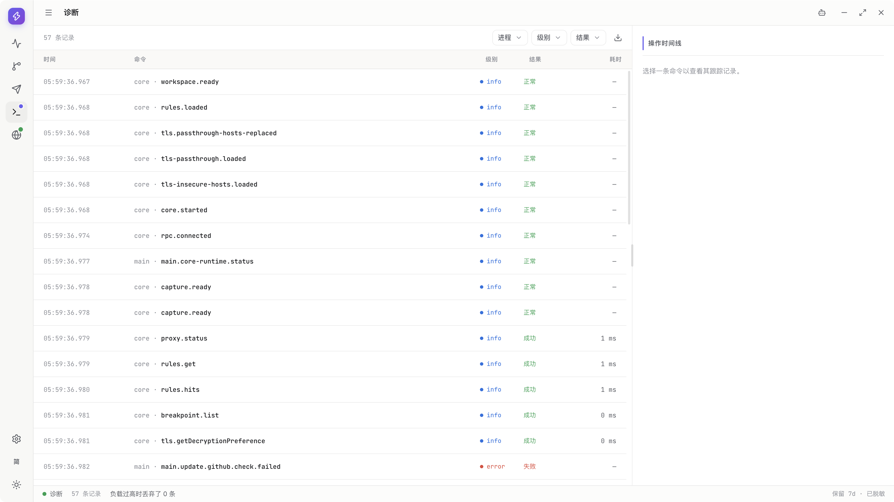
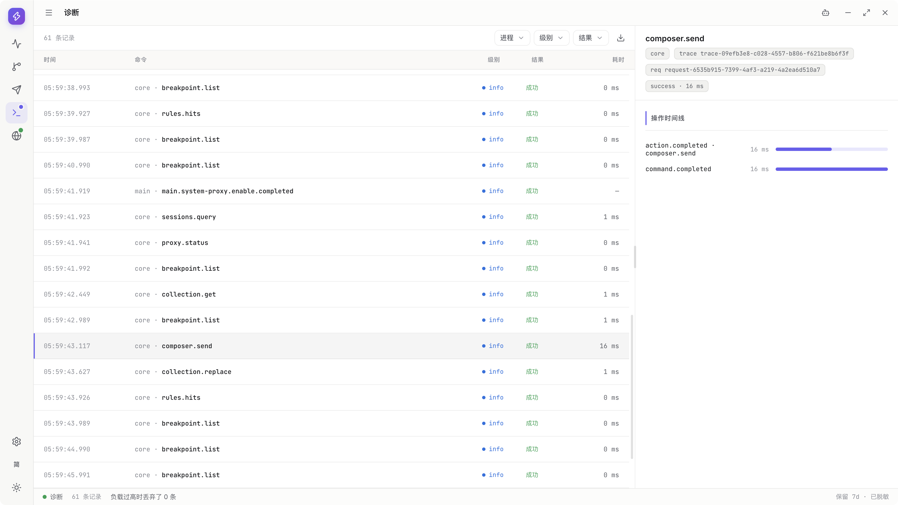
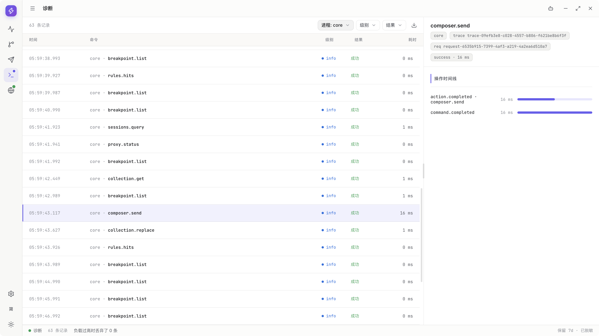
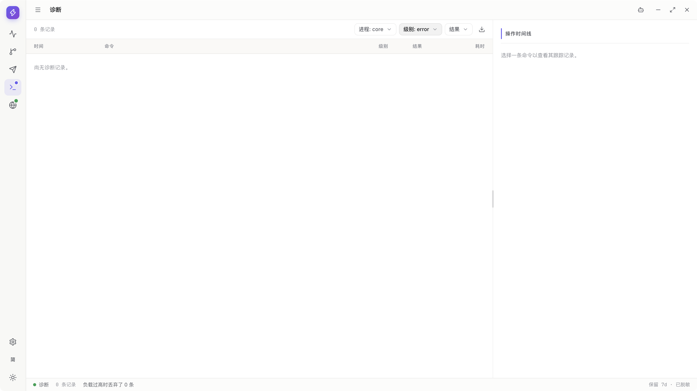
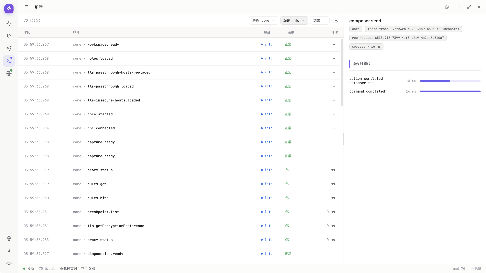
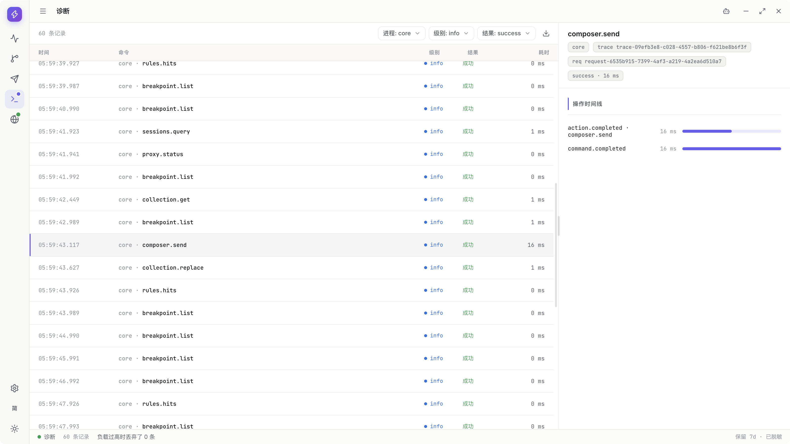
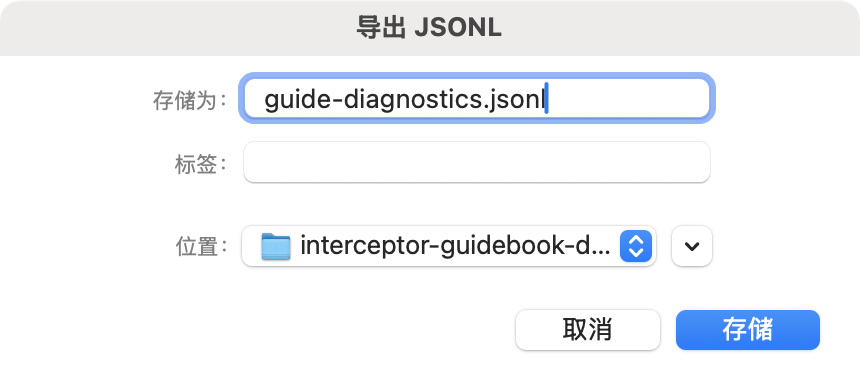
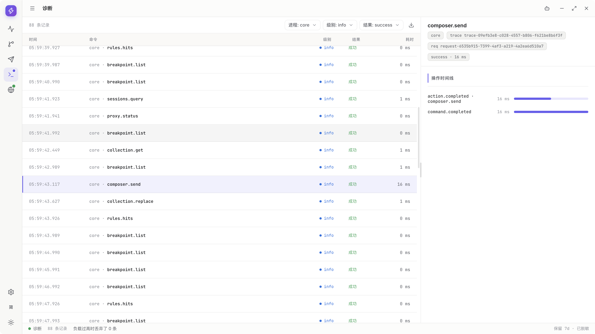

# Diagnostics: investigate runtime problems

> Draft for `v0.1.1-alpha.1`. Actual query and native JSONL export steps are illustrated; fault and Tool branches still have gaps. Neither this chapter nor item9 is complete. Diagnostics records operations, not every network frame.

[Guide directory](../README.en.md) · [Troubleshooting](troubleshooting.md)

<!-- recorded-walkthrough:start -->

## Recorded walkthrough: actual product steps

These images and video show the published <code>0.1.1-alpha.1</code> on macOS x64, retaining the App language <code>zh-CN</code>. Every recorded step has its own native-window screenshot; open an image at full size to inspect values.

Loopback addresses, ports and generated IDs belong to this recording, not a public service. Use your own authorized test environment. The actual values below match the screenshots and video. Advanced branches not shown here still need their own step images and acceptance.

| Example field | Actual recorded value |
| --- | --- |
| <code>requestUrl</code> | <code>http://127.0.0.1:54599/guide/diagnostics</code> |
| <code>method</code> | <code>GET</code> |
| <code>command</code> | <code>composer.send</code> |
| <code>process</code> | <code>core</code> |
| <code>level</code> | <code>info</code> |
| <code>outcome</code> | <code>success</code> |
| <code>fileName</code> | <code>guide-diagnostics.jsonl</code> |

<video controls preload="metadata" playsinline lang="en" src="../media/v0.1.1-alpha.1/diagnostics/diagnostics.mp4" poster="../media/v0.1.1-alpha.1/diagnostics/diagnostics-01-open.png">
<track kind="captions" srclang="zh-CN" label="Steps / 步骤" src="../media/v0.1.1-alpha.1/diagnostics/diagnostics.vtt" default>
</video>

### 01 · Open Diagnostics

[Video 00:00](../media/v0.1.1-alpha.1/diagnostics/diagnostics.mp4#t=0.423) · [Back to the video](#walkthrough-video)

### 02 · Select an actual record

[Video 00:03](../media/v0.1.1-alpha.1/diagnostics/diagnostics.mp4#t=3.322) · [Back to the video](#walkthrough-video)

### 03 · Filter by Process

[Video 00:06](../media/v0.1.1-alpha.1/diagnostics/diagnostics.mp4#t=6.133) · [Back to the video](#walkthrough-video)

### 04 · Filter by Level

[Video 00:08](../media/v0.1.1-alpha.1/diagnostics/diagnostics.mp4#t=8.993) · [Back to the video](#walkthrough-video)

### 05 · Select the info level

[Video 00:11](../media/v0.1.1-alpha.1/diagnostics/diagnostics.mp4#t=11.824) · [Back to the video](#walkthrough-video)

### 06 · Inspect successful operations

[Video 00:14](../media/v0.1.1-alpha.1/diagnostics/diagnostics.mp4#t=14.707) · [Back to the video](#walkthrough-video)

### 07 · Save guide-diagnostics.jsonl

[Video 00:28](../media/v0.1.1-alpha.1/diagnostics/diagnostics.mp4#t=28.128) · [Back to the video](#walkthrough-video)

### 08 · Verify the actual JSONL export

[Video 00:32](../media/v0.1.1-alpha.1/diagnostics/diagnostics.mp4#t=32.242) · [Back to the video](#walkthrough-video)

The complete reference follows. Only operations with matching real step images and checked input values count as illustrated acceptance.
<!-- recorded-walkthrough:end -->

## Select a record and inspect details

**Purpose:** locate a failed request send, file operation, proxy action or runtime event.

1. Note the operation and time. This reference uses the supplementary recording's successful `GET http://127.0.0.1:54599/guide/diagnostics`, command `composer.send`. `54599` is its dynamic recording port, not a public service or failed-request example.

   **Image pending:** this clip starts in Diagnostics, without the preceding Composer input/Send. A Composer image using another port cannot stand in for this operation.

2. Open Diagnostics and wait for the list to update.

   

3. Select a matching record and inspect process, command, level, outcome and duration.

   Recorded values are `core` / `composer.send` / `info` / `success`; time and duration are record-specific.

   

4. Expand related actions/timeline and distinguish start, completion, cancellation and failure.

   **Image pending:** separate related-action/timeline expansion and cancelled/failed records were not recorded. The success detail above covers only selection.

**Expected result:** connect a visible user action to actual runtime records instead of guessing from one error sentence.

**Notes:** Main, Core and Renderer are different sources. The UI does not expose every internal attribute or log complete command payloads and request bodies.

## Narrow the query

1. Select this example's `core` Process; keep all if the source is uncertain.

   

2. Use Level and observe the changed list; temporarily empty results are not necessarily missing logs.

   

3. Select this command's `info` level.

   

4. Limit Outcome to `success`.

   

5. Confirm list/selection belong to this operation; clear filters when necessary.

   **Image pending:** combined results are recorded, but clearing all filters is not.

6. Load earlier records and wait for the page to appear.

   **Image pending:** loading an older page was not recorded.

7. Resize the list/detail split and scroll through complete content.

   **Image pending:** divider dragging and scrolling longer details were not recorded.

**Expected result:** filtering changes the view, not stored records. Loading older results differs from receiving recent ones.

**Notes:** the screen is not the complete database. Tool filters follow their real schema; internal fields are not automatically UI controls.

## Distinguish failure, cancellation and unfinished work

1. Check whether the operation has reached a terminal state.

   This shows the actual `composer.send` success, not a failed, cancelled or still-running example.

   

2. Inspect the error summary and process, then verify state in the owning feature.

   **Image pending:** the available record is successful; an error summary and owning-feature round trip were not recorded.

3. For networking, inspect client/origin results; for files, task completion; for proxies, actual ownership.

   **Image pending:** these failure investigations were not individually recorded. One successful log is not every end-to-end result.

4. Do not conflate user cancellation, destination rejection, protocol errors and App failures.

   **Image pending:** contrasting terminal-state cases are missing; no errors are fabricated for illustrations.

**Expected result:** a specific investigation direction, not an assumption that one successful intermediate record means the entire operation succeeded.

**Notes:** an accepted UI intent may start an unfinished file task. A reported failure also does not prove the server received nothing.

## Export useful diagnostics

1. Reproduce the smallest authorized scenario and note time, version and OS.

   **Image pending:** this is a normal `composer.send` example on macOS x64, `0.1.1-alpha.1`, not a reproduced fault. Input/sending is outside the Diagnostics clip.

2. This example uses Process `core`, Level `info`, Outcome `success`. Adjust to your own records for an actual fault rather than filtering out the needed errors.

   

   

   

3. Use Export and save `guide-diagnostics.jsonl` in the real native dialog.

   

4. Wait for completion and inspect the output.

   

5. Review privacy, then share steps, expected behavior and the actual error.

   **Image pending:** final privacy review and issue submission were not recorded. A completed JSONL export is not permission to share it unchecked.

**Expected result:** line-delimited JSON useful for diagnosis, without sending the entire App data directory.

**Notes**

- Recording/export redaction does not eliminate every business identifier; review the final file.
- JSONL is not HAR and cannot recover missing captured bodies.
- Do not share model keys, MCP credentials, CA private keys or personal traffic.
- Starting export does not prove completion. See [file tasks](transfer.md#jobs).

## Query through Agent or MCP

1. Enable only required Diagnostics query tools.

   **Image pending:** the permissions recording uses Capture tools, not individual Diagnostics capabilities.

2. Limit the AI task to the source, time clues and operation instead of requesting unrelated history.

   **Image pending:** a Diagnostics-specific Agent/MCP instruction and query result were not recorded.

3. Distinguish current Core memory snapshots from persistent queries.

   **Image pending:** contrasting these tool results was not recorded; a UI record list cannot substitute.

4. Approve export separately and complete its native file window.

   **Image pending:** UI Export's native panel is recorded above, but Agent/MCP export approval is not; it is not the same call chain.

**Expected result:** AI receives the necessary redacted context while you choose export destinations.

**Notes:** `diagnostics_get_trace` and `diagnostics_get_recent` are current-Core snapshots, not unlimited history. The trace query has current-trace/count limits. See [Tool reference](tool-reference.md#diagnostics).

## What Diagnostics cannot prove

- Missing logs do not prove no network traffic occurred.
- It does not record every HTTP/2 frame or associate every session/stream precisely with requests. Normal records cannot reconstruct all SETTINGS, RST_STREAM or GOAWAY traffic.
- Records are not automatically discarded by a retention-days/count setting. Capture Clear is not a full Diagnostics-history deletion action.
- A hidden internal attribute is not permission for AI to infer or reconstruct it elsewhere.
