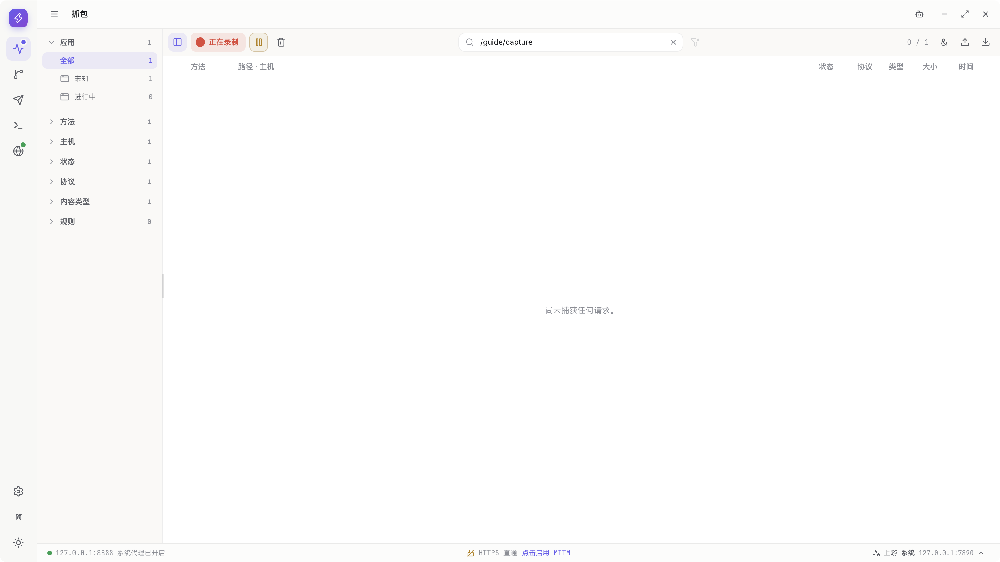
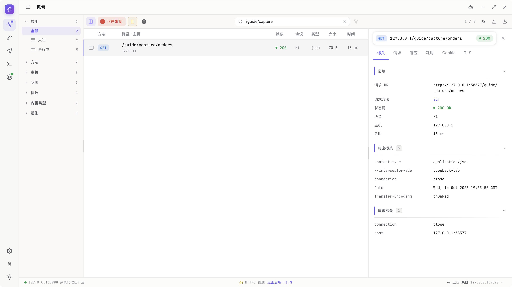
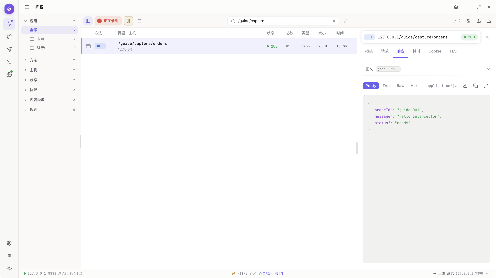
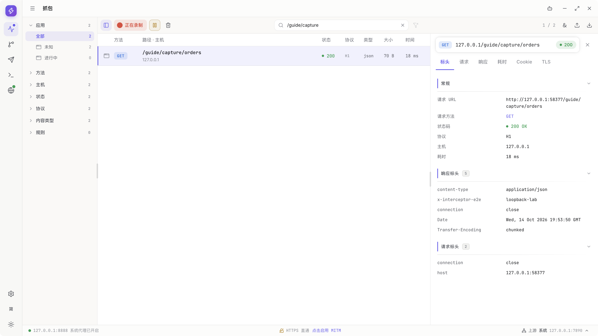
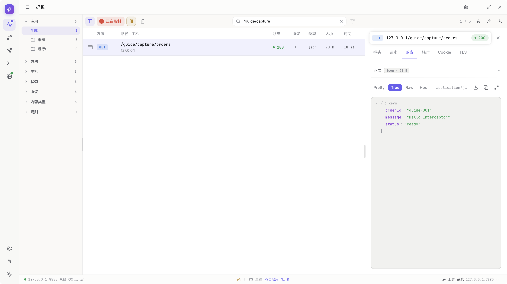
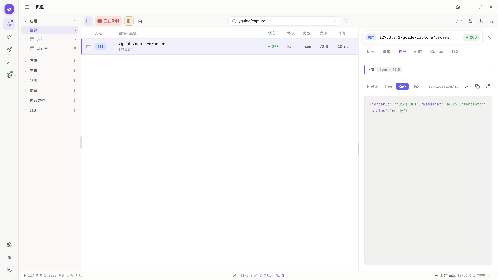
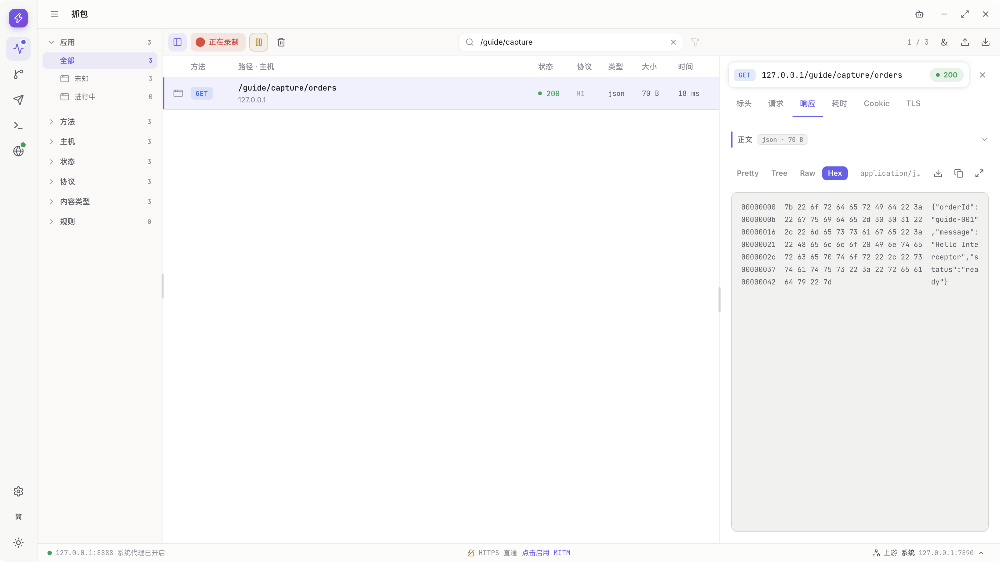

# Getting started: capture your first request

> Draft for `v0.1.1-alpha.1`. Request inspection and saving accurately reuse the owning chapters' walkthroughs. Installation, first authorization and exit recovery still need images; not all platforms or item9 are accepted.

[Guide directory](../README.en.md) · [Continue to Capture](capture.md)

<a id="先了解你要完成什么"></a>
## What you will accomplish

Send one credential-free HTTP request through Interceptor, inspect it in Capture, and quit normally.

No model API key, Rules configuration or HTTPS decryption is needed. Proxy forwarding and HTTPS decryption are separate operations.

<a id="准备应用"></a>
## Prepare the App

**Prerequisites**

- Windows or macOS, with the correct installer for your OS and architecture.
- Permission to run trusted software. Device management policies may restrict certificate or proxy changes.
- No other process using `127.0.0.1:8888`.

**Steps**

1. Open [GitHub Releases](https://github.com/zhxmt-xm/Interceptor/releases). Read the attached assets, release notes and Pre-release label. `Source code` is not an installer.

   **Image pending / blocked:** current material starts in the running release App, without a real release-download page. The private repository still requires access.

2. On macOS, select the DMG or ZIP for your CPU architecture, place the App in Applications and open it.

   **Image pending:** download, extraction/mounting, Applications placement and Gatekeeper opening were not recorded. A running App cannot demonstrate installation.

3. On Windows, select an installer or ZIP actually attached to the release. Extract a ZIP completely; do not run a lone EXE removed from its directory.

   **Image pending / blocked:** all current step images are from macOS; Windows installation/startup material is missing.

4. Read first-launch system prompts and authorize only the trusted Interceptor operation. Wait for startup preparation to finish.

   **Image pending / blocked:** the recording environment already had CA/trust state, without first authorization. Do not delete the daily-use CA to manufacture first launch.

**Expected result**

The App reaches its workspace. If startup fails, retain the error rather than repeatedly launching additional instances.

**Notes**

- The product repository is currently private. Downloads require a GitHub account with repository access; this guide does not bypass it.
- The macOS package is ad-hoc signed and not notarized; Windows installers are unsigned. Downloaded-product installation acceptance still has platform-specific gaps.
- Use the OS's normal per-application process for trusted software. Do not remove quarantine or disable system-wide protection.
- First launch may prepare shared certificates and system components. Do not delete your daily-use CA to recreate a “first launch.”
- See [Settings](settings.md#https-decryption) for system authorization, certificate trust and decryption.

<a id="确认代理与录制就绪"></a>
## Confirm proxy and recording readiness

**Purpose**

Make sure traffic can reach the proxy and Capture is recording. An open App window alone does not prove either condition.

**Steps**

1. Open Capture and inspect the Recording state and proxy readiness prompt.

   This reuses Workspace's actual Capture navigation. It shows the workspace, not a displayed or completed authorization prompt.

   

2. Startup attempts to take ownership of the system proxy. If readiness is incomplete, read the missing condition and use Enable or Proxy settings.

   **Image pending:** the readiness prompt and its Enable/Proxy settings actions were not recorded.

3. Once ready, enable Recording and confirm it before sending. This reuses Capture's actual enable action. Any native authorization must still be completed; that branch remains image pending.

   

**Expected result**

Capture can record new requests that pass through the local proxy.

**Notes**

- Cancelling readiness does not enable recording.
- Clients that follow system proxy settings use them; other clients need explicit proxy configuration.
- Pausing Recording does not restore the system proxy. It only affects recording of new traffic.
- If another proxy or network tool is already configured, inspect system and upstream settings instead of blindly overwriting it.

<a id="发出第一条-http-请求"></a>
## Send your first HTTP request

**Prerequisites**

Recording is enabled. These images accurately reuse Capture's `http://127.0.0.1:58377/guide/capture/orders`; `58377` is the recording's dynamic port, not an App constant. The App does not start that service. Substitute an already-running, authorized HTTP test service. A public HTTP address is another option, but is not this recording and needs its own result/image checks.

**Steps**

1. First search `/guide/capture` in Capture; for your own endpoint, use its corresponding Host/Path text.

   

2. Request that address through the explicit proxy in a terminal. These commands reproduce the same GET; the recording does not show terminal input.

   macOS:

   ```sh
   curl --proxy http://127.0.0.1:8888 --max-time 20 "http://127.0.0.1:58377/guide/capture/orders"
   ```

   Windows PowerShell:

   ```powershell
   curl.exe --proxy http://127.0.0.1:8888 --max-time 20 "http://127.0.0.1:58377/guide/capture/orders"
   ```

   **Image pending:** neither macOS terminal input nor Windows PowerShell was recorded. The next image shows Capture receiving the request, not terminal operation.

3. Return to Capture and wait for the new GET.

   

4. Select orders; check Host `127.0.0.1` and Path `/guide/capture/orders`.

   

5. Open Response and check `orderId: guide-001`, `message: Hello Interceptor` and `status: ready`. Other services determine their own status; capture success does not require `200`.

   

**Expected result**

You can find and inspect the GET request. An HTTP error response may still have been captured correctly. A connection failure needs investigation based on the actual error.

**Notes**

- This example sends no login information, does not disable TLS checks and does not modify server data.
- Check `NO_PROXY` or other bypass configuration if the terminal does not use the requested proxy.
- For an offline exercise, use your own running HTTP service. The guide does not create an invisible test server.
- Composer sends directly and does not automatically create Capture records, so this example uses an external client.

<a id="读懂这条请求"></a>
## Understand the request

**Steps**

1. Inspect the URL, method, status and protocol in the selected request's details.

   

2. Open Headers and inspect request and response headers. Expand collapsed sections as needed.

   

3. Open the JSON Response. Other MIME types offer Code, Text and other modes; this JSON is not HTML.

   

4. Select Tree to inspect field structure.

   

5. Select Raw for the original text.

   

6. Open the body's fullscreen view.

   

7. Press Escape to return.

   

8. Select Hex for bytes.

   

**Expected result**

You can distinguish what the client requested from what the destination returned.

**Notes**

Available modes depend on content type. HTML shown as source code is not an error and is not executed as a webpage.

<a id="保存需要的记录并正常退出"></a>
## Save important records and quit normally

**Steps**

These save images belong to the separate [Transfer recording](transfer.md), request `http://127.0.0.1:55059/guide/transfer/order`. `55059` is also recording-assigned. They do not claim the Capture request above was automatically exported. Select your own intended traffic when following the steps.

1. Open Capture Export.

   

2. Choose HAR for HTTP interchange. For more native traffic detail, follow [Native Archive](transfer.md#archive) separately.

   

3. Inspect scope; this example selects its current demo request.

   

4. Review body/privacy options.

   

5. Save `guide-recording.har` in the real native panel.

   

6. Wait for completion before preparing to close.

   

7. Close the App normally and wait for system operations/proxy recovery; if busy, wait before closing again.

   **Image pending:** App Close, process exit and system-proxy recovery have no step images here. Completed export or closing Agent does not verify App shutdown.

**Expected result**

Important records are saved to your chosen file, and the App handles its owned proxy settings during normal shutdown.

**Notes**

- Capture is temporary data belonging to the current Core process. Quitting or restarting Core releases it.
- Normal shutdown does not remove the shared CA. Decryption, proxy restoration and certificate trust are separate controls.
- If another application changes the proxy during the session, Interceptor must not overwrite that application's new settings.
- Do not force-kill the App instead of closing it normally.
- See [Import and export](transfer.md) for formats and cancellation, and [Proxy recovery](troubleshooting.md#proxy-recovery) if networking remains incorrect.

<a id="没有看到请求时"></a>
## If the request is missing

- Check Recording and unresolved readiness prompts.
- Clear search and filter conditions, not the captured records themselves.
- Check the client's proxy host, port and bypass rules.
- Confirm a request was actually sent and inspect terminal DNS/connection errors.
- An HTTPS TLS tunnel means “proxied but not decrypted,” which differs from traffic not reaching the proxy.

Next: [find, inspect and save traffic in Capture](capture.md).
