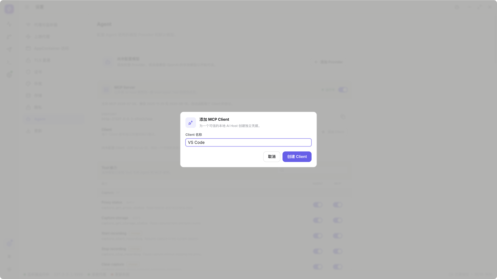
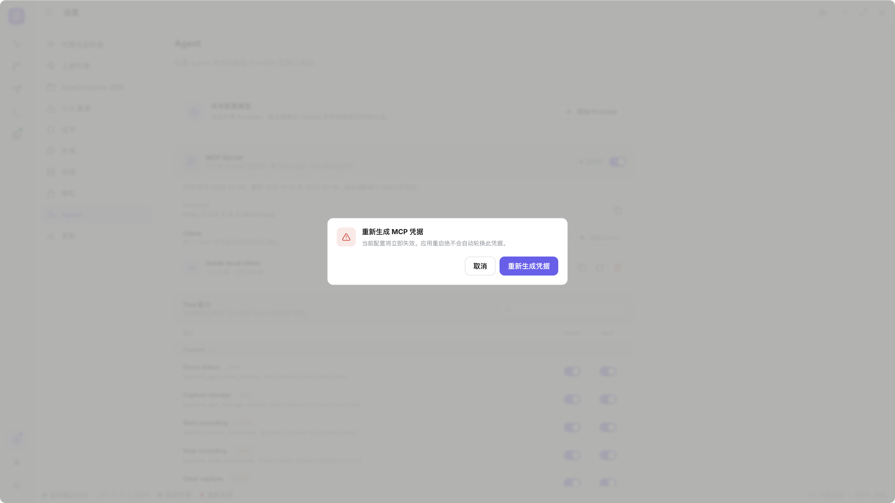
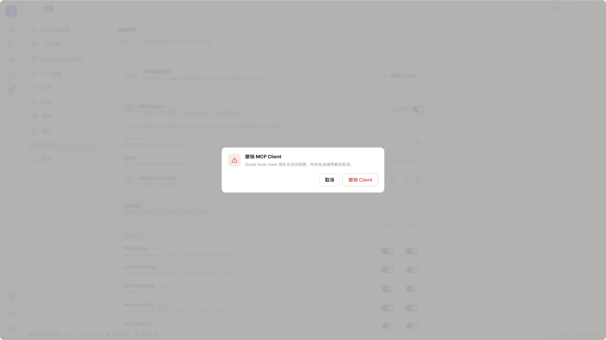
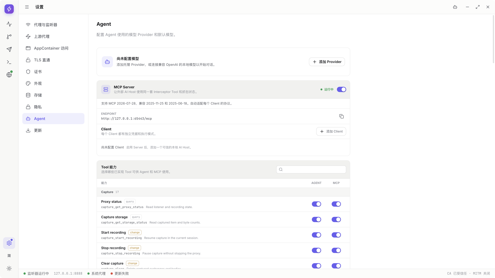
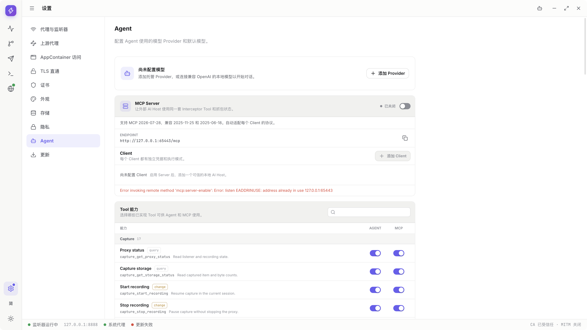
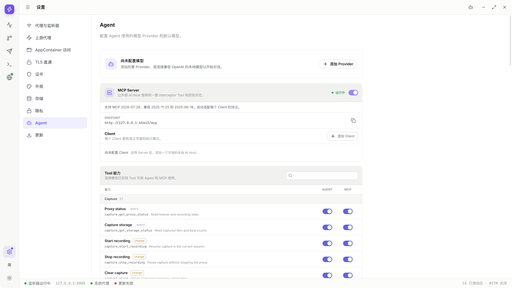
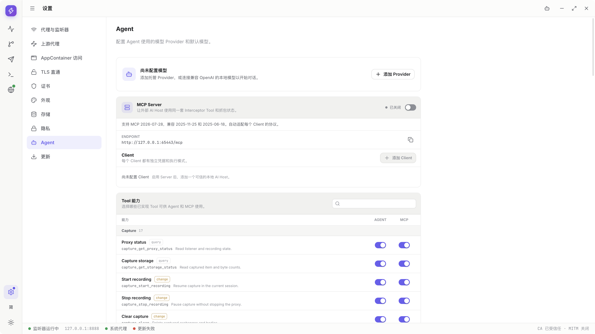
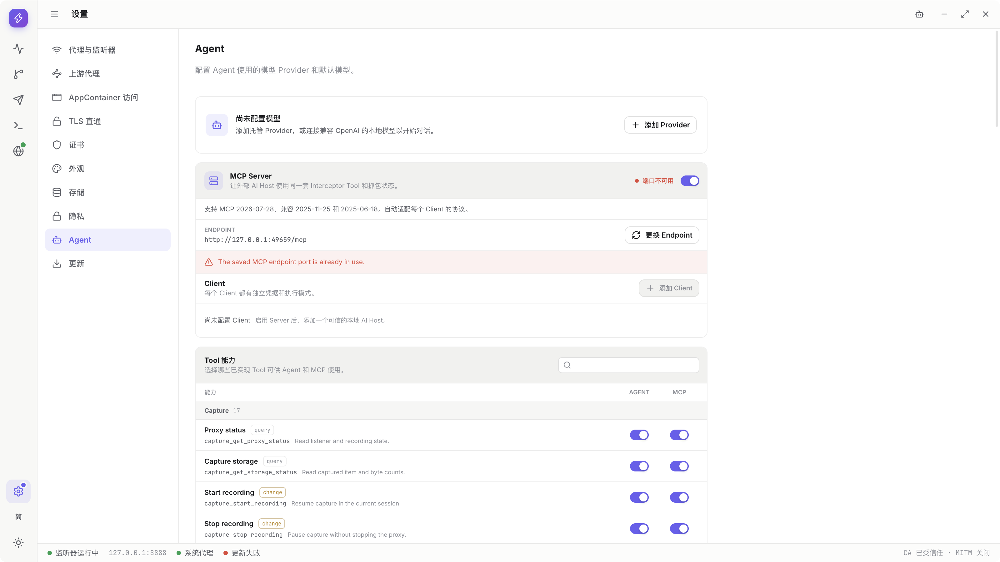

# MCP: connect an external AI host

> Draft for `v0.1.1-alpha.1`; local SDK, credential rotation and both port-conflict paths have real step images. Host-specific configuration still has gaps; neither this chapter nor item9 is complete. Protocol support is not universal host compatibility.

[Guide directory](../README.en.md) · [Permissions](tool-permissions.md) · [Tool reference](tool-reference.md)

<!-- recorded-walkthrough:start -->

## Recorded walkthrough: actual product steps

These images and video show the published <code>0.1.1-alpha.1</code> on macOS x64, retaining the App language <code>zh-CN</code>. Every recorded step has its own native-window screenshot; open an image at full size to inspect values.

Loopback addresses, ports and generated IDs belong to this recording, not a public service. Use your own authorized test environment. The actual values below match the screenshots and video. Advanced branches not shown here still need their own step images and acceptance.

> The caller is a local official-SDK demonstration client, not proof of VS Code or cloud-host compatibility. Credentials are not shown in the images or video; copied configuration is used only in local test memory.

| Example field | Actual recorded value |
| --- | --- |
| <code>clientName</code> | <code>Guide local client</code> |
| <code>endpoint</code> | <code>http://127.0.0.1:65443/mcp</code> |
| <code>endpointChanged</code> | <code>false</code> |
| <code>caller</code> | <code>official SDK local demonstration; not a VS Code or cloud-host compatibility claim</code> |

<video controls preload="metadata" playsinline lang="en" src="../media/v0.1.1-alpha.1/mcp/mcp.mp4" poster="../media/v0.1.1-alpha.1/mcp/mcp-01-settings.png">
<track kind="captions" srclang="zh-CN" label="Steps / 步骤" src="../media/v0.1.1-alpha.1/mcp/mcp.vtt" default>
</video>

### 01 · Open Settings

[Video 00:00](../media/v0.1.1-alpha.1/mcp/mcp.mp4#t=0.421) · [Back to the video](#walkthrough-video)

### 02 · Find MCP Server

[Video 00:03](../media/v0.1.1-alpha.1/mcp/mcp.mp4#t=3.275) · [Back to the video](#walkthrough-video)

### 03 · Enable the local MCP Server

[Video 00:06](../media/v0.1.1-alpha.1/mcp/mcp.mp4#t=6.417) · [Back to the video](#walkthrough-video)

### 04 · Add a separate Client

[Video 00:09](../media/v0.1.1-alpha.1/mcp/mcp.mp4#t=9.327) · [Back to the video](#walkthrough-video)

### 05 · Name the Client

[Video 00:12](../media/v0.1.1-alpha.1/mcp/mcp.mp4#t=12.266) · [Back to the video](#walkthrough-video)

### 06 · Create the Client

[Video 00:15](../media/v0.1.1-alpha.1/mcp/mcp.mp4#t=15.117) · [Back to the video](#walkthrough-video)

### 07 · Copy configuration without displaying credentials

[Video 00:18](../media/v0.1.1-alpha.1/mcp/mcp.mp4#t=18.067) · [Back to the video](#walkthrough-video)

### 08 · Connect the demo client and query

[Video 00:21](../media/v0.1.1-alpha.1/mcp/mcp.mp4#t=21.368) · [Back to the video](#walkthrough-video)

### 09 · Request an operation requiring approval

[Video 00:24](../media/v0.1.1-alpha.1/mcp/mcp.mp4#t=24.367) · [Back to the video](#walkthrough-video)

### 10 · Deny the operation

[Video 00:27](../media/v0.1.1-alpha.1/mcp/mcp.mp4#t=27.278) · [Back to the video](#walkthrough-video)

### 11 · Request again and review effects

[Video 00:30](../media/v0.1.1-alpha.1/mcp/mcp.mp4#t=30.168) · [Back to the video](#walkthrough-video)

### 12 · Allow pausing Recording

[Video 00:33](../media/v0.1.1-alpha.1/mcp/mcp.mp4#t=33.017) · [Back to the video](#walkthrough-video)

### 13 · Inspect Client Auto mode

[Video 00:35](../media/v0.1.1-alpha.1/mcp/mcp.mp4#t=35.917) · [Back to the video](#walkthrough-video)

### 14 · Restore Client Ask

[Video 00:38](../media/v0.1.1-alpha.1/mcp/mcp.mp4#t=38.868) · [Back to the video](#walkthrough-video)

### 15 · Review credential rotation

[Video 00:41](../media/v0.1.1-alpha.1/mcp/mcp.mp4#t=41.716) · [Back to the video](#walkthrough-video)

### 16 · Rotate and verify old configuration is rejected

[Video 00:44](../media/v0.1.1-alpha.1/mcp/mcp.mp4#t=44.618) · [Back to the video](#walkthrough-video)

### 17 · Copy new configuration and reconnect

[Video 00:47](../media/v0.1.1-alpha.1/mcp/mcp.mp4#t=47.568) · [Back to the video](#walkthrough-video)

### 18 · Review Client revocation

[Video 00:50](../media/v0.1.1-alpha.1/mcp/mcp.mp4#t=50.666) · [Back to the video](#walkthrough-video)

### 19 · Revoke the demo Client

[Video 00:53](../media/v0.1.1-alpha.1/mcp/mcp.mp4#t=53.568) · [Back to the video](#walkthrough-video)

### 20 · Disable MCP Server

[Video 00:56](../media/v0.1.1-alpha.1/mcp/mcp.mp4#t=56.468) · [Back to the video](#walkthrough-video)

### 21 · Observe an endpoint conflict

[Video 00:59](../media/v0.1.1-alpha.1/mcp/mcp.mp4#t=59.418) · [Back to the video](#walkthrough-video)

### 22 · Retry after ending the known port owner

[Video 01:02](../media/v0.1.1-alpha.1/mcp/mcp.mp4#t=62.368) · [Back to the video](#walkthrough-video)

### 23 · Finish by disabling the Server

[Video 01:05](../media/v0.1.1-alpha.1/mcp/mcp.mp4#t=65.319) · [Back to the video](#walkthrough-video)

The complete reference follows. Only operations with matching real step images and checked input values count as illustrated acceptance.
<!-- recorded-walkthrough:end -->

## Check the prerequisites

- Interceptor runs locally and MCP Server is enabled.
- The host can reach the local loopback Streamable HTTP endpoint.
- Supported protocols are `2025-06-18`, `2025-11-25`, `2026-07-28`; host/SDK negotiation is automatic.
- Do not substitute `stdio` or legacy HTTP+SSE configuration.
- The external host owns its model setup; an internal Agent model is not required.

A cloud-originated connector cannot access your computer's `127.0.0.1`. Supporting MCP alone does not make your loopback endpoint reachable from the cloud.

## Enable the server

1. Open Settings.

   

2. Open Agent, find MCP Server and read protocol support.

   

3. Enable, wait for Running and inspect the endpoint. This recording uses `http://127.0.0.1:65443/mcp`; `65443` is recording-assigned, not fixed. Check `127.0.0.1` and `/mcp`, not Capture's `8888`.

   

**Expected result:** first enable selects an available port; later starts retain the saved endpoint.

**Notes:** the service does not listen on LAN/public interfaces or remain as an independent background service after App exit.

## Create one client per host

The caller here is a local official-SDK demonstration, not VS Code, Claude or a cloud host. Its Client is explicitly named `Guide local client`.

1. Add a Client in the management area.

   

2. Enter `Guide local client`.

   

3. Create the Client and keep Ask initially.

   

4. Copy configuration through the product action without exposing its authentication fields.

   

5. In the real host's user-level settings, add an HTTP server using the copied endpoint/authentication fields in its required format.

   **Image pending / blocked:** the SDK demonstration has no commercial host settings page. App copy success is not host configuration success.

6. Connect, discover tools and perform a read-only proxy-status query. This is the actual local SDK checkpoint; real host discovery UI remains image pending.

   

**Expected result:** the host can use enabled tools through its own client identity.

**Notes**

- The copied snippet is not necessarily the entire configuration file for every host.
- It contains credentials. Keep it in user-level secure configuration, not a project, chat, public screenshot or Settings Sync.
- Copy success and successful authentication are distinct.
- Independent hosts should not share a client identity and credentials.

## Request a change from the host

1. Enable the Tool in the MCP column, not merely Agent.

   **Image pending:** the permissions chapter demonstrates `capture_clear` switches; this pause uses `capture_stop_recording`, whose individual enabling was not recorded.

2. Ask `Guide local client` to pause new recording. In Ask, inspect caller, Tool, arguments and effects in the App. This is the SDK caller, not a commercial host conversation.

   

3. Deny the first call.

   

4. Request again and inspect the new approval rather than reusing the old decision.

   

5. Allow and inspect the call result and product Recording state.

   

6. Other operations may still need native file/system prompts before success.

   **Image pending:** Pause needs neither. Manual Export or another platform's dialog does not demonstrate an MCP approval continuation.

**Expected result:** the App enforces its own authorization even if the external host considers the operation approved.

**Notes:** a host can also have its own approval layer. Auto skips per-call App approval for enabled change tools, not native file dialogs or UAC.

## Resolve an endpoint conflict

Read these as two separate paths: steps 1–4 are runtime manual Enable failure/retry; steps 5–11 are a saved-port conflict after a different normal restart. Ports belong to their own recording environments. You do not need to create a conflict.

1. When manual Enable fails, inspect `EADDRINUSE`; the service remains disabled.

   

2. Identify a known old App or owned service; never blindly terminate an unknown process.

   **Image pending:** the recording used an owned conflict process, without a separate OS process-identification window.

3. End the confirmed owned conflict and retry Enable without changing the endpoint. This shows the App retry result; ending the other process itself remains image pending.

   

4. Disable the demonstration Server afterward.

   

5. The other path starts with MCP saved enabled and its port occupied by an owned demo process during normal App restart. Open Settings afterward.

   

6. Inspect `endpoint-conflict`. This old endpoint is `http://127.0.0.1:49659/mcp`, not the earlier `65443`.

   

7. Explicitly choose Change endpoint when a new address is needed.

   

8. Inspect the new `http://127.0.0.1:49835/mcp`. Both `49659` and `49835` are values assigned for this recording.

   

9. Copy effective configurations and update each affected host.

   **Image pending / blocked:** real host configuration after this endpoint change was not recorded. Credential-rotation copying is a different operation.

10. Reconnect the host and repeat a read-only query.

    **Image pending:** this restart clip did not query the new endpoint. A query to an old endpoint is not proof.

11. Disable this demonstration Server afterward.

    

**Expected result:** address changes are deliberate, not hidden changes that invalidate existing clients.

**Notes:** normal disable/enable/restart should not require creating a Client again. An explicit endpoint change does require host updates.

**Actual branches in this release:** a manual enable attempt on an occupied port remains disabled and shows `EADDRINUSE`; end the known, owned conflicting process and retry. If MCP was previously saved as enabled and the port is occupied during App startup, it shows `endpoint-conflict` with Change endpoint. See the separate [runtime failure/retry recording](#walkthrough-video) and [restart recovery recording](#walkthrough-mcp-endpoint-video); do not assume their controls are identical.

## Rotate, revoke and disable

1. Open the credential-regeneration confirmation if a Client's configuration may have leaked. This target is `Guide local client`.

   

2. Confirm rotation; old credentials become invalid. Neither old nor new secrets are published here.

   

3. Copy the new configuration, update the caller and reconnect. This covers the same local SDK client; commercial host settings remain image pending.

   

4. When no longer needed, open Revoke and check the Client name.

   

5. Confirm revocation and check the identity is unusable. Cancellation of long in-flight calls was not separately recorded and remains image pending.

   

6. Disable MCP Server when no caller needs it.

   

7. Quit normally and let calls and listeners finish cleanup.

   **Image pending:** disabling Server is not quitting the App; this clip has no shutdown/process-cleanup images.

**Expected result:** rotation invalidates old credentials; revoke targets one client; disable stops all MCP access.

**Notes:** cancellation/revocation does not undo a completed file write, request or setting change. Inspect actual state before replaying side effects.

## Browser hosts and compatibility

1. Confirm the browser-side client runs on your device rather than through a remote connector.

   **Image pending / blocked:** this caller is a local SDK, not a Browser Host; deployment/reachability inspection is missing.

2. Use only a deliberately trusted page and provide only its authorized Client credentials.

   **Image pending / blocked:** there is no real Browser Host security-settings page. Credentials are not exposed to fill the gap.

3. If discovery is empty, inspect Server, identity, protocol and MCP permissions.

   **Image pending:** an actual Browser Host's empty-discovery investigation was not recorded.

4. If queries work but changes wait, check App approval, native windows and business prerequisites.

   **Image pending:** SDK Ask images only demonstrate App approval. That Browser Host's wait/native-window scenario was not recorded.

5. After host upgrades, verify a real query/action rather than only seeing a registered server entry.

   **Image pending / blocked:** no specific host before/after-upgrade operation is recorded. Local SDK success is not wider compatibility acceptance.

**Expected result:** network, authentication, protocol, permissions and business errors are distinguished.

**Notes**

- Cross-Origin browser support is not anonymous access.
- Do not give client credentials to arbitrary third-party webpages.
- The guide does not require internal Playground or claim that SDK-client checks certify all real VS Code/Claude/other hosts.
- Existing representative host results do not prove every Tool, two-host concurrency or every host version.

<!-- recorded-walkthrough:mcp-endpoint:start -->

## Recorded walkthrough: recover the endpoint after restart

These images and video show the published <code>0.1.1-alpha.1</code> on macOS x64, retaining the App language <code>zh-CN</code>. Every recorded step has its own native-window screenshot; open an image at full size to inspect values.

Loopback addresses, ports and generated IDs belong to this recording, not a public service. Use your own authorized test environment. The actual values below match the screenshots and video. Advanced branches not shown here still need their own step images and acceptance.

> The caller is a local official-SDK demonstration client, not proof of VS Code or cloud-host compatibility. Credentials are not shown in the images or video; copied configuration is used only in local test memory.

| Example field | Actual recorded value |
| --- | --- |
| <code>oldEndpoint</code> | <code>http://127.0.0.1:49659/mcp</code> |
| <code>newEndpoint</code> | <code>http://127.0.0.1:49835/mcp</code> |
| <code>prerequisite</code> | <code>MCP was enabled before normal App restart; its saved port was occupied by an owned demo process</code> |

<video controls preload="metadata" playsinline lang="en" src="../media/v0.1.1-alpha.1/mcp-endpoint/mcp-endpoint.mp4" poster="../media/v0.1.1-alpha.1/mcp-endpoint/mcp-endpoint-01-settings.png">
<track kind="captions" srclang="zh-CN" label="Steps / 步骤" src="../media/v0.1.1-alpha.1/mcp-endpoint/mcp-endpoint.vtt" default>
</video>

### 01 · Open Settings after restart

[Video 00:00](../media/v0.1.1-alpha.1/mcp-endpoint/mcp-endpoint.mp4#t=0.414) · [Back to the video](#walkthrough-mcp-endpoint-video)

### 02 · Inspect the saved endpoint conflict

[Video 00:03](../media/v0.1.1-alpha.1/mcp-endpoint/mcp-endpoint.mp4#t=3.262) · [Back to the video](#walkthrough-mcp-endpoint-video)

### 03 · Explicitly change the endpoint

[Video 00:06](../media/v0.1.1-alpha.1/mcp-endpoint/mcp-endpoint.mp4#t=6.461) · [Back to the video](#walkthrough-mcp-endpoint-video)

### 04 · Inspect the address that hosts must update

[Video 00:09](../media/v0.1.1-alpha.1/mcp-endpoint/mcp-endpoint.mp4#t=9.360) · [Back to the video](#walkthrough-mcp-endpoint-video)

### 05 · Disable the demonstration Server

[Video 00:12](../media/v0.1.1-alpha.1/mcp-endpoint/mcp-endpoint.mp4#t=12.261) · [Back to the video](#walkthrough-mcp-endpoint-video)

The complete reference follows. Only operations with matching real step images and checked input values count as illustrated acceptance.
<!-- recorded-walkthrough:mcp-endpoint:end -->
