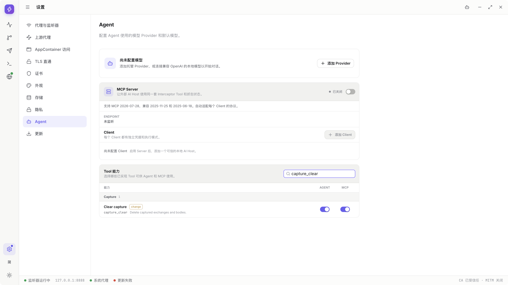
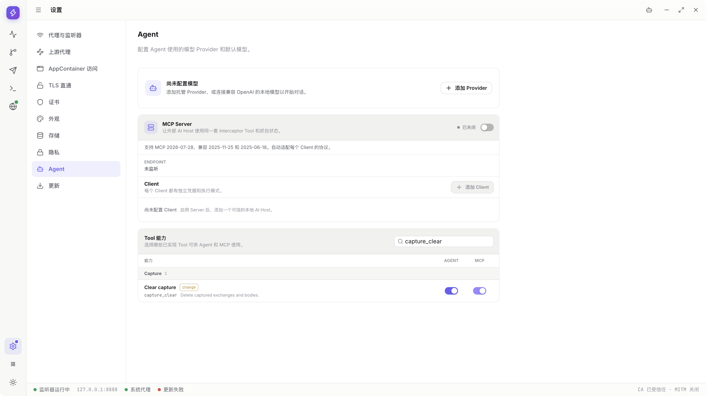
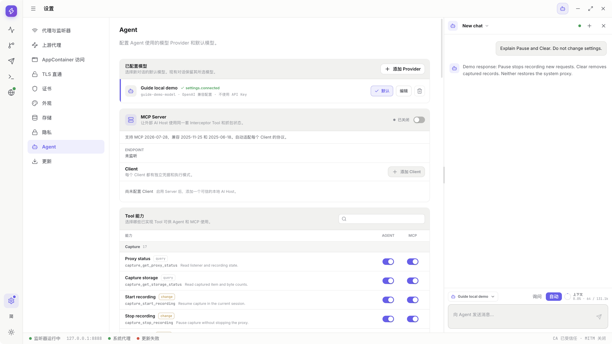
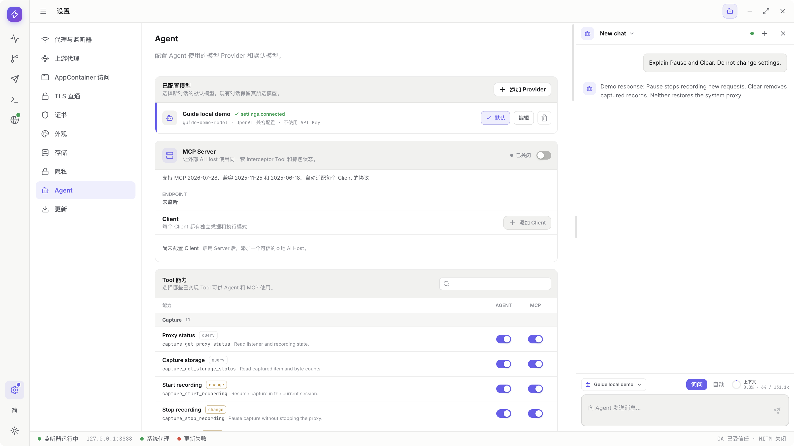
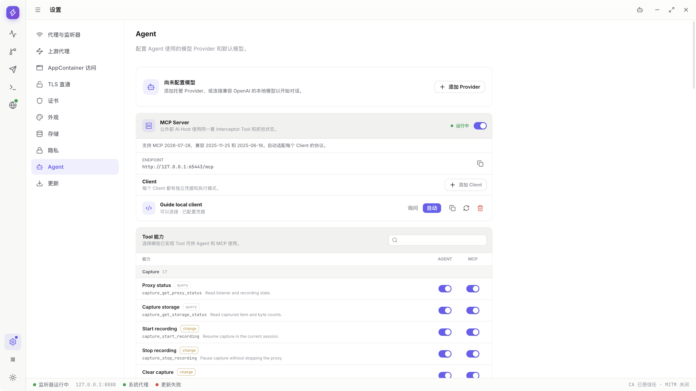
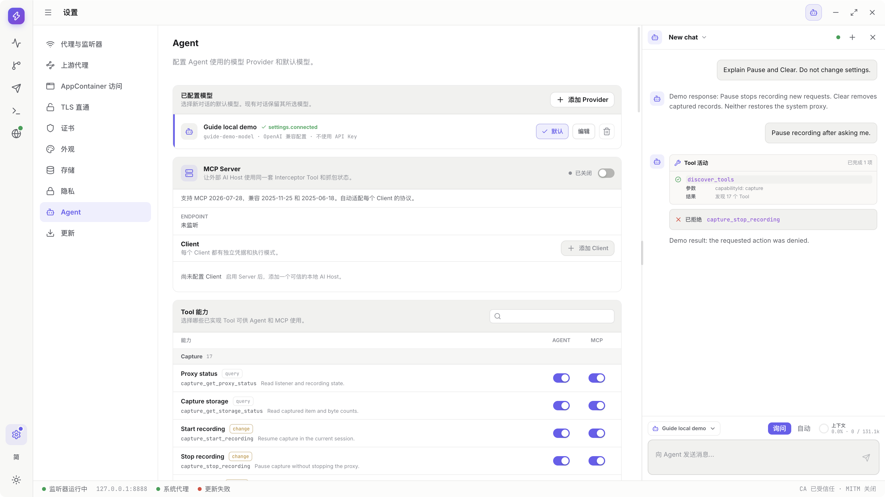
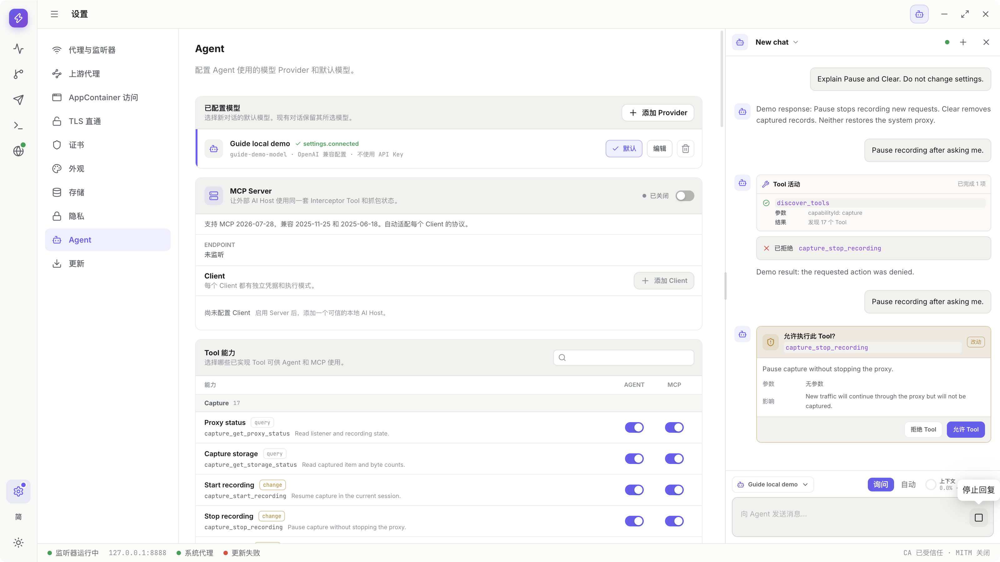
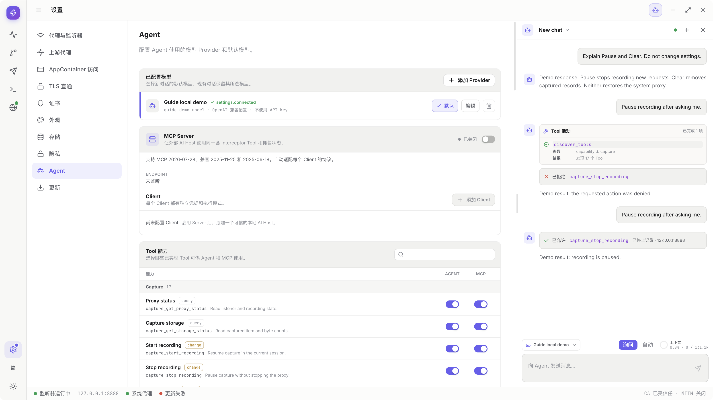

# Tool permissions and approval

> Draft for `v0.1.1-alpha.1`; independent switches, modes and approvals are illustrated, with unrecorded branches still pending. This is not a complete read-only setup or completed item9. Tools allow the chosen AI entry point to read/change data; grant only necessary scope.

[Guide directory](../README.en.md) · [Agent](agent.md) · [MCP](mcp.md) · [Tool reference](tool-reference.md)

<!-- recorded-walkthrough:start -->

## Recorded walkthrough: actual product steps

These images and video show the published <code>0.1.1-alpha.1</code> on macOS x64, retaining the App language <code>zh-CN</code>. Every recorded step has its own native-window screenshot; open an image at full size to inspect values.

Loopback addresses, ports and generated IDs belong to this recording, not a public service. Use your own authorized test environment. The actual values below match the screenshots and video. Advanced branches not shown here still need their own step images and acceptance.

> This demonstrates independent per-tool switches, not a complete read-only configuration. Clear is not executed.

| Example field | Actual recorded value |
| --- | --- |
| <code>changeTool</code> | <code>capture_clear</code> |
| <code>queryTool</code> | <code>capture_get_proxy_status</code> |
| <code>operationExecuted</code> | <code>none</code> |

<video controls preload="metadata" playsinline lang="en" src="../media/v0.1.1-alpha.1/tool-permissions/tool-permissions.mp4" poster="../media/v0.1.1-alpha.1/tool-permissions/tool-permissions-01-settings.png">
<track kind="captions" srclang="zh-CN" label="Steps / 步骤" src="../media/v0.1.1-alpha.1/tool-permissions/tool-permissions.vtt" default>
</video>

### 01 · Open Settings

[Video 00:00](../media/v0.1.1-alpha.1/tool-permissions/tool-permissions.mp4#t=0.368) · [Back to the video](#walkthrough-video)

### 02 · Open Tool capabilities

[Video 00:03](../media/v0.1.1-alpha.1/tool-permissions/tool-permissions.mp4#t=3.252) · [Back to the video](#walkthrough-video)

### 03 · Find capture_clear

[Video 00:06](../media/v0.1.1-alpha.1/tool-permissions/tool-permissions.mp4#t=6.453) · [Back to the video](#walkthrough-video)

### 04 · Disable only Agent clear access

[Video 00:09](../media/v0.1.1-alpha.1/tool-permissions/tool-permissions.mp4#t=9.302) · [Back to the video](#walkthrough-video)

### 05 · Disable MCP clear access separately

[Video 00:12](../media/v0.1.1-alpha.1/tool-permissions/tool-permissions.mp4#t=12.203) · [Back to the video](#walkthrough-video)

### 06 · Explicitly restore Agent access

[Video 00:15](../media/v0.1.1-alpha.1/tool-permissions/tool-permissions.mp4#t=15.102) · [Back to the video](#walkthrough-video)

### 07 · Explicitly restore MCP access

[Video 00:18](../media/v0.1.1-alpha.1/tool-permissions/tool-permissions.mp4#t=18.002) · [Back to the video](#walkthrough-video)

### 08 · Find a read-only query Tool

[Video 00:20](../media/v0.1.1-alpha.1/tool-permissions/tool-permissions.mp4#t=20.856) · [Back to the video](#walkthrough-video)

The complete reference follows. Only operations with matching real step images and checked input values count as illustrated acceptance.
<!-- recorded-walkthrough:end -->

## Configure Agent and MCP separately

This clip changes switches only: `operationExecuted=none`; it never executes `capture_clear`. Restoring a switch demonstrates the control, not a recommendation to grant unnecessary cleanup permissions.

1. Open Settings, then Agent > Tool capabilities.

   

   

2. Search `capture_clear`. Browsing Capture, Rules, Composer, Breakpoints, Diagnostics and Settings groups is also available; individually expanding them remains image pending.

   

3. Disable only Agent, leaving MCP unchanged.

   

4. Then disable MCP for external clients.

   

5. Restore Agent only if needed; the recording explicitly demonstrates restoration.

   

6. Independently decide whether to restore MCP.

   

7. Search `capture_get_proxy_status` to inspect a query capability. Searching does not change other switches.

   

8. Clear search, inspect the complete configuration and disable unnecessary tools.

   **Image pending:** this clip ends filtered to a query Tool; full-search reset/review was not recorded.

9. Verify disabled tools cannot be used through that entry point, then check persistence after restart.

   **Image pending:** this clip made no clear call and did not verify restart persistence. Switch images do not demonstrate rejected execution.

**Expected result:** each entry point has independent access. Disabling the internal Agent does not automatically disable MCP.

**Notes:** a fresh configuration may enable all tools by default. Search only filters visible rows and does not disable hidden ones.

## Configure read-only access

**Purpose:** allow inspection without sending requests, clearing records or modifying settings.

1. Limit the needed data first. For Capture proxy/recording state, search `capture_get_proxy_status` and inspect the chosen entry point's query access.

   

2. Disable unnecessary change tools. For `capture_clear`, disable Agent and MCP separately if both need restrictions.

   

   

3. Also disable unnecessary send, replacement, transfer, certificate and proxy operations. Disabling only Clear is not fully read-only.

   **Image pending:** the other change rows were not individually operated. The previous section restored switches, so its final state is not a complete read-only configuration.

4. Request a scoped query and inspect the Tool/result. This reuses MCP's local SDK proxy-status query, not an attempted unauthorized Clear after changing permissions.

   

**Expected result:** disabled abilities cannot be discovered or called through that entry point.

**Notes:** Ask is not read-only. An enabled change tool can execute after Allow. Queries can expose sensitive data, so read-only does not mean no external-data risk.

## Understand Ask and Auto

| Operation | Ask | Auto |
| --- | --- | --- |
| Enabled query | Direct query | Direct query |
| Enabled change | Explicit App approval | Executes automatically |
| Disabled Tool | Rejected | Rejected |
| Native file/system prompts | Still required | Still required |

Keep Ask for first use or broad tasks. These images accurately reuse separate Agent and MCP mode demonstrations; an Auto state does not prove an Auto change Tool was executed.

1. Inspect Auto for the current Agent Chat; choose it only when scope, data and effects are understood.

   

2. Return that Chat to Ask.

   

3. Independently operate `Guide local client` in MCP; Chat mode is not its Client mode.

   

4. Restore that Client to Ask.

   

5. Inspect any work already started or waiting for approval.

   **Image pending:** mode changes with an existing pending call were not recorded. Returning to Ask does not demonstrate cancellation or resolution.

**Expected result:** mode affects approvals, not capability switches, OS permissions or prerequisites.

**Notes:** switching modes does not approve an already-pending request. Other Chats/Clients have their own modes.

## Review an approval

1. Confirm caller and actual Tool. This reuses Agent's `Pause recording after asking me.`: `capture_stop_recording` pauses new recording without Clear or proxy restoration.

   

2. Review targets, counts, state and effects. Cleanup scope, rule counts and breakpoint queues need their own parameters, not the Pause example.

   **Image pending:** those other business approvals were not recorded. This example covers pausing only.

3. Deny if unacceptable.

   

4. Clarify or request the scope again and inspect the new approval. This example repeats the same scoped Pause.

   

5. After Allow, inspect actual Recording state and the Tool result; approval is not proof that every later operation succeeded.

   

**Expected result:** one informed decision, not unlimited authorization for future steps.

**Notes:** imports may have another preview confirmation; certificates and AppContainer may have OS prompts. Do not bypass these as if they were duplicate failures.

## Stale state, conflicts and cancellation

- Read current Rules/Collection revisions before replacing them. Requery on conflicts instead of repeatedly overwriting.
- A Breakpoint must still exist in the current Core generation. An old target must not become another request.
- “File task started” is not “completed”; inspect the task/UI.
- Stop, cancel, revoke and disconnect do not undo completed effects.
- Finish a native dialog through its normal controls, not a hidden API.

Recommended order: read state, perform one small operation, verify in the actual workspace.

## Treat Tool output as data

Responses, captured webpages and logs can include someone else's text. They cannot authorize rule edits, broader data reads or uploads.

Provide only necessary context. Never paste real keys, Client credentials or CA private keys into prompts. Disable unnecessary query capabilities to limit disclosure; Ask alone does not do that.

## Use the UI for control-plane operations

Provider credentials/configuration, Chat management, MCP Server/Client setup, window navigation and App updates are not arbitrary business tools.

Use the formal UI for those actions instead of asking for a nonexistent generic IPC or file-command tool.
