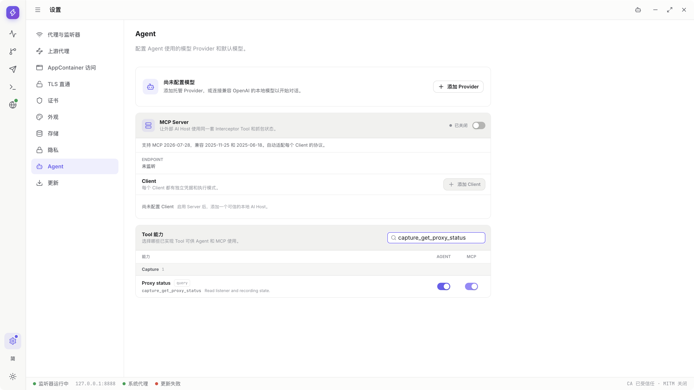
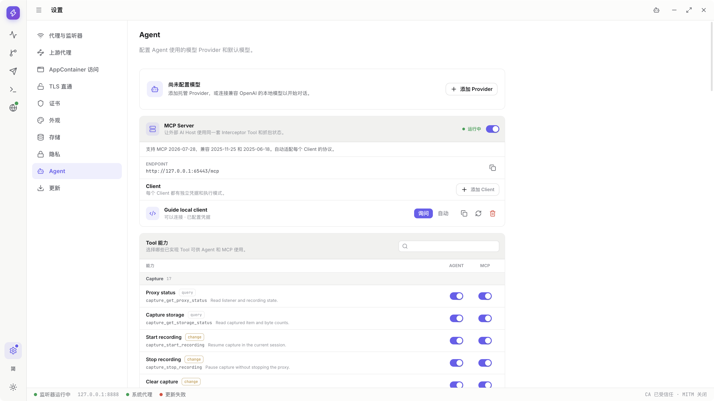
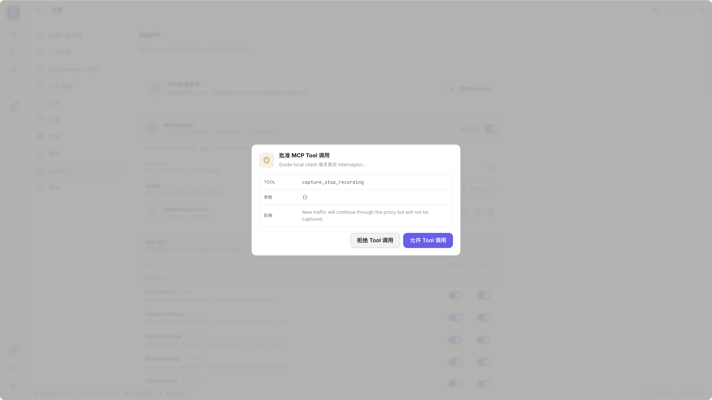
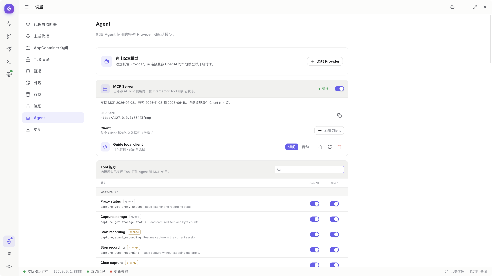

# Tool reference

> Draft for the implemented `v0.1.1-alpha.1` catalog. The final section illustrates representative status-query/pause steps, not acceptance of every Tool or item9. Read connected schemas; do not invent parameters or treat internal IPC names as Tools.

[Guide directory](../README.en.md) · [Permissions](tool-permissions.md)

`query` reads data. `change` controls operations, changes state, sends network traffic or opens native dialogs. Enabled queries run directly; changes follow the Agent Chat or MCP Client's Ask/Auto policy.

## Capture

| Tool | Type | Purpose |
| --- | --- | --- |
| `capture_get_proxy_status` | query | Read listener and recording state |
| `capture_get_storage_status` | query | Read temporary-record/body usage |
| `capture_start_recording` | change | Start recording with normal readiness requirements |
| `capture_stop_recording` | change | Pause new recording without stopping forwarding or restoring proxies |
| `capture_clear` | change | Clear current Capture records and bodies |
| `capture_list_exchanges` | query | Query request summaries |
| `capture_get_exchange` | query | Read an existing request's details |
| `capture_get_exchange_body` | query | Read its selected body within the returned preview limits |
| `capture_list_websocket_messages` | query | Read connection messages |
| `capture_list_grpc_messages` | query | Read gRPC messages |
| `capture_export_body` | change | Save a selected body through a native dialog |
| `capture_export_har` | change | Start HAR export through a native dialog |
| `capture_import_har` | change | Select and import HAR |
| `capture_export_archive` | change | Start native archive export |
| `capture_import_archive` | change | Select and import a native archive |
| `capture_get_transfer_job` | query | Inspect progress, warnings and final task state |
| `capture_cancel_transfer_job` | change | Request cancellation and wait for real cleanup |

Query current identities before reading bodies/messages. Do not reuse pre-restart IDs. File tasks need completion checks, and tools do not accept arbitrary model-chosen local paths. See [Capture](capture.md) and [transfers](transfer.md).

## Rules

| Tool | Type | Purpose |
| --- | --- | --- |
| `rules_get_tree` | query | Read the saved rule tree and revision |
| `rules_get_hits` | query | Inspect hits |
| `rules_replace_tree` | change | Replace the tree using the current revision |
| `rules_import` | change | Select a file and append after preview confirmation |
| `rules_export` | change | Export Core's saved rule tree |

Read the latest revision first. Map Local paths have explicit redaction/preservation rules; do not invent paths. UI draft export differs from Tool saved-state export: [Rules](rules.md#import-export).

## Composer

| Tool | Type | Purpose |
| --- | --- | --- |
| `composer_get_collection` | query | Read saved Collection/revision |
| `composer_replace_collection` | change | Atomically replace using the current revision |
| `composer_import_collection` | change | Select and append after preview confirmation |
| `composer_export_collection` | change | Export using the native save dialog |
| `composer_send_request` | change | Send directly, outside Capture's proxy data path |
| `composer_probe_connection` | change | Perform a TLS handshake without an HTTP request |

Replacing/importing collections does not Send. Sending and probing both create real network activity and are change operations. See [Composer](composer.md).

## Breakpoints

| Tool | Type | Purpose |
| --- | --- | --- |
| `breakpoints_list` | query | Read current waiting breakpoints |
| `breakpoints_enable_http` | change | Enable HTTP matching control |
| `breakpoints_disable_http` | change | Disable HTTP matching control |
| `breakpoints_enable_websocket` | change | Configure frame interception for a connection |
| `breakpoints_disable_websocket` | change | Disable frame interception |
| `breakpoints_continue` | change | Continue one existing wait unchanged |
| `breakpoints_forward_edited` | change | Edit permitted fields and continue one wait |
| `breakpoints_drop` | change | Drop one existing wait |
| `breakpoints_continue_queue` | change | Continue waits in the specified queue's initial snapshot |
| `breakpoints_drop_queue` | change | Drop waits in that snapshot |
| `breakpoints_continue_rule` | change | Continue existing waits belonging to a rule |

Editable Tool fields depend on phase: request method/URL/text body, response status/text body, or WebSocket text body. Headers, arbitrary file paths and close codes are not exposed here; use the [App editor](breakpoints.md#edit).

Batch Continue ignores Renderer drafts. Requery stale individual waits.

## Diagnostics

| Tool | Type | Purpose |
| --- | --- | --- |
| `diagnostics_get_trace` | query | Read a bounded current-Core trace snapshot |
| `diagnostics_get_recent` | query | Read recent current-Core memory records |
| `diagnostics_query` | query | Query persistent diagnostics |
| `diagnostics_export` | change | Export redacted JSONL through a native dialog |

Memory snapshots are not complete history. Wait for export completion. See [Diagnostics](diagnostics.md).

## Settings

| Tool | Type | Purpose |
| --- | --- | --- |
| `settings_get_core_process_status` | query | Read Core runtime state |
| `settings_get_system_proxy_status` | query | Read public proxy status |
| `settings_enable_system_proxy` | change | Take system proxy ownership |
| `settings_restore_system_proxy` | change | Restore according to ownership rules |
| `settings_get_certificate_status` | query | Read public CA identity/trust |
| `settings_generate_certificate` | change | Generate CA material, without overwriting a trusted CA |
| `settings_install_certificate` | change | Install trust through native authorization |
| `settings_uninstall_certificate` | change | Remove trust while retaining material |
| `settings_delete_certificate` | change | Remove material following necessary trust removal |
| `settings_reveal_certificate` | change | Reveal certificate material through the OS |
| `settings_view_certificate` | change | View the public certificate |
| `settings_open_certificate_manager` | change | Open the platform's manager |
| `settings_get_tls_insecure_hosts` | query | Read origin-certificate exceptions |
| `settings_replace_tls_insecure_hosts` | change | Replace the explicit exception list |
| `settings_enable_https_decryption` | change | Enable intent; effective decryption still needs a usable trusted CA |
| `settings_disable_https_decryption` | change | Stop decryption without removing CA trust |
| `settings_get_tls_passthrough` | query | Read encrypted-passthrough hosts |
| `settings_replace_tls_passthrough` | change | Replace that list |
| `settings_list_app_containers` | query | Read Windows AppContainer entries |
| `settings_enable_app_container` | change | Enable one loopback exemption |
| `settings_disable_app_container` | change | Remove one exemption |
| `settings_enable_all_app_containers` | change | Enable the current enumerated targets |
| `settings_disable_all_app_containers` | change | Remove exemptions for enumerated targets |
| `settings_set_language` | change | Select an existing App language |
| `settings_set_theme` | change | Select one of four App themes |
| `settings_set_export_privacy_defaults` | change | Set the three explicit export privacy defaults |

Ordinary queries do not expose arbitrary native paths, private keys or complete OS proxy configuration. See [Settings](settings.md) for platform and authorization limits.

## Use this reference

1. Read the owning chapter and understand its effects.

   The basic example below queries proxy status and pauses Recording. The [complete permissions walkthrough](tool-permissions.md#walkthrough-tool-permissions-readonly) inspects the whole catalog and verifies actual rejection of disabled actions. This is an entry-point reference, not a claim that every argument combination has its own step images.

2. Search `capture_get_proxy_status` in Settings Tool capabilities, inspect the chosen entry point and disable unrelated abilities.

   

   See the [complete read-only setup](tool-permissions.md#walkthrough-tool-permissions-readonly) for individual switches in every group. A row hidden by search is not automatically disabled.

3. Use the current schema for exact parameters.

   [Agent Recent→Trace→export](agent.md#walkthrough-agent-tool-lifecycle) and [MCP query/export approvals](mcp.md#walkthrough-mcp-tool-lifecycle) show actual arguments and results. The real external-host schema page still needs its own environment; this name table is not a complete argument schema.

4. Query first. This accurately reuses MCP's local SDK query, not a commercial host settings/conversation page.

   

5. To pause, keep Ask and inspect `capture_stop_recording` approval. Review other change tools' effects separately.

   

6. Deny if this operation is unwanted.

   

7. To continue the exercise, request again and inspect the new approval.

   

8. After Allow, inspect the Tool result and product Recording state rather than only model text.

   

This is not a provider-config, MCP credential-management, arbitrary file-access or update-tool catalog. Use the formal product UI for those control-plane operations.
