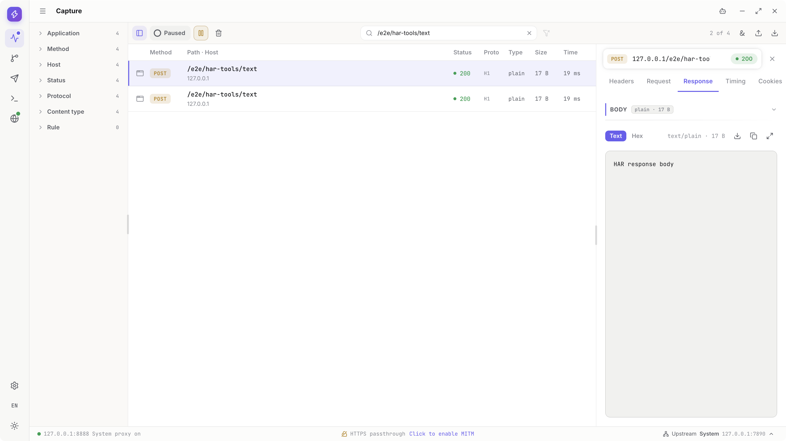
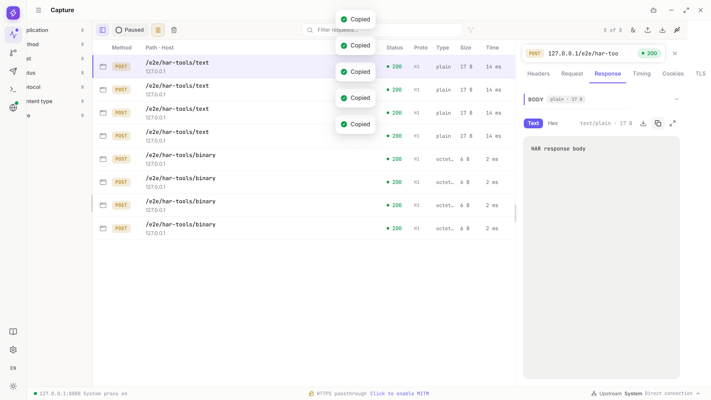
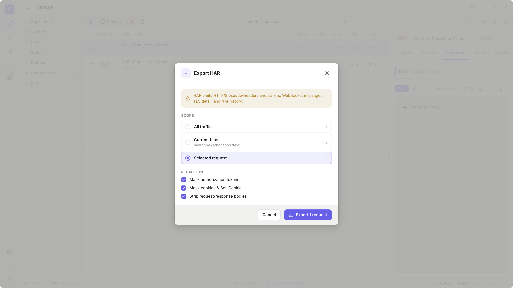

# Import and export: retain and share evidence

[Guide directory](../README.en.md) · [Capture](capture.md) · [Privacy settings](settings.md#privacy)

## Choose the right format

| Need | Use | Not a replacement for |
| --- | --- | --- |
| HTTP interchange with other tools | HAR | All Interceptor protocol details |
| Reopen more complete traffic in Interceptor | Native Archive | Rules, Collection or all App settings |
| One request/response/message payload | Save body | The rest of the session |
| A rule tree | Rules Export JSON | Captured exchanges |
| A request collection | Composer Export collection JSON | Send history or capture archives |
| App operations and errors | Diagnostics JSONL | Bodies or complete protocol capture |

Choose based on the facts you need. Similar file extensions or JSON syntax do not make formats interchangeable.

## Export HAR

Start with records you want to retain in Capture. This example has four: two `/e2e/har-tools/text` and two `/e2e/har-tools/binary` records. All, Current filter and Selected request produce four, two and one records from this set. Check your own records and filters rather than assuming these counts.

1. Pause new recording, open Export in Capture and choose Export HAR in box 1.

   

2. Choose All traffic in box 1 and check the four-record count. Review authorization and cookie masks and whether to retain bodies, then click Export 4 requests in box 2.

   

3. Choose your destination in the system Save dialog and save `ui.har`. Cancelling does not create an output file.

   

4. Wait for the file to be saved and return to Capture. Box 1 is Export, available for another operation, and box 2 shows recording remains Paused. Confirm the file exists before continuing.

   

5. Enter `/e2e/har-tools/text` in Keyword, box 1, to filter the two text records, then select one in box 2. The filtered scope and selected scope are different.

   

6. Open Export HAR again, choose Current filter in box 1 and click Export 2 requests in box 2. It includes both filtered records, not only the selected row.

   

7. Save a separate `ui-filter.har` so the all-records file is not unintentionally overwritten.

   

8. Wait for saving to finish, then use Export in box 1 for the next operation. The list retains its filter, and export does not delete original records.

   

9. Choose Selected request in box 1, confirm the one-record count and click Export 1 request in box 2. With no selected record, this scope is not a synonym for all records.

   

10. Save `ui-selected.har` separately and retain the all, filtered and single-record files according to their purpose.

    

11. Export in box 1 remains available after saving. Before sharing, inspect record counts, bodies and sensitive fields in the actual output file, not only the dialog choices.

    

12. To reopen the data, follow [Import](#import) using a file you just saved. Import appends its records without sending requests or automatically deduplicating them.

    
- HAR cannot losslessly represent HTTP/2 pseudo-headers, trailers, WebSocket messages, TLS detail or full Rule history.
- Compressed responses may be stored as decoded content as required by HAR. File body size alone does not establish whether wire bytes were lost.
- Large bodies increase export memory requirements; no fixed file-size limit does not imply low memory at every scale.
- Export is a snapshot, not an automatic inclusion of traffic arriving afterward.

## Save a native archive

Native Archive saves a complete Capture snapshot that Interceptor can reopen. This independent example contains eight records, including HTTP at `/e2e/archive-tools/http` and message connections at `/e2e/archive-tools/websocket`. Check your own data; HAR masks are not automatically applied.

1. Review the records in Capture, open Export and click Save Capture (`.iarchive`) in box 1. If a response is still arriving, decide whether to wait for its complete contents first.

   

2. Read the snapshot and sensitive-data warnings. Use Cancel in box 1 if not ready to save or share; cancelling this confirmation does not create an archive.

   

3. When ready, open the same action from Export again and click Save Capture in box 1.

   

4. Choose your destination in the system Save dialog and save `ui.iarchive`. Do not treat it as Rules or Collection JSON.

   

5. Wait for saving to finish before retaining or sharing the file. Returning to Capture does not clear the original records, which remain available for inspection.

   

- Archives contain unmasked original data; inspect them separately before sharing.
- Rule-hit associations are not a full Rules configuration backup.
- Arbitrary migration across past or future versions is not guaranteed; the current format does not support ZIP64.
- A snapshot of an unfinished connection does not contain bytes that will arrive later.

## Reopen HAR or native archives

Use a trusted file you have already saved through product Export. HAR and Archive are separate examples below; compare each file’s record count with the current list. Import appends without sending the requests to their origins and does not require Clear first.

1. For HAR, open Import in Capture and choose Import HAR in box 1.

   

2. Click Import HAR in box 1 and select the previously saved `ui.har` in the system Open dialog, not an `.iarchive` or configuration JSON file.

   

3. Wait for import to finish. Four entries from `ui.har` append to the original four, making eight. Box 1 marks a new binary record that is not selected yet; the Inspector still shows the earlier text content. Do not mistake those old details for the new row’s body.

   

4. Select the imported `/e2e/har-tools/binary`, open Request and use Copy in box 1 to check the complete `HAR request body`, `16 B`. A binary path does not mean its request body is binary.

   

5. Switch the same record to Response and inspect its six bytes in Hex: `00 01 7f 80 fe ff`. Copy in box 1 copies the current body representation. This is the opposite direction from the preceding request.

   

6. Select an imported `/e2e/har-tools/text` next. Request Copy in box 1 of the first image corresponds to `HAR request body` (`16 B`); Response Copy in box 1 of the second corresponds to `HAR response body` (`17 B`). Check each body rather than only counting records.

   

   

7. Read import warnings. Missing protocol detail or stripped bodies cannot be recreated. Failure or cancellation is not a complete import, even if partial progress was shown.

   

8. Import does not require an empty list. To reopen an archive into empty Capture, save records you need first, use Capture Clear and wait for cleanup to finish.

   

9. This separate example opens the saved `ui.iarchive` while eight original records remain. Choose Open Capture (`.iarchive`) in box 1 of Import.

   

10. Read the warning, click Open Capture in box 1 and choose that same `ui.iarchive` in the system Open dialog.

    

11. Wait for completion. The archive’s eight records append to the original eight, making sixteen in this example without replacing original records by name.

    

12. Select an imported HTTP record, open Response in box 1 and check the complete `archive-response-payload`. This is a text response, not JSON from another example.

    

13. Open the imported WebSocket record, select the message in box 1 and inspect `archive-websocket-payload` and its direction. An archive restores inspectable history, not a new live connection.

    

Repeated imports can append more copies rather than performing incremental synchronization. Unknown files can be large or sensitive; verify their source instead of automatically opening or extracting them to experiment. Reading a file and Recording are separate operations.

## Save an individual body

Save body writes the complete captured storage bytes, not only the read-only preview. This example is the UTF-8 response to GET `/e2e/body-preview/four-byte`, with `2097166` bytes (`2 MiB + 14`). It is separate from the HAR and archive files above.

1. Select your Capture record and open Request, Response or the relevant message body. This example saves Response; first confirm the direction and selected record.

   

2. Choose Original or Final first when both versions exist. This example has no dual-version comparison; see [original and final bodies](rules.md#effects) for saving rewritten traffic.

   

3. Click Save in the body toolbar, choose a destination in the system dialog and save `utf8-full-body.txt`. You choose the filename and location; Copy is not a substitute for saving the complete body.

   

4. Wait for the save to finish and inspect the file with an appropriate tool. The complete example is `2097166` bytes and still ends with `🙂after-preview`, even though the on-screen preview is truncated. The image shows Capture after closing the Inspector, not the file contents or a permanent completion badge.

   

- Export cannot recover bytes that never arrived before a network interruption.
- Stored content can retain its wire encoding; a saved file is not necessarily directly readable text.
- Audio, video, unknown binary data or oversized images may expose metadata and Save without an in-App player.
- Copy can copy only the preview or formatted display. Use Save body for complete data.

## Progress, cancellation and quitting

Large tasks usually expose progress; small files can finish quickly. Cancelling a running task differs from cancelling a Save dialog before a task starts. This example uses one `128 MiB` binary response without personal traffic.

1. Confirm the `/e2e/transfer-jobs/large-source` response in box 1 has finished arriving. Use only test data you are allowed to save and delete.

   

2. Open Export and choose Save Capture in box 1 to begin a native archive.

   

3. Read the warning, click Save Capture in box 1 and choose `cancel-ui.iarchive` in the system dialog. Cancel in that system dialog cancels file selection, not the running-task action below.

   

   

4. While Exporting archive is still running, click Cancel transfer in box 1. The `1 of 2 files` progress refers to archive work, not two Capture records.

   

5. Wait for cancellation and temporary-file cleanup. UI cancellation closes the progress dialog while the original Capture record remains. Clear in box 1 is a separate later cleanup action, not a substitute for Cancel transfer.

   

6. Clear only after confirming the record is disposable, then check the empty list. Skip this step if the record must remain. Also wait for task cleanup before a normal exit.

   

- A late Cancel is not Undo for a completed task and should not delete its final saved file.
- Capture Clear neither cancels another file task nor deletes exported files.
- Clear may be rejected during active work or cleanup; do not force a disabled action.
- Started from Agent/MCP means the job was accepted. Query its terminal state; stopping a conversation does not automatically cancel an existing file job.

## Exchange Rules and Collections

Rules and Collection use different JSON formats. These examples use `rules-roundtrip.json` and `collection-roundtrip.json`: Export from the owning feature first, then Import through that same feature.

1. Inspect your tree in Rules, click Export rules and save `rules-roundtrip.json`. This example has two Rules and one folder, with one Rule enabled. Export does not apply unsaved edits for you.

   

2. Use Export in the Composer Collection toolbar and save a separate `collection-roundtrip.json`. This example has two requests and one folder. Export does not send them.

   

3. In Rules, click Import rules and select the saved Rules file. Check Rules `2`, Folders `1`, Enabled `1` and Skipped `0`. Cancel in box 1 cancels the import; Import 2 rules in box 2 appends and saves it, potentially activating the enabled Rule for subsequent traffic.

   

4. Click Cancel first and confirm the existing tree has no additional nodes. This cancels the preview, not the exported file.

   

5. Import the same Rules file again and confirm. New nodes append after the existing tree rather than replacing names. This example now has four Rules, two folders and two enabled Rules, without another Save.

   

6. In Composer Collection, click Import and choose `collection-roundtrip.json`. Box 1 shows the import preview and box 2 is Cancel. Inspect requests, folders and warnings; do not use a Rules file here.

   

7. After Cancel, check the original Collection and open request remain unchanged. Cancellation neither appends data nor triggers Send.

   

8. Select the same Collection file again, review the preview in box 1 and click the confirmation action in box 2.

   

9. Expand the new folder in box 1 and verify the original Collection remains; new content was appended rather than overwritten.

   

10. Select the imported request in box 1 and inspect its URL in box 2, then Headers, Query, Body and Auth. Only an explicit Send issues a request; a successful import does not execute it.

    

Rules UI exports the current edited tree; Rules Tools export saved configuration, so Save first when appropriate. Repeated imports append again and enabled Rules can match repeatedly. Both file types can contain credentials, addresses, bodies or paths. Review them before sharing; see [Rules](rules.md#import-export) and [Composer](composer.md#导出和导入-collection) for complete workflows.

## Review privacy before sharing

Share only the data needed to reproduce the issue. A selected export format does not establish that the output is anonymized.

1. Narrow the scope first. Box 1 selects one current record and box 2 is Export 1 request. Avoid unintentionally exporting the whole session.

   

2. Mask Authorization and Cookie/Set-Cookie as needed and decide whether to strip bodies before using Export in box 1. This example enables both masks and Strip bodies.

   

3. Separately inspect URL queries, usernames, business identifiers, custom headers, local paths and file contents. Default rules cannot identify every sensitive business field.

   

4. Inspect the final file you will send, not only the App options. In particular, treat native archives and Collection configuration as sensitive files.

   

5. Describe the App version, system, protocol, steps and actual error in feedback. Do not send CA private keys, model credentials or Client credentials. When unsure, reproduce the issue with minimal credential-free test data.

   
