# Workspace and everyday controls

> Draft for `v0.1.1-alpha.1`; navigation, four themes, the language menu and panel have real images. Layout, language switching and exit still have gaps; neither this chapter nor item9 is complete. This is the desktop App, not the website layout/System theme.

[Guide directory](../README.en.md) · [Getting started](getting-started.md)

<!-- recorded-walkthrough:start -->

## Recorded walkthrough: actual product steps

These images and video show the published <code>0.1.1-alpha.1</code> on macOS x64, retaining the App language <code>zh-CN</code>. Every recorded step has its own native-window screenshot; open an image at full size to inspect values.

Loopback addresses, ports and generated IDs belong to this recording, not a public service. Use your own authorized test environment. The actual values below match the screenshots and video. Advanced branches not shown here still need their own step images and acceptance.

| Example field | Actual recorded value |
| --- | --- |
| <code>initialTheme</code> | <code>light</code> |
| <code>appLanguage</code> | <code>zh-CN</code> |
| <code>languageChanged</code> | <code>false</code> |

<video controls preload="metadata" playsinline lang="en" src="../media/v0.1.1-alpha.1/workspace/workspace.mp4" poster="../media/v0.1.1-alpha.1/workspace/workspace-01-sidebar.png">
<track kind="captions" srclang="zh-CN" label="Steps / 步骤" src="../media/v0.1.1-alpha.1/workspace/workspace.vtt" default>
</video>

### 01 · Expand sidebar labels

[Video 00:00](../media/v0.1.1-alpha.1/workspace/workspace.mp4#t=0.396) · [Back to the video](#walkthrough-video)

### 02 · Open Capture

[Video 00:03](../media/v0.1.1-alpha.1/workspace/workspace.mp4#t=3.229) · [Back to the video](#walkthrough-video)

### 03 · Open Rules

[Video 00:06](../media/v0.1.1-alpha.1/workspace/workspace.mp4#t=6.078) · [Back to the video](#walkthrough-video)

### 04 · Open Composer

[Video 00:08](../media/v0.1.1-alpha.1/workspace/workspace.mp4#t=8.929) · [Back to the video](#walkthrough-video)

### 05 · Open Diagnostics

[Video 00:11](../media/v0.1.1-alpha.1/workspace/workspace.mp4#t=11.778) · [Back to the video](#walkthrough-video)

### 06 · Open Settings

[Video 00:14](../media/v0.1.1-alpha.1/workspace/workspace.mp4#t=14.678) · [Back to the video](#walkthrough-video)

### 07 · Select the warm theme

[Video 00:17](../media/v0.1.1-alpha.1/workspace/workspace.mp4#t=17.578) · [Back to the video](#walkthrough-video)

### 08 · Select the light theme

[Video 00:20](../media/v0.1.1-alpha.1/workspace/workspace.mp4#t=20.828) · [Back to the video](#walkthrough-video)

### 09 · Select the ember theme

[Video 00:24](../media/v0.1.1-alpha.1/workspace/workspace.mp4#t=24.078) · [Back to the video](#walkthrough-video)

### 10 · Select the dark theme

[Video 00:27](../media/v0.1.1-alpha.1/workspace/workspace.mp4#t=27.378) · [Back to the video](#walkthrough-video)

### 11 · Restore the original theme

[Video 00:30](../media/v0.1.1-alpha.1/workspace/workspace.mp4#t=30.578) · [Back to the video](#walkthrough-video)

### 12 · Inspect languages without changing the current language

[Video 00:33](../media/v0.1.1-alpha.1/workspace/workspace.mp4#t=33.829) · [Back to the video](#walkthrough-video)

### 13 · Open the optional Agent panel

[Video 00:36](../media/v0.1.1-alpha.1/workspace/workspace.mp4#t=36.792) · [Back to the video](#walkthrough-video)

### 14 · Close the panel, not the App

[Video 00:39](../media/v0.1.1-alpha.1/workspace/workspace.mp4#t=39.678) · [Back to the video](#walkthrough-video)

The complete reference follows. Only operations with matching real step images and checked input values count as illustrated acceptance.
<!-- recorded-walkthrough:end -->

## Find the tool you need

**Purpose and prerequisites:** startup has finished. Choose the workspace for your task from the left navigation.

| Entry | Purpose |
| --- | --- |
| Capture | Inspect proxied requests, bodies and messages; handle waiting breakpoints |
| Rules & Map | Change subsequent matching proxy traffic |
| Composer | Send independent requests and manage collections |
| Diagnostics | Query operations and failures |
| Settings | Manage proxies, certificates, preferences, models, MCP and updates |
| Agent button near the window controls | Open or close the AI panel beside the workspace |

**Steps**

1. Expand the sidebar using the menu button at the left of the window header.

   

2. Select Capture.

   

3. Select Rules & Map.

   

4. Select Composer.

   

5. Select Diagnostics.

   

6. Select Settings and the section you need.

   

7. Leave Settings and return to inspect the retained last section.

   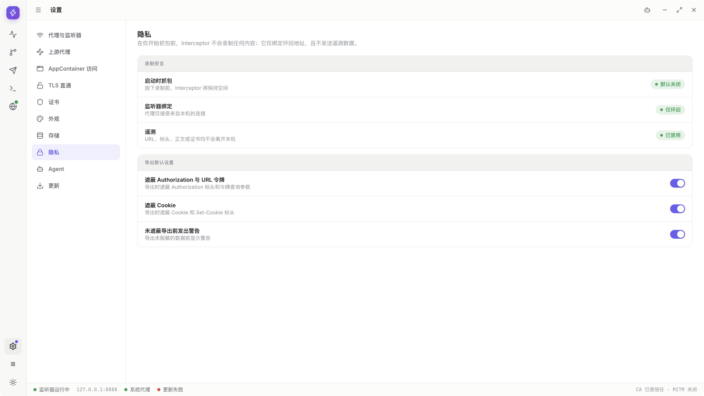

8. Follow a feature-specific prompt and check its selected section, such as TLS passthrough.

   

   See the separate [TLS passthrough round trip](settings.md#walkthrough-settings-tls-passthrough) for its deep link; opening a section directly is not the same operation.

**Expected result:** the header and main content follow navigation; navigation does not resend traffic.

**Notes:** Breakpoints live inside Capture. Entering Composer or Settings does not pause Capture. Background behavior still depends on Recording, proxy ownership and rules.

## Resize panes, windows and scrollable content

**Steps**

1. Drag Capture's separators between filters, list and details to allocate space.

   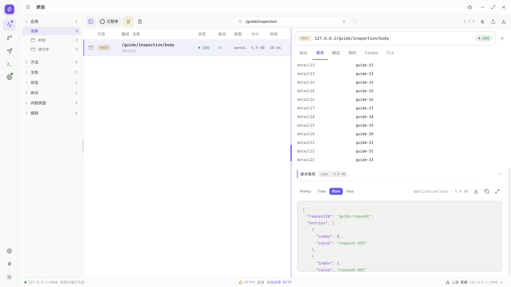

2. In Composer, adjust the Collection width and the request/response heights separately.

   

   

3. Use minimize, maximize or restore; resize the window from its edges when needed.

   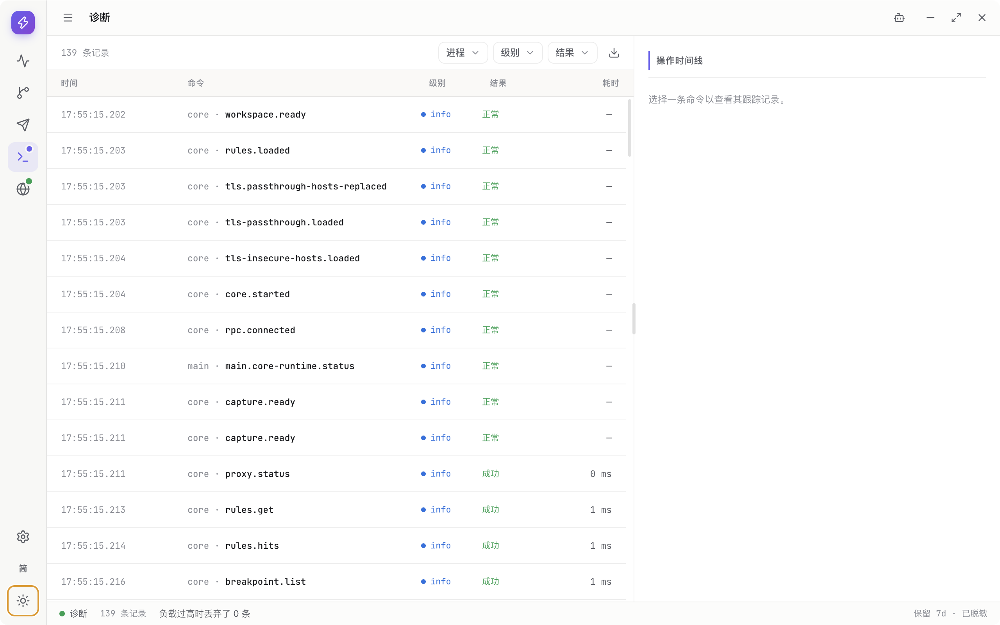

   

   These consecutive steps demonstrate resizing. The separate [window-controls recording](#walkthrough-workspace-window-controls) actually clicks Maximize and Restore and checks native window/work-area dimensions, then clicks Minimize. Its button image precedes the actual click; native state is checked separately. The test restores only the same window for continued inspection, not as recorded Dock interaction.

4. Use the wheel, trackpad or keyboard to read overflow. Continue scrolling the outer content after the body viewer reaches its boundary.

   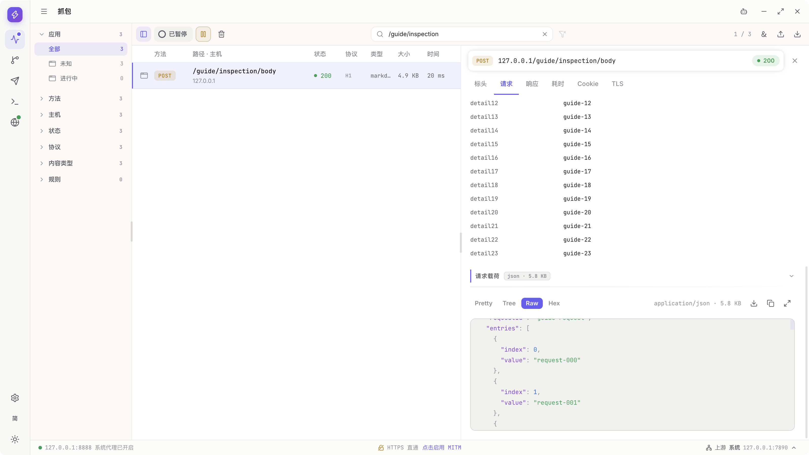

   

5. Use fullscreen for a long body, then return to the workspace.

   These accurately reuse Capture's orders JSON fullscreen/Escape sequence. They demonstrate the controls, not oversized-body scrolling.

   

   

**Expected result:** panes fit the available area without silently cutting off readable content.

**Notes:** minimizing is not quitting. Recording and proxy forwarding can continue. Fullscreen changes the viewing area, not byte-preview limits or previously missing data.

## Choose a theme and language

**Steps**

1. Open Theme at the bottom of the sidebar.

   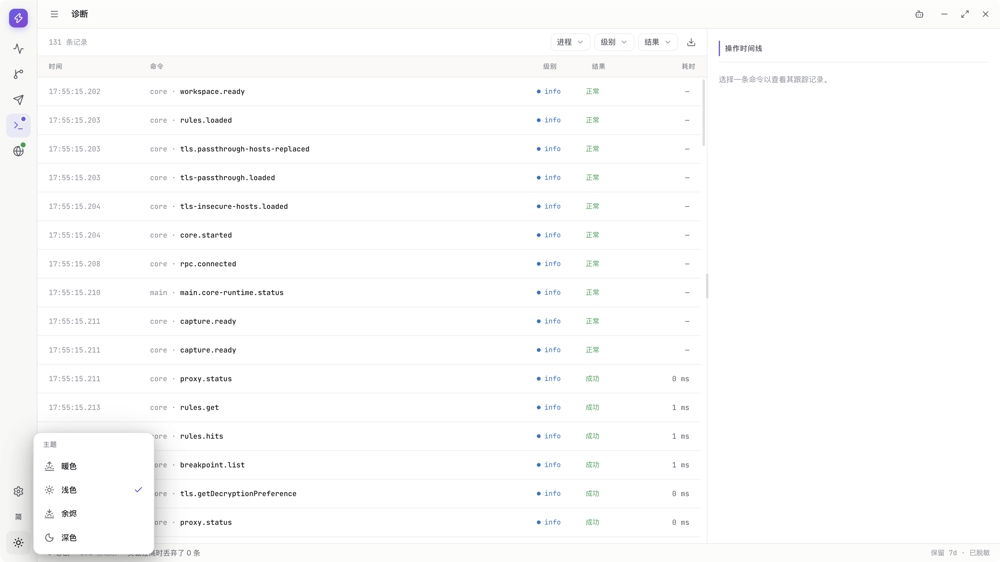

2. First select `warm`.

   

3. Select `light`.

   

4. Select `ember`.

   

5. Select `dark`.

   

6. Restore the original `light`, not an App System theme.

   

7. Open Language to inspect available choices; this recording retains `zh-CN`.

   

8. Select a different supported language when needed and inspect the interface change.

   **Image pending:** `languageChanged=false` in this recording. The menu does not prove a switch to English or another language.

9. Restart normally and inspect retained language/theme preferences.

   The new `workspace-restart` recording confirms `zh-CN` across two App starts without switching language for recording:

   

   **Image pending:** this does not change language/theme before restarting, so it is not a complete changed-preference round trip.

**Expected result:** theme changes colors, not behavior. Language changes UI text, not URLs, protocol values, request content or Tool names.

**Notes:** the App has four themes and 15 UI languages. This does not imply 15 translated guides. The website's System/Light/Dark control is a separate preference.

## Use Agent beside your workspace

**Steps**

1. Click the Agent button near the window controls.

   

2. If no model is configured, follow the configuration entry to Settings > Agent.

   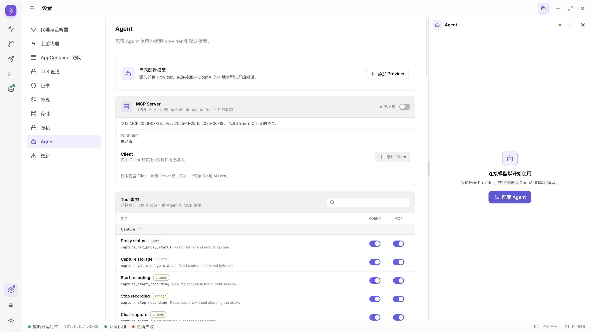

3. Otherwise, select or create a Chat. Switch workspaces normally when you need another tool.

   These reuse the separate `agent-management` with `Guide model one` and `Guide model two` already configured: create the second Chat, then select `Guide chat one`. This workspace's empty panel did not configure models automatically.

   

   

   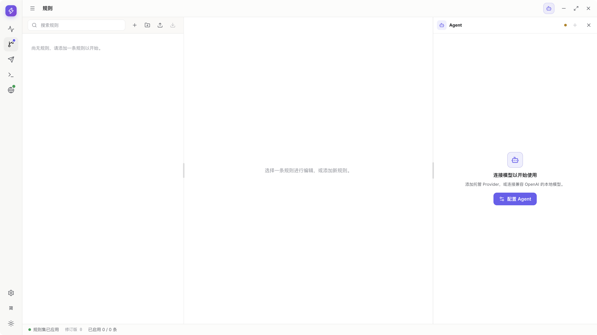

   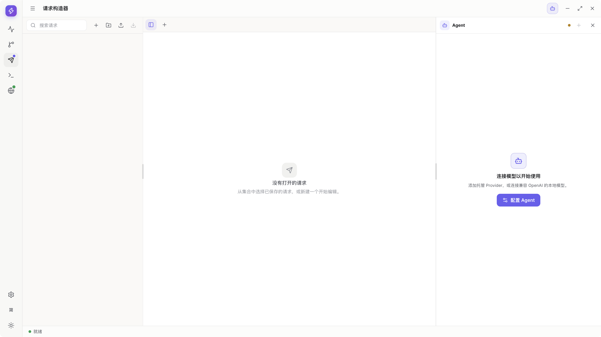

4. Close the panel using the Agent toggle or its own Close action.

   

   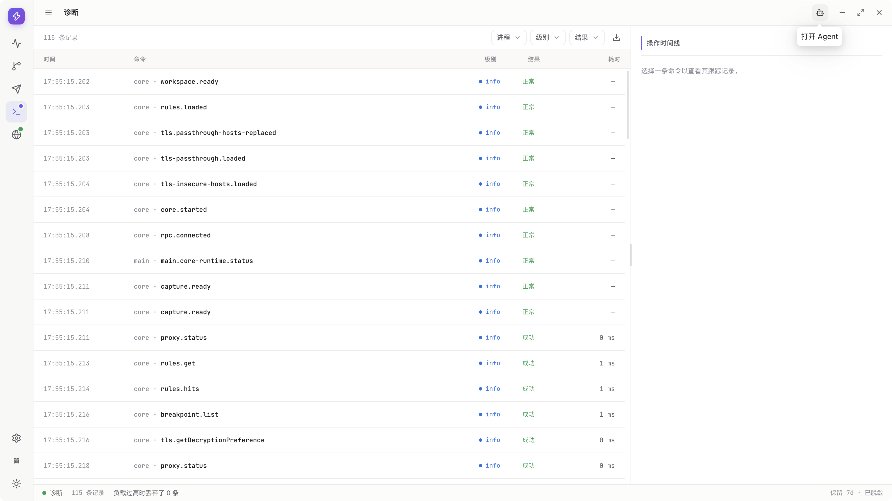

   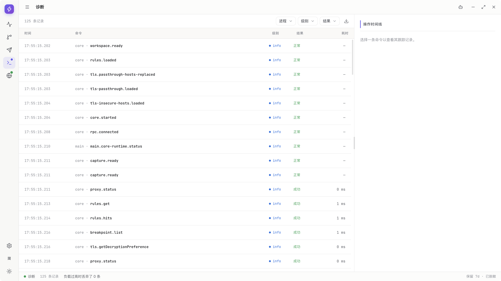

**Expected result:** the main workspace narrows beside the panel rather than being covered. Workspace/settings navigation does not close Agent implicitly.

**Notes:** merely opening the panel does not attach the selected request to the model. See [Agent privacy](agent.md#privacy).

## Know what is retained

| Data | Retention rule |
| --- | --- |
| Current Capture records and bodies | Temporary; Core shutdown/restart releases them. Export important data |
| Rules | Apply edits; confirming a file import saves the appended result directly |
| Composer Collection | Edits save automatically; Recent sends is separate in-memory data |
| Proxy, TLS and preferences | Saved through their own controls; Capture Clear does not erase them |
| Agent configuration and chats | Stored locally, but model calls and Tool results can still leave the machine |
| Exported files | Saved where you choose; Capture Clear does not delete them |

**Actual saving and restart check**

Read `workspace-close` → `workspace-restart` in their real order: two App generations using the same profile. The request is `Guide retained request`, URL `http://127.0.0.1:63009/guide/restart/request`; `63009` is this recording's dynamic service port.

1. Open Composer.

   

2. Enter that test URL and wait for automatic saving.

   

3. Name the request `Guide retained request`.

   

4. Temporarily set that profile's Privacy `maskCookies` to `false` to inspect persistence. No personal data is exported/shared here; masking is restored afterward.

   

5. Generate a temporary Capture demonstration record through the proxy, separate from the saved Collection definition.

   

6. After confirming saving, Close normally. The driver executed the real Close in this run. This image precedes the action; it is neither the click nor the desktop after exit.

   

   Actual Close and exit recovery are checked outside the recording through real operations and state evidence. A pre-close picture is not a process-exit image. Other exit branches, such as busy refusal, still need their own scenarios; the desktop or a process manager is not recorded to fill the gap.

7. Start the same profile again, find `Guide retained request` in the new App generation's Collection and inspect the saved URL.

   

8. Open Privacy and verify `maskCookies` remains `false`, rather than inferring persistence from an old window staying open.

   

9. Restore the Cookie-masking default rather than leaving it disabled for the demonstration.

   

10. Return to Capture and confirm the previous generation's temporary records are gone, unlike the retained Collection definition.

    

11. Confirm the language is still `zh-CN`; recording did not change it.

    

**Scope:** this segment checks Collection name/URL, Privacy and temporary Capture. A complete representative request now has paired [saving](composer.md#walkthrough-composer-persistence-save) and [actual restart](composer.md#walkthrough-composer-persistence-restart) recordings covering three folder levels, method/protocol, Header values and enabled states, Query, JSON and public Auth fields, without refilling or automatic Send. See [Agent restart](agent.md#walkthrough-agent-session-restart) for history. No single clip exhausts every preference or Body/Auth combination.

**Before quitting:** finish exports, Apply or pending saves. Visible editor content alone does not prove it has been persisted.

Do not assume collections or chats synchronize between OS accounts or separate App data environments. The current OS user's shared CA and proxy-recovery information have separate lifetimes; deleting an App profile is not a safe way to reset them.

## Finish a session

1. Resolve or deliberately abandon waiting breakpoints so clients are not left waiting unnoticed.

   These separately reuse one unchanged continuation and POST-C/PUT-C batch continuation in the new HTTP queue. They are not a global status for every current connection; complete cleanup across mixed queues remains image pending.

   

   

2. Export important traffic and wait for file operations.

   This reuses Transfer's completed `guide-recording.iarchive`, not automatic persistence of the entire workspace.

   

3. Check for native authorization or file windows awaiting a decision.

   Finish or cancel each window you opened. [Agent](agent.md#walkthrough-agent-tool-lifecycle-11-native-cancel-panel) and [MCP](mcp.md#walkthrough-mcp-tool-lifecycle-11-native-panel) show actual Save cancellation and subsequent saving, not a claim that every current window was inspected for you.

4. Close the App normally. If a busy operation prevents quitting, wait for it and close again.

   The [preceding section](#saved-data) now records a real driver-executed Close and actual restart. This image precedes closing, not the Close click or completed system recovery.

   

   **Recording boundary:** [shutdown with mixed waits](breakpoints.md#walkthrough-breakpoints-mixed-queues) actually closes normally while HTTP and WS items are pending, then verifies client cancellation and no origin forwarding. Native file cancellation is in [Collection Tools](composer.md#walkthrough-composer-file-tools). A pre-close picture is still not an exited-process image; shutdown and host recovery have separate evidence. The guide does not manufacture Core crashes or record the desktop/process manager.

**Expected result:** proxy recovery and process shutdown finish. Minimizing or force-killing is not normal shutdown.

**Notes:** quitting does not uninstall a CA, delete exports or overwrite another application's new proxy settings. See [recovery](troubleshooting.md#proxy-recovery).

<!-- recorded-walkthrough:workspace-close:start -->

## Recorded walkthrough: save before normal Close

These images and video show the published <code>0.1.1-alpha.1</code> on macOS x64, retaining the App language <code>zh-CN</code>. Every recorded step has its own native-window screenshot; open an image at full size to inspect values.

Loopback addresses, ports and generated IDs belong to this recording, not a public service. Use your own authorized test environment. The actual values below match the screenshots and video. Advanced branches not shown here still need their own step images and acceptance.

| Example field | Actual recorded value |
| --- | --- |
| <code>requestName</code> | <code>Guide retained request</code> |
| <code>url</code> | <code>http://127.0.0.1:63009/guide/restart/request</code> |
| <code>maskCookies</code> | <code>false</code> |
| <code>closeImage</code> | <code>before the actual Close action; shutdown is verified by the driver</code> |

<video controls preload="metadata" playsinline lang="en" src="../media/v0.1.1-alpha.1/workspace-close/workspace-close.mp4" poster="../media/v0.1.1-alpha.1/workspace-close/workspace-close-01-composer.png">
<track kind="captions" srclang="zh-CN" label="Steps / 步骤" src="../media/v0.1.1-alpha.1/workspace-close/workspace-close.vtt" default>
</video>

### 01 · Open Composer

[Video 00:00](../media/v0.1.1-alpha.1/workspace-close/workspace-close.mp4#t=0.346) · [Back to the video](#walkthrough-workspace-close-video)

### 02 · Save the example URL

[Video 00:03](../media/v0.1.1-alpha.1/workspace-close/workspace-close.mp4#t=3.329) · [Back to the video](#walkthrough-workspace-close-video)

### 03 · Name the retained request

[Video 00:06](../media/v0.1.1-alpha.1/workspace-close/workspace-close.mp4#t=6.177) · [Back to the video](#walkthrough-workspace-close-video)

### 04 · Set this profile’s export preference

[Video 00:10](../media/v0.1.1-alpha.1/workspace-close/workspace-close.mp4#t=10.277) · [Back to the video](#walkthrough-workspace-close-video)

### 05 · Produce a temporary Capture record

[Video 00:13](../media/v0.1.1-alpha.1/workspace-close/workspace-close.mp4#t=13.284) · [Back to the video](#walkthrough-workspace-close-video)

### 06 · Save first, then close normally

[Video 00:16](../media/v0.1.1-alpha.1/workspace-close/workspace-close.mp4#t=16.276) · [Back to the video](#walkthrough-workspace-close-video)

The complete reference follows. Only operations with matching real step images and checked input values count as illustrated acceptance.
<!-- recorded-walkthrough:workspace-close:end -->

<!-- recorded-walkthrough:workspace-restart:start -->

## Recorded walkthrough: persistent and temporary data after reopening

These images and video show the published <code>0.1.1-alpha.1</code> on macOS x64, retaining the App language <code>zh-CN</code>. Every recorded step has its own native-window screenshot; open an image at full size to inspect values.

Loopback addresses, ports and generated IDs belong to this recording, not a public service. Use your own authorized test environment. The actual values below match the screenshots and video. Advanced branches not shown here still need their own step images and acceptance.

| Example field | Actual recorded value |
| --- | --- |
| <code>requestName</code> | <code>Guide retained request</code> |
| <code>url</code> | <code>http://127.0.0.1:63009/guide/restart/request</code> |
| <code>persisted</code> | <code>Collection and privacy preference</code> |
| <code>temporary</code> | <code>Capture records</code> |
| <code>appLanguage</code> | <code>zh-CN</code> |

<video controls preload="metadata" playsinline lang="en" src="../media/v0.1.1-alpha.1/workspace-restart/workspace-restart.mp4" poster="../media/v0.1.1-alpha.1/workspace-restart/workspace-restart-01-collection.png">
<track kind="captions" srclang="zh-CN" label="Steps / 步骤" src="../media/v0.1.1-alpha.1/workspace-restart/workspace-restart.vtt" default>
</video>

### 01 · Find the saved request after reopening

[Video 00:00](../media/v0.1.1-alpha.1/workspace-restart/workspace-restart.mp4#t=0.365) · [Back to the video](#walkthrough-workspace-restart-video)

### 02 · Verify the persisted preference

[Video 00:03](../media/v0.1.1-alpha.1/workspace-restart/workspace-restart.mp4#t=3.395) · [Back to the video](#walkthrough-workspace-restart-video)

### 03 · Restore the masking default

[Video 00:06](../media/v0.1.1-alpha.1/workspace-restart/workspace-restart.mp4#t=6.305) · [Back to the video](#walkthrough-workspace-restart-video)

### 04 · Verify old Capture records are temporary

[Video 00:09](../media/v0.1.1-alpha.1/workspace-restart/workspace-restart.mp4#t=9.146) · [Back to the video](#walkthrough-workspace-restart-video)

### 05 · Confirm recording did not change language

[Video 00:12](../media/v0.1.1-alpha.1/workspace-restart/workspace-restart.mp4#t=12.103) · [Back to the video](#walkthrough-workspace-restart-video)

The complete reference follows. Only operations with matching real step images and checked input values count as illustrated acceptance.
<!-- recorded-walkthrough:workspace-restart:end -->

<!-- recorded-walkthrough:workspace-navigation:start -->

## Recorded walkthrough: retained Settings, Agent deep links, panel navigation and window resizing

These images and video show the published <code>0.1.1-alpha.1</code> on macOS x64, retaining the App language <code>zh-CN</code>. Every recorded step has its own native-window screenshot; open an image at full size to inspect values.

Loopback addresses, ports and generated IDs belong to this recording, not a public service. Use your own authorized test environment. The actual values below match the screenshots and video. Advanced branches not shown here still need their own step images and acceptance.

| Example field | Actual recorded value |
| --- | --- |
| <code>savedSection</code> | <code>Privacy</code> |
| <code>configureTarget</code> | <code>Settings / Agent</code> |
| <code>shortcutTarget</code> | <code>Settings / Upstream</code> |
| <code>originalSize</code> | <code>1600x900</code> |
| <code>smallerSize</code> | <code>1280x800</code> |
| <code>initialTheme</code> | <code>light</code> |
| <code>appLanguage</code> | <code>zh-CN</code> |
| <code>languageChanged</code> | <code>false</code> |
| <code>requestPath</code> | <code>/guide/navigation/ready</code> |

<video controls preload="metadata" playsinline lang="en" src="../media/v0.1.1-alpha.1/workspace-navigation/workspace-navigation.mp4" poster="../media/v0.1.1-alpha.1/workspace-navigation/workspace-navigation-01-settings.png">
<track kind="captions" srclang="zh-CN" label="Steps / 步骤" src="../media/v0.1.1-alpha.1/workspace-navigation/workspace-navigation.vtt" default>
</video>

### 01 · Open Settings

[Video 00:00](../media/v0.1.1-alpha.1/workspace-navigation/workspace-navigation.mp4#t=0.486) · [Back to the video](#walkthrough-workspace-navigation-video)

### 02 · Open the Privacy section

[Video 00:03](../media/v0.1.1-alpha.1/workspace-navigation/workspace-navigation.mp4#t=3.411) · [Back to the video](#walkthrough-workspace-navigation-video)

### 03 · Leave Settings for Composer

[Video 00:06](../media/v0.1.1-alpha.1/workspace-navigation/workspace-navigation.mp4#t=6.343) · [Back to the video](#walkthrough-workspace-navigation-video)

### 04 · Return to Settings with Privacy retained

[Video 00:09](../media/v0.1.1-alpha.1/workspace-navigation/workspace-navigation.mp4#t=9.249) · [Back to the video](#walkthrough-workspace-navigation-video)

### 05 · Switch to Diagnostics

[Video 00:12](../media/v0.1.1-alpha.1/workspace-navigation/workspace-navigation.mp4#t=12.169) · [Back to the video](#walkthrough-workspace-navigation-video)

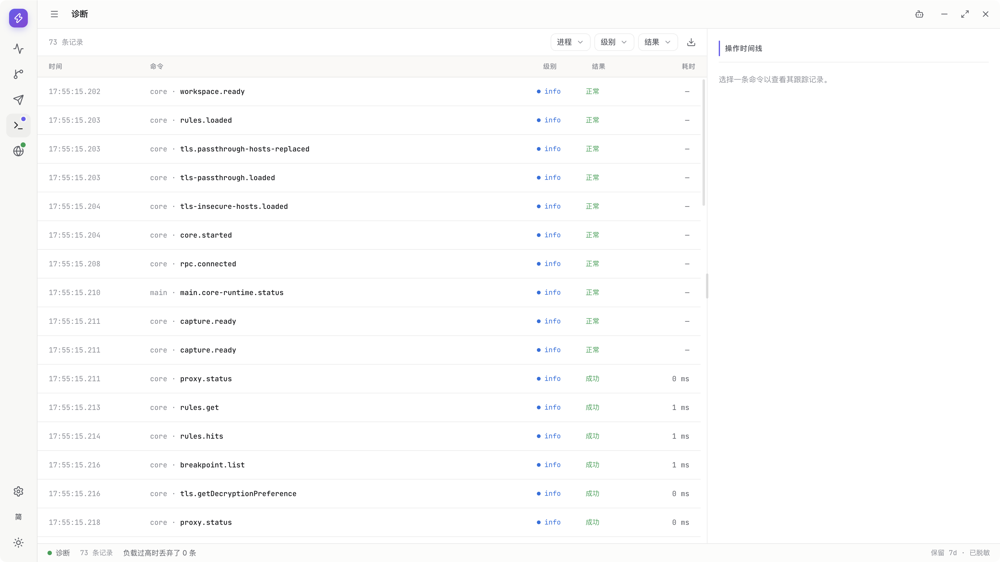

### 06 · Return again to the retained Privacy section

[Video 00:15](../media/v0.1.1-alpha.1/workspace-navigation/workspace-navigation.mp4#t=15.151) · [Back to the video](#walkthrough-workspace-navigation-video)

### 07 · Return to Capture

[Video 00:18](../media/v0.1.1-alpha.1/workspace-navigation/workspace-navigation.mp4#t=18.100) · [Back to the video](#walkthrough-workspace-navigation-video)

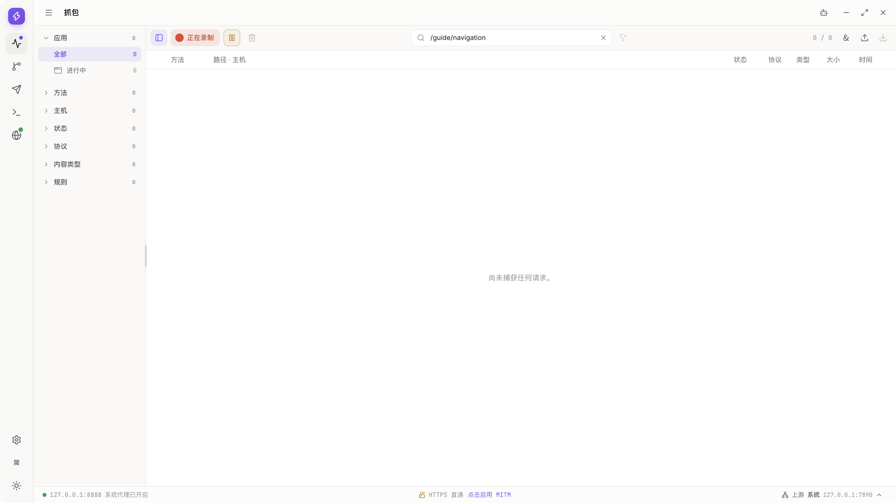

### 08 · Open the unconfigured Agent panel

[Video 00:21](../media/v0.1.1-alpha.1/workspace-navigation/workspace-navigation.mp4#t=21.016) · [Back to the video](#walkthrough-workspace-navigation-video)

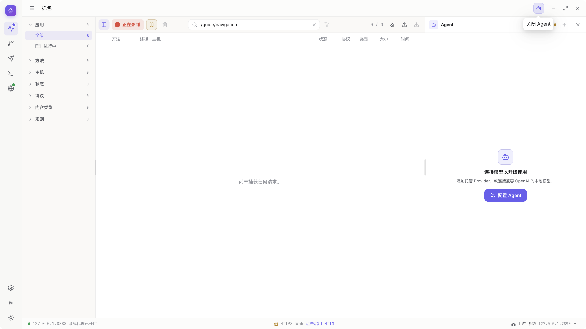

### 09 · Follow Configure from the empty state

[Video 00:23](../media/v0.1.1-alpha.1/workspace-navigation/workspace-navigation.mp4#t=23.935) · [Back to the video](#walkthrough-workspace-navigation-video)

### 10 · Return to Capture with Agent open

[Video 00:27](../media/v0.1.1-alpha.1/workspace-navigation/workspace-navigation.mp4#t=27.087) · [Back to the video](#walkthrough-workspace-navigation-video)

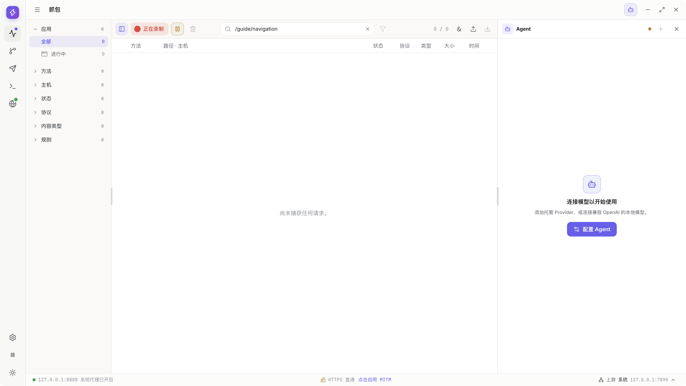

### 11 · Open rules while retaining Agent

[Video 00:30](../media/v0.1.1-alpha.1/workspace-navigation/workspace-navigation.mp4#t=30.076) · [Back to the video](#walkthrough-workspace-navigation-video)

### 12 · Open composer while retaining Agent

[Video 00:33](../media/v0.1.1-alpha.1/workspace-navigation/workspace-navigation.mp4#t=33.006) · [Back to the video](#walkthrough-workspace-navigation-video)

### 13 · Open diagnostics while retaining Agent

[Video 00:35](../media/v0.1.1-alpha.1/workspace-navigation/workspace-navigation.mp4#t=35.927) · [Back to the video](#walkthrough-workspace-navigation-video)

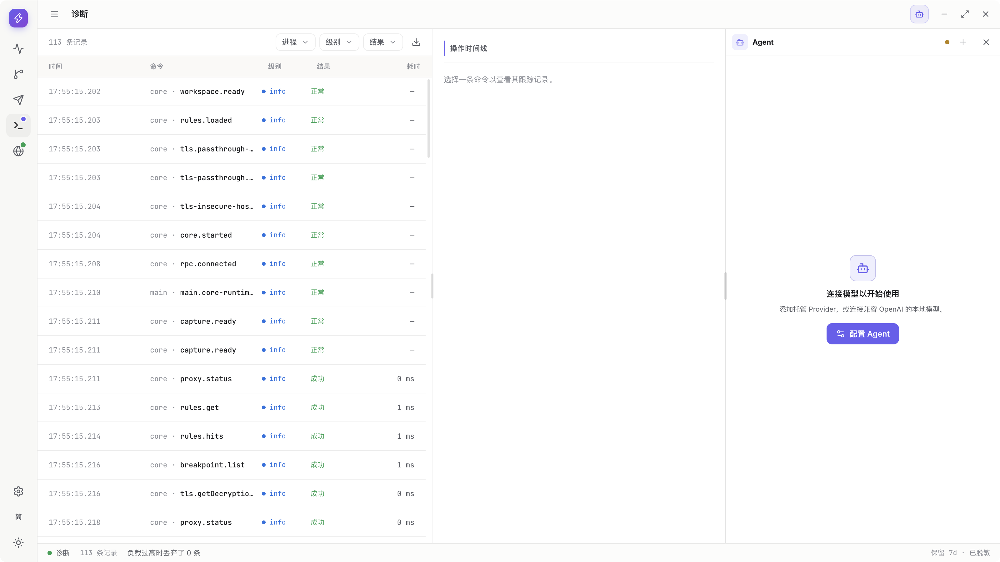

### 14 · Close Agent with the Header control

[Video 00:38](../media/v0.1.1-alpha.1/workspace-navigation/workspace-navigation.mp4#t=38.938) · [Back to the video](#walkthrough-workspace-navigation-video)

### 15 · Reopen with the Header control

[Video 00:41](../media/v0.1.1-alpha.1/workspace-navigation/workspace-navigation.mp4#t=41.903) · [Back to the video](#walkthrough-workspace-navigation-video)

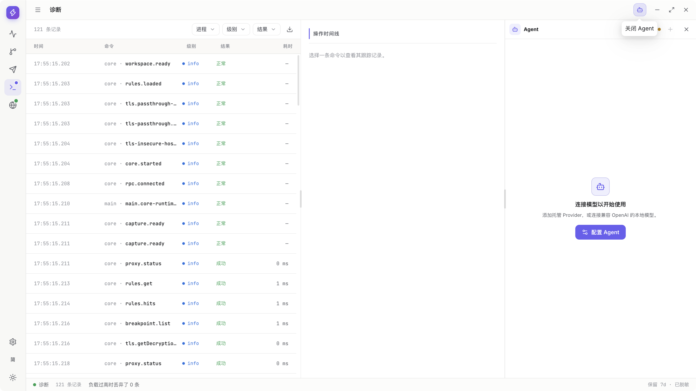

### 16 · Use the panel’s own close button

[Video 00:44](../media/v0.1.1-alpha.1/workspace-navigation/workspace-navigation.mp4#t=44.901) · [Back to the video](#walkthrough-workspace-navigation-video)

### 17 · Open Theme without changing the selection

[Video 00:47](../media/v0.1.1-alpha.1/workspace-navigation/workspace-navigation.mp4#t=47.866) · [Back to the video](#walkthrough-workspace-navigation-video)

### 18 · Dismiss with Escape and retain the theme

[Video 00:50](../media/v0.1.1-alpha.1/workspace-navigation/workspace-navigation.mp4#t=50.941) · [Back to the video](#walkthrough-workspace-navigation-video)

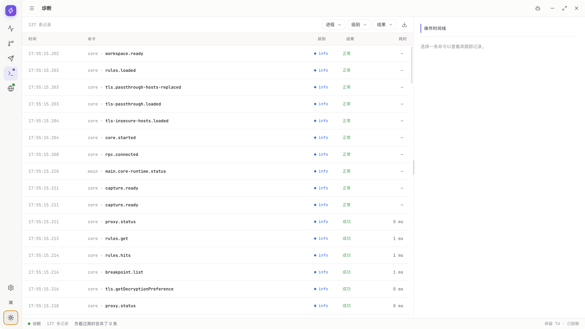

### 19 · Resize the actual App window smaller

[Video 00:54](../media/v0.1.1-alpha.1/workspace-navigation/workspace-navigation.mp4#t=54.219) · [Back to the video](#walkthrough-workspace-navigation-video)

### 20 · Restore the original window size

[Video 00:57](../media/v0.1.1-alpha.1/workspace-navigation/workspace-navigation.mp4#t=57.422) · [Back to the video](#walkthrough-workspace-navigation-video)

### 21 · Return to Capture for its shortcut

[Video 01:00](../media/v0.1.1-alpha.1/workspace-navigation/workspace-navigation.mp4#t=60.605) · [Back to the video](#walkthrough-workspace-navigation-video)

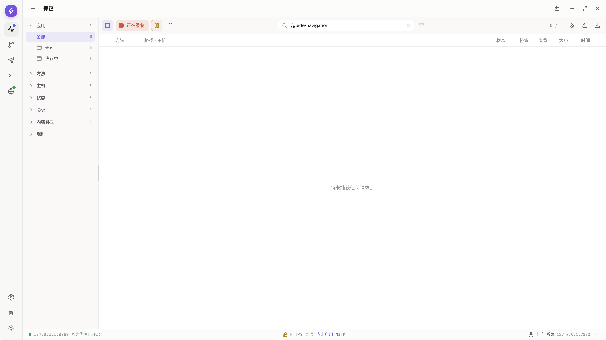

### 22 · Open the statusbar Upstream shortcut

[Video 01:03](../media/v0.1.1-alpha.1/workspace-navigation/workspace-navigation.mp4#t=63.545) · [Back to the video](#walkthrough-workspace-navigation-video)

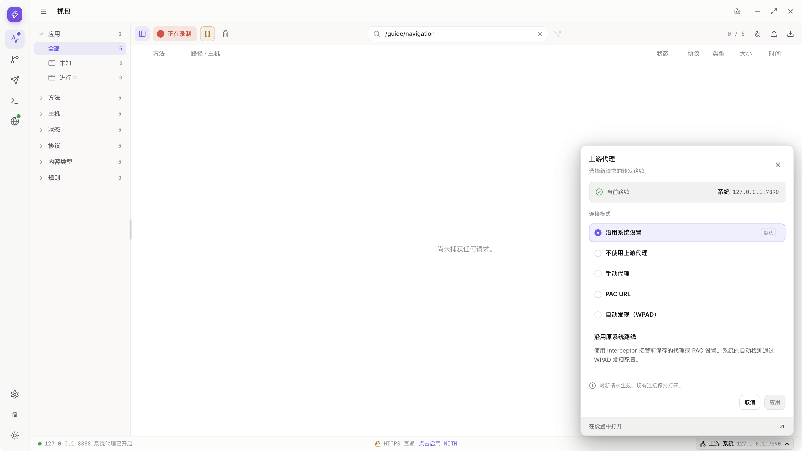

### 23 · Open Upstream settings from the popover

[Video 01:06](../media/v0.1.1-alpha.1/workspace-navigation/workspace-navigation.mp4#t=66.505) · [Back to the video](#walkthrough-workspace-navigation-video)

### 24 · Leave the deep-link destination

[Video 01:09](../media/v0.1.1-alpha.1/workspace-navigation/workspace-navigation.mp4#t=69.454) · [Back to the video](#walkthrough-workspace-navigation-video)

### 25 · Return to Settings with Upstream retained

[Video 01:12](../media/v0.1.1-alpha.1/workspace-navigation/workspace-navigation.mp4#t=72.368) · [Back to the video](#walkthrough-workspace-navigation-video)

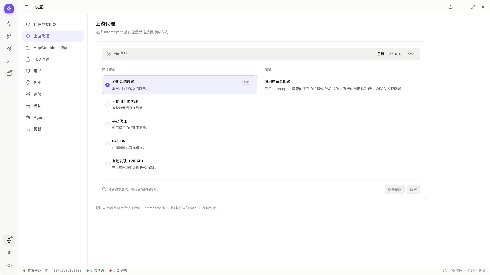

### 26 · Return to Capture and confirm Recording

[Video 01:15](../media/v0.1.1-alpha.1/workspace-navigation/workspace-navigation.mp4#t=75.333) · [Back to the video](#walkthrough-workspace-navigation-video)

### 27 · Verify a request after navigation

[Video 01:18](../media/v0.1.1-alpha.1/workspace-navigation/workspace-navigation.mp4#t=78.273) · [Back to the video](#walkthrough-workspace-navigation-video)

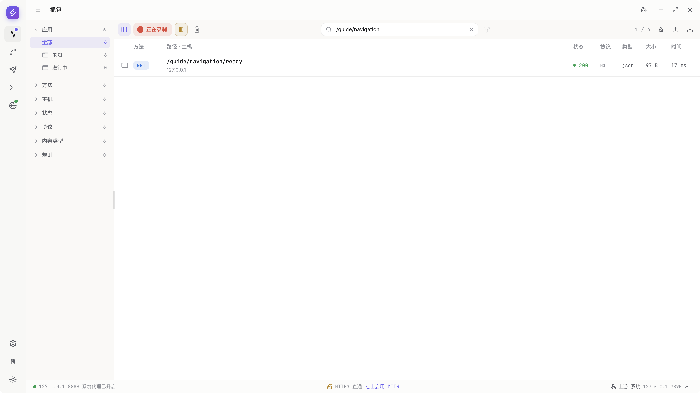

The complete reference follows. Only operations with matching real step images and checked input values count as illustrated acceptance.
<!-- recorded-walkthrough:workspace-navigation:end -->

<!-- recorded-walkthrough:workspace-window-controls:start -->

## Recorded walkthrough: native window maximize, restore and minimize

These images and video show the published <code>0.1.1-alpha.1</code> on macOS x64, retaining the App language <code>zh-CN</code>. Every recorded step has its own native-window screenshot; open an image at full size to inspect values.

Loopback addresses, ports and generated IDs belong to this recording, not a public service. Use your own authorized test environment. The actual values below match the screenshots and video. Advanced branches not shown here still need their own step images and acceptance.

| Example field | Actual recorded value |
| --- | --- |
| <code>workspace</code> | <code>Settings &gt; Privacy</code> |
| <code>initialSize</code> | <code>1600x900</code> |
| <code>maximize</code> | <code>Actual product Maximize and Restore clicks</code> |
| <code>minimize</code> | <code>Actual product Minimize click; the button image precedes the click</code> |
| <code>restoreBoundary</code> | <code>Test-side accessibility restores the same owned window for continued verification; no Dock interaction is claimed</code> |
| <code>recordingScope</code> | <code>Only the App window; no display, desktop or other application capture</code> |

<video controls preload="metadata" playsinline lang="en" src="../media/v0.1.1-alpha.1/workspace-window-controls/workspace-window-controls.mp4" poster="../media/v0.1.1-alpha.1/workspace-window-controls/workspace-window-controls-01-normal.png">
<track kind="captions" srclang="zh-CN" label="Steps / 步骤" src="../media/v0.1.1-alpha.1/workspace-window-controls/workspace-window-controls.vtt" default>
</video>

### 01 · Inspect the current normal window

[Video 00:00](../media/v0.1.1-alpha.1/workspace-window-controls/workspace-window-controls.mp4#t=0.436) · [Back to the video](#walkthrough-workspace-window-controls-video)

### 02 · Click Maximize

[Video 00:03](../media/v0.1.1-alpha.1/workspace-window-controls/workspace-window-controls.mp4#t=3.689) · [Back to the video](#walkthrough-workspace-window-controls-video)

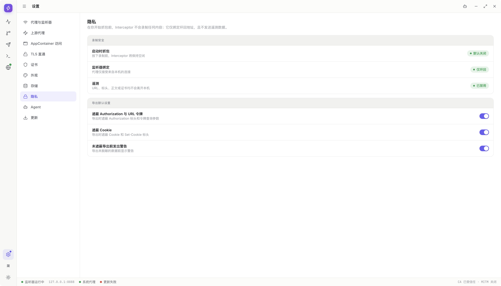

### 03 · Click again to restore the window

[Video 00:07](../media/v0.1.1-alpha.1/workspace-window-controls/workspace-window-controls.mp4#t=7.592) · [Back to the video](#walkthrough-workspace-window-controls-video)

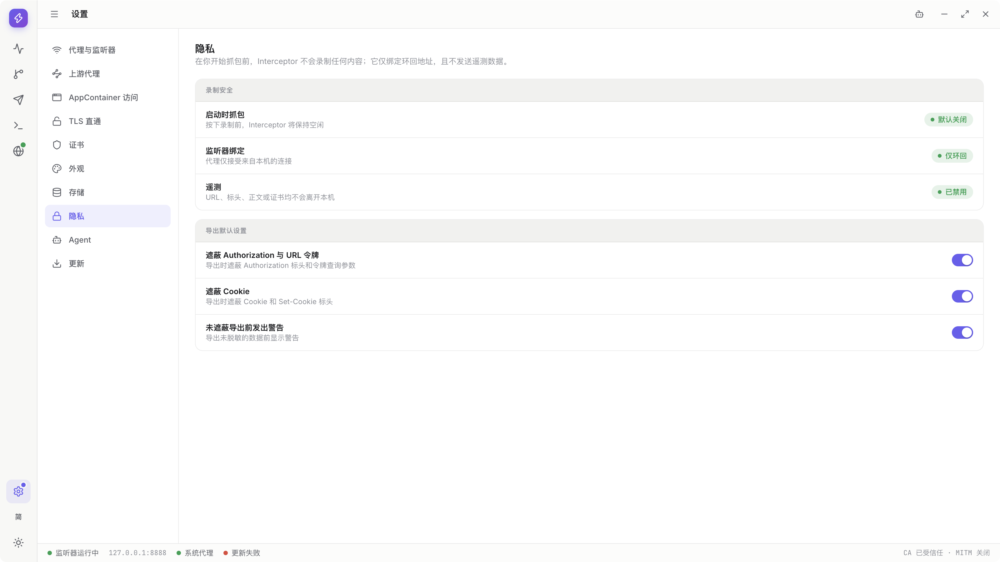

### 04 · Inspect Minimize before actually clicking it

[Video 00:11](../media/v0.1.1-alpha.1/workspace-window-controls/workspace-window-controls.mp4#t=11.531) · [Back to the video](#walkthrough-workspace-window-controls-video)

### 05 · Inspect the returned window without recording the Dock

[Video 00:16](../media/v0.1.1-alpha.1/workspace-window-controls/workspace-window-controls.mp4#t=16.893) · [Back to the video](#walkthrough-workspace-window-controls-video)

The complete reference follows. Only operations with matching real step images and checked input values count as illustrated acceptance.
<!-- recorded-walkthrough:workspace-window-controls:end -->
