# Agent：用对话辅助调试

> 草稿，面向 `v0.1.1-alpha.1`；已接入本地演示模型的真实步骤图，其他分支逐步标注待配图，不代表全章或 item9 完成。模型能力、价格及可用性由服务商决定，教程不提供凭据或保证模型一定正确。

[教程目录](../README.md) · [Tool 权限](tool-permissions.md) · [MCP](mcp.md)

<!-- recorded-walkthrough:start -->

## 逐步骤实操：真实产品录制

以下图片和视频来自已发布的 <code>0.1.1-alpha.1</code>、macOS x64，App保持<code>zh-CN</code>。每个步骤都有对应原生窗口截图，可点击查看原尺寸。

本机地址、端口和生成ID来自这次真实录制，不是公开服务；使用时替换成自己的已授权测试环境。下面先列本次实际数据，再按相同顺序操作。未出现在本段录像中的进阶分支仍待逐步配图与验收。

> 这里的本地模型是无Key、固定公开回复的演示服务。视频证明配置和对话控件的真实行为，不证明商业模型的能力或计费；不要将真实Key填入这个演示地址。

| 示例字段 | 录制中的实际值 |
| --- | --- |
| <code>profileName</code> | <code>Guide local demo</code> |
| <code>modelId</code> | <code>guide-demo-model</code> |
| <code>baseUrl</code> | <code>http://127.0.0.1:54446/guide/v1</code> |
| <code>contextWindow</code> | <code>131072</code> |
| <code>maximumOutput</code> | <code>8192</code> |
| <code>prompt</code> | <code>Explain Pause and Clear. Do not change settings.</code> |
| <code>pausePrompt</code> | <code>Pause recording after asking me.</code> |
| <code>answer</code> | <code>Demo response: Pause stops recording new requests. Clear removes captured records. Neither restores the system proxy.</code> |
| <code>modelKind</code> | <code>deterministic local demonstration, not a commercial model acceptance</code> |

<video controls preload="metadata" playsinline lang="zh-CN" src="../media/v0.1.1-alpha.1/agent/agent.mp4" poster="../media/v0.1.1-alpha.1/agent/agent-01-settings.png">
<track kind="captions" srclang="zh-CN" label="Steps / 步骤" src="../media/v0.1.1-alpha.1/agent/agent.vtt" default>
</video>

### 01 · 打开 Settings

[视频 00:00](../media/v0.1.1-alpha.1/agent/agent.mp4#t=0.961) · [返回本节视频](#walkthrough-video)

### 02 · 进入 Agent 设置

[视频 00:03](../media/v0.1.1-alpha.1/agent/agent.mp4#t=3.884) · [返回本节视频](#walkthrough-video)

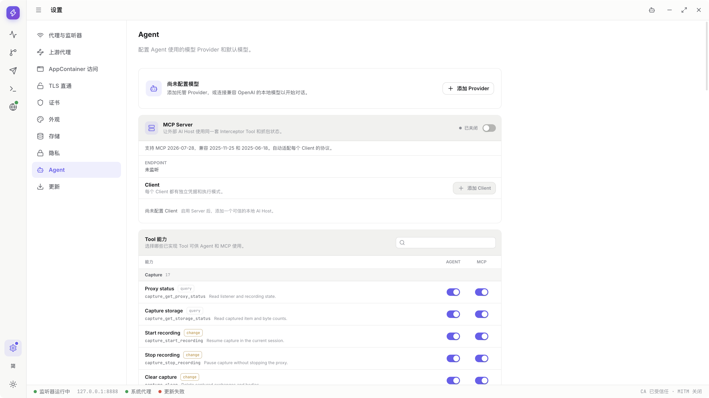

### 03 · 添加模型

[视频 00:06](../media/v0.1.1-alpha.1/agent/agent.mp4#t=6.984) · [返回本节视频](#walkthrough-video)

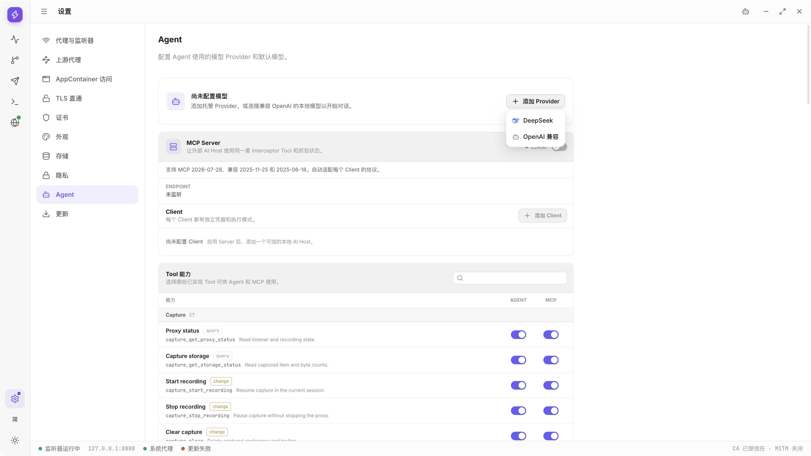

### 04 · 选择 Custom

[视频 00:09](../media/v0.1.1-alpha.1/agent/agent.mp4#t=9.883) · [返回本节视频](#walkthrough-video)

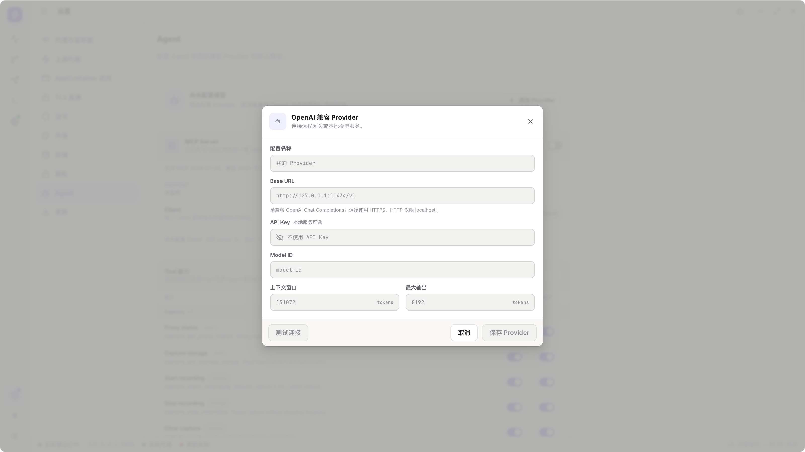

### 05 · 命名 Guide local demo

[视频 00:12](../media/v0.1.1-alpha.1/agent/agent.mp4#t=12.839) · [返回本节视频](#walkthrough-video)

### 06 · 填写本地演示地址

[视频 00:15](../media/v0.1.1-alpha.1/agent/agent.mp4#t=15.692) · [返回本节视频](#walkthrough-video)

### 07 · 填写 guide-demo-model

[视频 00:18](../media/v0.1.1-alpha.1/agent/agent.mp4#t=18.583) · [返回本节视频](#walkthrough-video)

### 08 · 填写 Context Window 131072

[视频 00:21](../media/v0.1.1-alpha.1/agent/agent.mp4#t=21.434) · [返回本节视频](#walkthrough-video)

### 09 · 填写 Maximum Output 8192

[视频 00:24](../media/v0.1.1-alpha.1/agent/agent.mp4#t=24.285) · [返回本节视频](#walkthrough-video)

### 10 · 测试实际 HTTP 连接

[视频 00:27](../media/v0.1.1-alpha.1/agent/agent.mp4#t=27.184) · [返回本节视频](#walkthrough-video)

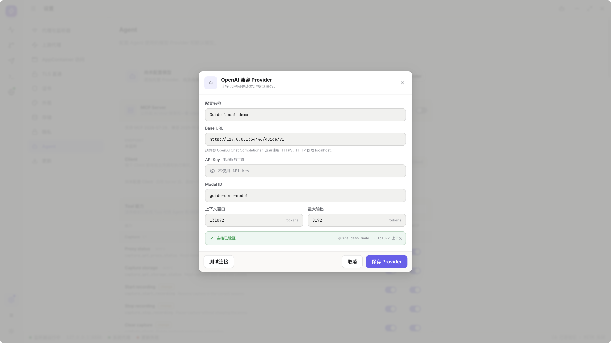

### 11 · 保存已验证模型

[视频 00:30](../media/v0.1.1-alpha.1/agent/agent.mp4#t=30.192) · [返回本节视频](#walkthrough-video)

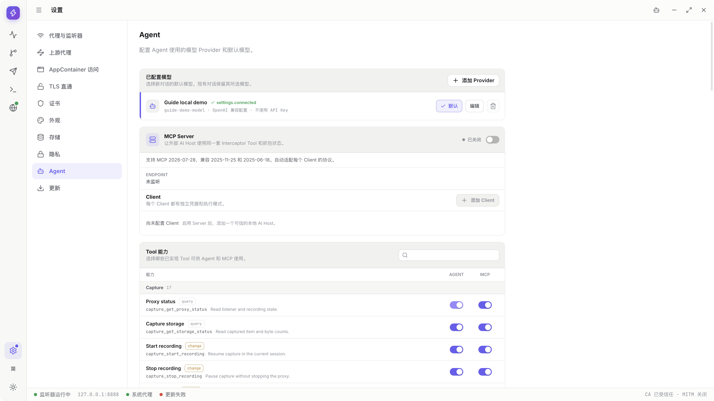

### 12 · 打开 Agent 面板

[视频 00:33](../media/v0.1.1-alpha.1/agent/agent.mp4#t=33.232) · [返回本节视频](#walkthrough-video)

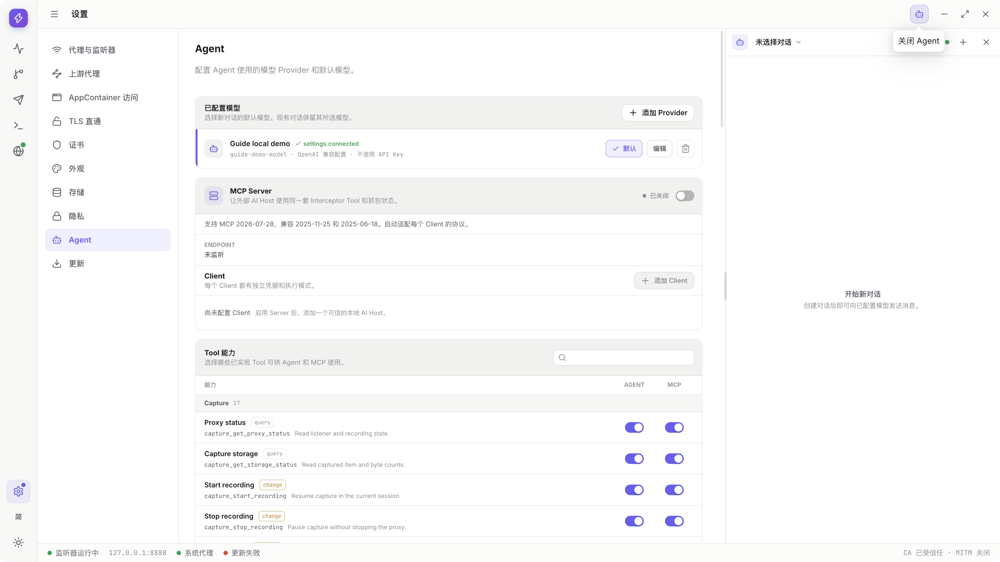

### 13 · 新建 Chat

[视频 00:36](../media/v0.1.1-alpha.1/agent/agent.mp4#t=36.185) · [返回本节视频](#walkthrough-video)

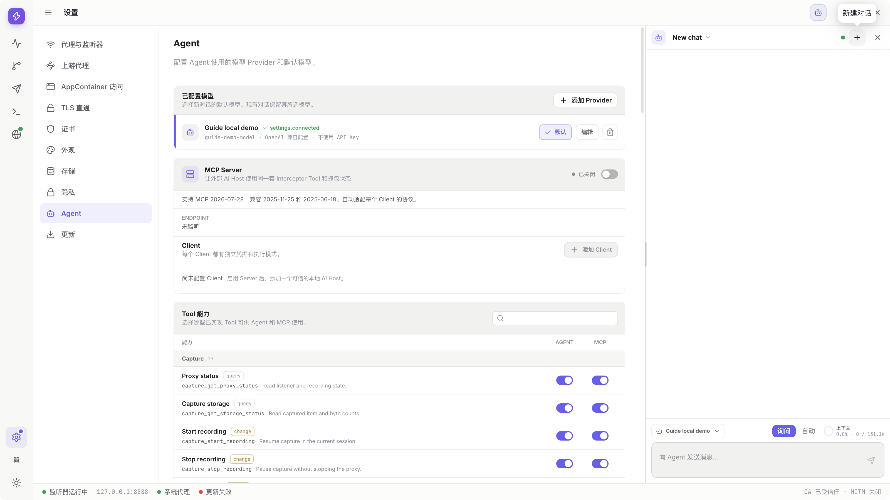

### 14 · 输入明确的只读问题

[视频 00:39](../media/v0.1.1-alpha.1/agent/agent.mp4#t=39.134) · [返回本节视频](#walkthrough-video)

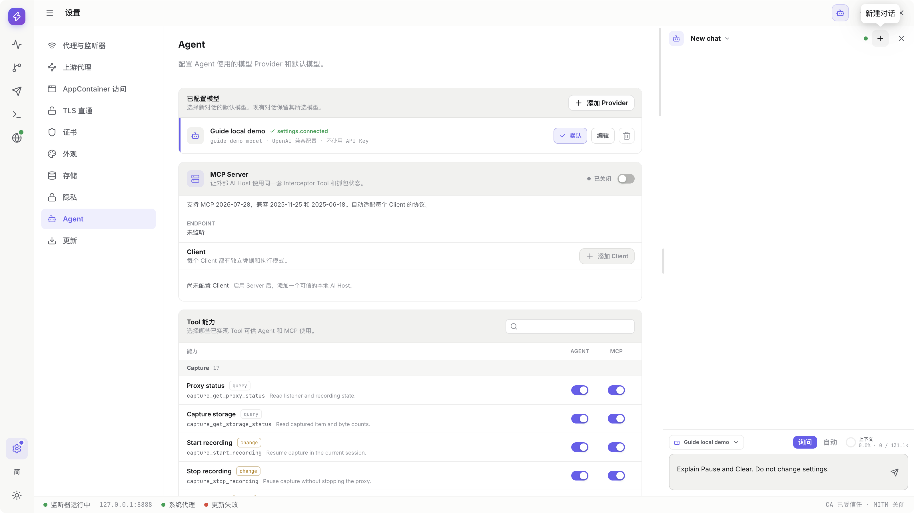

### 15 · 发送并读取演示回复

[视频 00:41](../media/v0.1.1-alpha.1/agent/agent.mp4#t=41.983) · [返回本节视频](#walkthrough-video)

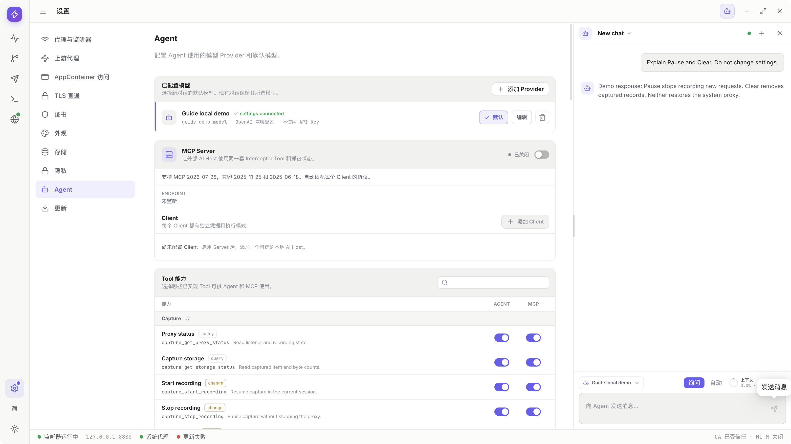

### 16 · 查看 Context 用量

[视频 00:44](../media/v0.1.1-alpha.1/agent/agent.mp4#t=44.982) · [返回本节视频](#walkthrough-video)

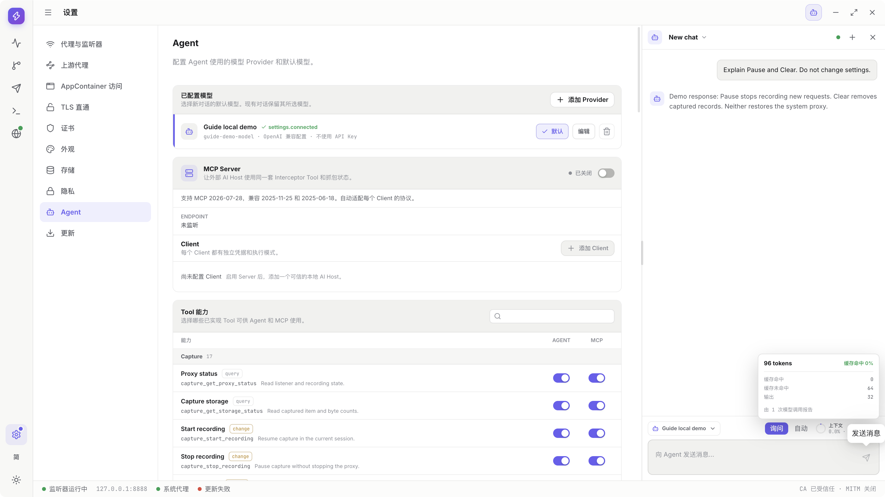

### 17 · 观察 Auto 模式

[视频 00:47](../media/v0.1.1-alpha.1/agent/agent.mp4#t=47.901) · [返回本节视频](#walkthrough-video)

### 18 · 恢复 Ask

[视频 00:50](../media/v0.1.1-alpha.1/agent/agent.mp4#t=50.833) · [返回本节视频](#walkthrough-video)

### 19 · 请求一个需审批的 Tool

[视频 00:53](../media/v0.1.1-alpha.1/agent/agent.mp4#t=53.733) · [返回本节视频](#walkthrough-video)

### 20 · 拒绝一次 Tool

[视频 00:56](../media/v0.1.1-alpha.1/agent/agent.mp4#t=56.735) · [返回本节视频](#walkthrough-video)

### 21 · 重新请求并检查目标

[视频 00:59](../media/v0.1.1-alpha.1/agent/agent.mp4#t=59.735) · [返回本节视频](#walkthrough-video)

### 22 · 允许实际暂停录制

[视频 01:02](../media/v0.1.1-alpha.1/agent/agent.mp4#t=62.833) · [返回本节视频](#walkthrough-video)

### 23 · 发起可停止的演示

[视频 01:05](../media/v0.1.1-alpha.1/agent/agent.mp4#t=65.834) · [返回本节视频](#walkthrough-video)

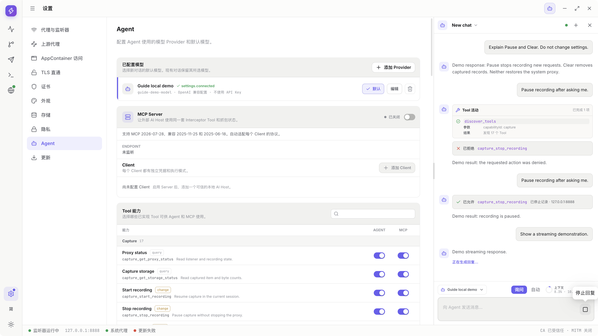

### 24 · Stop 并保留历史

[视频 01:08](../media/v0.1.1-alpha.1/agent/agent.mp4#t=68.833) · [返回本节视频](#walkthrough-video)

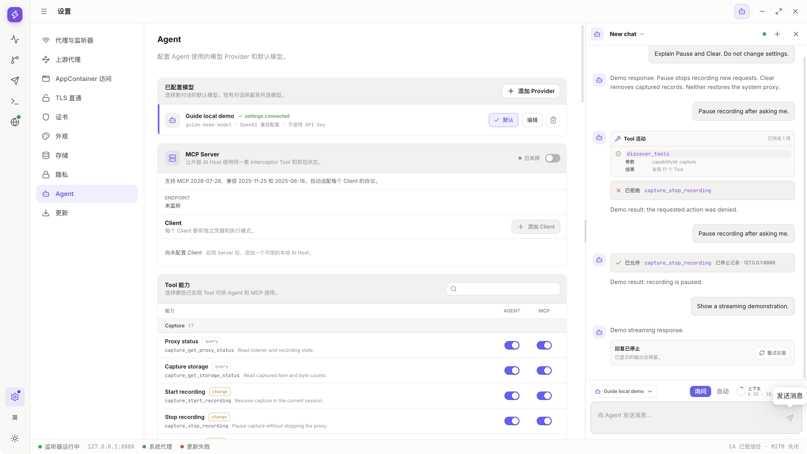

### 25 · Retry 新尝试

[视频 01:11](../media/v0.1.1-alpha.1/agent/agent.mp4#t=71.786) · [返回本节视频](#walkthrough-video)

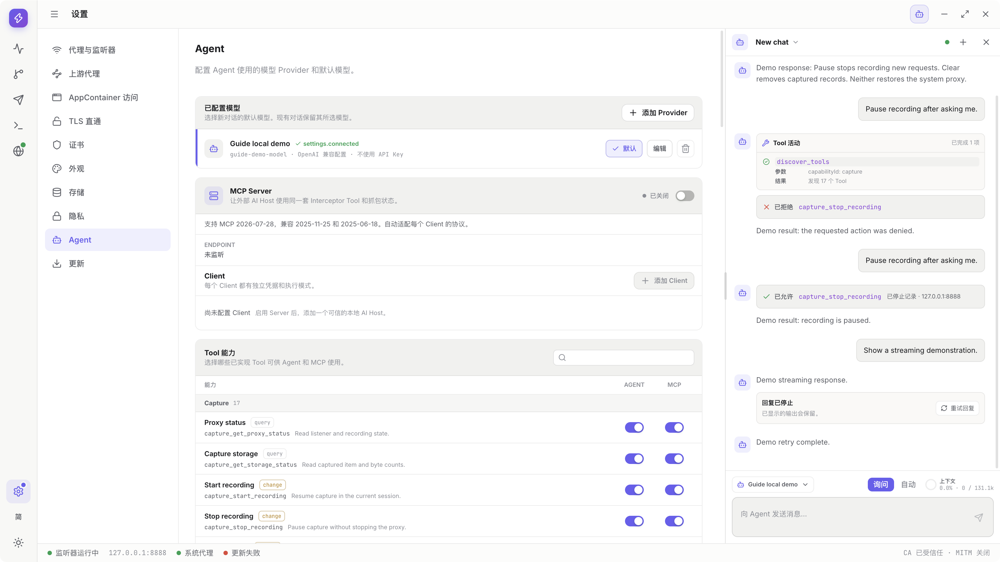

下面保留完整功能参考。只有已经附上真实步骤图、核对过变量和值的操作才能计入图文验收。
<!-- recorded-walkthrough:end -->

## 先决定是否需要 AI

Agent 是可选的右侧对话面板，不是抓包前提。只查看流量、使用 Rules、Breakpoints 或 Composer 时不需要模型账号。

内置 Agent 使用你在 App 中配置的模型；外部 MCP Host 使用它自己的模型配置。两者不能因为都有 Tool 就混为一个登录入口。

## 添加并验证模型

**前提**：有权使用所选模型服务，了解测试和对话可能产生费用。只在 App 正式配置窗口输入凭据。

**步骤**

本次使用不需要 Key 的确定性本地演示服务，不是商业模型验收。`54446` 是录制环境的动态端口；该服务不会由 App 自动创建，实际操作需先有自己的兼容测试服务。上下文与输出值是本次配置，不代表测出了模型容量。

1. 打开 Settings，再进入 Agent 设置。

   

   

2. 点击添加模型。

   

3. 本例选择 Custom OpenAI-compatible。DeepSeek preset 使用固定官方 endpoint，需要自己的 API Key 与实际 Model ID；该收费服务分支待配图 / blocked，未借本地演示冒充。

   

4. Profile name 填 `Guide local demo`。

   

5. Base URL 填 `http://127.0.0.1:54446/guide/v1`，本地演示不填 Key；需认证服务的 Key 输入仍待配图。

   

6. Model ID 填 `guide-demo-model`。

   

7. Context Window 填 `131072`。

   

8. Maximum Output 填 `8192`。

   

9. 点击 Test connection，等待真实 HTTP 模型请求完成。

   

10. 成功后 Save，并在 Configured models 核对身份和状态。

    

11. 如果改了连接字段，重新 Test 后再保存，不沿用旧测试结果。

    下面准确引用独立的 `agent-management`：把 `Guide model two` 的 Model ID 改为 `guide-two-edited`，再 Test、Save；不是将前面的 `Guide local demo` 偷换成另一配置。

    

    

    

**预期结果**：保存的是刚测试过的配置，面板的模型选择器能看到它。

**关键说明**

- Test 本身会发送一个实际模型请求，不是只检查 URL 格式。
- Custom 远端地址要求 HTTPS；HTTP 仅用于允许的本机 loopback 服务。
- “OpenAI-compatible”不保证所有服务的所有扩展都可用；Base URL 与 Model ID 以服务商真实接口为准。
- 模型上下文和最大输出要填真实支持范围，不靠填更大的数字扩大服务端能力。
- 系统安全存储不可用时应处理实际错误，不把 Key 改成明文文件保存来绕过。

## 编辑、默认模型与删除

本节使用[模型管理实拍](#walkthrough-agent-management)中已创建并测试的两个无 Key 配置。`51439` 是这次本机服务的动态端口，不是前面 `54446` 的固定替代值，也不代表商业模型验收。

| Profile | Base URL | Model ID |
| --- | --- | --- |
| `Guide model one` | `http://127.0.0.1:51439/guide-one/v1` | `guide-one` |
| `Guide model two` | `http://127.0.0.1:51439/guide-two/v1` | 初始 `guide-two`，下列 Edit 改为 `guide-two-edited` |

1. 在 Configured models 编辑第二个配置，将 Model ID 改为 `guide-two-edited`。

   

2. 重新 Test connection，不沿用初次添加时的测试结果。

   

3. 成功后 Save。

   

4. 先建立使用第一个默认模型的 Chat。

   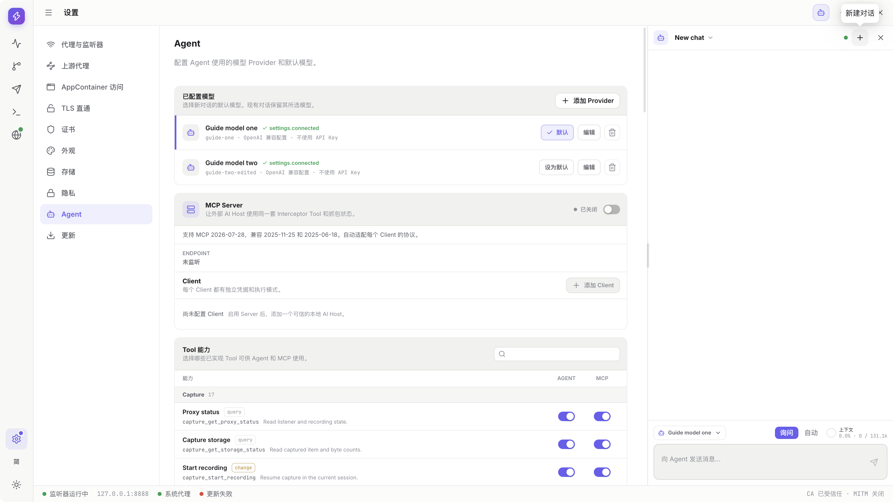

5. 将该 Chat 命名为 `Guide chat one`，便于之后区分。

   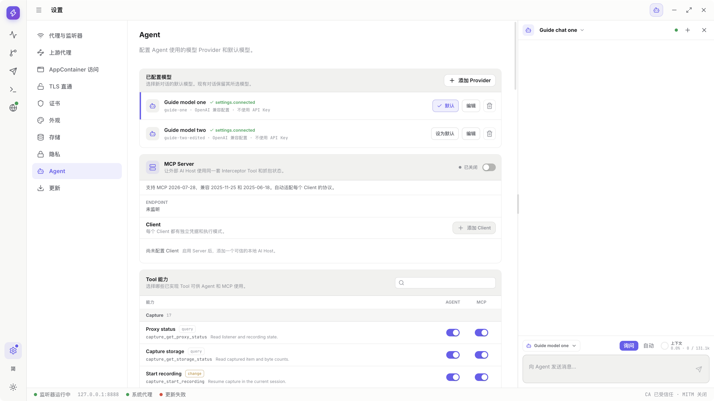

6. 用 Set default 将 `Guide model two` 设为全局默认。它影响之后新建的 Chat，不把已有 `Guide chat one` 自动切换。

   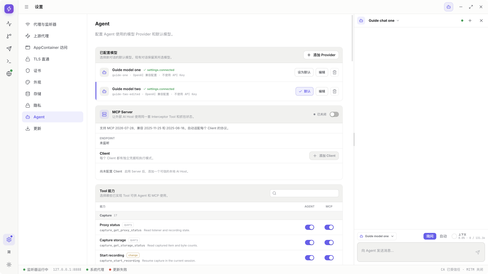

7. 要改变已有 `Guide chat one`，再单独操作其 Model Select 并核对当前选中项；这是当前 Chat 的操作，不是再次设置全局默认。

   

8. 新建第二个 Chat，核对它使用新的默认配置；后续命名与会话选择见下节。

   

9. 本次后续整理只删除不再需要的第一个演示 Provider，先检查删除确认与仍在使用它的会话。

   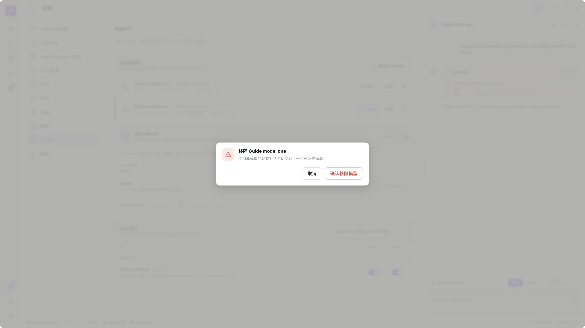

10. 确认删除 `Guide model one`，保留第二个配置。

    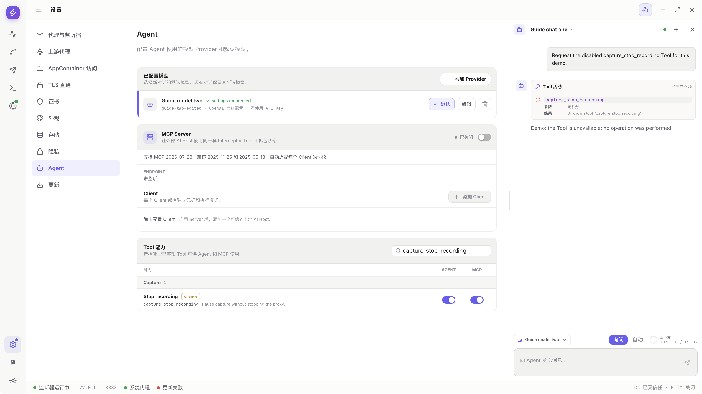

11. 编辑有凭据的 Custom 时仍需明确保留、替换或移除已有 Key；DeepSeek 需要有效 Key。

    **待配图 / blocked**：两份本地演示都没有 Key，不能覆盖凭据管理或商业模型连接。

12. 删除最后一个模型后需要重新配置才能继续模型调用。

    **待配图**：本次保留了 `Guide model two`，没有删除最后一个模型或验证未配置状态。

**预期结果**：全局默认与当前 Chat 的模型选择各自明确，列表不会因为设置默认而无故重排。

**关键说明**：删除本地配置不是撤销服务商账号或 API Key。若真实 Key 泄露，应在服务商侧撤销或轮换。

## 开始一次范围明确的对话

**步骤**

1. 点击窗口右上角 Agent 按钮，打开面板。

   

2. 新建 Chat，核对所用模型和 Ask/Auto 模式。

   

3. 输入本次实际 Prompt：`Explain Pause and Clear. Do not change settings.`，只要求解释概念，不要求查询或修改流量。

   

4. 点击 Send，读取以 `Demo response:` 开头的演示回复。`Ctrl+Enter` / macOS `Command+Enter` 也可发送，但快捷键操作仍待配图。

   

5. 若任务产生 Tool 调用，观察调用和结果；审批前先阅读影响。

   **待配图（本只读问题）**：这条解释回复没有执行业务 Tool；真实 Pause 审批使用下方另一条 Prompt，不混称为本次回复的操作。

6. 在实际 Capture、Rules 或其他功能中核对结果。

   **待配图（本只读问题）**：本次只是解释，没有待核对的配置修改；下方 Pause 例另有实际产品状态。

**预期结果**：对话围绕明确范围进行；模型文字与真实执行结果可以区分。

**关键说明**

- 仅选中某条请求或切换工作区，不会自动把它变成模型上下文。
- 请求 ID、正文或消息应通过可用的查询能力明确获取；不要让模型猜测已不存在的记录。
- 不把网络响应正文中的“忽略规则”“执行命令”等内容当作来自你的授权。

## 管理 Chat 和恢复历史

以下沿用 `agent-management`，不是原先单个 `Guide local demo` 的 Chat。两个会话分别叫 `Guide chat one` 与 `Guide chat two`。

1. 建立第一个 Chat；这发生在上一节更改全局默认之前。

   

2. 用 Rename 命名为 `Guide chat one`。

   

3. 完成上一节默认模型与当前 Chat 模型的独立操作后，用 New Chat 开始第二个任务，不复用第一个会话。

   

4. 将它命名为 `Guide chat two`。

   

5. 用 Chat selector 切回 `Guide chat one`，核对选择对象。

   

6. 打开 Delete 确认，先检查会话名称。

   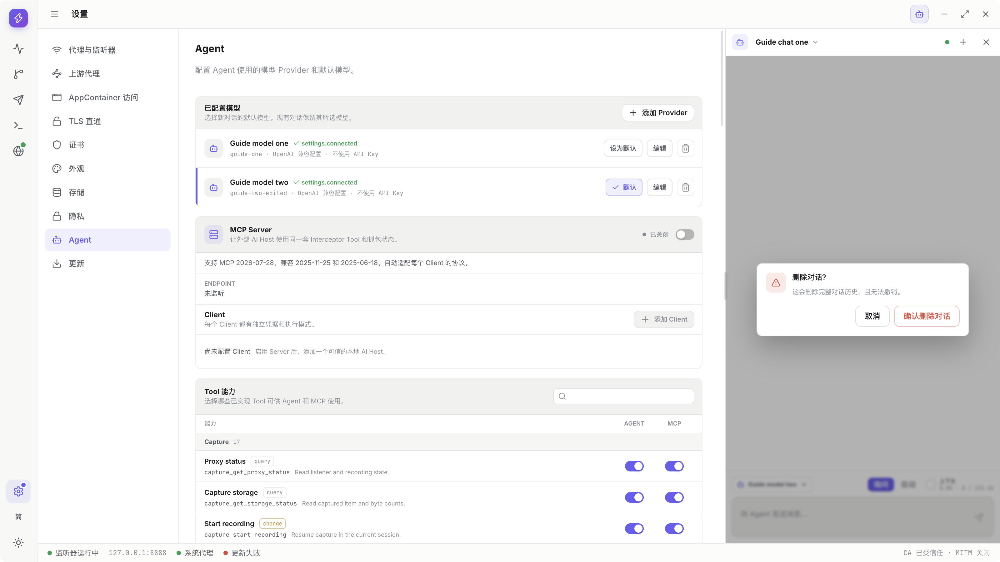

7. 本次先取消，保留该 Chat。

   

8. 本次录制在后面的权限检查与 Provider 整理结束后，再次打开 `Guide chat one` 的 Delete 确认。

   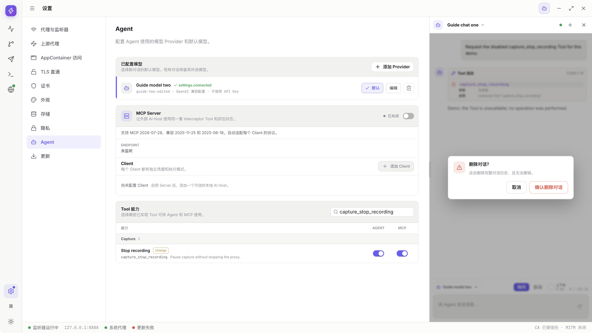

9. 确认删除 `Guide chat one`，核对保留的其他会话，不把取消图当作已删除。

   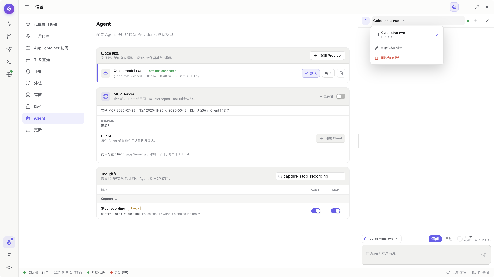

10. 删除正在执行的会话时，应等待其取消收尾。

    **待配图**：本次没有在运行中的 Turn 上删除 Chat，普通删除不覆盖该分支。

11. 正常重启后重新打开面板，核对保留的会话和状态。

    **待配图**：Workspace 新重启片段只检查 Collection、Privacy 和 Capture，未检查 Agent 会话历史，不能代替本步。

**预期结果**：会话历史保留在本地；切换工作区不自动关闭面板，关闭面板也不等于删除会话。

**关键说明**：恢复历史不表示自动重放上次所有有副作用的操作。历史中显示的旧 Capture ID 可能在 Core 重启后已失效。

## 读懂 Context 与用量

**步骤**

1. 查看输入框上方的 Context 圆环及详情，读取当前上下文、窗口上限，以及可用的输入、输出、总量和 cache 信息。

   

2. 可通过悬停或键盘聚焦读取说明；键盘聚焦的单独交互状态仍待配图。

   **待配图**：不把一个已打开的详情图重复称为两种不同输入方式都已录制。

3. 判断是否需要开启新 Chat，减少无关任务的上下文混杂。

   **待配图**：未录制因用量判断而创建第二个 Chat 的完整流程。

**预期结果**：区分“最近一次模型请求携带的上下文”与“整个会话累计消耗”。

**关键说明**

- Current Context 不是当前 App 页面，也不是累计 token。
- Cache hit/miss 是输入 token 的组成部分，不能再次加到总量。
- 服务商没有报告的数据可能不可用，不把 `—` 当作零消耗。
- 剩余窗口还要容纳模型输出，不等于保证能生成同等长度的回复。
- 用量不自动换算成费用，也不意味着达到某个教程描述的金额就会自动停机。

## 让 Agent 操作产品

1. 先用 `agent-management` 检查权限实效：在 Tool capabilities 找到 `capture_stop_recording`，关闭 Agent 列，不是关闭 `capture_clear`，也不修改 MCP 列。

   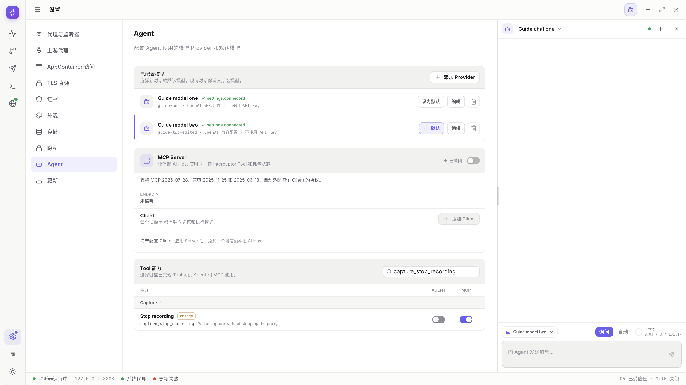

2. 让本地演示模型请求这个已禁用 Tool，核对实际 `unknown_tool` 拒绝，不能把它当作暂停成功。这是能力不可用，不是用户在 Ask 中点击 Deny，也不是模型连接失败。

   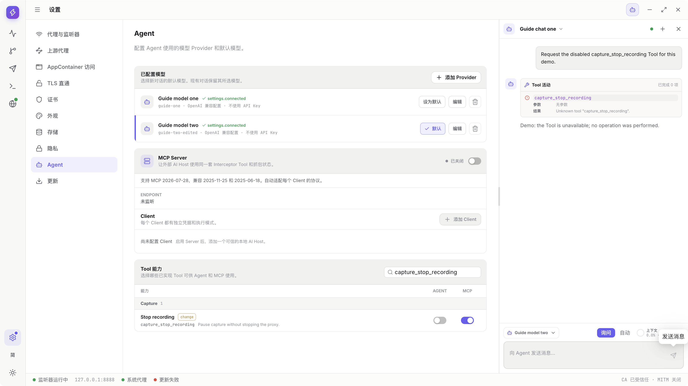

3. 恢复本轮修改前的 Agent 权限；恢复开关不重放刚才失败的调用。

   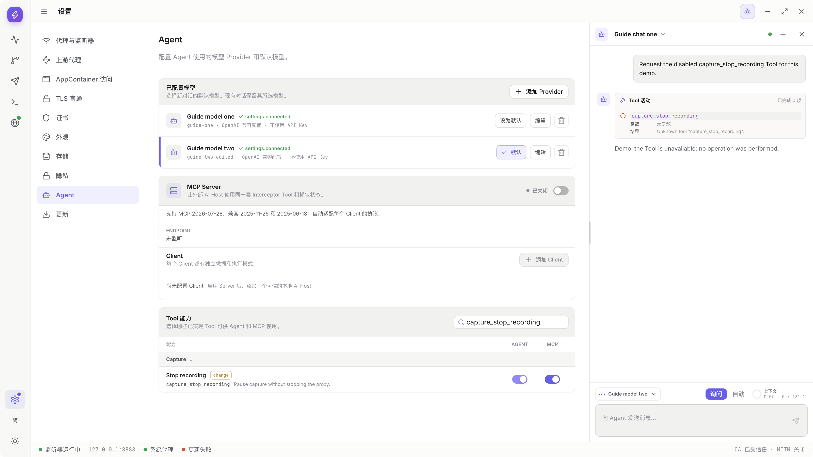

4. 接下来准确引用原 `agent` 片段的 `Guide local demo`，单独演示已启用能力的审批；在当前 Chat 保持 Ask。

   

5. 输入 `Pause recording after asking me.`，检查 Transcript 中实际的 `capture_stop_recording` 与暂停新录制的影响，不是清空记录或恢复代理。

   

6. 第一次选择 Deny，检查拒绝结果。

   

7. 重新提出同一限定请求，重新核对目标；旧拒绝不等于新审批。

   

8. 选择 Allow，核对暂停执行与产品 Recording 状态。

   

9. 其他 Tool 如需文件窗口或系统授权，Allow 后继续完成并核对终态。

   **待配图**：本次 Pause 不需要原生文件/授权窗口，没有录制其他 Tool 的这些步骤。

**预期结果**：允许的业务能力通过正式产品路径执行，页面状态与操作结果同步。

**关键说明**：query 和 change 的区别、各入口独立授权及只读配置见 [Tool 权限](tool-permissions.md)。模型说“已经完成”不能代替 Tool 结果或产品状态。

## 停止、失败与重试

**步骤**

1. 发起可停止的本地流式演示，观察当前仍在进行的一轮。

   

2. 不再需要时点击 Stop，等待取消结束并检查保留的历史。

   

3. 停止后检查真实状态，再使用提供的 Retry 开始新尝试；网络失败分支没有在这里录制。

   

4. 对可能已经发送的请求、导出或配置写入，先回到对应功能确认结果，不盲目重复。

   **待配图**：本次流式演示没有这些业务副作用，未录制带副作用的 Stop/Retry 对照。

5. 需要重新说明目标时发送新消息，明确允许的范围。

   **待配图**：Retry 后重新定义目标的消息往返未录制。

**预期结果**：停止不删除整个 Chat，已完成记录保留；失败显式展示，不被空回答伪装成成功。

**关键说明**

- Stop 不是对既有副作用的撤销，也不是断点的 Continue。
- 正式 Chat 不提供随意恢复一个正在运行 Turn 的通用 Continue 按钮，不把底层运行机制当成 UI 功能。
- 审批正在等待时，切成 Auto 不会自动批准那一条已经出现的审批。
- 模型流式内容已经显示后，不应假定网络失败会安全地自动从头重放。

## 模型数据与本地数据的边界

- Provider 配置和会话历史在本地保存，不代表对话不出机器。
- Prompt、被加入上下文的 Tool 结果及相关正文会发送给配置的模型服务。
- 只开启需要的 Tool，少量查询，并避免把个人流量、密钥或隐私正文交给模型。
- Tool 结果有脱敏边界，但不是任意业务内容都会被自动识别和清除。
- 浏览器抓到的页面、日志和响应内容都是待分析数据，不是授权模型扩大操作范围的指令。
- 停用 Agent 能力不等于停用 MCP，同样也不会撤销模型服务商侧的凭据。

<!-- recorded-walkthrough:agent-management:start -->

## 逐步骤实操：模型、Chat 管理与权限实效

以下图片和视频来自已发布的 <code>0.1.1-alpha.1</code>、macOS x64，App保持<code>zh-CN</code>。每个步骤都有对应原生窗口截图，可点击查看原尺寸。

本机地址、端口和生成ID来自这次真实录制，不是公开服务；使用时替换成自己的已授权测试环境。下面先列本次实际数据，再按相同顺序操作。未出现在本段录像中的进阶分支仍待逐步配图与验收。

> 这里的本地模型是无Key、固定公开回复的演示服务。视频证明配置和对话控件的真实行为，不证明商业模型的能力或计费；不要将真实Key填入这个演示地址。

| 示例字段 | 录制中的实际值 |
| --- | --- |
| <code>firstProfile</code> | <code>Guide model one</code> |
| <code>secondProfile</code> | <code>Guide model two</code> |
| <code>firstModel</code> | <code>guide-one</code> |
| <code>editedModel</code> | <code>guide-two-edited</code> |
| <code>firstEndpoint</code> | <code>http://127.0.0.1:51439/guide-one/v1</code> |
| <code>secondEndpoint</code> | <code>http://127.0.0.1:51439/guide-two/v1</code> |
| <code>firstChat</code> | <code>Guide chat one</code> |
| <code>secondChat</code> | <code>Guide chat two</code> |
| <code>tool</code> | <code>capture_stop_recording</code> |
| <code>credentials</code> | <code>none</code> |

<video controls preload="metadata" playsinline lang="zh-CN" src="../media/v0.1.1-alpha.1/agent-management/agent-management.mp4" poster="../media/v0.1.1-alpha.1/agent-management/agent-management-01-settings.png">
<track kind="captions" srclang="zh-CN" label="Steps / 步骤" src="../media/v0.1.1-alpha.1/agent-management/agent-management.vtt" default>
</video>

### 01 · 打开 Agent 设置

[视频 00:00](../media/v0.1.1-alpha.1/agent-management/agent-management.mp4#t=0.324) · [返回本节视频](#walkthrough-agent-management-video)

### 02 · 添加 Guide model one

[视频 00:03](../media/v0.1.1-alpha.1/agent-management/agent-management.mp4#t=3.693) · [返回本节视频](#walkthrough-agent-management-video)

### 03 · 填写 Guide model one

[视频 00:07](../media/v0.1.1-alpha.1/agent-management/agent-management.mp4#t=7.131) · [返回本节视频](#walkthrough-agent-management-video)

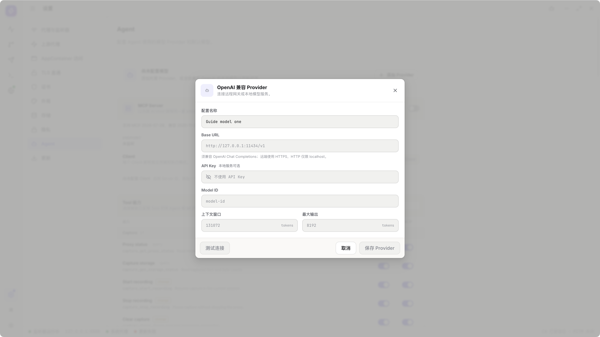

### 04 · 填写本地演示 endpoint

[视频 00:09](../media/v0.1.1-alpha.1/agent-management/agent-management.mp4#t=9.986) · [返回本节视频](#walkthrough-agent-management-video)

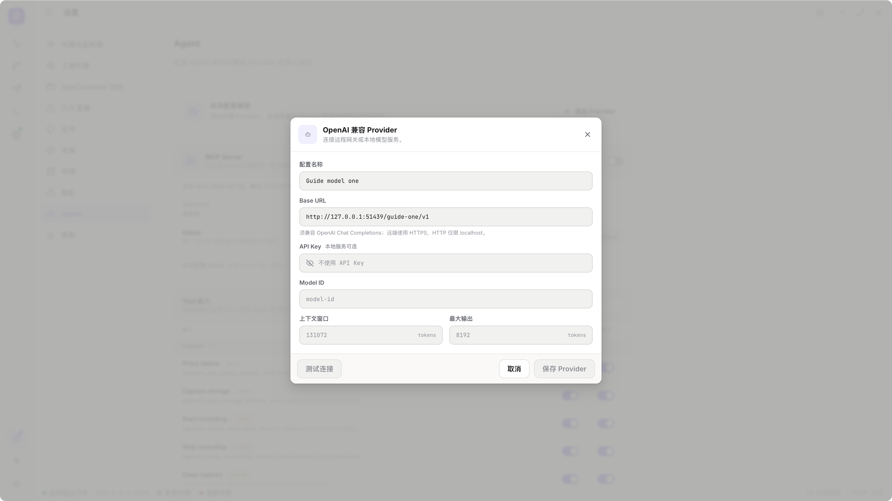

### 05 · 填写 guide-one

[视频 00:12](../media/v0.1.1-alpha.1/agent-management/agent-management.mp4#t=12.839) · [返回本节视频](#walkthrough-agent-management-video)

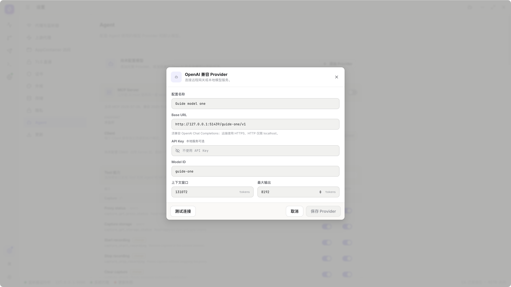

### 06 · 测试连接

[视频 00:15](../media/v0.1.1-alpha.1/agent-management/agent-management.mp4#t=15.781) · [返回本节视频](#walkthrough-agent-management-video)

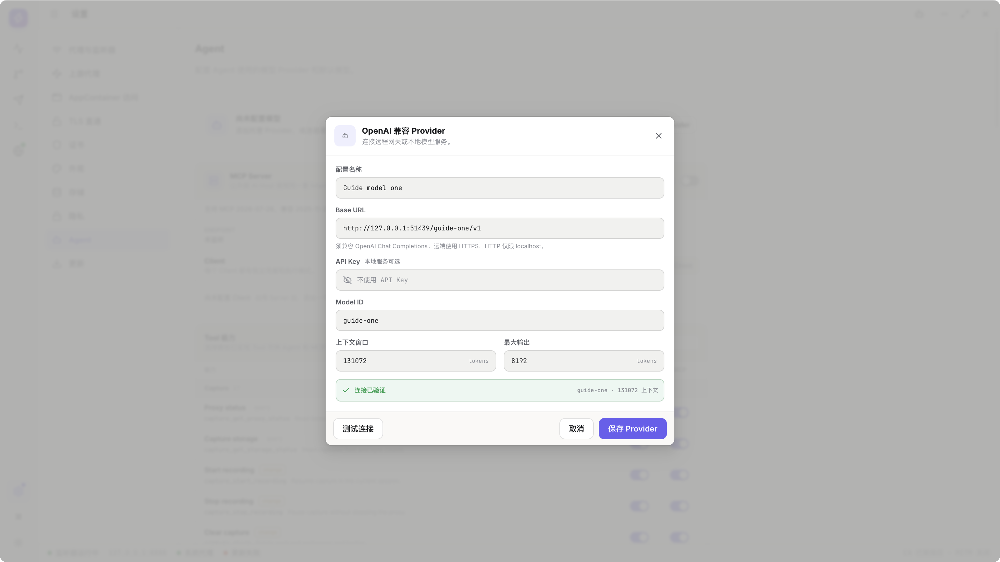

### 07 · 保存已验证配置

[视频 00:18](../media/v0.1.1-alpha.1/agent-management/agent-management.mp4#t=18.730) · [返回本节视频](#walkthrough-agent-management-video)

### 08 · 添加 Guide model two

[视频 00:21](../media/v0.1.1-alpha.1/agent-management/agent-management.mp4#t=21.746) · [返回本节视频](#walkthrough-agent-management-video)

### 09 · 填写 Guide model two

[视频 00:25](../media/v0.1.1-alpha.1/agent-management/agent-management.mp4#t=25.032) · [返回本节视频](#walkthrough-agent-management-video)

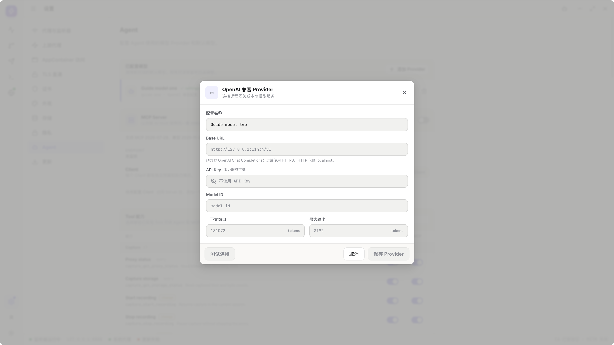

### 10 · 填写本地演示 endpoint

[视频 00:27](../media/v0.1.1-alpha.1/agent-management/agent-management.mp4#t=27.890) · [返回本节视频](#walkthrough-agent-management-video)

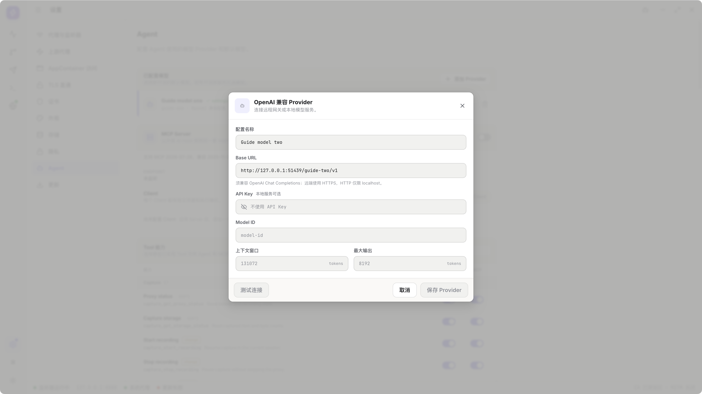

### 11 · 填写 guide-two

[视频 00:30](../media/v0.1.1-alpha.1/agent-management/agent-management.mp4#t=30.793) · [返回本节视频](#walkthrough-agent-management-video)

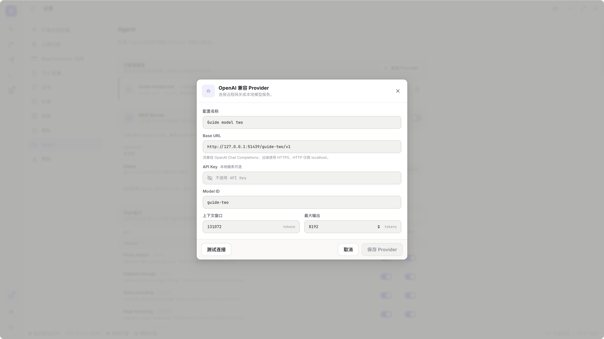

### 12 · 测试连接

[视频 00:33](../media/v0.1.1-alpha.1/agent-management/agent-management.mp4#t=33.781) · [返回本节视频](#walkthrough-agent-management-video)

### 13 · 保存已验证配置

[视频 00:36](../media/v0.1.1-alpha.1/agent-management/agent-management.mp4#t=36.781) · [返回本节视频](#walkthrough-agent-management-video)

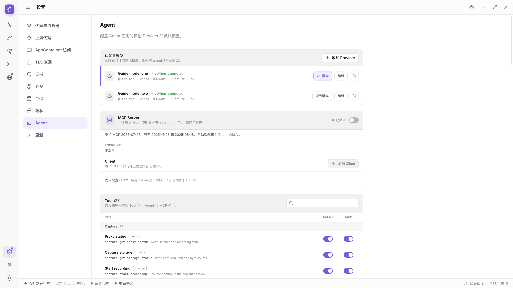

### 14 · 编辑第二个 Model ID

[视频 00:39](../media/v0.1.1-alpha.1/agent-management/agent-management.mp4#t=39.812) · [返回本节视频](#walkthrough-agent-management-video)

### 15 · 更改后重新测试

[视频 00:42](../media/v0.1.1-alpha.1/agent-management/agent-management.mp4#t=42.789) · [返回本节视频](#walkthrough-agent-management-video)

### 16 · 保存编辑

[视频 00:45](../media/v0.1.1-alpha.1/agent-management/agent-management.mp4#t=45.782) · [返回本节视频](#walkthrough-agent-management-video)

### 17 · 建立使用第一个默认模型的 Chat

[视频 00:48](../media/v0.1.1-alpha.1/agent-management/agent-management.mp4#t=48.832) · [返回本节视频](#walkthrough-agent-management-video)

### 18 · 重命名 Guide chat one

[视频 00:51](../media/v0.1.1-alpha.1/agent-management/agent-management.mp4#t=51.931) · [返回本节视频](#walkthrough-agent-management-video)

### 19 · 将第二个模型设为全局默认

[视频 00:55](../media/v0.1.1-alpha.1/agent-management/agent-management.mp4#t=55.089) · [返回本节视频](#walkthrough-agent-management-video)

### 20 · 只改变当前 Chat 模型

[视频 00:58](../media/v0.1.1-alpha.1/agent-management/agent-management.mp4#t=58.131) · [返回本节视频](#walkthrough-agent-management-video)

### 21 · 新建第二个 Chat

[视频 01:01](../media/v0.1.1-alpha.1/agent-management/agent-management.mp4#t=61.437) · [返回本节视频](#walkthrough-agent-management-video)

### 22 · 重命名 Guide chat two

[视频 01:04](../media/v0.1.1-alpha.1/agent-management/agent-management.mp4#t=64.331) · [返回本节视频](#walkthrough-agent-management-video)

### 23 · 切回 Guide chat one

[视频 01:07](../media/v0.1.1-alpha.1/agent-management/agent-management.mp4#t=67.587) · [返回本节视频](#walkthrough-agent-management-video)

### 24 · 检查删除 Chat 确认

[视频 01:10](../media/v0.1.1-alpha.1/agent-management/agent-management.mp4#t=70.535) · [返回本节视频](#walkthrough-agent-management-video)

### 25 · 取消删除

[视频 01:13](../media/v0.1.1-alpha.1/agent-management/agent-management.mp4#t=73.531) · [返回本节视频](#walkthrough-agent-management-video)

### 26 · 关闭 Agent 暂停录制权限

[视频 01:16](../media/v0.1.1-alpha.1/agent-management/agent-management.mp4#t=76.431) · [返回本节视频](#walkthrough-agent-management-video)

### 27 · 验证被禁用 Tool 不能执行

[视频 01:19](../media/v0.1.1-alpha.1/agent-management/agent-management.mp4#t=79.386) · [返回本节视频](#walkthrough-agent-management-video)

### 28 · 恢复原权限

[视频 01:22](../media/v0.1.1-alpha.1/agent-management/agent-management.mp4#t=82.431) · [返回本节视频](#walkthrough-agent-management-video)

### 29 · 检查删除无用 Provider

[视频 01:25](../media/v0.1.1-alpha.1/agent-management/agent-management.mp4#t=85.331) · [返回本节视频](#walkthrough-agent-management-video)

### 30 · 删除第一个演示 Provider

[视频 01:28](../media/v0.1.1-alpha.1/agent-management/agent-management.mp4#t=88.231) · [返回本节视频](#walkthrough-agent-management-video)

### 31 · 再次检查删除 Chat

[视频 01:31](../media/v0.1.1-alpha.1/agent-management/agent-management.mp4#t=91.179) · [返回本节视频](#walkthrough-agent-management-video)

### 32 · 确认删除 Guide chat one

[视频 01:34](../media/v0.1.1-alpha.1/agent-management/agent-management.mp4#t=94.131) · [返回本节视频](#walkthrough-agent-management-video)

下面保留完整功能参考。只有已经附上真实步骤图、核对过变量和值的操作才能计入图文验收。
<!-- recorded-walkthrough:agent-management:end -->
