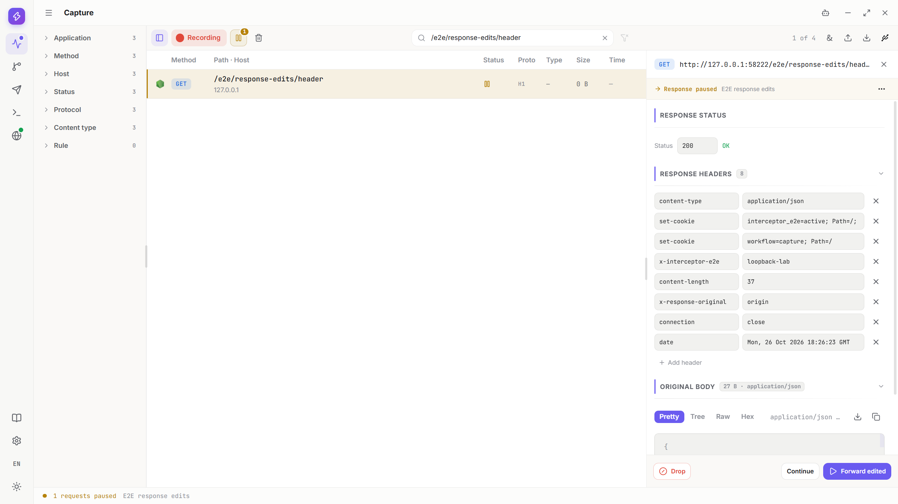
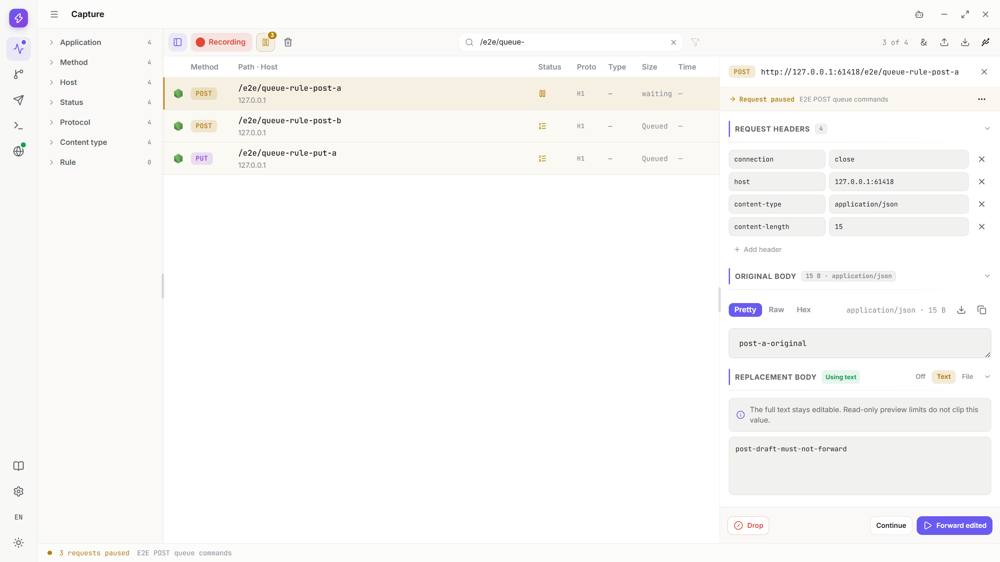
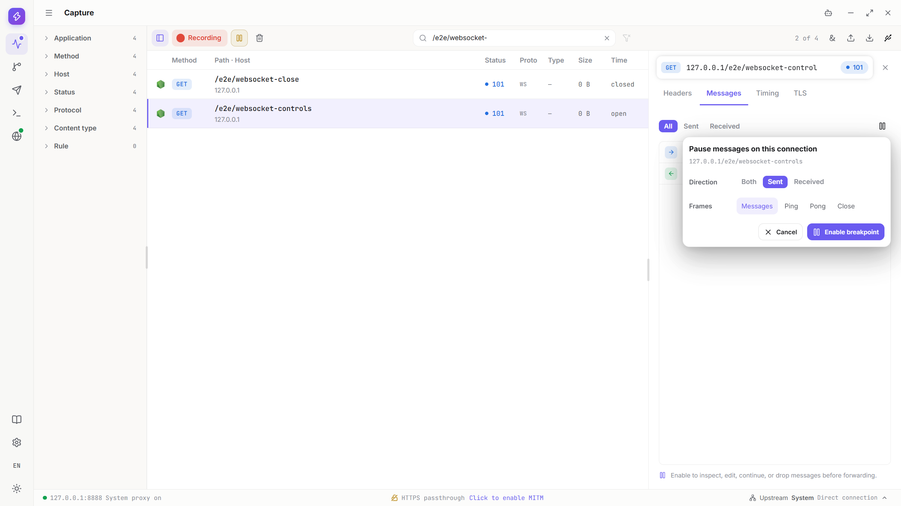

# Breakpoints：暂停流量后再决定如何继续

[教程目录](../README.md) · [Rules](rules.md) · [Capture](capture.md)

## 建立 HTTP 请求或响应断点

请求断点在请求继续前暂停，响应断点在响应交给客户端前暂停。先开启 Recording，并让客户端通过代理发往自己控制的服务。下面请求与响应是独立示例；切换时停用覆盖同一路径的另一条规则，避免无意挂起两个阶段。

1. 从侧栏打开 Rules。

   

2. 在规则树空白处右键，选择红框 1 的 New rule。

   

3. 在红框 1 填名称 `E2E request breakpoint`，先保持规则停用，补齐匹配与动作。

   

4. 红框 1 的 Host 填 `127.0.0.1`。实际服务不在本机时使用你有权调试的精确 Host，不直接扩大范围。

   

5. 通过 Add condition 添加 Path，在红框 1 填 `/e2e/`。实际练习最好进一步限制到自己的测试接口。

   

6. 移除默认 Header 动作，再从 Add action 选择红框 1 的 Breakpoint。移除默认动作后先别保存空动作规则。

   

   

7. 确认 Phase 为 Request。响应阶段需要另外选择 Response，而不是仅修改规则名称。

   

8. 开启规则，再点击红框 1 的 Save。等 Rule set applied 后才发新的请求；未填完整时先处理校验提示。

   

   

9. 回到 Capture，确认 Break on match 开启，再让客户端发送匹配的 POST。图中 `/e2e/header-only` 的红框 1 是 Request paused 记录；选中它后处理当前队首。

   

10. 练习响应断点时，单独配置 `E2E response edits`。红框 1 是名称，红框 2 的 Path 为 `/e2e/response-edits/`。若要使用文件替换，先按[正文编辑](#edit)保存自己的响应文件。

    

11. 打开 Phase 菜单，选择红框 1 的 Response。

    

12. 启用并保存，确认红框 1 显示 Rule set applied。后续匹配请求会在响应阶段等待。

    

13. 让客户端请求 `/e2e/response-edits/header`，选中红框 1 的等待项。确认显示 Response paused 和响应状态码编辑区，不要把它当作请求阶段。

    

14. 也可从 Capture 记录右键菜单的 Breakpoint → This endpoint 快捷创建；它会启用并立即保存请求和响应阶段，可能连续暂停两次。具体操作与撤销见[快捷断点](#walkthrough-breakpoints-manager)，不要与仅 Request 的手工规则混淆。

    
HTTP 头部阶段可以在完整正文到达之前暂停。Original 暂无正文不代表请求或响应本来没有正文；当前队首决定可操作对象，后面的 Queued 项只能查看。

## 原样放行、修改后放行或丢弃

每次先核对阶段、路径和当前等待项。下面使用上一节独立的响应规则；三类命令也适用于对应的请求队首，不对已处理的旧目标重复操作。

1. 选中红框 1 的 `/e2e/response-edits/header` 响应等待项。

   

2. 先演示修改后放行：在 Response headers 添加 `x-response-edited: header-only`，保持正文 Off，再点击红框 1 的 Forward edited。需要 Text 或 File 时，按[下一节](#edit)输入完整替换后使用同一个命令。

   

3. 检查客户端收到新增 Header。红框 1 的 Response 中仍是 `{"action":"header","source":"origin"}`，只改 Header 没有把正文替换掉。

   

4. 另发 `/e2e/response-edits/unmodified`，选中红框 1 的新等待项，不复用上一条已经放行的响应。

   

5. 即使红框 1 的 Text 中已有 `not-forwarded` 草稿，点击红框 2 的 Continue 仍会原样放行，不提交草稿。

   

6. 在红框 1 的 Response 核对原文 `{"action":"unmodified","source":"origin"}`，客户端没有收到草稿。

   

7. 再发 `/e2e/response-edits/drop`，明确选中红框 1 的这条等待项。

   

8. 点击红框 1 的 Drop，检查客户端错误或连接结束，而不是成功响应。本例已处于响应阶段，Drop 不能撤销已经到达源站的请求。

   

   

Continue 忽略本地未提交草稿；Forward edited 才提交编辑；Drop 终止该等待项。此前规则可能已经修改消息，因此“原样”不一定等于最初客户端字节。处理后如要重试，重新产生请求并选择当前有效等待项。

## 编辑 Header、Text 和 File

下面单独使用 `E2E response edits` 响应规则，Path 为 `/e2e/response-edits/`。先保存文件再启用规则，避免文件源请求也被拦住。Off 保留原正文，Text 使用明确输入的内容，File 使用选中文件的完整字节。

1. 在规则启用前请求 `/e2e/response-edits/file-source`，选中记录并打开 Response，核对 `{"message":"file-response"}`。点击红框 1 的 Save body。

   

2. 在系统窗口保存 `response-body.json`，等待文件生成。后面的 File 必须选择这个已保存文件，而不是仅填写名称或使用别处内容不同的同名文件。

   

   

3. 按前文创建并保存响应规则。红框 1 的名称为 `E2E response edits`，红框 2 的 Path 为 `/e2e/response-edits/`，Phase 选择 Response。

   

4. 请求 `/e2e/response-edits/header`，选中红框 1 的 Response paused 记录，检查响应状态码和 Headers。

   

5. 仅改 Header 时，保持 Body Off，使用 Add header 增加 `x-response-edited: header-only`，再点击红框 1 的 Forward edited。

   

6. 检查客户端收到新增 Header；红框 1 的 Response 中正文仍为 `{"action":"header","source":"origin"}`。Header 编辑没有自动替换正文。

   

7. 另发 `/e2e/response-edits/text`，选择红框 1 的新等待项。需要更多空间时，点击 Response headers 和 Original body 的标题收起它们。

   

8. 红框 1 的 Status 填 `201`，选择 Text，在红框 2 输入完整 `{"message":"response-edited"}`，再点击红框 3 的 Forward edited。只替换正文而不改状态时保留原 Status。

   

9. 打开红框 1 的 Response，选择 Final 和 Raw，核对 `201` 及新 JSON；这里展示的是最终响应，不是原请求正文。

   

10. 再发 `/e2e/response-edits/file`，选中红框 1 的新响应等待项，不复用刚才的 Text 目标。

    

11. 收起 Headers 和 Original，为替换区留出空间。选择 File，点击红框 1 的 Choose file，在系统 Open 窗口选择本节保存的 `response-body.json`。

    

12. 在红框 1 核对文件名、`27 B` 和 `file-response` 预览，再点击红框 2 的 Forward edited。发送的是完整文件，不是预览中的选中文字。

    

13. 在红框 1 的 Response → Final → Raw 检查 `{"message":"file-response"}`，并核对客户端实际收到的完整内容。

    

14. 处理完等待项后返回该响应规则，关闭红框 1 的启用开关。

    

15. 先点击第一张图红框 1 的 Save，再确认第二张图红框 1 的 Rule set applied。停用匹配和处理已存在等待项仍需分别完成。

    

    

- File 的只读文本预览最多 `2 MiB`，完整图片预览最多 `16 MiB`；未知二进制、音视频或超限图片可能只显示文件信息。
- HTTP 头部阶段没有正文快照时，空 Text 可以保留原正文；WebSocket 已有消息快照时，空 Text 可明确发送空消息，两者不能混用。
- 后来加载的 Capture 原文预览，不会改变暂停时快照是否存在。
- Header、字符集、压缩与正文配合见[消息编辑约定](rules.md#message-editing)，文件和空 Text 变体见[下一节](#walkthrough-breakpoints-request-variants)。

## 只改请求 Header、使用文件正文或修改响应状态

以下是独立的请求与响应例子。每次先确认规则阶段和 Path，只启用当前需要的规则，再发送新的请求；已经处理的等待项不能重复提交。JSON 文件示例使用 `/e2e/body-file/`，其余请求变体使用 `E2E request breakpoint` 的 `/e2e/` 范围。

1. 发送 POST `/e2e/header-only`，请求正文为 `{"stage":"header-only"}`、Header `x-edit-stage: original`。选中红框 1 的新请求等待项。

   

2. 保持 Body Off。把红框 1 的 Content-Type 改为 `application/x-header-only`，红框 2 的 `x-edit-stage` 改为 `edited`，再点击红框 3 的 Forward edited。源站仍收到原来的 JSON 字节，改 Header 不会自动转换正文。

   

   

3. 需要明确替换文本时，另发 `/e2e/body-only`，原正文为 `{"stage":"body-original"}`。选择 Text，在红框 1 填完整 `{"stage":"body-edited"}`，再点击红框 2 的 Forward edited。

   

4. 在 Request 核对红框 1 的 Text 来源标记，在其下方选择 Final，再用 Raw 查看 `{"stage":"body-edited"}`；同时核对源站实际收到的完整内容。

   

5. 另发 `/e2e/empty-text`，正文 `{"stage":"empty-keeps-original"}`。第一张图红框 1 选择新请求；第二张图红框 1 选择 Text，但保持空白，再点击红框 2 的 Forward edited。HTTP 头阶段没有正文快照时，这个空值保留原正文，不等于 WebSocket 空消息。

   

   

6. 在 Request 点击红框 1 的 Raw，核对仍是 `{"stage":"empty-keeps-original"}`。没有发生正文替换时，不必寻找不存在的 Original/Final 对照。

   

7. JSON 文件另用 `/e2e/body-file/source` 的响应：`begin` 为 `file-preview-start`、`cartId` 为 `cart-123`、`end` 为 `complete-file-end`。点击红框 1 的 Save body，保存 `exported-body.json`；本例文件为 `89 B`。

   

   

8. 为 POST `/e2e/body-file/target` 启用对应请求断点，选中红框 1 的等待项。Original 较长时先点击标题收起，为 File 区域留出空间。

   

   

9. 选择 File，点击红框 1 的 Choose file，在系统窗口选择刚保存的 `exported-body.json`。回到 App 后核对文件名、大小和预览，不仅填写一个文件名。

   

   

10. 点击红框 1 的 Forward edited，再从客户端或源站确认完整 JSON 已送达。预览高度、滚动位置和选中文字不会限制发送长度。

    

    

11. 二进制例子先从 `/e2e/request-file/source` 使用红框 1 的 Save body 保存 `request-body.bin`。它有七个字节：`00 01 02 7f 80 fe ff`，不要用文本文件冒充。

    

    

12. 另发 POST `/e2e/binary-file`。第一张图红框 1 选择等待项；按接口要求，将第二张图红框 1 的 Content-Type 改为 `application/octet-stream`。

    

    

13. 收起 Headers 和 Original 后选择 File，点击红框 1 的 Choose file，选中本节保存的 `request-body.bin`。

    

14. 红框 1 核对文件名与完整 `7 B`，再点击红框 2 的 Forward edited。源站应收到全部七字节；二进制没有文本预览，不代表文件为空。

    

    

15. 只改响应状态时，单独启用 Response 规则并请求 `/e2e/response-edits/status`。保持 Body Off，将红框 1 的 Status 改为 `202`，再点击红框 2 的 Forward edited。

    

16. 在红框 1 的 Response 核对状态为 `202`，正文仍为 `{"action":"status","source":"origin"}`，没有发生 Text 或 File 替换。

    

17. 结束时关闭第一张图红框 1 的 `E2E request breakpoint`。若还配置了示例中的 `E2E later rewrite` Header 规则，也关闭第二张图红框 1 的开关，再点击第三张图红框 1 的 Save。对应响应规则也按前节停用并保存，避免后续流量继续等待。

    

    

    

## 处理多个等待项

使用自己可控制、允许 POST 和 PUT 的测试服务。示例地址为 `http://127.0.0.1:57756`，操作时换成自己的地址。下面两条规则都限定 Host `127.0.0.1`、Path `/e2e/queue-` 和 Request 阶段；不同 Method 的 HTTP 等待项仍进入同一个队列。

1. 在 Rules 新建请求断点。红框 1 的名称填 `E2E POST queue commands`，红框 2 的 Method 选 POST；补齐上述 Host、Path 和 Breakpoint 动作，启用后点击 Save。

   

2. 再建一条规则，红框 1 命名为 `E2E PUT queue commands`，红框 2 改为 PUT。其他范围与阶段相同，启用并 Save，不把两条规则理解为两个 HTTP 队列。

   

3. 回到 Capture，开启 Recording，搜索 `/e2e/queue-`。点击顶部断点管理器，确认红框 1 的 Break on match 和两条规则都已开启，然后关闭管理器。

   

4. 让客户端经代理依次发送 POST `/e2e/queue-rule-post-a`、POST `/e2e/queue-rule-post-b` 和 PUT `/e2e/queue-rule-put-a`，正文分别为 `post-a-original`、`post-b-original`、`put-a-original`。先不要放行；红框 1 显示三条等待项，第一条是 Head，后两条是 Queued。

   

5. 选中第一条 POST，在 Replacement body 选择 Text，并在红框 1 输入 `post-draft-must-not-forward`。暂时不点击 Forward edited，这份内容仍只是当前等待项的草稿。

   

6. 点击红框 1 的第二条 POST。详情显示 Queued，只能查看；不能在这里替其他队首提交修改。

   

7. 再点击红框 1 的 PUT。它虽然匹配另一条规则，仍在同一个 HTTP 队列中等待，也不能越过队首编辑。

   

8. 返回第一条 POST，确认红框 1 仍是自己的 `post-draft-must-not-forward`。切换查看不会把这份草稿复制给后面的请求。

   

9. 此时三条请求都还在等待。接着按[批量处理](#batch)选择要放行的规则或队列，不重新发送已经挂起的请求。

   
- 搜索和筛选只改变可见行，不移除隐藏的等待项，也不改变队列顺序。
- 客户端超时或断开可能移除等待项；不要把已失效的草稿提交给下一条请求。
- 没有队列太长就自动放行的机制，大量等待可能占满客户端连接。
- HTTP 请求与响应共用 HTTP 队列；已建立的 WebSocket 连接有各自的消息队列，见[混合队列](#walkthrough-breakpoints-mixed-queues)。

## 批量处理和规则管理

接着处理上一节的三条等待项。批量命令只处理点击时所选范围内的等待项，不会持续吸收后来的新请求；原样继续也不会提交编辑器中的 Text 草稿。

1. 在第一条 POST 的暂停详情右上角展开 Queue actions。红框 1 的 Continue all from this rule 只处理当前规则；红框 2 的 Continue all 处理整个 HTTP 队列；红框 3 的 Drop all 丢弃整个队列。本次先点击红框 1。

   

2. 检查两条 POST 已继续，红框 1 的 PUT 仍是等待中的新队首。源站收到 `post-a-original` 和 `post-b-original`，不是未提交的 `post-draft-must-not-forward`。

   

3. 再发送 PUT `/e2e/queue-drop-put-b`，正文 `put-b-original`。确认它排在原 PUT 后面，从当前 HTTP 队列菜单点击红框 1 的 Drop all。

   

4. 检查两个 PUT 不再等待，客户端结束或报错，源站没有收到这两次请求。Drop 不是成功响应，不要把连接错误当作已经发送成功。

   

5. 另发两个新 POST：`/e2e/queue-continue-a` 的正文为 `queue-a-original`，`/e2e/queue-continue-b` 为 `queue-b-original`。点击红框 1 的新队首；这是新的一组请求，不复用已经放行或丢弃的目标。

   

6. 展开 Queue actions，点击红框 1 的 Continue all。检查这次两个 POST 都完成，正文分别保持 `queue-a-original`、`queue-b-original`；这个命令选择的是整个当前队列，不是单条规则。

   

   

7. 全部等待项处理完后，返回 Rules，选中 `E2E POST queue commands` 并关闭红框 1 的开关。此时只是未保存的修改。

   

8. 选中 `E2E PUT queue commands`，同样关闭红框 1 的开关。停用匹配与处理已存在的等待项是两件事。

   

9. 点击红框 1 的 Save，等待底部显示已应用且 Save 恢复为不可点击。确认两条规则都保持停用；本次保留规则，不删除。

   

   

断点管理器的规则开关或撤销会立即应用；普通 Rules 编辑仍需 Save。使用[断点管理器](#walkthrough-breakpoints-manager)检查全局或单条规则开关、撤销快捷创建，或跳到对应 Rules。不能把规则已经关闭当作客户端已经释放。

## 撤销快捷断点，或临时停用匹配

先在 Capture 找到自己有权调试的历史请求。本节使用 GET `http://127.0.0.1:60784/e2e/capture/breakpoint-submenu-lifecycle`；实际操作换成自己的服务地址。所有新请求都发往同一个接口，旧历史记录不会因为创建规则而重新发送。

1. 右键该请求，移入 Breakpoint 子菜单，选择红框 1 的 This endpoint。This path prefix 和 This host 的范围更大，不要在只需一个接口时误选。

   

2. 红框 1 的创建提示出现后，快捷规则已启用并保存，不需要再去 Rules 点击 Save。关闭提示不会撤销规则；其中的 Undo 才是撤销入口。

   

3. 发送新的同接口请求。第一张图红框 1 的 Continue 放行 Request；随后 Response 再暂停，点击第二张图红框 1 的 Continue。This endpoint 默认包含两个阶段，不是重复点击同一个等待项。

   

   

4. 点击 Capture 顶部断点按钮打开管理器。红框 1 只控制这一条规则，红框 2 的 Break on match 控制全部新断点匹配；两者都不等于 Recording。

   

5. 只想停用当前接口时，关闭红框 1 的规则开关，保留 Break on match 开启。这项修改会立即保存；已有等待项仍需分别处理。

   

6. 点击管理器同一行的 View rule 进入 Rules。确认当前规则为 Disabled，红框 1 显示 Rule set applied；此时不需要补点 Save。以后手动编辑匹配条件或动作仍需要 Save。

   

7. 回到 Capture，再发同一 GET。红框 1 的新记录直接完成 `200`，没有再次暂停；不要只看旧记录的状态推断开关效果。

   

8. 要继续调试，重新打开管理器并开启第一张图红框 1 的规则开关。再发新请求，第二张图红框 1 放行 Request，第三张图红框 1 放行 Response，直到客户端完成。

   

   

   

9. 需要暂时停止所有新匹配时，关闭红框 1 的 Break on match，规则自身仍保持启用。不要用这个开关代替 Continue、Drop 或客户端取消。

   

10. 关闭管理器再发新请求，检查红框 1 的记录直接完成。Capture 仍在录制，不需要切换系统代理。

    

11. 重新打开管理器，开启红框 1 的 Break on match。关闭管理器后再发送的匹配请求会重新进入等待。

    

12. 第一张图红框 1 是新 Request 队首。在发请求的客户端取消这次请求，例如终端中按 Ctrl+C；回到 App，第二张图红框 1 的断点入口已无等待计数。对应历史记录可以保留，但不能再处理已经结束的等待项。

    

    

13. 重新发送会得到新的等待项。第一张图红框 1 原样放行 Request，第二张图红框 1 再原样放行 Response；它不是恢复刚才已经取消的请求。

    

    

14. 如果误建了快捷断点，在刚出现的创建提示中点击红框 1 的 Undo。提示只短暂保留，鼠标移入可暂留。图中先停用了原规则，又创建了第二条；Undo针对刚创建的第二条，不是清空整个规则树。

    

15. 撤销完成后，新规则消失，红框 1 的原规则仍停用；状态已保存。提示已经消失时，改从管理器或 Rules 处理对应规则，不把关闭提示当作Undo。

    

16. 最后再次发送同一接口，核对红框 1 的新记录完成 `200` 且不暂停。保留所需配置，停用不再需要的匹配，再正常退出。

    

## 分别处理 HTTP 与 WebSocket 等待队列

HTTP 请求与响应共用一个队列；每条已建立的 WebSocket 连接有自己的消息队列。本例使用 POST `/e2e/queue-isolation-http` 的请求断点、GET `/e2e/queue-isolation-response` 的响应断点，以及 `/e2e/queue-isolation-ws` 消息连接。先按前文创建对应规则，WebSocket 先建立连接再处理消息，不把 Upgrade 当作已建立连接的消息。

1. 选中 WebSocket 连接并打开 Messages，在断点设置的红框 1 选择 Both，只启用 Messages。

   

2. 先经代理发送 POST，正文 `http-queue`，让它成为 HTTP 队首；再发送上述 GET，让其响应排队。点击红框 1 的响应记录，可见 Queued 和 `2 of 2`，此时只能查看，不能编辑排队响应。

   

3. 在 WebSocket 客户端发送 `client-queue-head`，再让服务端发送 `server-queue-follower`。消息队列形成自己的 Head 与 Queued，此时 HTTP 仍在等待。

   

4. 选回 HTTP 队首，在 Text 的红框 1 输入 `http-draft`，暂时不要 Forward edited。

   

5. 再选 WebSocket 队首，在红框 1 输入另一份 `websocket-draft`。来回切换后检查各自草稿，不把两个队列的内容混为一份。

   

6. 选择 `server-queue-follower` 后只能看到 Queued 信息；没有 Forward edited。要执行命令，先选回当前消息队首。

   

7. 展开 WebSocket 队列菜单，点击红框 1 的 Continue all。本次只原样放行当前消息队列中的两帧，不提交 `websocket-draft`，也不放行 HTTP。

   

8. 服务端随后产生的回显是新的 Received 等待项，不能被先前的批量命令自动吸收。选回这条连接并原样继续该回显；HTTP 请求与响应仍留在自己的队列。

   

9. 选回 HTTP 队首，点击红框 1 的 Continue。源站收到原来的 `http-queue`，不是未提交的 `http-draft`。

   

10. 此前排队的响应现在成为 Head。选中它，使用红框 1 的 Continue 原样放行，检查该请求完成；请求与响应不是两个互不相关的 HTTP 队列。

    

    

11. 要练习队列丢弃时，重新产生 `mixed-queue-drop-sent` 和 `mixed-queue-drop-received` 两条消息，核对当前是 WebSocket 队列，再点击红框 1 的 Drop all。

    

12. 确认等待项已移除，再停用本连接断点并发送 `mixed-queue-after-drop`。新消息可以正常往返，不代表先前被 Drop 的帧重新送达。

    

13. 另一种结束方式是正常关闭 App。图中红框 1 提醒仍有等待项，红框 2 是 Close；关闭会取消仍挂起的客户端，而不是帮你提交草稿或自动放行。需要保留的流量应先处理。

    

## 暂停和编辑 WebSocket 帧

先让客户端通过代理连接自己控制的 WebSocket 服务，并开启 Recording。以下使用 `/e2e/websocket-controls` 连接上的普通文本消息；WSS 还需要解密条件。每次只处理新出现的暂停帧，不把历史消息或另一方向的等待项当作当前目标。

1. 在 Capture 选中该连接并打开 Messages。保留已有历史即可，不必为了练习先 Clear。

   

2. 打开 Messages 右上角的连接断点设置，红框 1 选择 Sent，只勾选 Messages，再点击红框 2 的 Enable breakpoint。Sent 只拦截这一个方向。

   

3. 客户端发送 `e2e-sent-original`，选中新的暂停帧。保持 Replacement 为 Off，点击红框 1 的 Continue 原样放行。

   

4. 检查这一帧不再等待，客户端收到 `e2e-sent-original`。发送方向的示例服务会回显文本；接收方向则直接交付给客户端。

   

5. 客户端发送 `e2e-sent-before-edit`。暂停后选择红框 1 的 Text，在红框 2 填完整替换 `e2e-sent-edited`，再点击红框 3 的 Forward edited。

   

6. 核对客户端实际收到 `e2e-sent-edited`，不是原来的 `e2e-sent-before-edit`。Capture 的历史记录仍可保留原帧，不能仅凭历史摘要推断客户端收到的字节。

   

7. 客户端发送另一条 `e2e-sent-drop`，选中它后点击红框 1 的 Drop。只丢弃当前帧，不把它当作已经成功送达；Drop 也不等于删除历史。

   

8. 点击 Messages 的断点按钮停用当前拦截，再由客户端发送 `e2e-sent-after-disable`。确认新消息正常到达，而之前 Drop 的帧没有随后补发。

   

9. 打开 Messages 右上角的连接断点设置，红框 1 选择 Received，只勾选 Messages，再点击红框 2 的 Enable breakpoint。Received 只拦截这一个方向。

   

10. 让服务端发送或回显 `e2e-received-original`，选中新的暂停帧。保持 Replacement 为 Off，点击红框 1 的 Continue 原样放行。

    

11. 检查这一帧不再等待，客户端收到 `e2e-received-original`。发送方向的示例服务会回显文本；接收方向则直接交付给客户端。

    

12. 让服务端发送或回显 `e2e-received-before-edit`。暂停后选择红框 1 的 Text，在红框 2 填完整替换 `e2e-received-edited`，再点击红框 3 的 Forward edited。

    

13. 核对客户端实际收到 `e2e-received-edited`，不是原来的 `e2e-received-before-edit`。Capture 的历史记录仍可保留原帧，不能仅凭历史摘要推断客户端收到的字节。

    

14. 让服务端发送或回显另一条 `e2e-received-drop`，选中它后点击红框 1 的 Drop。只丢弃当前帧，不把它当作已经成功送达；Drop 也不等于删除历史。

    

15. 点击 Messages 的断点按钮停用当前拦截，再让服务端发送或回显 `e2e-received-after-disable`。确认新消息正常到达，而之前 Drop 的帧没有随后补发。

    

16. 练习结束后在客户端正常关闭连接。若要同时拦截两个方向、替换为空消息或处理控制帧，继续按[空消息、Ping/Pong 和关闭码](#walkthrough-breakpoints-websocket-controls)操作。

    
切换到另一连接配置，不会自动处理旧连接已存在的等待项；先核对每条连接的队列。只有 Forward edited 提交 Text，Continue 忽略未提交草稿。暂停 Ping、Pong 或 Close 可能影响保活与连接关闭。

## 修改 WebSocket 空消息、Ping/Pong 和关闭码

使用自己控制的 WebSocket 服务，客户端通过代理连接，并开启 Capture Recording。先用 `/e2e/websocket-close` 演示关闭码，再用另一条 `/e2e/websocket-controls` 连接演示空消息与 Ping/Pong；处理完旧连接的等待项再切换配置。

1. 选中 `/e2e/websocket-close` 连接并打开 Messages，点击红框 1 的连接断点按钮。

   

2. 选择红框 1 的 Close 帧类型，再点击红框 2 的 Enable breakpoint。本例方向为 Both；只需要单向时可改为 Sent 或 Received，但不要把 Both 理解为一次放行两个方向。

   

3. 让客户端以关闭码 `1000` 发出关闭帧，选中暂停的 Close。红框 1 显示当前关闭码，先确认方向和目标。

   

4. 需要节省查看空间时，可用 Replacement message 标题右侧箭头收起或展开内容。这不会把 Off 改成 Text，也不会改变关闭码。

   

5. 把红框 1 的关闭码改为 `1001`，保持 Replacement message 为 Off，再点击红框 2 的 Forward edited。只编辑关闭码，不需要另填 Text。

   

6. Both 还会暂停返回的 Close。确认当前为 Received close，再点击红框 1 的 Continue 原样放行这个方向。等待该连接显示 closed、暂停编辑区消失；发出方向的修改不代表返回方向已经处理。

   

   

7. 建立并选中新的 `/e2e/websocket-controls` 连接，打开 Messages 的断点设置。红框 1 选择 Both，勾选 Messages、Ping 和 Pong，取消 Close，再点击红框 2 的 Enable breakpoint。

   

8. 客户端发送 `e2e-before-empty` 并暂停后，点击红框 1 的 Text，明确把红框 2 的替换内容清空，再点击红框 3 的 Forward edited。Text 的空值表示发送空消息，Off 才表示保留原文。

   

9. 返回方向的空消息仍会独立暂停。确认 Received message 的 Original 为 `0 B`，再点击红框 1 的 Continue，客户端才会收到这条空消息。

   

   

10. 客户端发送内容为 `e2e-control-ping` 的 Ping。确认当前等待的是 Sent ping，再点击红框 1 的 Continue，不修改其内容。

    

11. 返回的 Pong 也会暂停，继续点击红框 1 的 Continue。确认本连接已没有等待项，客户端收到对应 Pong；不能只放行 Ping 就停止处理。

    

    

12. 点击 Messages 右上角的断点按钮停用本连接拦截，再发送 `e2e-controls-disabled`。确认发送与返回消息正常出现，不再等待人工决定。

    

暂停 Ping、Pong 或 Close 可能影响保活和关闭。发出方向与返回方向的关闭码、错误或结束事件分别以客户端和源站实际收到的结果为准；不要因为一端已经处理就推断另一端也已完成。

## 结束调试与异常释放

用户决定、客户端断开或 App/Core 生命周期结束会解除对应等待；没有固定秒数之后自动放行的规则。

1. 先处理仍需保留的等待项，再停用不再使用的规则。两张图的红框 1 分别是 POST 和 PUT 示例规则的启用开关；关闭匹配不会代替处理已经存在的等待项。

   

   

2. 点击红框 1 的 Save，等待应用成功。规则仍可保留供下次使用，不必为了结束调试删除整棵树。

   

   

3. 客户端断开时，只移除属于它的等待。图中 WebSocket 的 `disconnect-must-not-forward` 不再等待，但独立的 HTTP 仍是 Head；不要向已消失的等待项再次提交。

   

   

4. 最后核对红框 1 的等待数量，明确决定是否继续这些流量。需要退出时点击红框 2 的 Close；仍挂起的请求与消息被取消，不会作为成功响应送达。

   

   

重新启动不会恢复旧连接的等待项。检查客户端实际错误和 App 恢复状态；系统代理仍异常时按[恢复步骤](troubleshooting.md#proxy-recovery)处理，不使用反复强杀或删除恢复记录代替正常恢复。

## 通过 Agent 或 MCP 处理断点

先查询当前等待项，再审批针对具体项、队列或规则的操作。过期目标会被拒绝；让 AI 重新读取状态，不要猜下一个 ID。

Tool 的编辑范围小于完整 UI：它不接受任意本地文件路径，也不提供所有 Header 或关闭码编辑。文件替换和更细的协议编辑应回到 App 的正式控件；详见 [Tool 速查](tool-reference.md#breakpoints)。
