# Diagnostics：查找运行问题

> 草稿，面向 `v0.1.1-alpha.1`；已配实际查询与原生 JSONL 导出步骤图，故障和 Tool 分支仍有缺口，不代表全章或 item9 完成。Diagnostics 是 App 的运行记录，不是完整网络协议分析器。

[教程目录](../README.md) · [常见问题](troubleshooting.md)

<!-- recorded-walkthrough:start -->

## 逐步骤实操：真实产品录制

以下图片和视频来自已发布的 <code>0.1.1-alpha.1</code>、macOS x64，App保持<code>zh-CN</code>。每个步骤都有对应原生窗口截图，可点击查看原尺寸。

本机地址、端口和生成ID来自这次真实录制，不是公开服务；使用时替换成自己的已授权测试环境。下面先列本次实际数据，再按相同顺序操作。未出现在本段录像中的进阶分支仍待逐步配图与验收。

| 示例字段 | 录制中的实际值 |
| --- | --- |
| <code>requestUrl</code> | <code>http://127.0.0.1:54599/guide/diagnostics</code> |
| <code>method</code> | <code>GET</code> |
| <code>command</code> | <code>composer.send</code> |
| <code>process</code> | <code>core</code> |
| <code>level</code> | <code>info</code> |
| <code>outcome</code> | <code>success</code> |
| <code>fileName</code> | <code>guide-diagnostics.jsonl</code> |

<video controls preload="metadata" playsinline lang="zh-CN" src="../media/v0.1.1-alpha.1/diagnostics/diagnostics.mp4" poster="../media/v0.1.1-alpha.1/diagnostics/diagnostics-01-open.png">
<track kind="captions" srclang="zh-CN" label="Steps / 步骤" src="../media/v0.1.1-alpha.1/diagnostics/diagnostics.vtt" default>
</video>

### 01 · 打开 Diagnostics

[视频 00:00](../media/v0.1.1-alpha.1/diagnostics/diagnostics.mp4#t=0.423) · [返回本节视频](#walkthrough-video)

### 02 · 选择实际记录

[视频 00:03](../media/v0.1.1-alpha.1/diagnostics/diagnostics.mp4#t=3.322) · [返回本节视频](#walkthrough-video)

### 03 · 按 Process 筛选

[视频 00:06](../media/v0.1.1-alpha.1/diagnostics/diagnostics.mp4#t=6.133) · [返回本节视频](#walkthrough-video)

### 04 · 按 Level 筛选

[视频 00:08](../media/v0.1.1-alpha.1/diagnostics/diagnostics.mp4#t=8.993) · [返回本节视频](#walkthrough-video)

### 05 · 切换到 info

[视频 00:11](../media/v0.1.1-alpha.1/diagnostics/diagnostics.mp4#t=11.824) · [返回本节视频](#walkthrough-video)

### 06 · 只查看成功操作

[视频 00:14](../media/v0.1.1-alpha.1/diagnostics/diagnostics.mp4#t=14.707) · [返回本节视频](#walkthrough-video)

### 07 · 保存 guide-diagnostics.jsonl

[视频 00:28](../media/v0.1.1-alpha.1/diagnostics/diagnostics.mp4#t=28.128) · [返回本节视频](#walkthrough-video)

### 08 · 核对真实 JSONL 导出

[视频 00:32](../media/v0.1.1-alpha.1/diagnostics/diagnostics.mp4#t=32.242) · [返回本节视频](#walkthrough-video)

下面保留完整功能参考。只有已经附上真实步骤图、核对过变量和值的操作才能计入图文验收。
<!-- recorded-walkthrough:end -->

## 选择记录并阅读详情

**用途**：知道一次发送、文件任务、代理操作或运行错误发生在哪里。

**步骤**

1. 记下操作时间和用户动作。本参考使用补充录制中的成功请求：`GET http://127.0.0.1:54599/guide/diagnostics`，命令为 `composer.send`；`54599` 只是该次录制的动态端口，不是失败示例或公共服务。

   **待配图**：本段从 Diagnostics 开始，没有单独展示前面的 Composer 输入与 Send；其他端口的 Composer 截图不能冒充本次操作。

2. 打开 Diagnostics，等待记录列表刷新。

   

3. 选中时间和操作相符的记录，检查进程、命令、等级、结果和耗时。

   本次值为 `core` / `composer.send` / `info` / `success`，时间和耗时以实际记录为准。

   

4. 选中记录后读取右侧自动展示的关联时间线；这里没有额外的“展开时间线”按钮。

   

**预期结果**：把用户操作与可观察的运行记录关联起来，而不是只凭一句错误描述猜原因。

**关键说明**：Main、Core、Renderer 是不同来源；界面不包含每个内部字段，也不会将完整请求正文或命令参数原样作为日志公开。

## 缩小查询范围

**步骤**

1. 在 Process 选择本例来源 `core`；不确定来源时先保留全部。

   

2. 操作 Level 筛选，观察列表随等级条件改变，不把暂时无结果当成日志丢失。

   

3. 切换到本次命令的 `info`。

   

4. 将 Outcome 限定为 `success`，检查本次成功操作。

   

5. 确认列表和选择属于本次操作，必要时清除过滤重新定位。

   

6. 想看更早数据时使用页面加载入口，等待记录进入列表。

   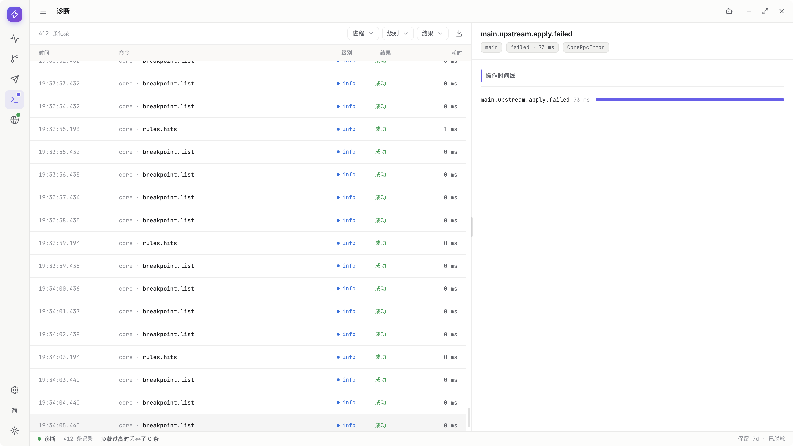

7. 调整列表和详情分栏，滚动阅读完整内容。

   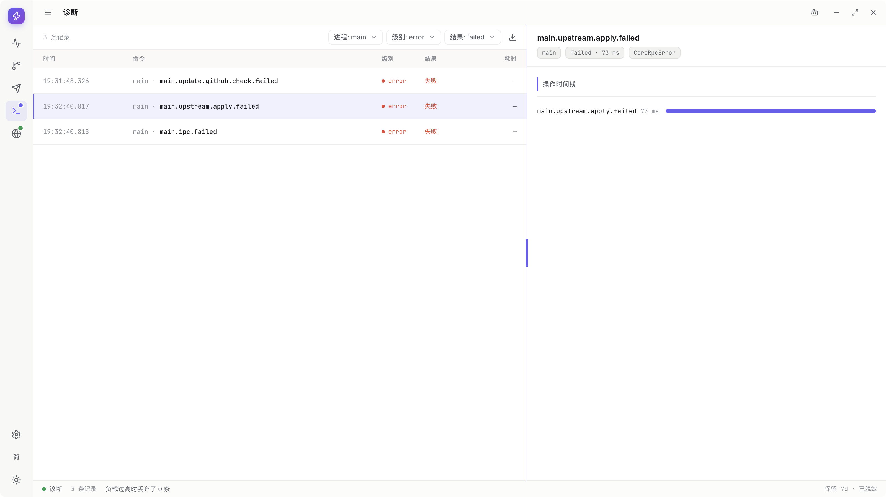

   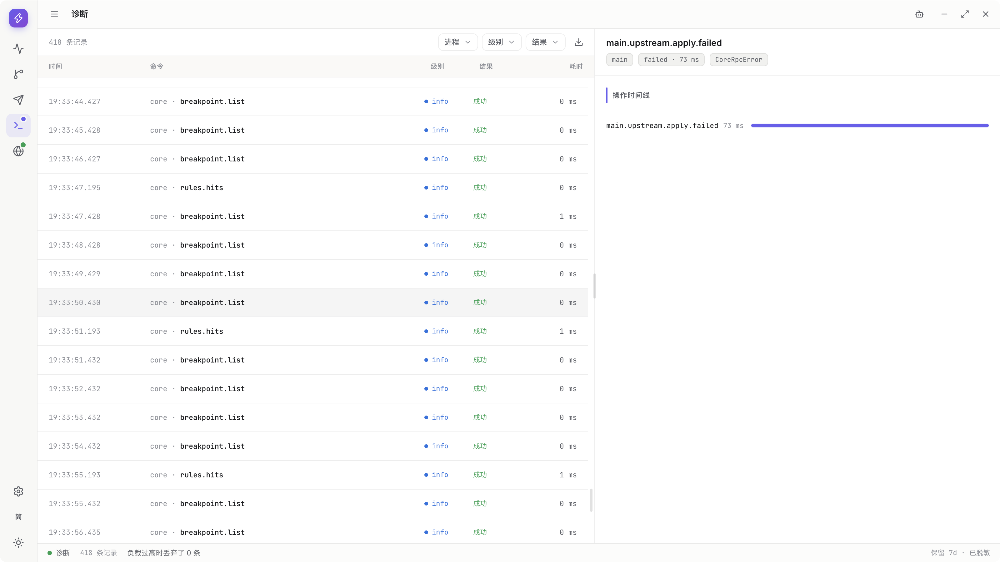

**预期结果**：筛选改变当前查看范围，不删除底层记录；加载更早记录与刷新最新记录是不同动作。

**关键说明**：列表不是一次性展示数据库中的全部记录，当前屏幕没有某条数据不代表它一定不存在。Tool 查询可用条件按实际 schema 提供，不把内部字段想当然当成 UI 控件。

## 判断失败、取消和未完成

1. 先看操作是否已经进入终态。

   下图是本次 `composer.send` 的 `success` 终态，不是失败、取消或“仍在执行”的示例。

   

2. 检查失败摘要和对应进程，再回到所属功能核对实际状态。

   本例在Settings填写自有返回404的PAC URL，Apply失败后Discard草稿，再选择`main.upstream.apply.failed`。完整输入与恢复见[实录](#walkthrough-diagnostics-lifecycle)。

   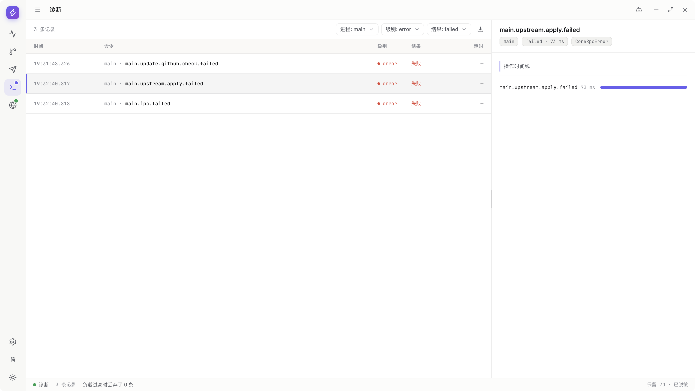

3. 网络发送检查客户端与目标；文件操作检查任务终态；代理操作检查当前系统归属。

   Composer网络失败仍可能对应`composer.send`的`info/success`命令记录：命令成功返回了网络失败结果，不等于HTTP成功。回到Composer用同一自有服务重新Send，实际响应才证明业务恢复。

   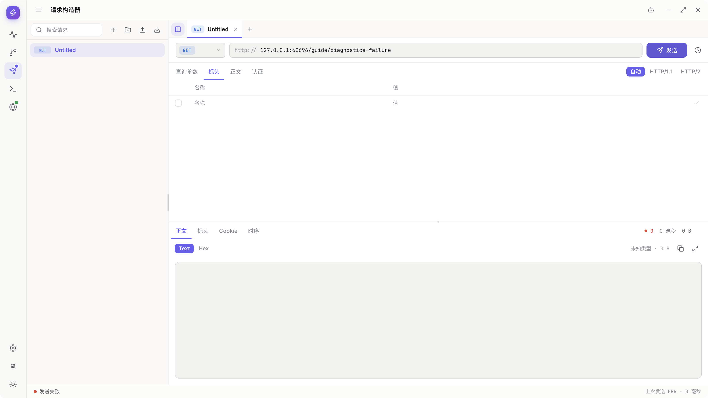

   

4. 避免把用户取消、目标拒绝、协议错误和 App 内部错误混成同一类。

   `cancelled`、`timed_out`筛选可以没有记录，不把空列表伪称为实际超时。用户取消的具体操作见[原生Save取消](agent.md#walkthrough-agent-tool-lifecycle-12-cancel-native)和[运行中归档取消](transfer.md#walkthrough-transfer-cancel)。

   

**预期结果**：得到具体的排查方向，不因看到一条成功记录就假定整条流程成功。

**关键说明**：例如 UI 成功提交意图，不等于异步文件任务已经完成；同理日志中某个步骤失败也不保证目标服务完全没有收到请求。

## 导出诊断给维护者

**步骤**

1. 复现一次有权执行的最小问题，并记下时间、版本和系统。

   本章基础片段使用成功的`composer.send`；[进阶实录](#walkthrough-diagnostics-lifecycle-04a-upstream)另外展示自有PAC地址返回404后的真实Apply失败。两者都使用macOS x64、`0.1.1-alpha.1`，不伪造故障日志。

2. 本例使用 Process `core`、Level `info`、Outcome `success`；实际故障应按自己的记录调整，不能过滤掉所需错误。

   

   

   

3. 使用 Export，在真实系统保存窗口保存 `guide-diagnostics.jsonl`。

   

4. 等待导出任务完成，再检查结果。

   

5. 分享前再检查内容，附上操作步骤、预期结果和实际错误。

   这是分享前的安全要求，不是自动上传步骤。本教程没有把导出文件发给第三方；导出完成也不表示可以不经检查就分享。

**预期结果**：得到逐行 JSON 的诊断文件，便于核对，不需要公开整个 App 数据目录。

**关键说明**

- 诊断在记录和导出环节有脱敏，仍应检查业务标识和其他可识别信息。
- Diagnostics 导出不等于 HAR，也不能恢复没有保存的正文。
- 不发送模型 Key、MCP 配置凭据、CA 私钥或个人流量。
- 导出任务启动不等于保存完成，取消规则见[文件任务](transfer.md#jobs)。

## 通过 Agent 或 MCP 查询

1. 仅开启需要的 Diagnostics 查询 Tool。

   [完整只读配置](tool-permissions.md#walkthrough-tool-permissions-readonly)逐项关闭change、保留query，包含Diagnostics分组；需要导出时再明确授予`diagnostics_export`。

2. 让 AI 限定来源、时间线索和操作，不要求它读取全部无关日志。

   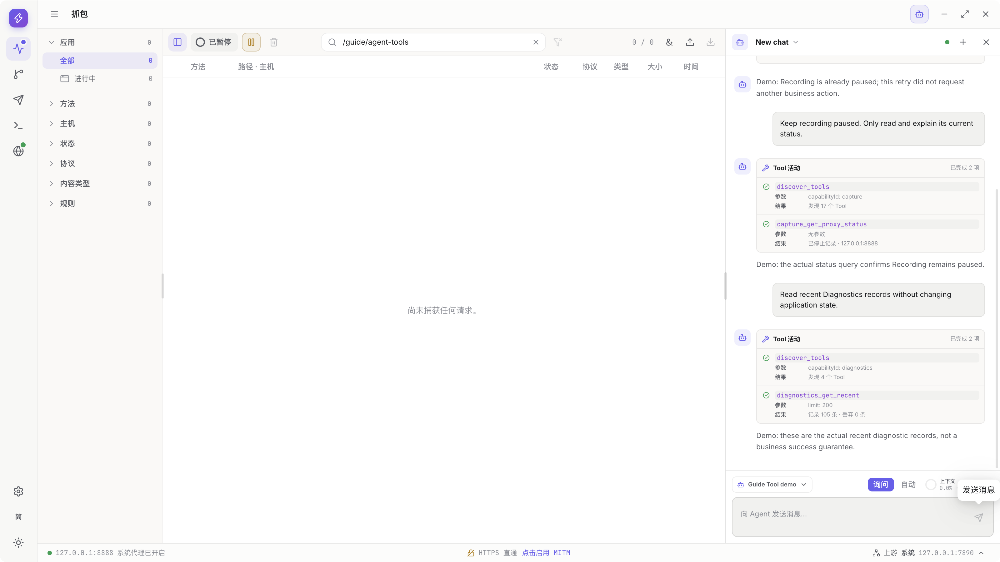

3. 区分当前 Core 内存快照与持久查询结果。

   先用`diagnostics_get_recent`读当前Core快照，再把实际返回的`traceId`传给`diagnostics_get_trace`；需要持久记录用`diagnostics_query`。不要给`diagnostics_get_trace`添加不存在的`limit`参数，也不要用它查询任意历史。

   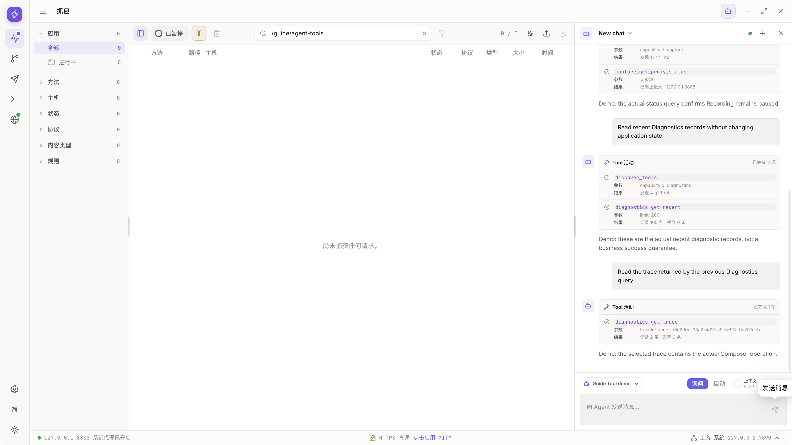

4. 需要导出时单独审批导出操作，并完成原生保存窗口。

   [Agent实录](agent.md#walkthrough-agent-tool-lifecycle-10-export-request)和[MCP实录](mcp.md#walkthrough-mcp-tool-lifecycle-08-export-ask)分别包含真实审批、Save取消、再次保存和任务完成查询。

   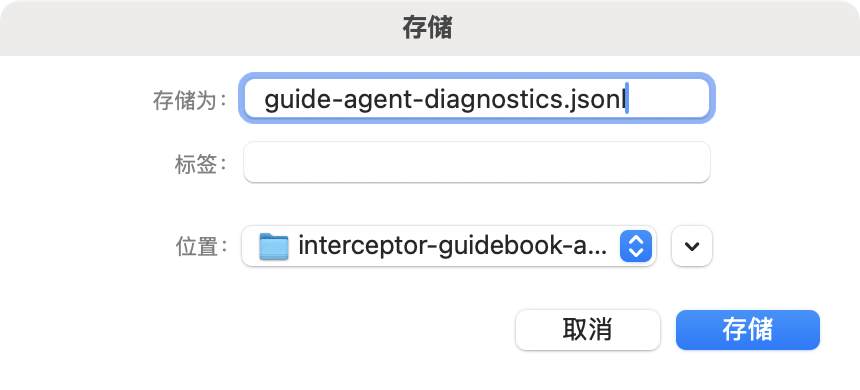

**预期结果**：AI 获得必要的脱敏摘要，正式导出仍由用户选择文件。

**关键说明**：`diagnostics_get_trace` 和 `diagnostics_get_recent` 是当前 Core 快照，不是任意历史的完整查询；前者有当前 trace 与条数边界。具体名称见 [Tool 速查](tool-reference.md#diagnostics)。

## 不要用 Diagnostics 推断这些事情

- 没有日志不能证明网络没有发生，需结合真实目标和客户端。
- 当前没有完整 HTTP/2 帧录制及所有 session/stream 与请求的精确关联；不能从普通请求日志重建全部 SETTINGS、RST_STREAM 或 GOAWAY。
- 记录不是自动按天数或条数淘汰；Capture Clear 也不是完整 Diagnostics 历史清理入口。
- 导出没有包含某个内部属性，不代表可以让 AI 从别处推测还原。

<!-- recorded-walkthrough:diagnostics-lifecycle:start -->

## 实际失败、过滤、历史和JSONL

以下图片和视频来自已发布的 <code>0.1.1-alpha.1</code>、macOS x64，App保持<code>zh-CN</code>。每个步骤都有对应原生窗口截图，可点击查看原尺寸。

本机地址、端口和生成ID来自这次真实录制，不是公开服务；使用时替换成自己的已授权测试环境。下面先列本次实际数据，再按相同顺序操作。未出现在本段录像中的进阶分支仍待逐步配图与验收。

| 示例字段 | 录制中的实际值 |
| --- | --- |
| <code>successUrl</code> | <code>http://127.0.0.1:60694/guide/diagnostics-visible/success</code> |
| <code>failureUrl</code> | <code>http://127.0.0.1:60696/guide/diagnostics-failure</code> |
| <code>unavailablePac</code> | <code>http://127.0.0.1:60694/guide/diagnostics-visible/unavailable.pac</code> |
| <code>failedOrigin</code> | <code>Owned loopback TCP service closes its accepted connection</code> |
| <code>history</code> | <code>120 real Composer Send operations prepared before filming, not seeded diagnostic rows</code> |
| <code>command</code> | <code>composer.send</code> |
| <code>failedAction</code> | <code>main.upstream.apply.failed</code> |
| <code>failureFilter</code> | <code>main / error / failed</code> |
| <code>clearedFilter</code> | <code>all / all / all</code> |
| <code>outcomeBoundary</code> | <code>Composer returns a normal command result with ok=false for network failure; diagnostic success does not imply HTTP success</code> |
| <code>file</code> | <code>guide-diagnostics-lifecycle.jsonl</code> |
| <code>timeline</code> | <code>Shown automatically for the selected operation; not an expandable control</code> |

<video controls preload="metadata" playsinline lang="zh-CN" src="../media/v0.1.1-alpha.1/diagnostics-lifecycle/diagnostics-lifecycle.mp4" poster="../media/v0.1.1-alpha.1/diagnostics-lifecycle/diagnostics-lifecycle-01-input.png">
<track kind="captions" srclang="zh-CN" label="Steps / 步骤" src="../media/v0.1.1-alpha.1/diagnostics-lifecycle/diagnostics-lifecycle.vtt" default>
</video>

### 01 · 填写本次可见的成功请求

[视频 00:00](../media/v0.1.1-alpha.1/diagnostics-lifecycle/diagnostics-lifecycle.mp4#t=0.394) · [返回本节视频](#walkthrough-diagnostics-lifecycle-video)

### 02 · 真实Send并核对成功响应

[视频 00:03](../media/v0.1.1-alpha.1/diagnostics-lifecycle/diagnostics-lifecycle.mp4#t=3.409) · [返回本节视频](#walkthrough-diagnostics-lifecycle-video)

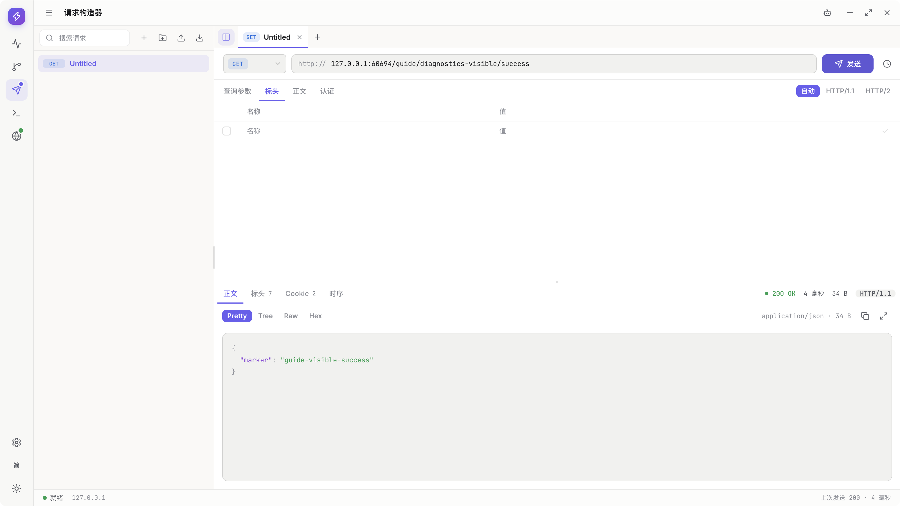

### 03 · 填写本轮会关闭连接的自有端点

[视频 00:06](../media/v0.1.1-alpha.1/diagnostics-lifecycle/diagnostics-lifecycle.mp4#t=6.492) · [返回本节视频](#walkthrough-diagnostics-lifecycle-video)

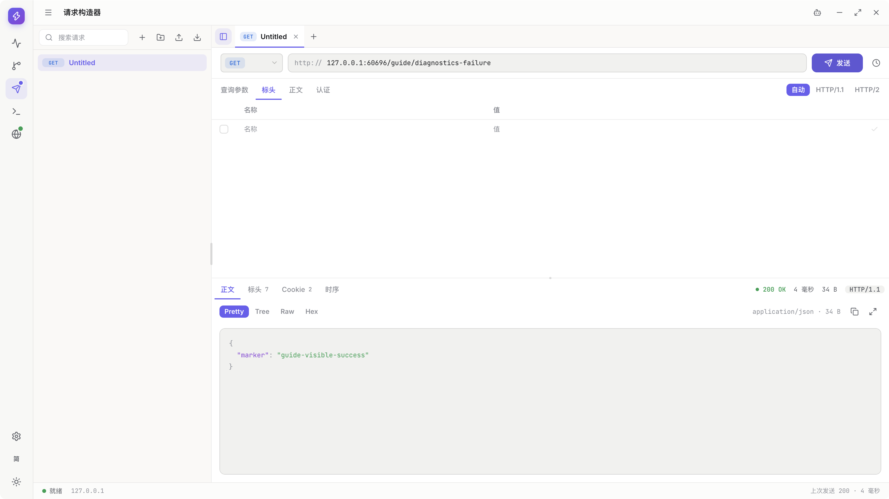

### 04 · 观察真实网络失败

[视频 00:09](../media/v0.1.1-alpha.1/diagnostics-lifecycle/diagnostics-lifecycle.mp4#t=9.508) · [返回本节视频](#walkthrough-diagnostics-lifecycle-video)

### 05 · 打开自有PAC失败示例

[视频 00:12](../media/v0.1.1-alpha.1/diagnostics-lifecycle/diagnostics-lifecycle.mp4#t=12.536) · [返回本节视频](#walkthrough-diagnostics-lifecycle-video)

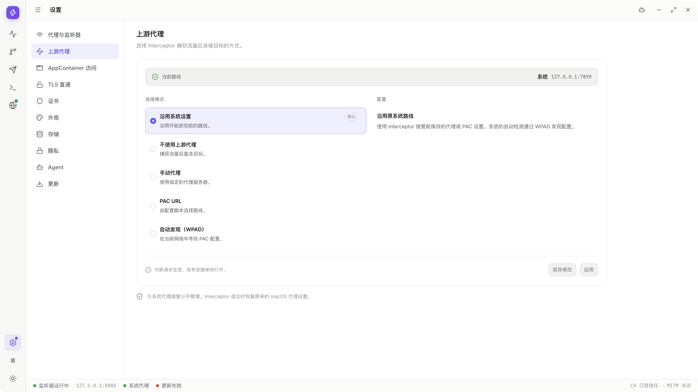

### 06 · 选择PAC草稿

[视频 00:15](../media/v0.1.1-alpha.1/diagnostics-lifecycle/diagnostics-lifecycle.mp4#t=15.664) · [返回本节视频](#walkthrough-diagnostics-lifecycle-video)

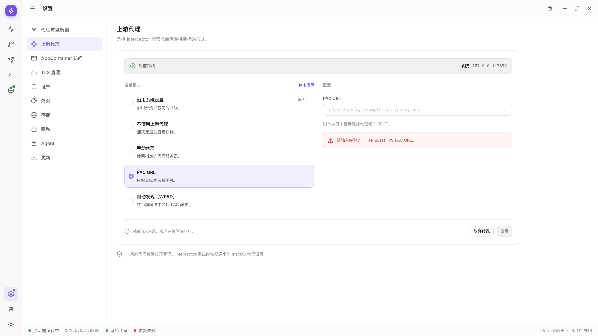

### 07 · 填写本轮返回404的PAC地址

[视频 00:18](../media/v0.1.1-alpha.1/diagnostics-lifecycle/diagnostics-lifecycle.mp4#t=18.719) · [返回本节视频](#walkthrough-diagnostics-lifecycle-video)

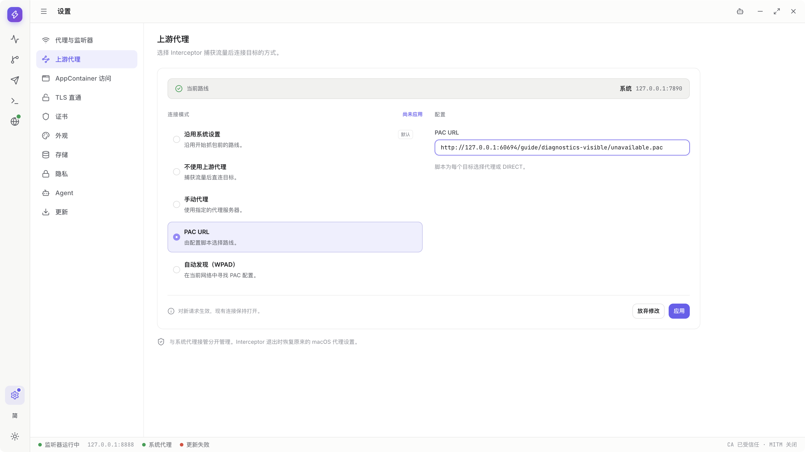

### 08 · Apply实际失败并保持原路线

[视频 00:21](../media/v0.1.1-alpha.1/diagnostics-lifecycle/diagnostics-lifecycle.mp4#t=21.729) · [返回本节视频](#walkthrough-diagnostics-lifecycle-video)

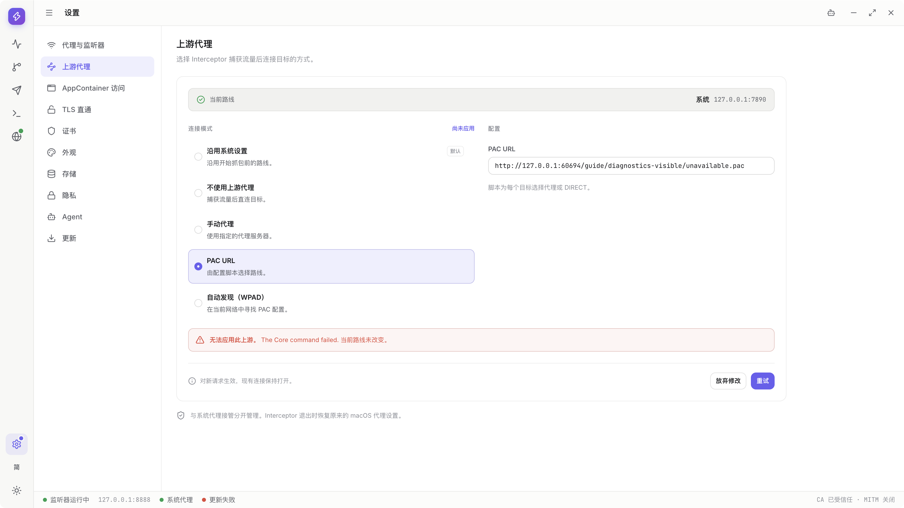

### 09 · Discard失败草稿不改原配置

[视频 00:24](../media/v0.1.1-alpha.1/diagnostics-lifecycle/diagnostics-lifecycle.mp4#t=24.868) · [返回本节视频](#walkthrough-diagnostics-lifecycle-video)

### 10 · 进入Diagnostics

[视频 00:27](../media/v0.1.1-alpha.1/diagnostics-lifecycle/diagnostics-lifecycle.mp4#t=27.901) · [返回本节视频](#walkthrough-diagnostics-lifecycle-video)

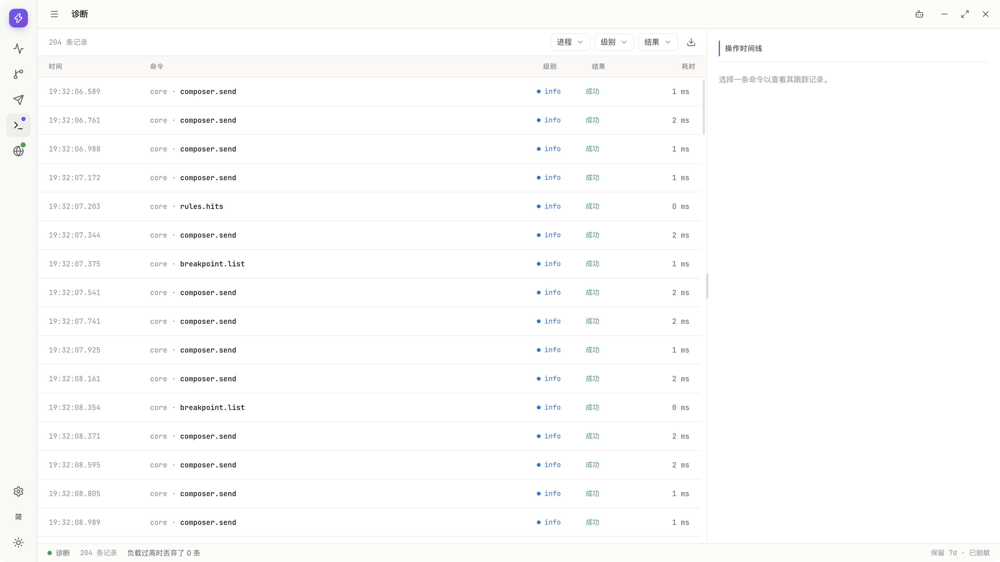

### 11 · 先导出当前记录留证据

[视频 00:43](../media/v0.1.1-alpha.1/diagnostics-lifecycle/diagnostics-lifecycle.mp4#t=43.163) · [返回本节视频](#walkthrough-diagnostics-lifecycle-video)

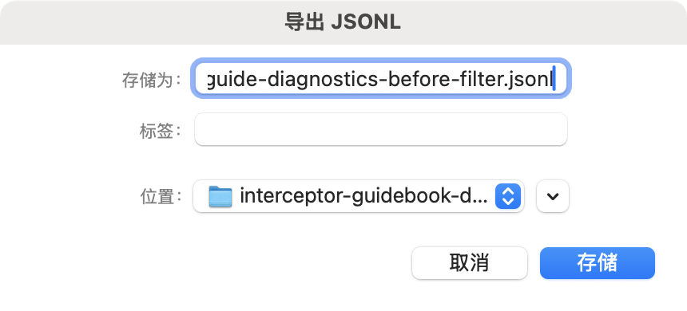

### 12 · 核对产品导出的真实结果分类

[视频 00:47](../media/v0.1.1-alpha.1/diagnostics-lifecycle/diagnostics-lifecycle.mp4#t=47.649) · [返回本节视频](#walkthrough-diagnostics-lifecycle-video)

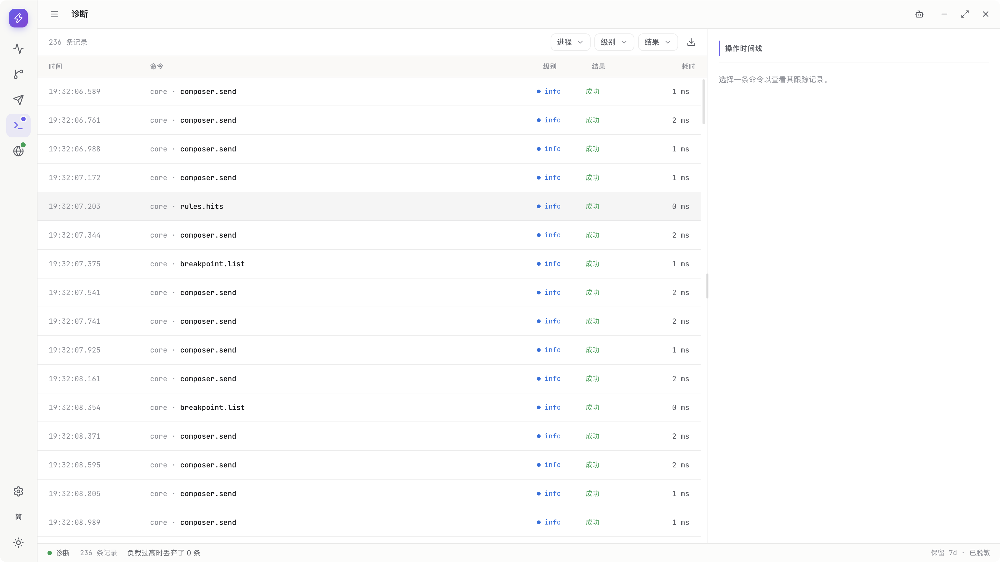

### 13 · 按core进程筛选

[视频 00:50](../media/v0.1.1-alpha.1/diagnostics-lifecycle/diagnostics-lifecycle.mp4#t=50.649) · [返回本节视频](#walkthrough-diagnostics-lifecycle-video)

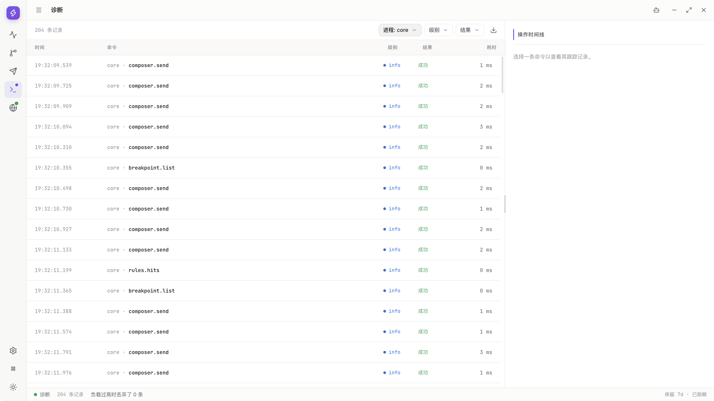

### 14 · 切到失败操作所属main进程

[视频 00:53](../media/v0.1.1-alpha.1/diagnostics-lifecycle/diagnostics-lifecycle.mp4#t=53.798) · [返回本节视频](#walkthrough-diagnostics-lifecycle-video)

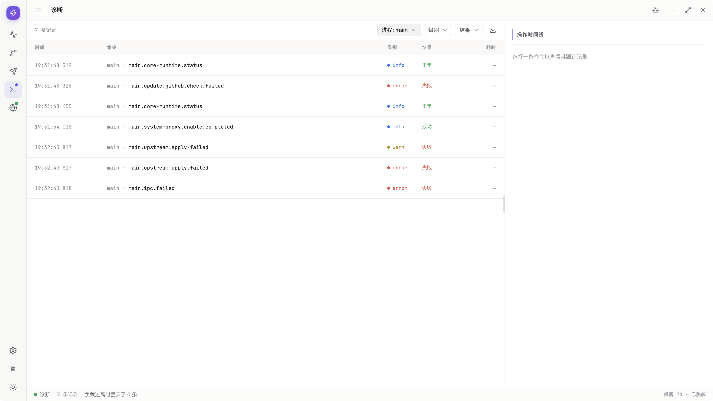

### 15 · 按error级别筛选

[视频 00:56](../media/v0.1.1-alpha.1/diagnostics-lifecycle/diagnostics-lifecycle.mp4#t=56.869) · [返回本节视频](#walkthrough-diagnostics-lifecycle-video)

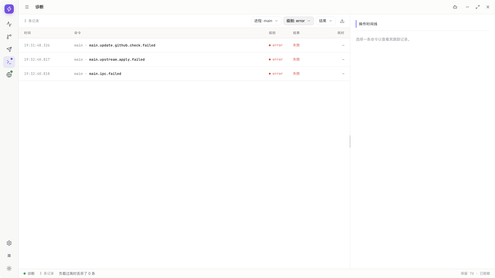

### 16 · 查看success结果组合

[视频 00:59](../media/v0.1.1-alpha.1/diagnostics-lifecycle/diagnostics-lifecycle.mp4#t=59.908) · [返回本节视频](#walkthrough-diagnostics-lifecycle-video)

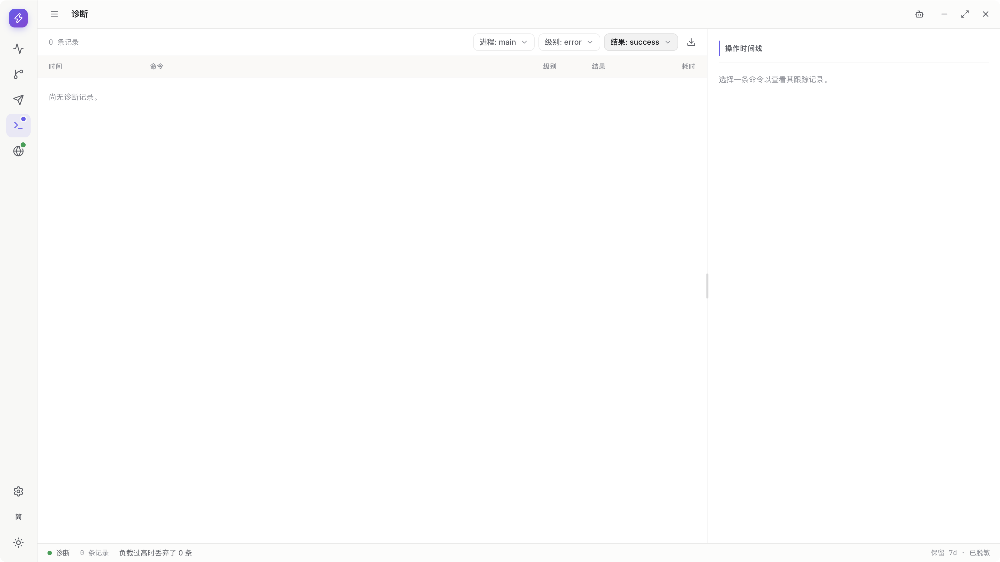

### 17 · 切到failed结果

[视频 01:02](../media/v0.1.1-alpha.1/diagnostics-lifecycle/diagnostics-lifecycle.mp4#t=62.921) · [返回本节视频](#walkthrough-diagnostics-lifecycle-video)

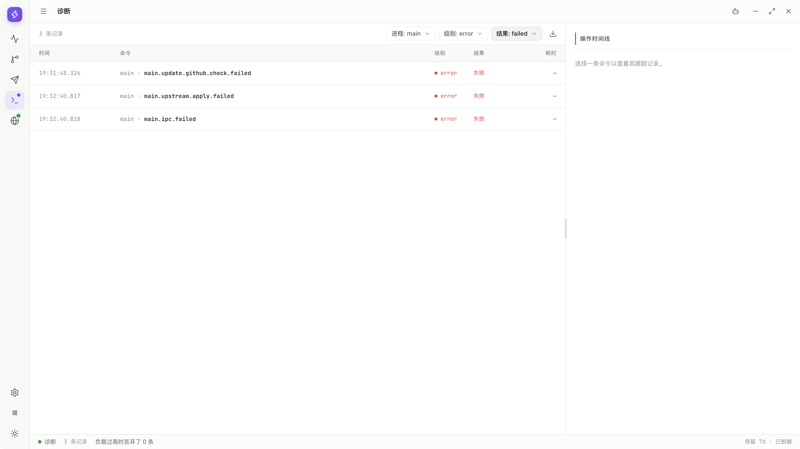

### 18 · 选择真正失败的上游操作

[视频 01:05](../media/v0.1.1-alpha.1/diagnostics-lifecycle/diagnostics-lifecycle.mp4#t=65.945) · [返回本节视频](#walkthrough-diagnostics-lifecycle-video)

### 19 · 读取自动展示的关联时间线

[视频 01:08](../media/v0.1.1-alpha.1/diagnostics-lifecycle/diagnostics-lifecycle.mp4#t=68.993) · [返回本节视频](#walkthrough-diagnostics-lifecycle-video)

### 20 · 拖动Diagnostics分栏

[视频 01:11](../media/v0.1.1-alpha.1/diagnostics-lifecycle/diagnostics-lifecycle.mp4#t=71.977) · [返回本节视频](#walkthrough-diagnostics-lifecycle-video)

### 21 · 切换Level至warn

[视频 01:15](../media/v0.1.1-alpha.1/diagnostics-lifecycle/diagnostics-lifecycle.mp4#t=75.497) · [返回本节视频](#walkthrough-diagnostics-lifecycle-video)

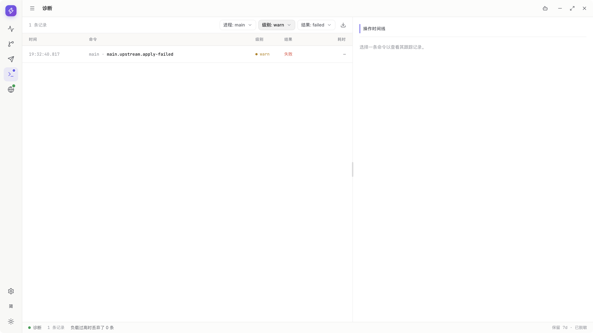

### 22 · 切换Level至info

[视频 01:18](../media/v0.1.1-alpha.1/diagnostics-lifecycle/diagnostics-lifecycle.mp4#t=78.532) · [返回本节视频](#walkthrough-diagnostics-lifecycle-video)

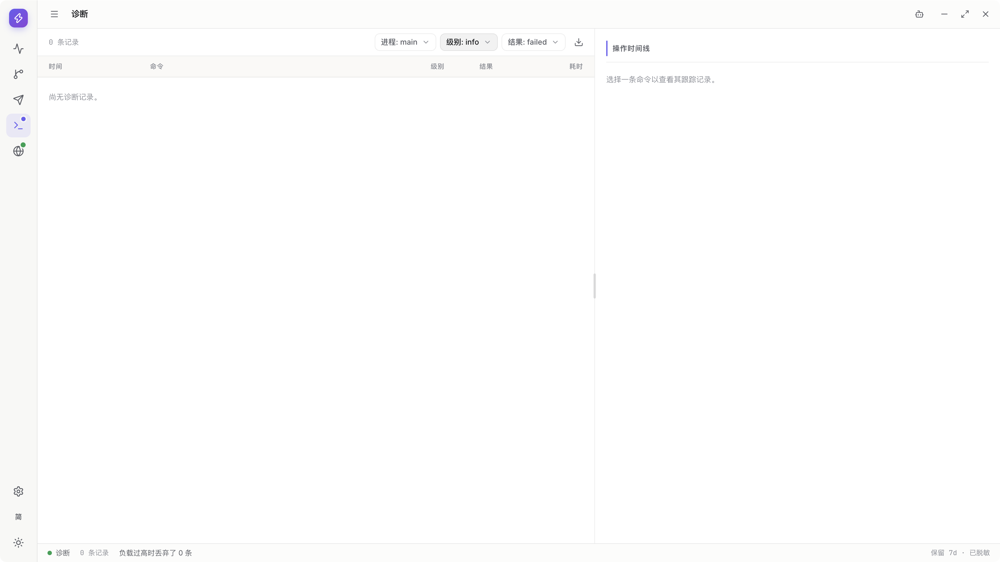

### 23 · 切换Level至debug

[视频 01:21](../media/v0.1.1-alpha.1/diagnostics-lifecycle/diagnostics-lifecycle.mp4#t=81.568) · [返回本节视频](#walkthrough-diagnostics-lifecycle-video)

### 24 · 切换Level至all

[视频 01:24](../media/v0.1.1-alpha.1/diagnostics-lifecycle/diagnostics-lifecycle.mp4#t=84.599) · [返回本节视频](#walkthrough-diagnostics-lifecycle-video)

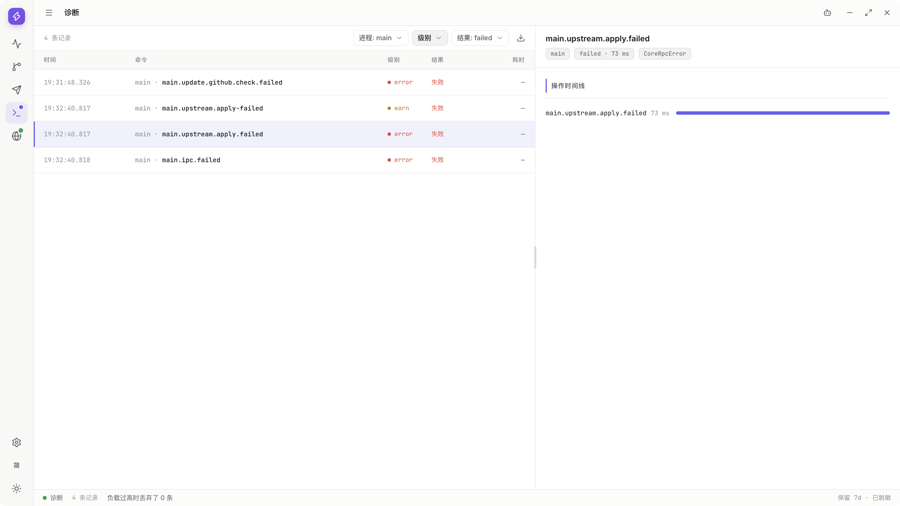

### 25 · 切换Outcome至cancelled

[视频 01:27](../media/v0.1.1-alpha.1/diagnostics-lifecycle/diagnostics-lifecycle.mp4#t=87.627) · [返回本节视频](#walkthrough-diagnostics-lifecycle-video)

### 26 · 切换Outcome至timed_out

[视频 01:30](../media/v0.1.1-alpha.1/diagnostics-lifecycle/diagnostics-lifecycle.mp4#t=90.640) · [返回本节视频](#walkthrough-diagnostics-lifecycle-video)

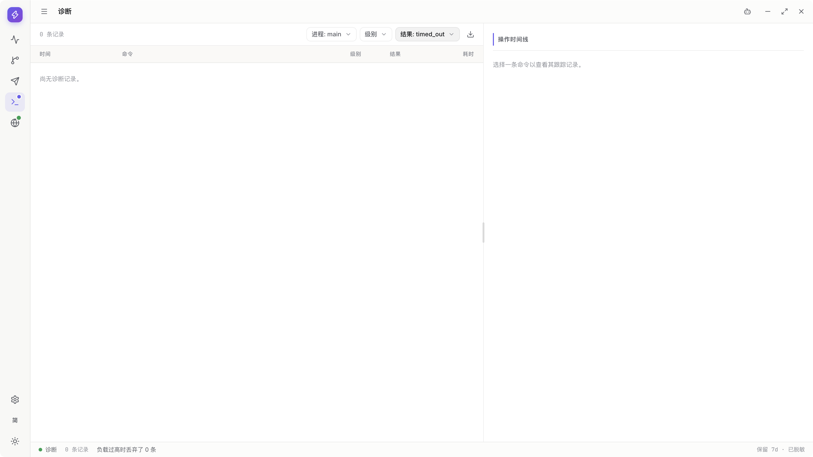

### 27 · 切换Outcome至all

[视频 01:33](../media/v0.1.1-alpha.1/diagnostics-lifecycle/diagnostics-lifecycle.mp4#t=93.657) · [返回本节视频](#walkthrough-diagnostics-lifecycle-video)

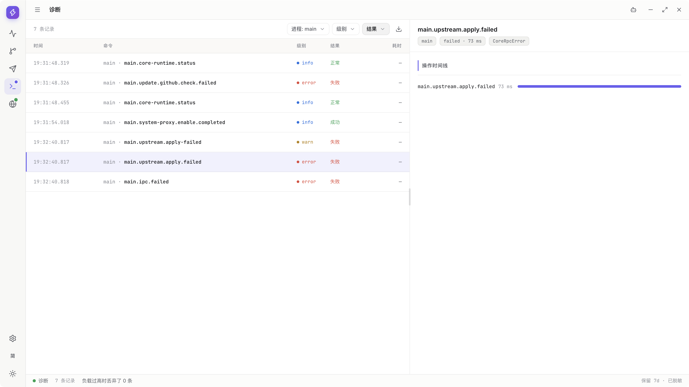

### 28 · 切换Process至renderer

[视频 01:36](../media/v0.1.1-alpha.1/diagnostics-lifecycle/diagnostics-lifecycle.mp4#t=96.677) · [返回本节视频](#walkthrough-diagnostics-lifecycle-video)

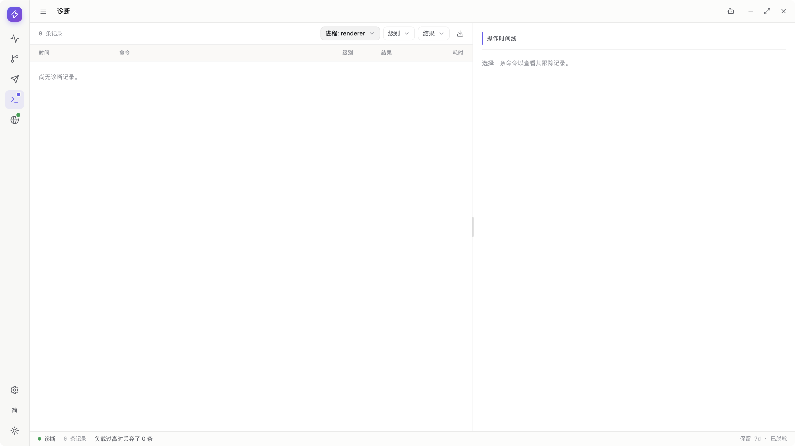

### 29 · 切换Process至all

[视频 01:39](../media/v0.1.1-alpha.1/diagnostics-lifecycle/diagnostics-lifecycle.mp4#t=99.701) · [返回本节视频](#walkthrough-diagnostics-lifecycle-video)

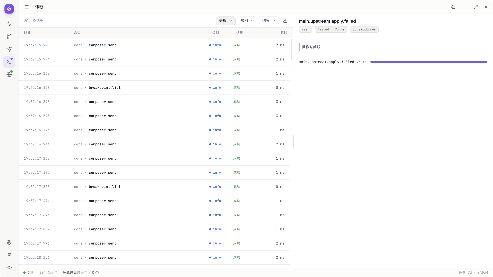

### 30 · 确认三个筛选全部清除

[视频 01:42](../media/v0.1.1-alpha.1/diagnostics-lifecycle/diagnostics-lifecycle.mp4#t=102.732) · [返回本节视频](#walkthrough-diagnostics-lifecycle-video)

### 31 · 加载实际历史页

[视频 01:45](../media/v0.1.1-alpha.1/diagnostics-lifecycle/diagnostics-lifecycle.mp4#t=105.821) · [返回本节视频](#walkthrough-diagnostics-lifecycle-video)

### 32 · 滚动真实历史列表

[视频 01:49](../media/v0.1.1-alpha.1/diagnostics-lifecycle/diagnostics-lifecycle.mp4#t=109.118) · [返回本节视频](#walkthrough-diagnostics-lifecycle-video)

### 33 · 保存本次Diagnostics JSONL

[视频 02:02](../media/v0.1.1-alpha.1/diagnostics-lifecycle/diagnostics-lifecycle.mp4#t=122.469) · [返回本节视频](#walkthrough-diagnostics-lifecycle-video)

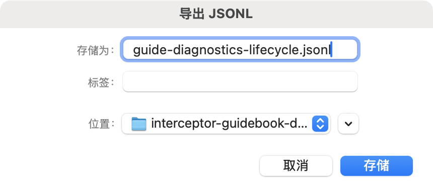

### 34 · 核对实际导出而不是只看弹窗

[视频 02:06](../media/v0.1.1-alpha.1/diagnostics-lifecycle/diagnostics-lifecycle.mp4#t=126.942) · [返回本节视频](#walkthrough-diagnostics-lifecycle-video)

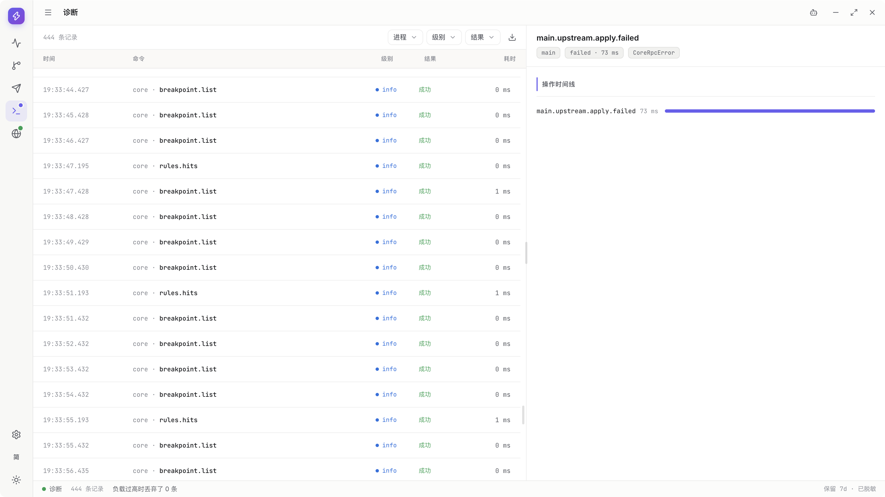

### 35 · 返回产生记录的Composer

[视频 02:09](../media/v0.1.1-alpha.1/diagnostics-lifecycle/diagnostics-lifecycle.mp4#t=129.945) · [返回本节视频](#walkthrough-diagnostics-lifecycle-video)

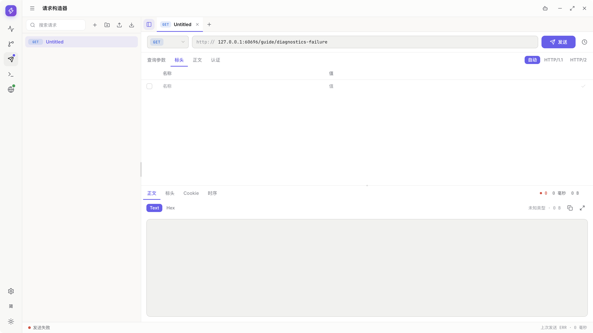

### 36 · 改回可工作的自有服务

[视频 02:13](../media/v0.1.1-alpha.1/diagnostics-lifecycle/diagnostics-lifecycle.mp4#t=133.053) · [返回本节视频](#walkthrough-diagnostics-lifecycle-video)

### 37 · 再次Send核对真实业务恢复

[视频 02:16](../media/v0.1.1-alpha.1/diagnostics-lifecycle/diagnostics-lifecycle.mp4#t=136.067) · [返回本节视频](#walkthrough-diagnostics-lifecycle-video)

下面保留完整功能参考。只有已经附上真实步骤图、核对过变量和值的操作才能计入图文验收。
<!-- recorded-walkthrough:diagnostics-lifecycle:end -->
