# Diagnostics：查找运行问题

[教程目录](../README.md) · [常见问题](troubleshooting.md)

## 选择记录并阅读详情

遇到发送、代理或文件操作问题时，先记下发生时间和刚才的操作，再到 Diagnostics 找对应记录。以下以 `main.upstream.apply.failed` 为例；自己的故障应按实际时间和命令查找。

1. 从侧栏打开 Diagnostics，等待记录列表更新。Time、Command、Level、Outcome 和 Duration 分别帮助核对发生时间、操作、等级、结果和耗时。

   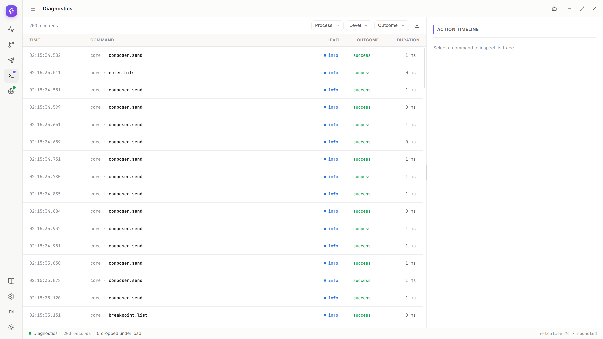

2. 点击红框 1 的 Process 筛选，切到本例的 `main`。来源不确定时先不限定；`core`、`main`、`renderer` 是不同进程，不要混为一类。

   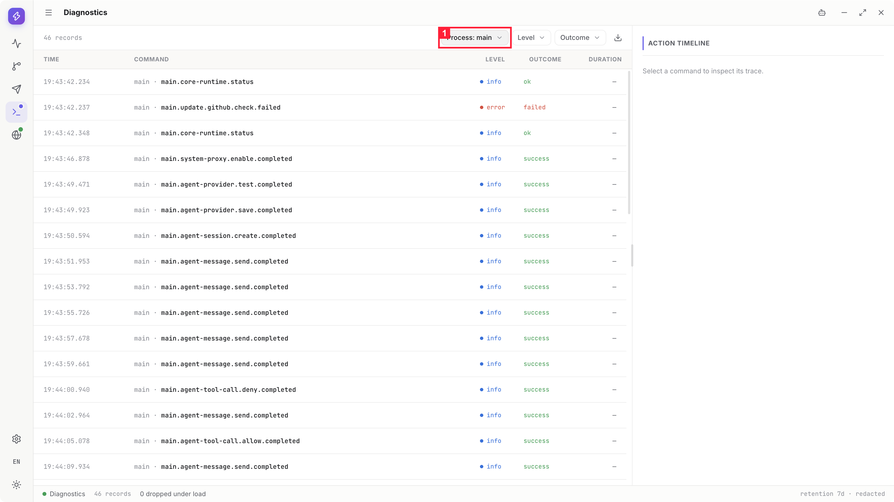

3. 把红框 1 的 Level 切到 `error`。其他问题可按实际记录使用 `warn`、`info` 或 `debug`；暂时没有匹配结果不代表日志已丢失。

   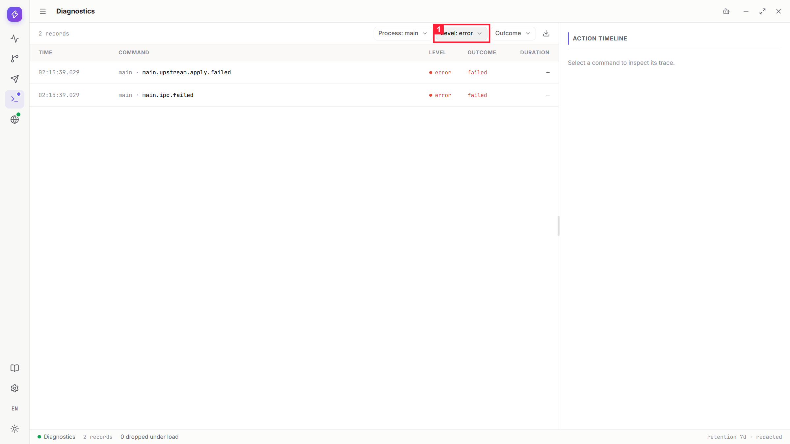

4. 将 Outcome 切到 `failed`，点击与出错时间匹配的 `main.upstream.apply.failed`。红框 1 显示进程、结果、耗时、错误类型和关联时间线；选择记录后自动展示，不需要另找“展开时间线”按钮。

   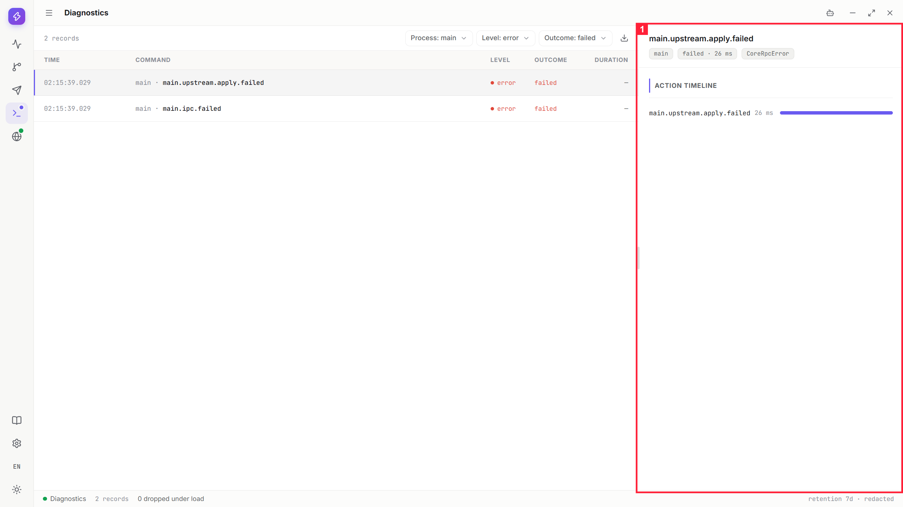

5. 拖动列表与详情之间的分隔条，为时间线分配更多宽度；在列表或详情区域滚动阅读，当前选中的记录保留。

   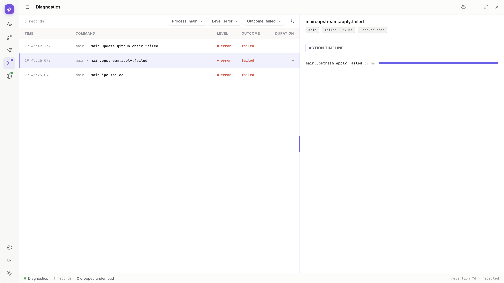

6. 需要重新定位时，把 Process、Level 和 Outcome 切回未限定状态。筛选只改变查看范围，不删除记录，也不等于清理 Capture。

   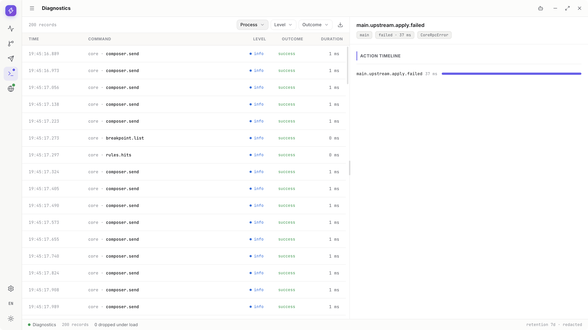

7. 向列表底部滚动并点击 Load earlier records，等待更早的记录加入列表。本例从一页加载到更多记录；它不是刷新最新记录，也不是一次性读出整个数据库。

   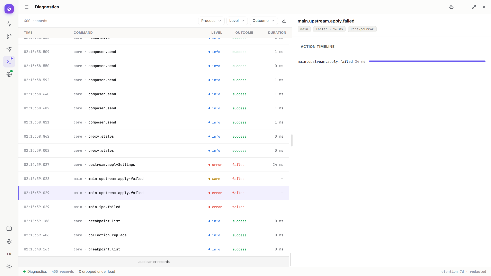

屏幕没有某条记录，不代表它不存在。先检查筛选和分页；Tool 可查询的内部条件也不等于页面提供了同名控件。

## 判断失败、取消和未完成

把命令是否返回、任务是否完成和实际网络结果分开检查。日志提供线索，不代替业务结果。

1. 操作页面出现错误时先读取提示。图中红框 1 表示 PAC 应用失败，Current route 仍为 System；不要把失败当作已经切换出口。不再使用该草稿时选择 Discard changes。

   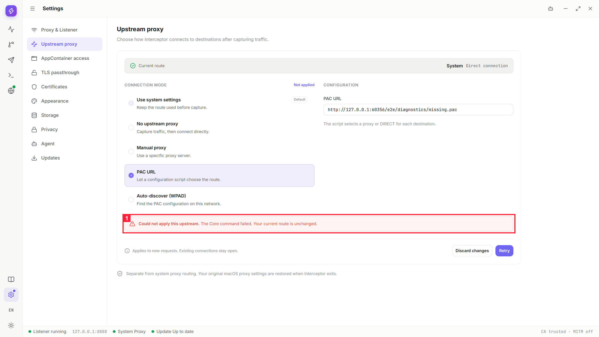

2. 再到 Diagnostics 找同一时间的失败记录。红框 1 的 `main.upstream.apply.failed` 与这次操作对应；不能用旁边另一条 `success` 记录解释所有失败。

   

3. 回到所属功能确认是否恢复。图中 Composer 再次发送到自己的正常接口，得到 `200` 和 `diagnostics-recovered`。`composer.send` 的 `info/success` 也可能只是命令成功返回了网络失败结果，不能仅凭日志判断 HTTP 成功。

   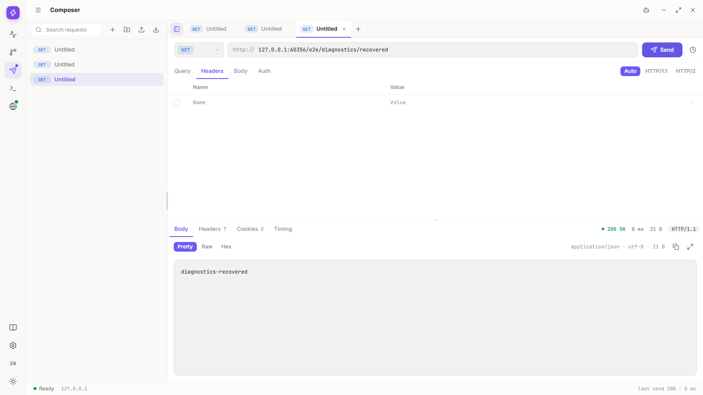

4. 区分 `success`、`failed`、`cancelled` 和 `timed_out`。筛选取消或超时时可以没有记录，不能把空列表当作发生过这些事件；文件操作还要检查实际文件和任务终态。

   
提交意图成功不等于异步文件任务完成；某个步骤失败也不保证目标服务完全没有收到请求。

## 导出诊断给维护者

先复现自己有权执行的最小问题并记下时间。根据问题设置 Process、Level、Outcome；不要把所需错误过滤掉。此例已清除这些筛选，因此导出包含成功和失败记录。

1. 确认筛选范围后点击红框 1 的导出按钮。选中某条记录用于查看详情，不代表导出只包含这一行。

   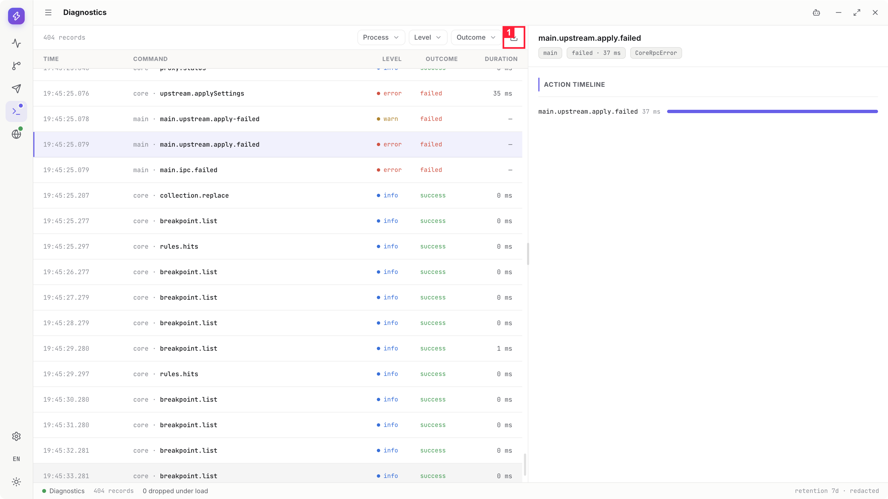

2. 在系统 Save 窗口选择自己的目录，填写文件名，例如 `lifecycle.jsonl`，再点击 Save。不想继续时选择 Cancel。

   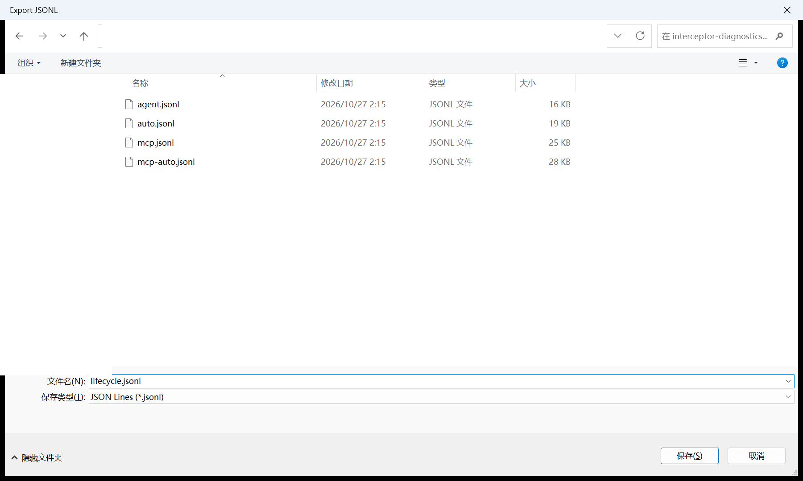

3. 返回 Diagnostics 后继续检查任务与输出文件，不把回到列表当成保存已完成。JSONL 的每一行是一条 JSON 记录，不是 HAR，也不能恢复缺失的流量正文。

   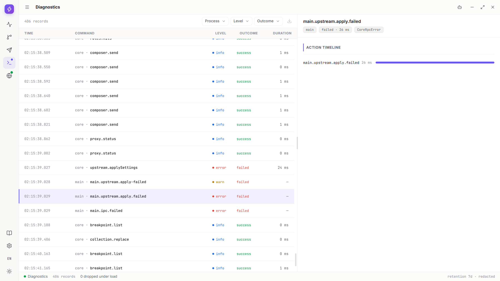

4. 分享前检查业务标识和其他可识别信息，附上复现步骤、时间、版本、系统和实际错误。不发送模型 Key、MCP 凭据、CA 私钥或个人流量；导出不会自动上传给任何人。

   
记录与导出都会脱敏，但仍需检查实际文件。文件任务的取消和完成状态见[导入导出](transfer.md#jobs)。

## 通过 Agent 或 MCP 查询

只开启需要的 Diagnostics 权限，并让模型限定来源、时间线索和操作。查询与导出不同：query 只读，`diagnostics_export` 是需要单独授权的 change。

1. 使用 `diagnostics_get_recent` 读取当前 Core 的近期内存记录。本例传 `limit: 200`，结果有记录数和 droppedCount；它不是任意历史的完整查询。

   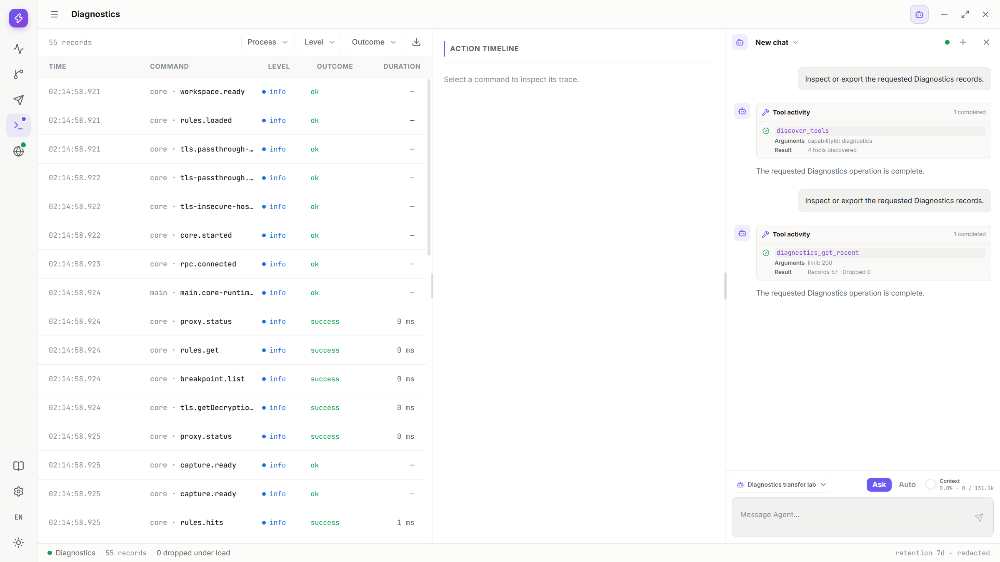

2. 从实际返回的记录取得 traceId，再交给 `diagnostics_get_trace`。图中返回该 trace 的两条记录；不猜 ID，也不添加不存在的 limit 参数。

   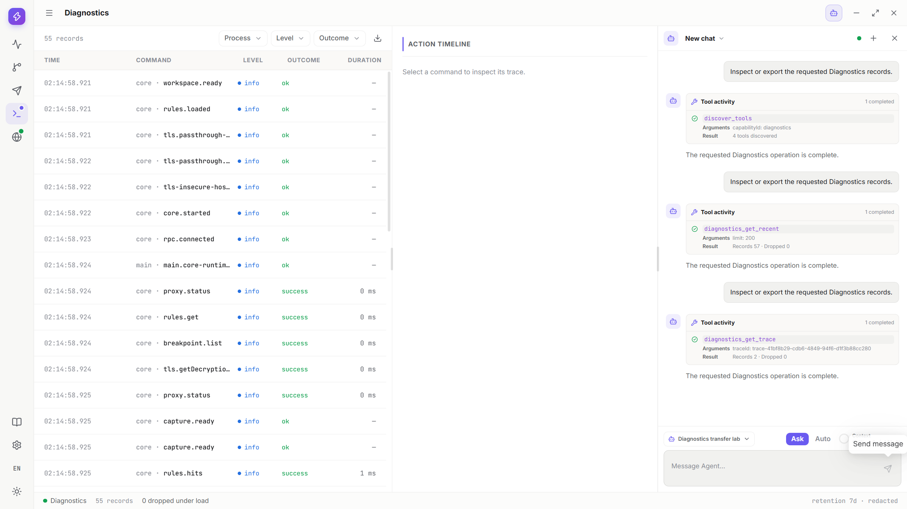

3. 需要持久化历史和分页时改用 `diagnostics_query`，按实际 schema 提供条件。Recent/Trace 保持当前 Core 内存顺序，不能当作数据库的最新优先分页。

   

4. 请求导出时检查 `diagnostics_export` 的参数，本例为 process `core`、level `info`、outcome `success`。红框 1 的 Deny Tool 拒绝操作；红框 2 的 Allow Tool 才继续。先选择 Deny，App 不打开 Save。

   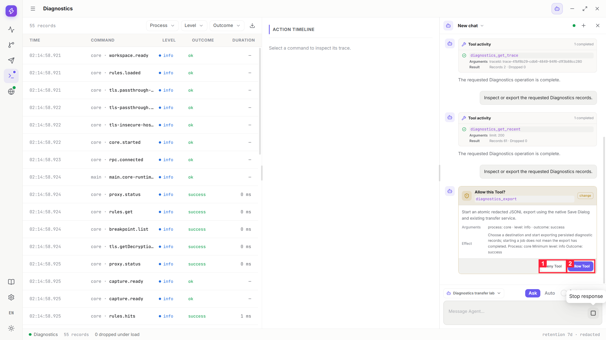

   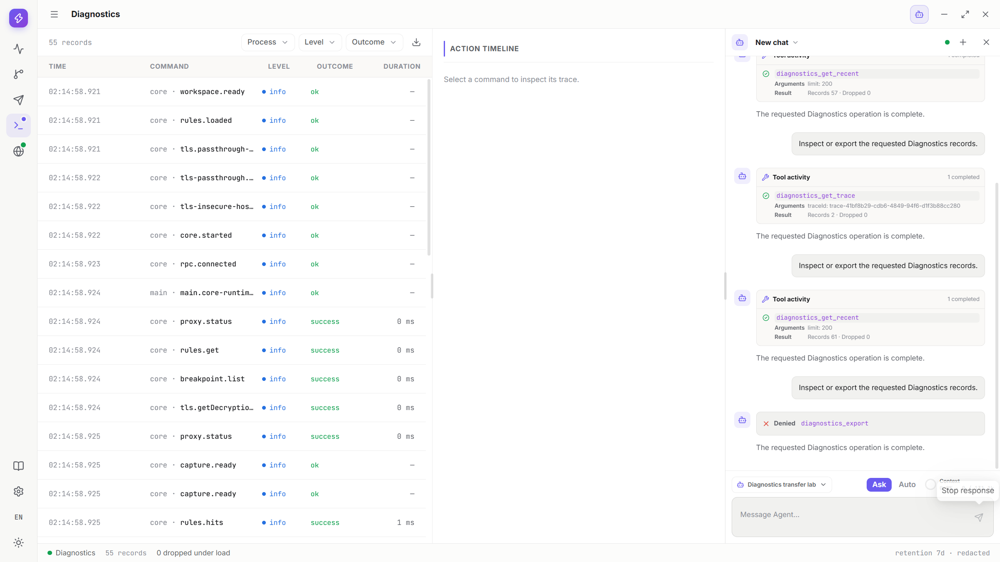

5. 重新请求时，红框 1 仍可拒绝，红框 2 才允许本次调用。即使选择 Allow，之后在系统 Save 点击 Cancel，App 也只返回 Export canceled，不启动导出任务。

   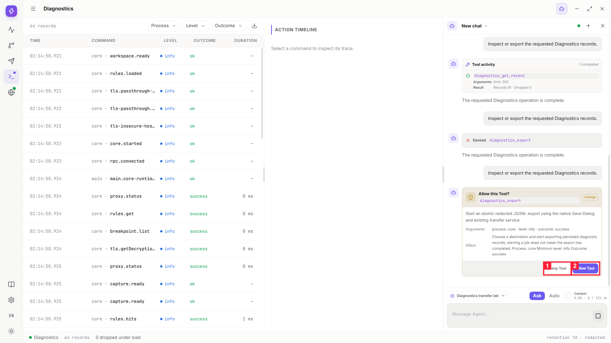

   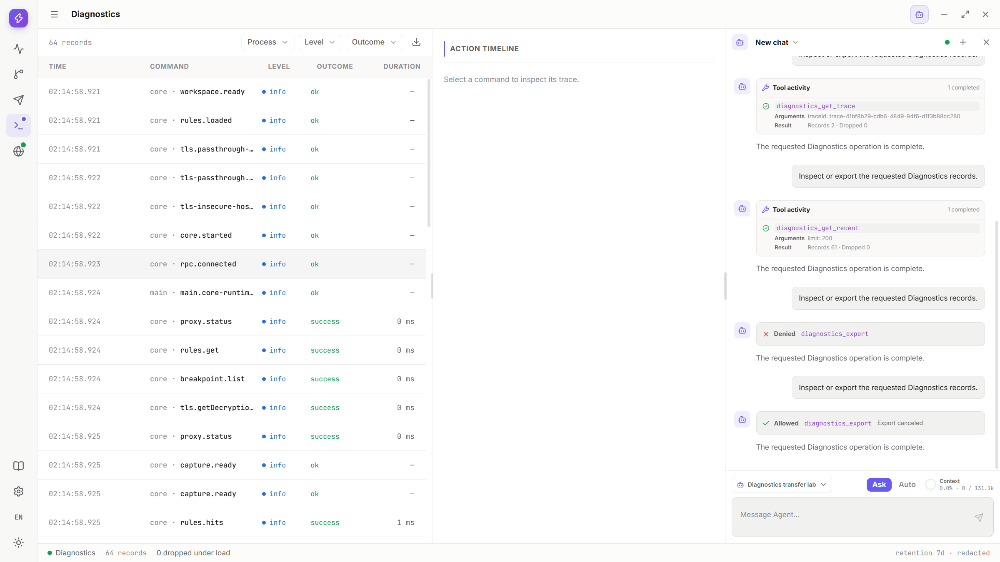

6. 要保存时再次核对审批：红框 1 是 Deny，红框 2 是 Allow。允许后在真实 Save 窗口选择位置，本例文件名为 `agent.jsonl`，再确认 Save。

   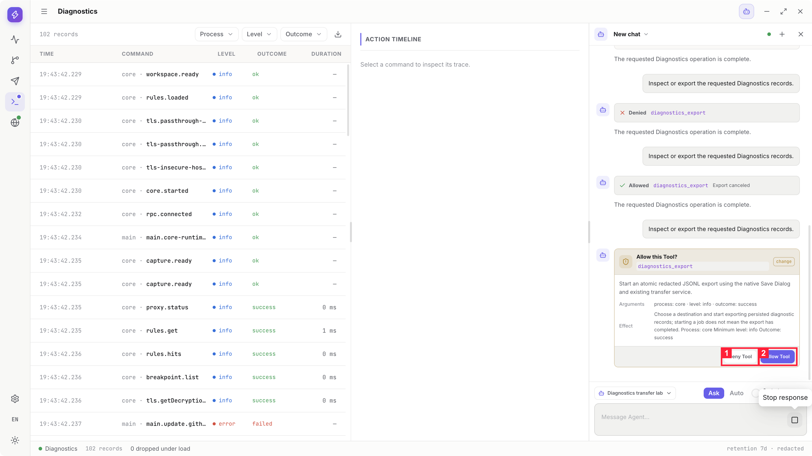

   

7. 返回的 Export job Running 或 started 表示已启动，不是文件已完成。继续核对保存位置中的文件与终态；不要仅依据模型回复中的“完成”。

   

8. 切换红框 1 的 Agent Auto 后，文件操作仍会打开系统 Save。示例另存 `auto.jsonl`；Auto 不代替用户选择路径。

   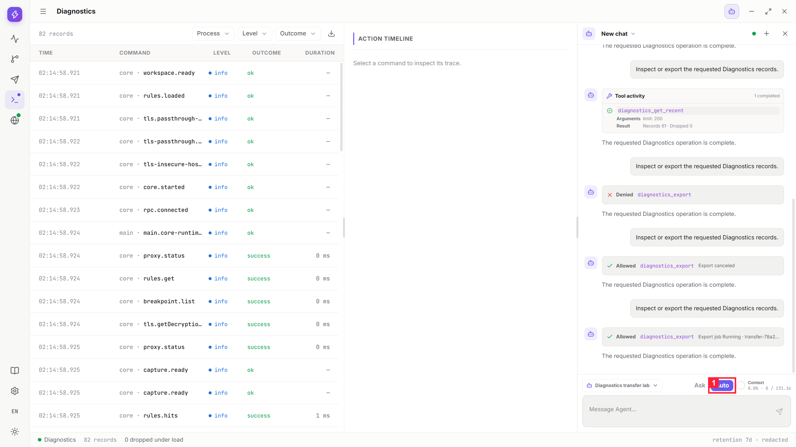

   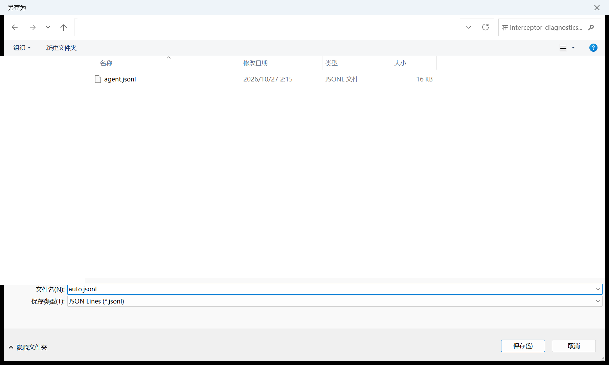

9. 外部 MCP Client 使用独立审批。核对客户端、Tool 和参数后，点击红框 1 的 Allow Tool call，再在系统 Save 保存 `mcp.jsonl`；不能拿 Agent 的批准代替这次 MCP 决定。

   

   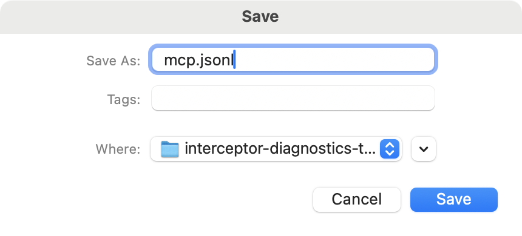

10. MCP Client 的 Auto 也不会跳过文件选择，图中仍需确认 `mcp-auto.jsonl` 的 Save。完成后按需要撤销对应入口的权限，而不是删除其他入口的配置。

    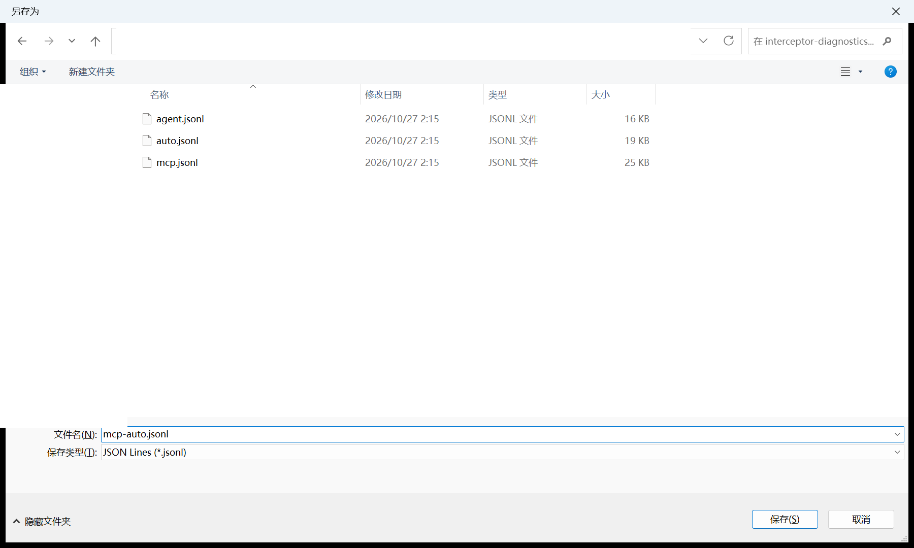

完整只读配置见 [Tool 权限](tool-permissions.md#walkthrough-tool-permissions-readonly)，参数边界见 [Tool 速查](tool-reference.md#diagnostics)。

## 不要用 Diagnostics 推断这些事情

- 没有日志不能证明网络没有发生，需结合真实目标和客户端。
- 当前没有完整 HTTP/2 帧录制及所有 session/stream 与请求的精确关联；不能从普通请求日志重建全部 SETTINGS、RST_STREAM 或 GOAWAY。
- 记录不是自动按天数或条数淘汰；Capture Clear 也不是完整 Diagnostics 历史清理入口。
- 导出没有包含某个内部属性，不代表可以让 AI 从别处推测还原。
