# MCP：连接外部 AI 客户端

> 草稿，面向 `v0.1.1-alpha.1`；已配本地 SDK、凭据轮换及两种端口冲突的真实步骤图，具体 Host 配置仍有缺口，不代表全章或 item9 完成。支持某版协议不等于所有 MCP 产品都能接入。

[教程目录](../README.md) · [Tool 权限](tool-permissions.md) · [Tool 速查](tool-reference.md)

<!-- recorded-walkthrough:start -->

## 逐步骤实操：真实产品录制

以下图片来自已发布的 <code>0.1.1-alpha.1</code>、macOS x64，App保持<code>zh-CN</code>。每个步骤都有对应原生窗口截图，可点击查看原尺寸。

本机地址、端口和生成ID来自这次真实录制，不是公开服务；使用时替换成自己的已授权测试环境。下面先列本次实际数据，再按相同顺序操作。未出现在本组步骤图中的进阶分支仍待逐步配图与验收。

> 调用方是官方SDK构建的本地演示Client，不是VS Code或云端Host兼容性演示。凭据未进入图文，Copy后的配置只在本机测试内存中使用。

| 示例字段 | 录制中的实际值 |
| --- | --- |
| <code>clientName</code> | <code>Guide local client</code> |
| <code>endpoint</code> | <code>http://127.0.0.1:65443/mcp</code> |
| <code>endpointChanged</code> | <code>false</code> |
| <code>caller</code> | <code>official SDK local demonstration; not a VS Code or cloud-host compatibility claim</code> |

### 01 · 打开 Settings

### 02 · 找到 MCP Server

### 03 · 开启本机 MCP Server

### 04 · 添加独立 Client

### 05 · 输入 Guide local client

### 06 · 创建 Client

### 07 · 复制配置，不展示凭据

### 08 · 演示客户端连接并查询

### 09 · 发起需要审批的操作

### 10 · 拒绝一次操作

### 11 · 再次请求并检查影响

### 12 · 允许暂停录制

### 13 · 查看 Client 的 Auto 模式

### 14 · 恢复 Client 的 Ask

### 15 · 检查轮换凭据确认

### 16 · 轮换凭据并验证旧配置失效

### 17 · 复制新配置并重新连接

### 18 · 查看撤销 Client 的确认

### 19 · 撤销演示 Client

### 20 · 关闭 MCP Server

### 21 · 观察端口冲突提示

### 22 · 结束已知占用后重试

### 23 · 结束演示并关闭 Server

下面保留完整功能参考。只有已经附上真实步骤图、核对过变量和值的操作才能计入图文验收。
<!-- recorded-walkthrough:end -->

## 先确认接入条件

- Interceptor 必须在本机运行，MCP Server 已开启。
- Host 需要能够从这台机器连接 loopback Streamable HTTP endpoint。
- 支持的协议为 `2025-06-18`、`2025-11-25`、`2026-07-28`，由 Host 与 SDK 自动处理，不手动切版本。
- 不使用 `stdio` 或旧式 HTTP+SSE 的配置替代当前 HTTP endpoint。
- 外部 Host 负责自己的模型配置；不要求先给 Interceptor 内置 Agent 添加模型。

**重要限制**：从云端发起连接的远程 connector 不能访问你电脑的 `127.0.0.1`。例如不能因为某个云端产品支持 MCP，就把本机 endpoint 粘过去并期待可达。

## 开启服务并取得 endpoint

**步骤**

1. 打开 Settings。

   

2. 进入 Agent，找到 MCP Server 并阅读协议说明。

   

3. 开启服务，等待 Running，再检查实际 endpoint。本段为 `http://127.0.0.1:65443/mcp`；`65443` 是录制时分配的端口，不是固定配置。核对 `127.0.0.1` 与 `/mcp`，不要使用 Capture 的 `8888`。

   

**预期结果**：首次开启选择一个空闲端口，正常后续启动使用保存的端口。

**关键说明**：服务不会对局域网或公网监听；App 关闭后也不留下独立后台 MCP 服务。

## 为一个 Host 创建独立客户端

**步骤**

本次调用方是官方 SDK 的本地演示客户端，不是 VS Code、Claude 或云端 Host。Client 名称也明确为 `Guide local client`。

1. 在客户端管理区点击添加 Client。

   

2. 名称填 `Guide local client`。

   

3. 创建 Client，初次保持 Ask。

   

4. 使用复制配置动作，把连接片段放入系统剪贴板，不公开其中的认证信息。

   

5. 在实际 Host 的用户级 MCP 配置中，按其格式添加 HTTP Server，使用复制的 endpoint 与认证字段。

   **待配图 / blocked**：本地 SDK 演示没有商业 Host 的设置页面，不能把 App 的复制成功当作 Host 配置成功。

6. 让调用方连接、发现 Tool，再做只读代理状态查询。本图是本次 SDK 客户端的实际检查点；真实 Host 的发现界面仍待配图。

   

**预期结果**：Host 可以使用被允许的 Tool，每个 Host 使用自己的 Client 凭据。

**关键说明**

- 复制的是通用连接片段，外层配置格式与保存入口由具体 Host 决定，不把它当作所有 Host 的整份配置文件。
- 配置包含凭据，只放在 Host 的用户级安全配置；不要提交到项目、粘进聊天、公开截图或加入 Settings Sync。
- App 不向普通 Renderer 暴露凭据内容，复制成功与认证成功仍是两个步骤。
- 两个独立 Host 不应共用同一 Client 身份和凭据。

## 从 Host 请求一个修改操作

1. 在Settings的MCP列检查该Tool已开启，不用Agent列代替。本次`capture_stop_recording`已经开启，不重复切换。

   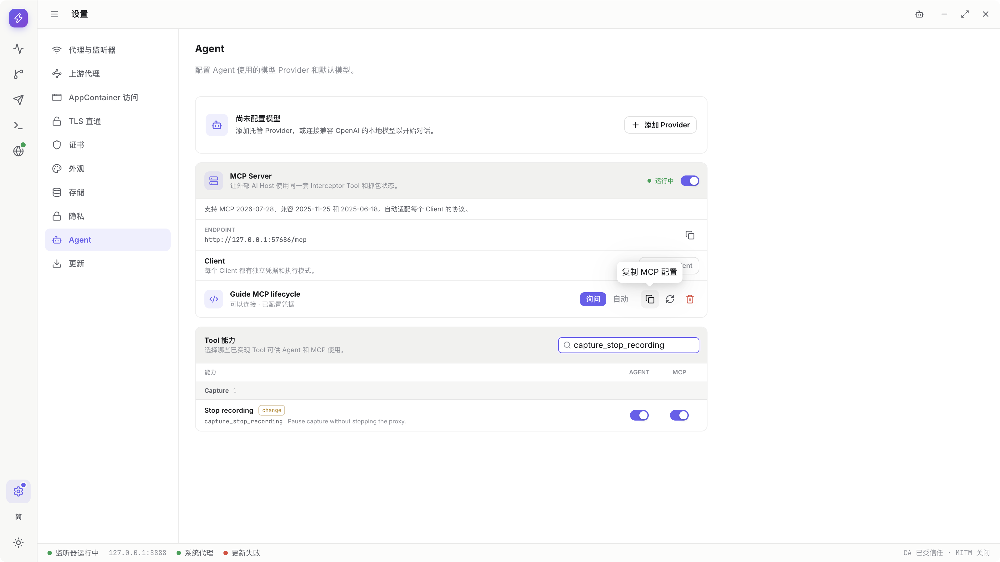

2. 用 `Guide local client` 请求暂停新流量录制，Ask 下回到 App 检查调用方、Tool、参数和影响。这里仍是 SDK 调用方，不是商业 Host 的对话截图。

   

3. 第一次选择 Deny。

   

4. 再次请求，重新检查本次审批，不复用旧决定。

   

5. 选择 Allow，核对调用结果与产品 Recording 状态。

   

6. 其他操作如有原生文件窗口或系统授权，仍要完成后再判断成功。

   [MCP导出实录](#walkthrough-mcp-tool-lifecycle-08-export-ask)实际调用`diagnostics_export`，分别演示Deny、Allow后取消Save、再次保存和查询任务完成；不借用手工Export画面，也不代表Windows系统授权。

   

**预期结果**：外部请求与 App 的权限和真实状态一致，不因 Host 自己说“已授权”就跳过 App 的控制。

**关键说明**：Host 可能还有自己的审批，和 Interceptor 审批是两层不同控制。Auto 只省略 App 对已启用 change Tool 的逐次审批，不省略文件选择和 UAC。

## endpoint 冲突或需要更换

**步骤**

两条路径分开阅读：下面 1–4 是运行期手动 Enable 的错误/重试，5–11 是另一次正常重启后的保存端口冲突。不同端口属于不同录制环境，不要求读者制造冲突。

1. 手动 Enable 失败时，检查是否明确报告 `EADDRINUSE`，服务保持关闭。

   

2. 核对占用者是旧 App 还是自己管理的已知服务，不盲目结束未知进程。

   录制中的占用者是本次主动启动的自有服务，因此可确认身份。教程只录App，不录其他进程管理器；遇到未知占用者时先自行确认，不照着示例结束陌生进程。

3. 结束确认属于自己的占用后重试 Enable，不要求换 endpoint。图中是释放端口后的 App 重试结果，终止占用程序本身仍待配图。

   

4. 本轮验证结束关闭演示 Server。

   

5. 另一条路径的前提是 MCP 上次保存为开启，正常重启时保存端口被自己的演示进程占用；重启后打开 Settings。

   

6. 检查 `endpoint-conflict`。这次旧地址为 `http://127.0.0.1:49659/mcp`，不是前一段的 `65443`。

   

7. 确需换地址时明确点击更换 endpoint。

   

8. 核对新地址，本次为 `http://127.0.0.1:49835/mcp`。`49659`、`49835` 都只是本次录制分配值。

   

9. 重新复制各 Host 的有效配置并更新 Host。

   下图来自更换endpoint后的独立复制，不是凭据轮换片段。真实外部Host的设置页面仍为`blocked`；本例把配置只保留在本地SDK内存，不公开凭据。

   

10. Host 重新连接后，再做一次只读查询。

    

    该结果属于本地官方SDK调用方，不扩展为未录制的外部Host兼容性结论。

11. 演示结束关闭本轮 Server。

    

**预期结果**：地址变化是明确动作，不在后台悄悄换端口让所有旧配置失效。

**关键说明**：正常关闭、开启或重启不应要求每次重新创建 Client；但主动更换 endpoint 后，旧地址仍需手动更新。

**该版本的实际分支**：如果在页面中手动开启一个被占用的端口，App保持关闭并显示`EADDRINUSE`；结束明确属于自己的占用程序后可以重试。若上次保存为开启，App重启时发现原端口被占用，才会显示`endpoint-conflict`及更换入口。两种实录分别见[运行期错误与重试](#walkthrough)和[重启恢复](#walkthrough-mcp-endpoint)，不把其中一个画面套用到另一种情况。

## 轮换凭据、撤销客户端和关闭服务

**步骤**

1. 某个 Client 配置可能泄露时，打开重新生成凭据的确认框。本次目标是 `Guide local client`。

   

2. 确认轮换，旧凭据失效；不在教程中公开新旧凭据。

   

3. 复制新配置，更新调用方再连接。本图覆盖同一个本地 SDK 客户端的重连；商业 Host 设置页面仍待配图。

   

4. 不再需要时打开撤销 Client 的确认框，核对名称。

   

5. 确认撤销，检查身份不可再用。在途长调用的取消过程没有独立录制，仍待配图。

   

6. 不再需要任何调用方时关闭 MCP Server。

   

7. 正常退出 App 时等待服务及在途操作收尾。

   关闭Server与退出App是不同操作。实录结束后另行核对正常退出、监听释放和系统代理恢复；不以Server关闭图冒充进程收尾，也不为录退出而扩展到桌面或进程管理器。

**预期结果**：轮换使旧凭据失效；撤销只针对目标 Client；关闭 Server 停止全部 MCP 接入。

**关键说明**：取消连接或撤权不是撤销已经完成的文件保存、请求发送或配置写入。发生竞态时先查询真实业务状态，避免重放有副作用的请求。

## Browser Host 与兼容性排查

1. 确认 Browser 中的客户端在你自己的设备上运行，而不是由远端服务器代理连接。

   **待配图 / blocked**：本次使用本地 SDK，不是 Browser Host，缺对应部署与可达性检查。

2. 使用自己明确授权的页面，并按要求提供 Client 凭据。

   **待配图 / blocked**：没有实际 Browser Host 安全配置页面；不公开凭据凑图。

3. 如果工具列表为空，检查 Server、Client 身份、协议支持和 MCP 列权限。

   **外部Host环境缺失 / blocked**：未录制真实Browser Host的空发现列表与排查往返。App侧的权限拒绝与重启发现可先参考[完整只读实录](tool-permissions.md#walkthrough-tool-permissions-readonly)。

4. 查询成功但修改停住时，检查 App 审批、原生窗口和目标业务的前提。

   **外部Host环境缺失 / blocked**：该Browser Host的等待场景尚未录制；本地SDK的真实App审批和原生窗口已经在[Tool生命周期](#walkthrough-mcp-tool-lifecycle)逐步展示，两种调用方不混称。

5. 升级 Host 后重新核对连接和一项实际操作，不只看“Server 已登记”。

   **待配图 / blocked**：没有具体 Host 升级前后操作，不能扩展成本机 SDK 之外的兼容性通过。

**预期结果**：把网络、认证、协议、Tool 权限和业务失败分开判断。

**关键说明**

- 允许 Browser 跨 Origin 访问不意味着匿名调用，实际请求仍需有效认证。
- Tool 查询结果可能包含调试数据，不要把 Client 凭据交给任意第三方网页。
- 本教程不要求使用内部 Playground，也不把官方 SDK 客户端测试冒充真实 VS Code、Claude 或其他 Host 的全部兼容性。
- 当前部分真实 Host 的代表调用已有记录，不代表全部 Tool、双 Host 并发或所有版本均已逐项验收。

<!-- recorded-walkthrough:mcp-endpoint:start -->

## 逐步骤实操：重启后的 endpoint 冲突恢复

以下图片来自已发布的 <code>0.1.1-alpha.1</code>、macOS x64，App保持<code>zh-CN</code>。每个步骤都有对应原生窗口截图，可点击查看原尺寸。

本机地址、端口和生成ID来自这次真实录制，不是公开服务；使用时替换成自己的已授权测试环境。下面先列本次实际数据，再按相同顺序操作。未出现在本组步骤图中的进阶分支仍待逐步配图与验收。

> 调用方是官方SDK构建的本地演示Client，不是VS Code或云端Host兼容性演示。凭据未进入图文，Copy后的配置只在本机测试内存中使用。

| 示例字段 | 录制中的实际值 |
| --- | --- |
| <code>oldEndpoint</code> | <code>http://127.0.0.1:49659/mcp</code> |
| <code>newEndpoint</code> | <code>http://127.0.0.1:49835/mcp</code> |
| <code>prerequisite</code> | <code>MCP was enabled before normal App restart; its saved port was occupied by an owned demo process</code> |

### 01 · 重启后打开 Settings

### 02 · 检查已保存 endpoint 冲突

### 03 · 显式更换 endpoint

### 04 · 核对需要更新的地址

### 05 · 关闭演示 Server

下面保留完整功能参考。只有已经附上真实步骤图、核对过变量和值的操作才能计入图文验收。
<!-- recorded-walkthrough:mcp-endpoint:end -->

<!-- recorded-walkthrough:mcp-tool-lifecycle:start -->

## 取消审批、导出与运行中撤销Client

以下图片来自已发布的 <code>0.1.1-alpha.1</code>、macOS x64，App保持<code>zh-CN</code>。每个步骤都有对应原生窗口截图，可点击查看原尺寸。

本机地址、端口和生成ID来自这次真实录制，不是公开服务；使用时替换成自己的已授权测试环境。下面先列本次实际数据，再按相同顺序操作。未出现在本组步骤图中的进阶分支仍待逐步配图与验收。

> 调用方是官方SDK构建的本地演示Client，不是VS Code或云端Host兼容性演示。凭据未进入图文，Copy后的配置只在本机测试内存中使用。

| 示例字段 | 录制中的实际值 |
| --- | --- |
| <code>caller</code> | <code>Official SDK on localhost; App-side UI, not an external Host settings page</code> |
| <code>clientName</code> | <code>Guide MCP lifecycle</code> |
| <code>endpoint</code> | <code>http://127.0.0.1:57686/mcp</code> |
| <code>queries</code> | <code>diagnostics_get_recent and diagnostics_get_trace using the actual returned traceId</code> |
| <code>file</code> | <code>guide-mcp-diagnostics.jsonl</code> |
| <code>cancelledFile</code> | <code>guide-mcp-cancelled.jsonl</code> |
| <code>inFlightUrl</code> | <code>http://127.0.0.1:57678/guide/mcp-tools/in-flight</code> |
| <code>revocation</code> | <code>The owned Composer socket is cancelled and the old Client can no longer query</code> |

### 01 · 查看本次真实SDK Client

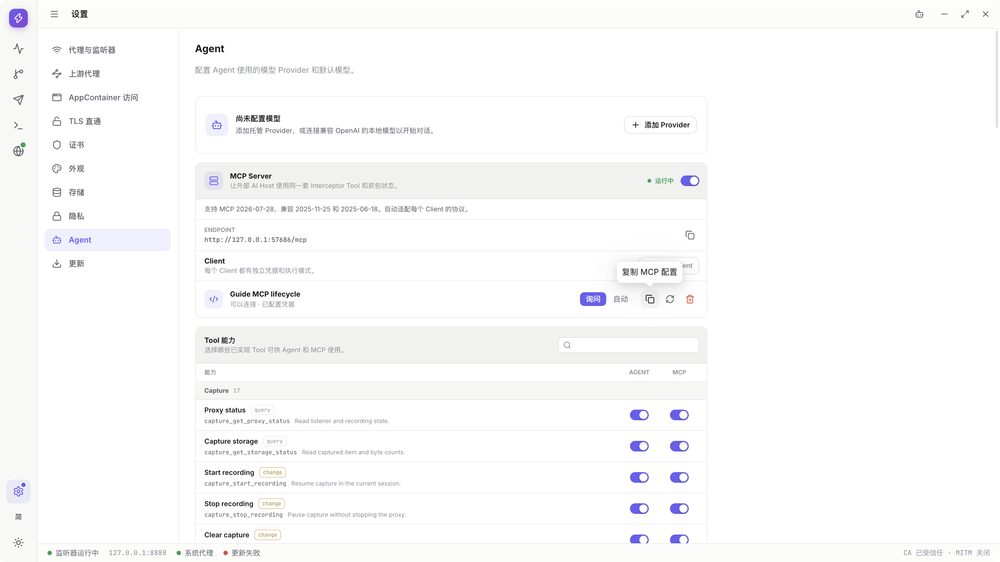

### 02 · 定位本次暂停Tool的MCP权限

### 03 · 发起一个尚待审批的操作

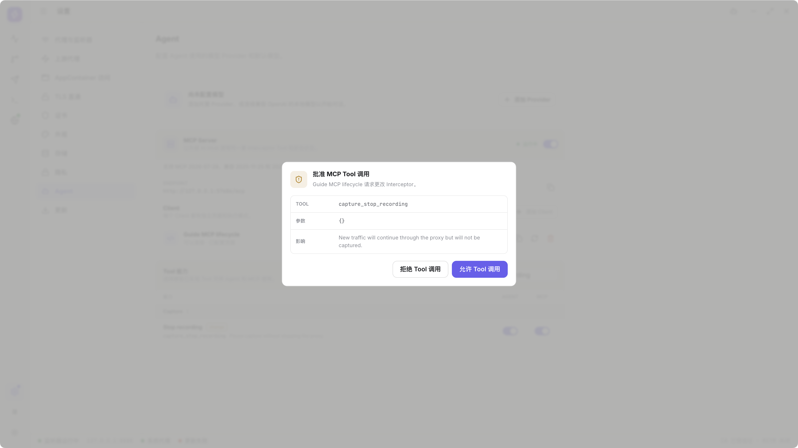

### 04 · 调用方真实取消该请求

### 05 · 定位Diagnostics查询与导出权限

### 06 · SDK实际查询Recent且不出现审批

### 07 · 用返回的traceId查询Trace

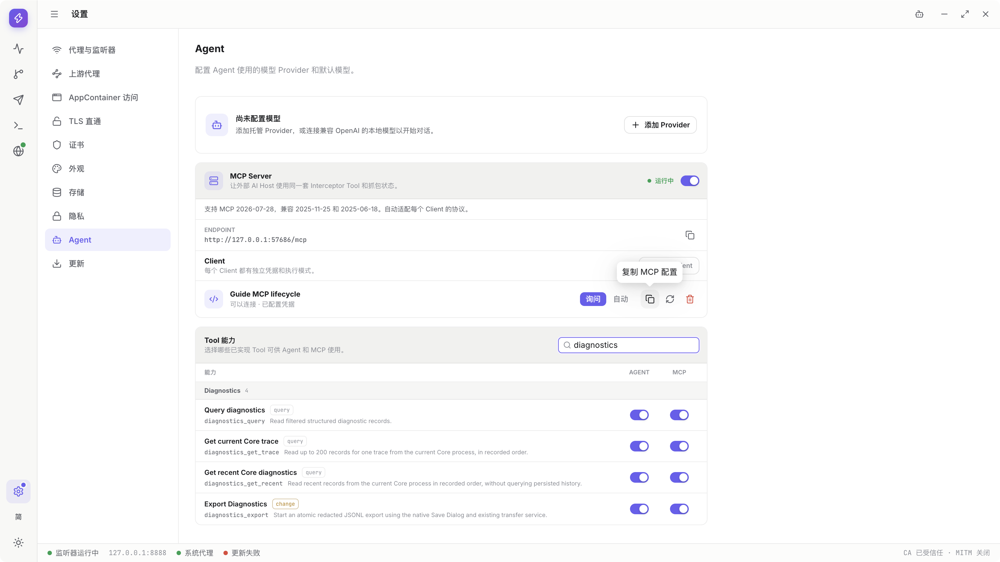

### 08 · 请求导出并检查实际参数

### 09 · Deny不打开文件窗口

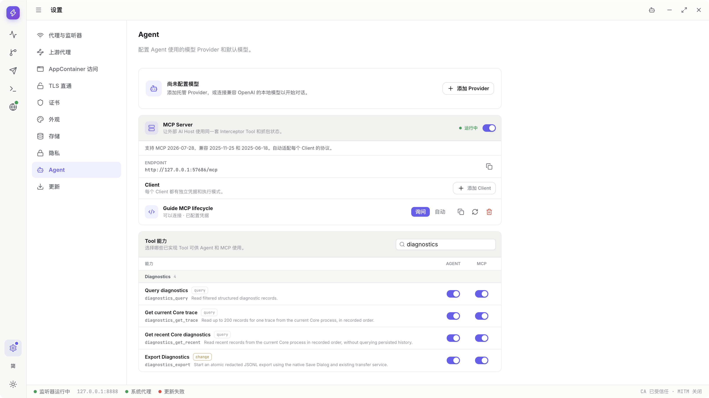

### 10 · 再次请求导出

### 11 · Allow后仍有真正的Save窗口

### 12 · 真实取消原生Save

### 13 · 重新请求需要保存的导出

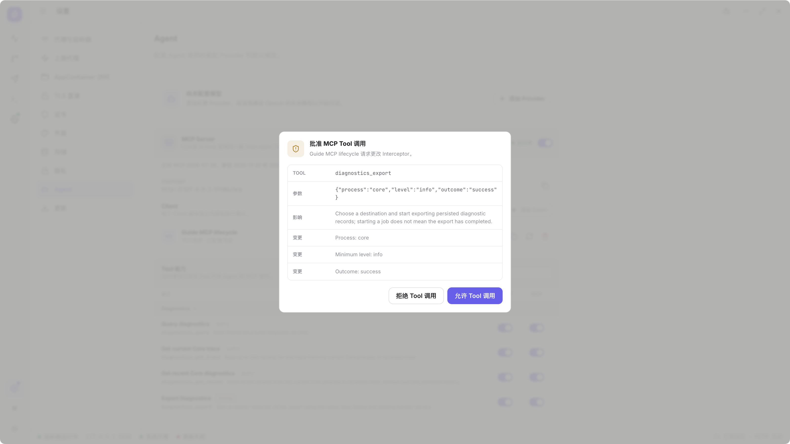

### 14 · 保存guide-mcp-diagnostics.jsonl

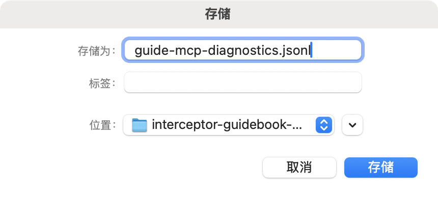

### 15 · 查询真实任务并核对文件

### 16 · 清空搜索返回Client控制

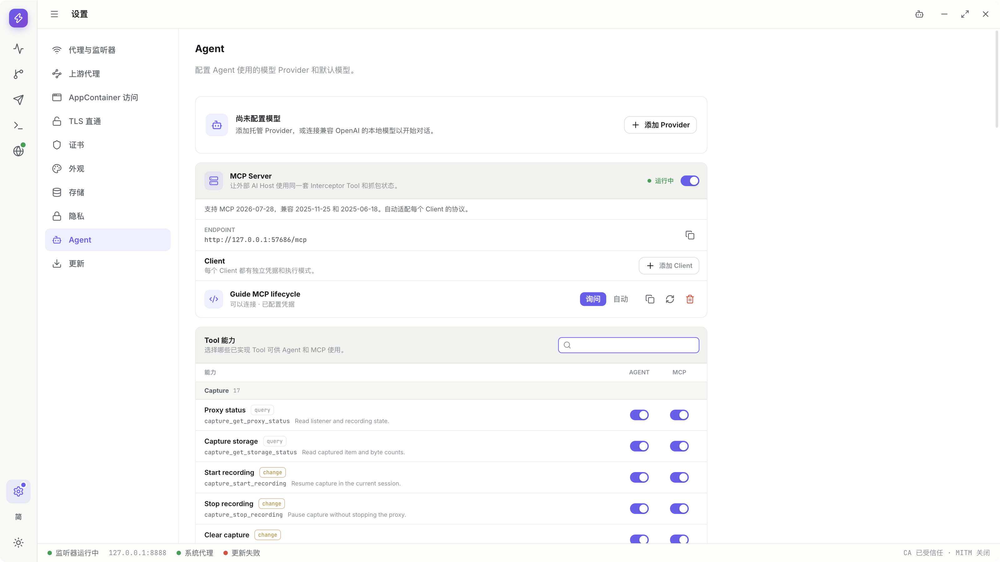

### 17 · 本次长调用选择Auto

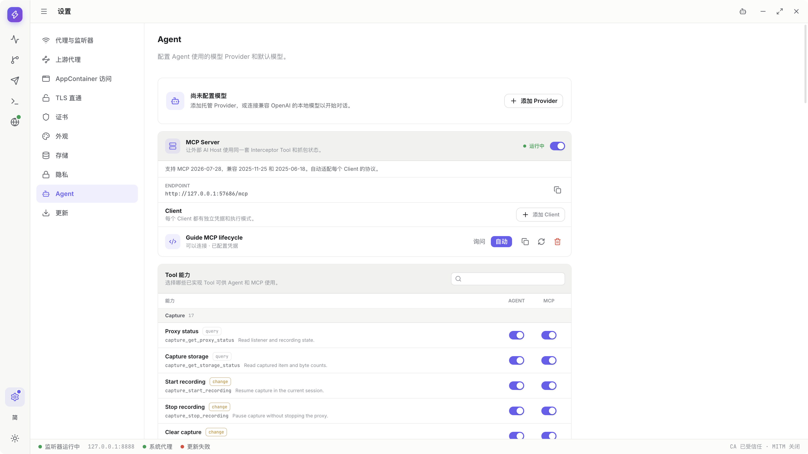

### 18 · 发起真实未完成的Composer请求

### 19 · 在途调用期间打开撤销确认

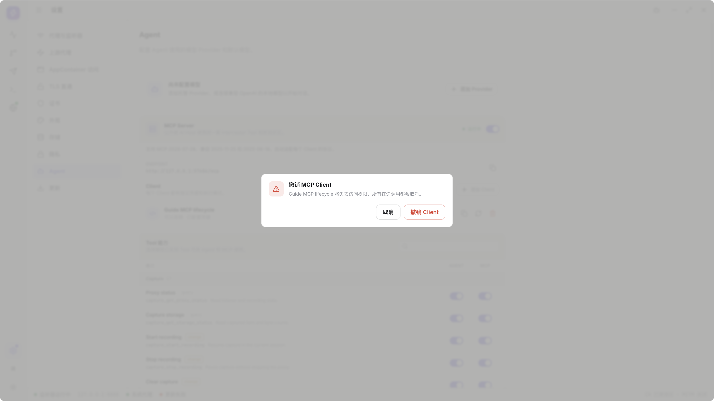

### 20 · 撤销Client并核对真实请求取消

### 21 · 旧Client身份不能再查询

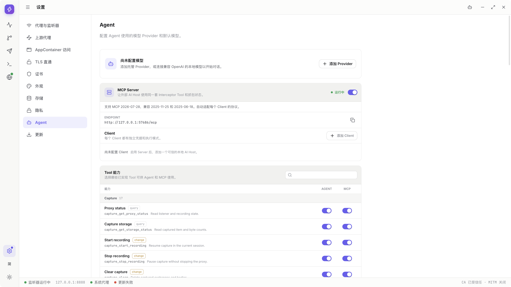

### 22 · 关闭本轮MCP Server

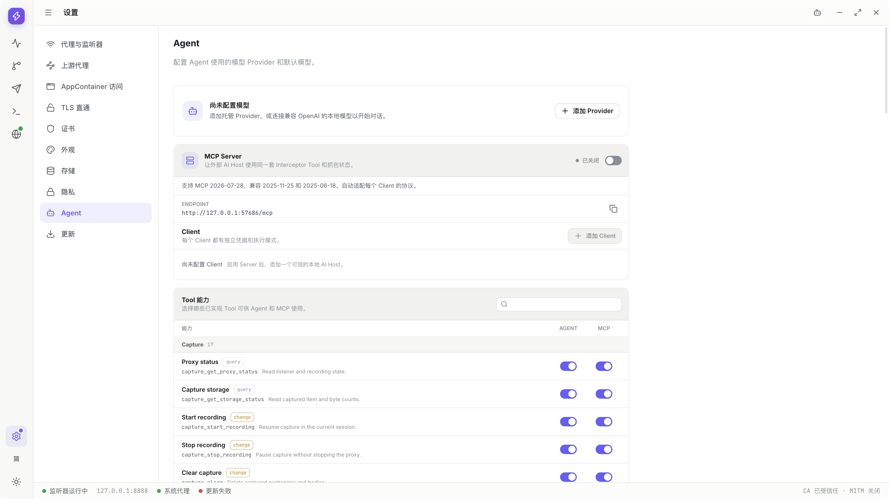

下面保留完整功能参考。只有已经附上真实步骤图、核对过变量和值的操作才能计入图文验收。
<!-- recorded-walkthrough:mcp-tool-lifecycle:end -->

<!-- recorded-walkthrough:mcp-endpoint-reconnect:start -->

## 更换冲突地址并重新发现Tool

以下图片来自已发布的 <code>0.1.1-alpha.1</code>、macOS x64，App保持<code>zh-CN</code>。每个步骤都有对应原生窗口截图，可点击查看原尺寸。

本机地址、端口和生成ID来自这次真实录制，不是公开服务；使用时替换成自己的已授权测试环境。下面先列本次实际数据，再按相同顺序操作。未出现在本组步骤图中的进阶分支仍待逐步配图与验收。

> 调用方是官方SDK构建的本地演示Client，不是VS Code或云端Host兼容性演示。凭据未进入图文，Copy后的配置只在本机测试内存中使用。

| 示例字段 | 录制中的实际值 |
| --- | --- |
| <code>oldEndpoint</code> | <code>http://127.0.0.1:59234/mcp</code> |
| <code>newEndpoint</code> | <code>http://127.0.0.1:59291/mcp</code> |
| <code>clientName</code> | <code>Guide endpoint client</code> |
| <code>caller</code> | <code>Actual official local SDK; no commercial Host configuration screen is claimed</code> |
| <code>identity</code> | <code>Endpoint changes; the same Client credential remains valid and is never shown</code> |
| <code>evidenceGeneration</code> | <code>endpoint-reopened</code> |

### 01 · 重启后打开MCP设置

### 02 · 核对真实endpoint冲突

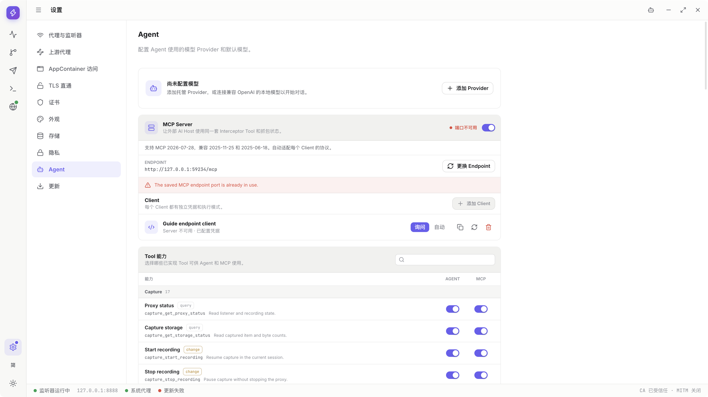

### 03 · 显式Change endpoint

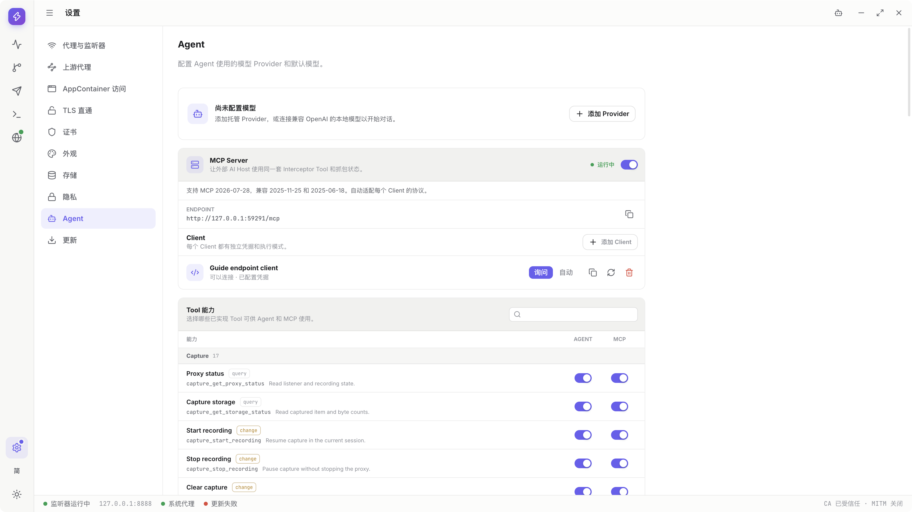

### 04 · 复制当前配置，不展示凭据

### 05 · 让本地SDK使用新地址重新连接

### 06 · 在新endpoint执行真实查询

### 07 · 关闭新地址上的演示Server

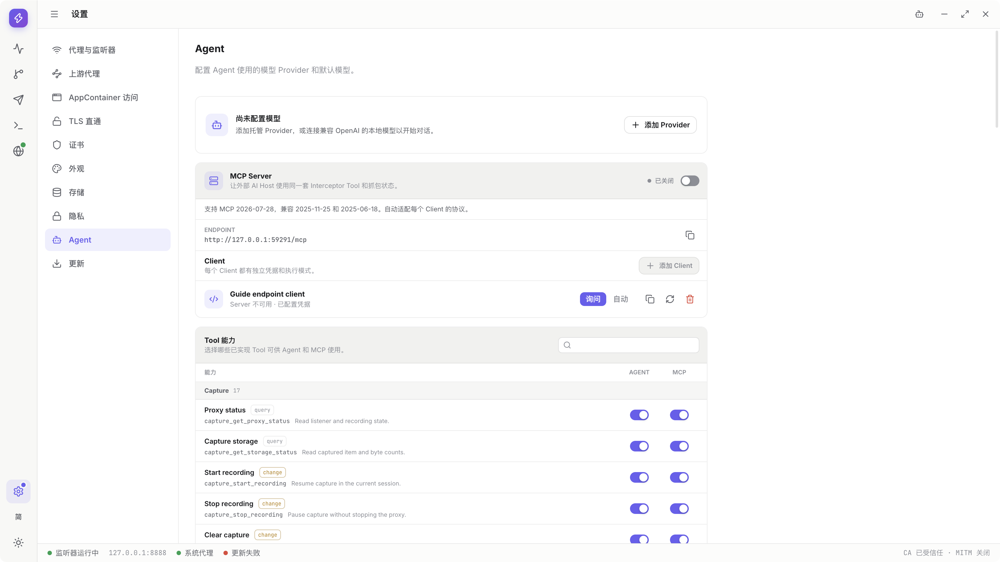

下面保留完整功能参考。只有已经附上真实步骤图、核对过变量和值的操作才能计入图文验收。
<!-- recorded-walkthrough:mcp-endpoint-reconnect:end -->
