# MCP：连接外部 AI 客户端

[教程目录](../README.md) · [Tool 权限](tool-permissions.md) · [Tool 速查](tool-reference.md)

## 先确认接入条件

- Interceptor 必须在本机运行，MCP Server 已开启。
- Host 需要能够从这台机器连接 loopback Streamable HTTP endpoint。
- 支持的协议为 `2025-06-18`、`2025-11-25`、`2026-07-28`，由 Host 与 SDK 自动处理，不手动切版本。
- 不使用 `stdio` 或旧式 HTTP+SSE 的配置替代当前 HTTP endpoint。
- 外部 Host 负责自己的模型配置；不要求先给 Interceptor 内置 Agent 添加模型。

从云端发起连接的远程 connector 不能访问你电脑的 `127.0.0.1`。不能因为某个云端产品支持 MCP，就把本机 endpoint 粘过去并期待可达。

## 开启服务并取得 endpoint

MCP Server 与 Capture 的代理监听器分开。首次开启选择空闲端口，之后正常启动沿用保存的端口。

1. 打开 Settings → Agent，找到 MCP server。没有配置内置 Agent 模型也可以使用 MCP；Server 默认关闭。

   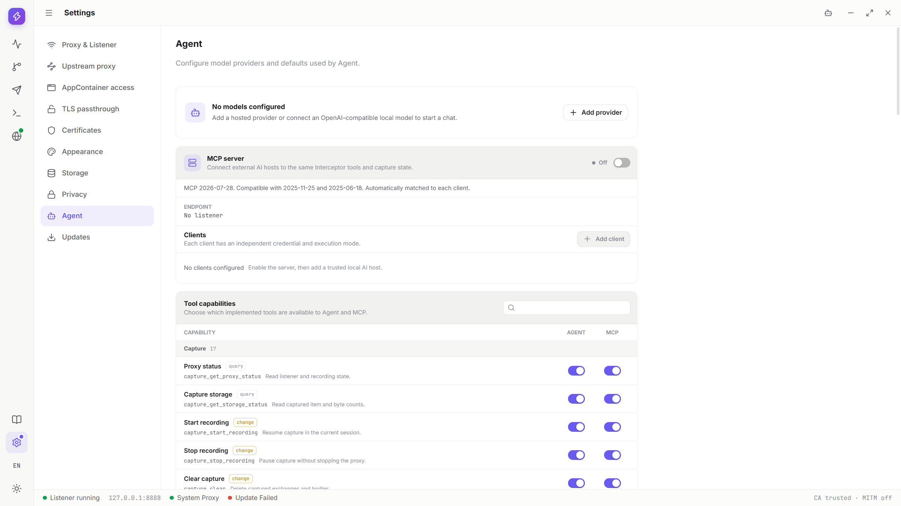

2. 点击红框 1 的开关，等待 Running。红框 2 显示本次实际 endpoint：`http://127.0.0.1:55871/mcp`。使用自己页面显示的地址，不把 Capture 的 `8888` 当作 MCP 端口。

   

服务只监听本机 loopback，不对局域网或公网开放。App 正常关闭后，不会留下独立运行的 MCP Server。

## 为一个 Host 创建独立客户端

为每个实际 Host 创建独立 Client。本例名称为 `MCP workflow client`；名称只是识别标签，不会自动替你配置对应 Host。

1. 在 Clients 区点击 Add client，打开 Client name 窗口。默认名称可以改成自己容易识别的 Host 名称。

   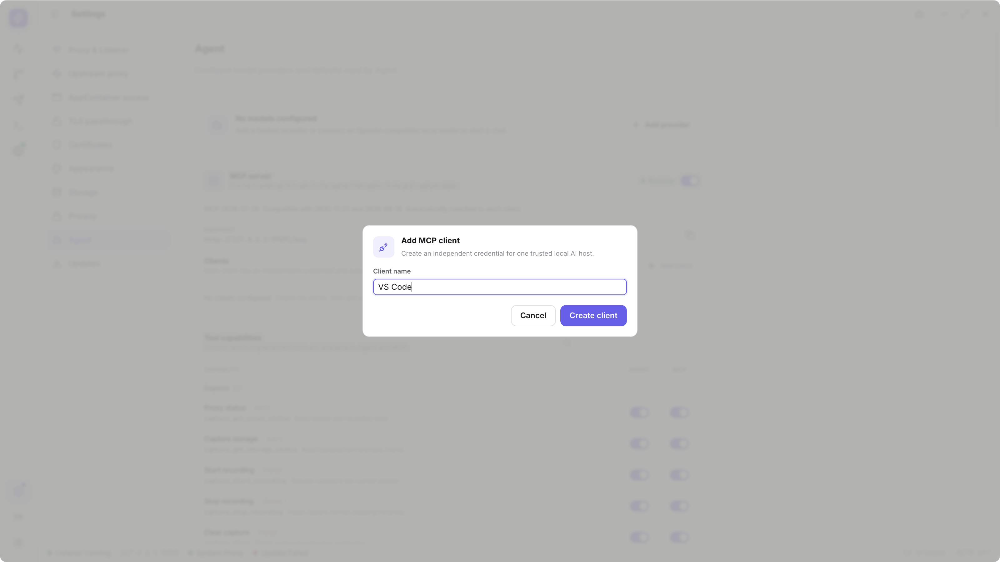

2. 在红框 1 填 `MCP workflow client`，点击红框 2 的 Create client。新 Client 初始为 Ask，拥有独立凭据，不与其他 Host 共用身份。

   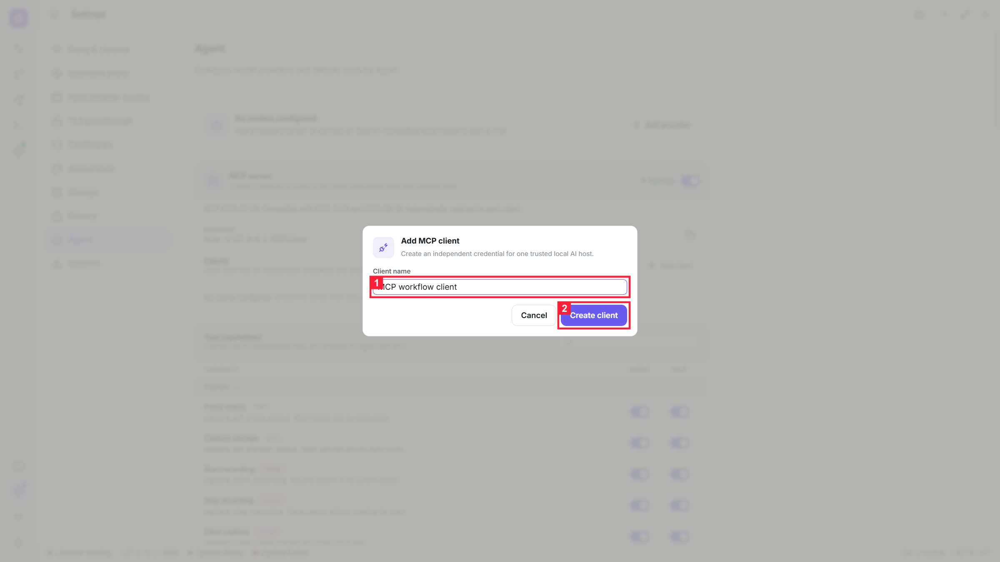

   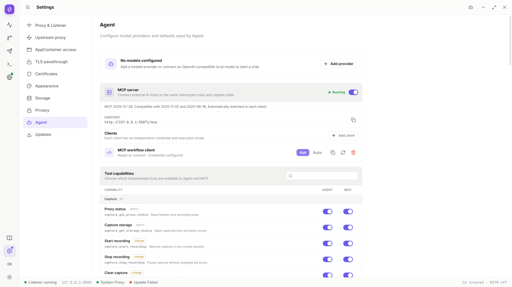

3. 点击 Client 行红框 1 的复制按钮，将连接配置放入系统剪贴板。配置包含认证信息，不粘贴到聊天、提交到项目或公开截图。

   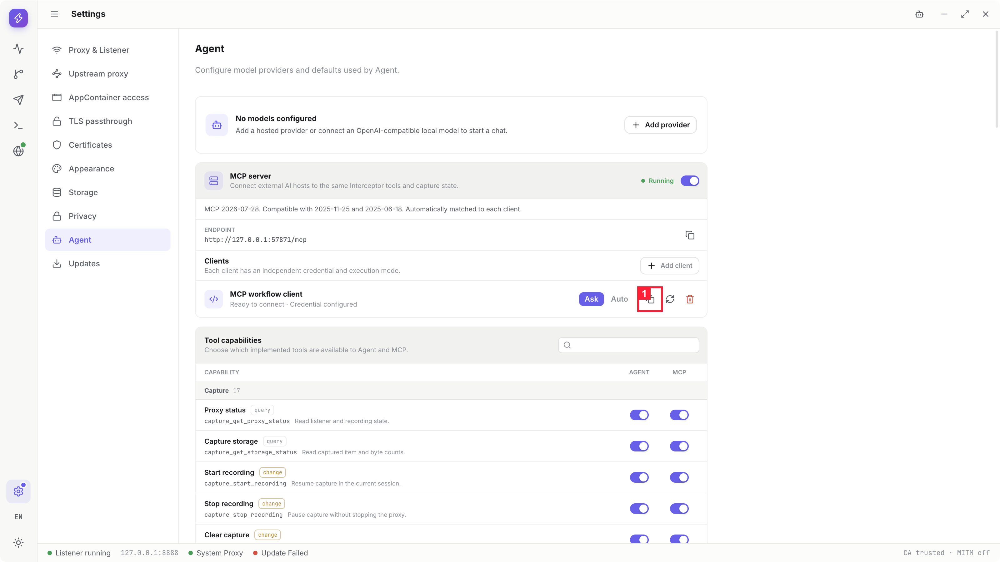

4. 在实际 Host 的用户级 MCP 配置中，按该 Host 的格式添加 HTTP Server，填写复制的 endpoint 和认证字段。外层配置格式并不通用，也不要把本机 loopback 地址交给无法访问本机的云端 connector。

   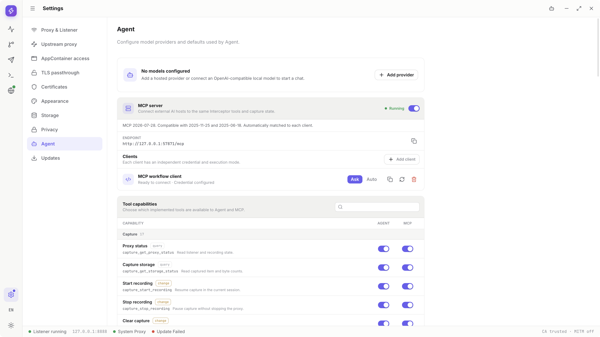

5. 让 Host 连接并刷新 Tool 列表，先调用只读的 `capture_get_proxy_status`，在 Host 中核对实际返回。App 保持这份 Client 配置；复制成功不等于认证和查询都成功。

   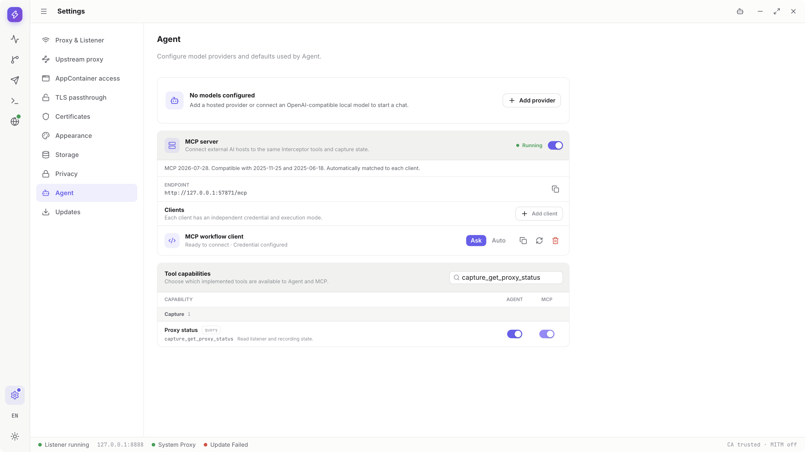

6. 需要控制查询权限时，在 Tool capabilities 搜索 `capture_get_proxy_status`。红框 1 是 MCP 开关，红框 2 是独立的 Agent 开关。关闭 MCP 后该 Tool 不再可用，需要时再明确开启。

   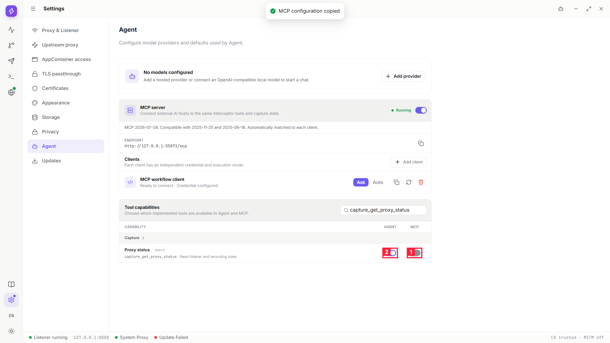

   

- 将配置保存在 Host 的用户级安全位置，不纳入项目或 Settings Sync。
- 不同 Host 使用不同 Client；不通过共享一份凭据简化管理。
- Host 的模型账号与 Interceptor 内置 Agent 的模型配置相互独立。

## 从 Host 请求一个修改操作

先在 Tool capabilities 的 MCP 列允许所需 Tool。以下使用 VS Code 内的 Copilot SDK Host，Client 名为 `Current copilot-cli`，与上一节的 `MCP workflow client` 是两个独立示例。SDK 会话和 VS Code 内置 Copilot Chat 的 MCP 配置入口不一定相同；让当前 Host 从它的正式用户级入口加载配置，不把凭据粘贴到聊天中。

1. 在 `Current copilot-cli` 行用第一张图红框 1 复制配置，让当前 SDK Host 加载本例的 `http://127.0.0.1:51983/mcp`；自己操作时使用 App 显示的实际地址。第二张图红框 1 保持 Ask。复制成功、Server 显示 Running，都不能代替下一步实际调用。

   

   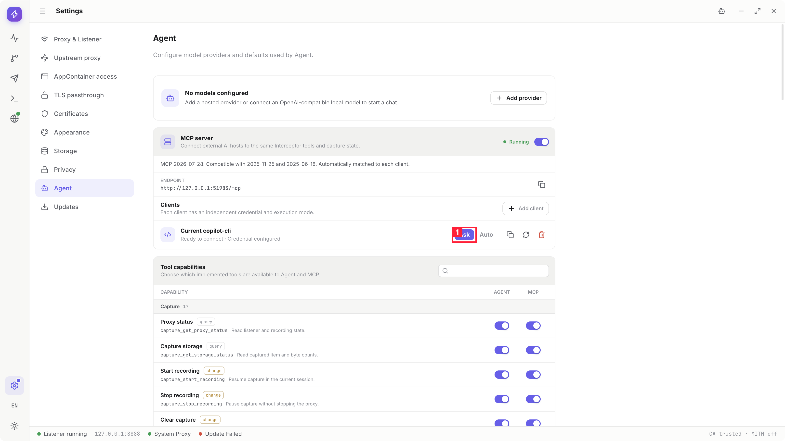

2. 只使用自己可清理的测试录制，经代理发送一个自己控制的请求。红框 1 按本例路径 `/e2e/current-mcp-host/c8a505f8-a3b7-4197-841c-002a789ccc9d` 筛选，红框 2 是对应的 GET、`200`、`113 B`。在当前 Host 调用 `capture_get_proxy_status`，再让 `capture_list_exchanges` 使用相同路径和 GET 筛选；从返回的 ID 读取详情与正文，核对同一请求，而不是查询其他个人流量。本例路径是动态示例，实际操作时换成自己的路径。

   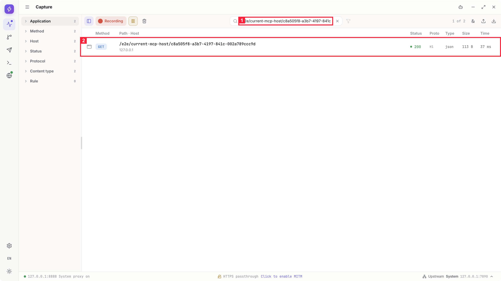

3. 从当前 Host 请求 `capture_stop_recording`，回到 App 核对 Client、Tool、空参数和暂停新录制的影响。先点击第一张图红框 1 的 Deny Tool call；Host 返回拒绝，第二张图红框 1 仍是 Recording。拒绝这一次调用不会暂停录制或恢复系统代理。

   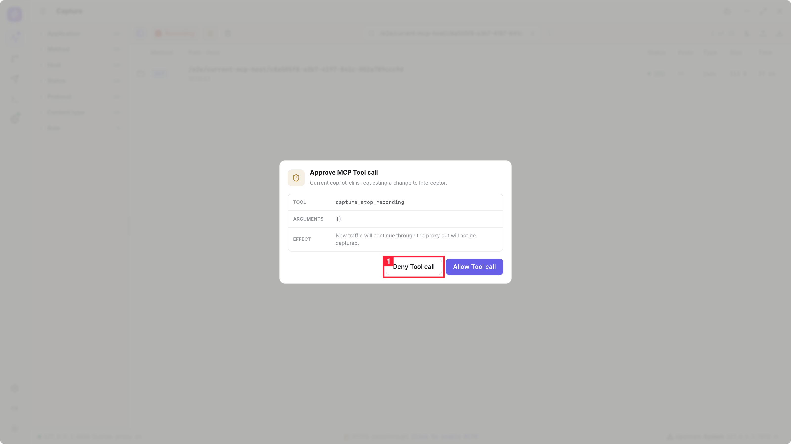

   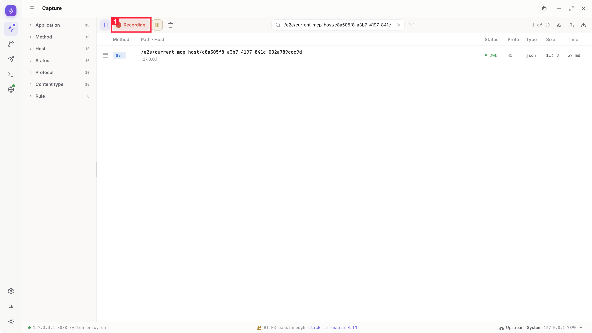

4. 让 Host 再次请求同一 Tool，重新核对后点击第一张图红框 1 的 Allow Tool call。第二张图红框 1 变为 Paused，Host 返回 `recording: false`。前一次拒绝不是这一次的决定，也不能只凭模型说“已完成”判断状态。

   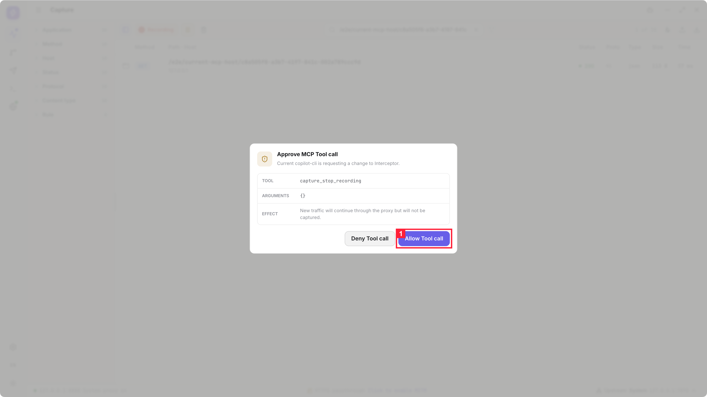

   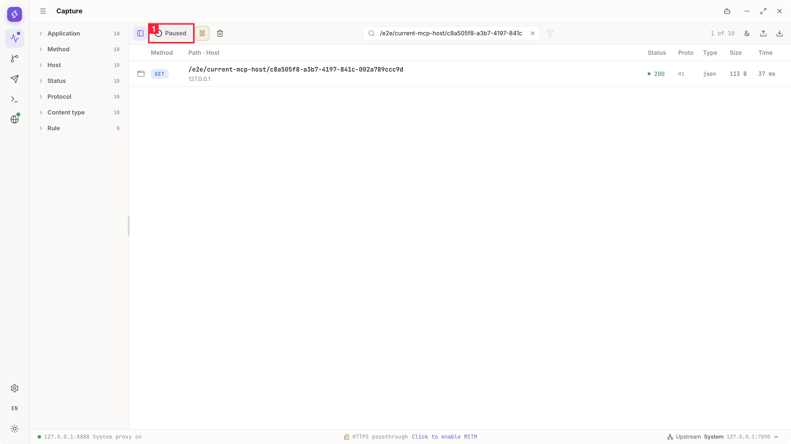

5. 先在 Capture 恢复 Recording。确实接受自动执行时，在 Settings 点击第一张图红框 1，仅把当前 Client 切到 Auto；再次从 Host 请求暂停，第二张图红框 1 显示 Paused，不再出现 App 审批。Auto 不绕过 Tool 权限、Host 自己的审批或系统授权，也不改变内置 Agent 的 Chat 模式。演示后按需要恢复 Recording。

   

   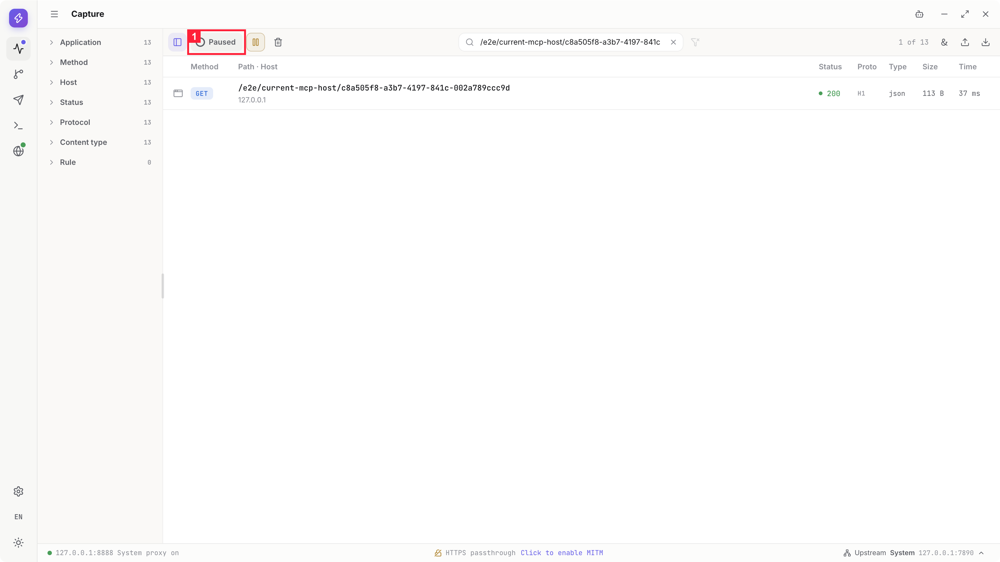

6. 只有确认当前录制可全部清理后，才让 Host 调用 `capture_clear`。它清空当前录制，不只删除筛选结果。核对实际返回中的记录与正文计数为零；图中红框 1 保留 Keyword，红框 2 仍为 Recording，列表为空。图片上方的 Stop recording 是鼠标提示，不表示已经暂停。

   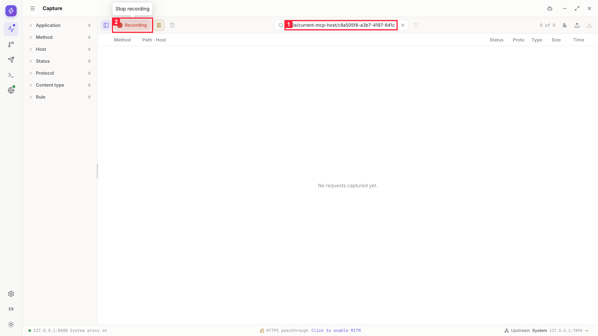

7. 调用方支持取消时，可以取消尚待裁决的单次调用；审批收起，Recording 保持原状态。下图改用独立的 `MCP workflow client` 示例。取消一次调用与断开整个 Host 不同，实际入口取决于 Host。

   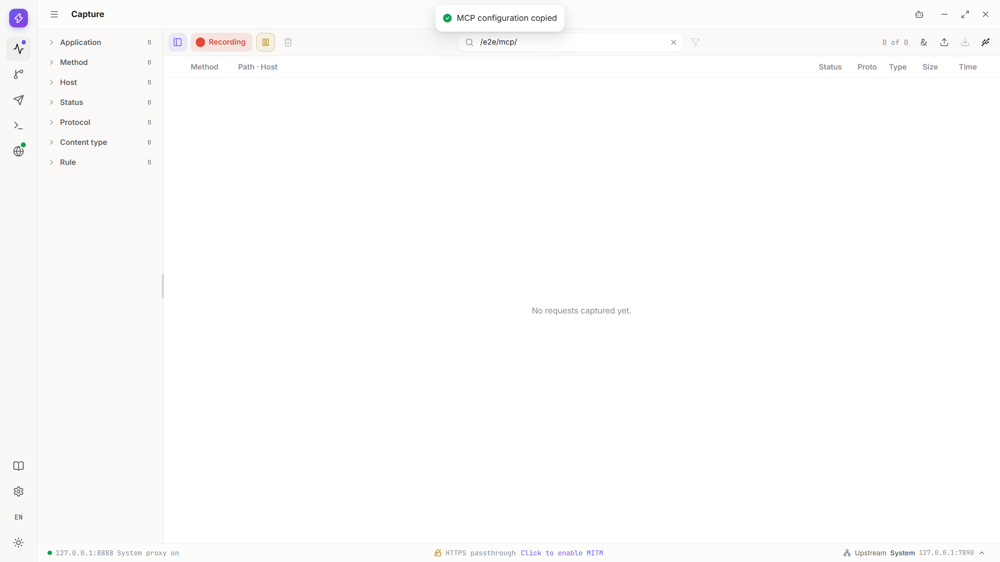

8. 文件 Tool 仍需完成系统窗口。图中另一个 Client `Diagnostics transfer MCP` 请求 `diagnostics_export`，先点击红框 1 的 Allow Tool call，再在 Save 保存 `mcp.jsonl`；Cancel 不会开始导出。保存后继续核对任务与实际文件。

   

   

Host 可能还有自己的审批，与 Interceptor 审批是两层控制。Auto 不替你选择文件，也不会绕过系统授权。

## endpoint 冲突或需要更换

手动开启时端口已占用，与 App 重启后保存端口发生冲突，是两条不同的处理路径。先读取实际错误，不为练习故意占用端口，也不结束未知进程。

1. 打开 Settings → Agent。红框 1 的协议说明在 Server 关闭时也可见；端口冲突不是协议版本变化，支持版本仍为 `2026-07-28`、`2025-11-25` 和 `2025-06-18`。

   

2. 手动开启失败时，红框 1 显示 `EADDRINUSE`，Server 保持 Off。本例被占用的是 `127.0.0.1:52142`，不是 Capture 的 `8888`。

   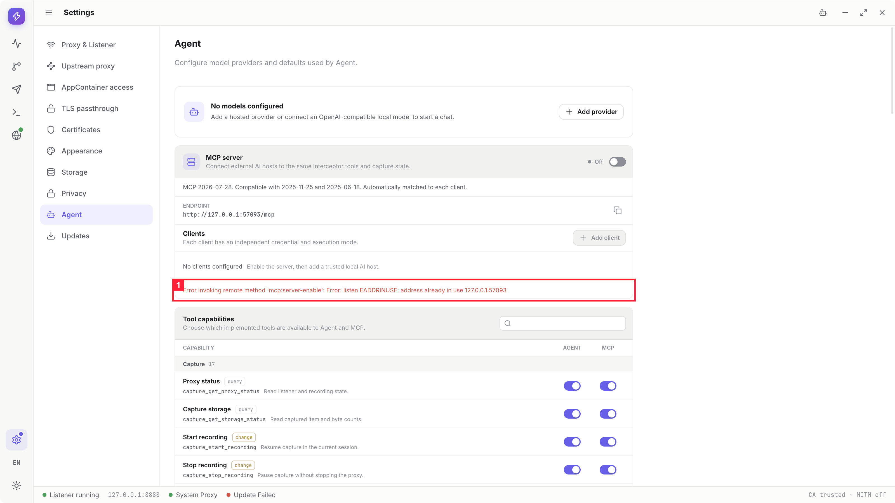

3. 先确认占用程序的身份，只正常关闭自己管理且不再需要的服务。不能确认归属时不要终止它，先由该服务的使用者处理。

   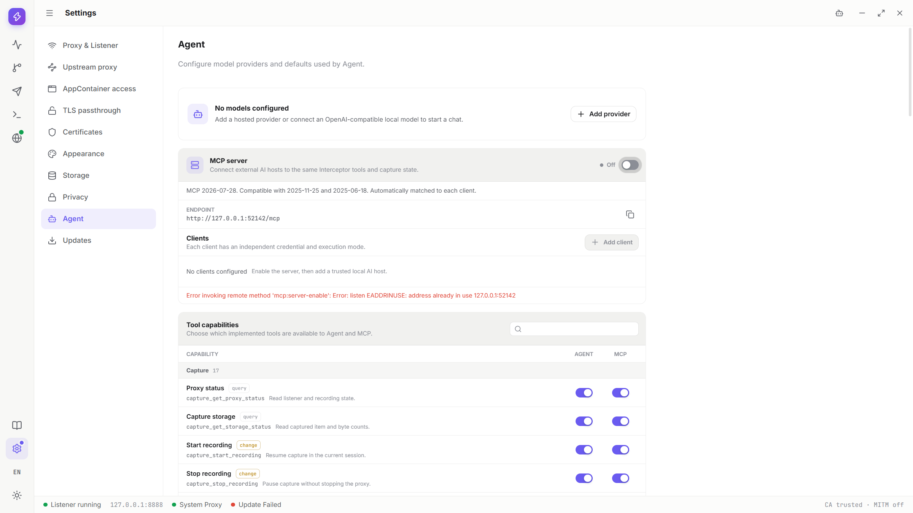

4. 已知占用释放后重新开启 MCP Server，等待 Running。红框 1 仍是原地址 `http://127.0.0.1:52142/mcp`，不必先换 endpoint。

   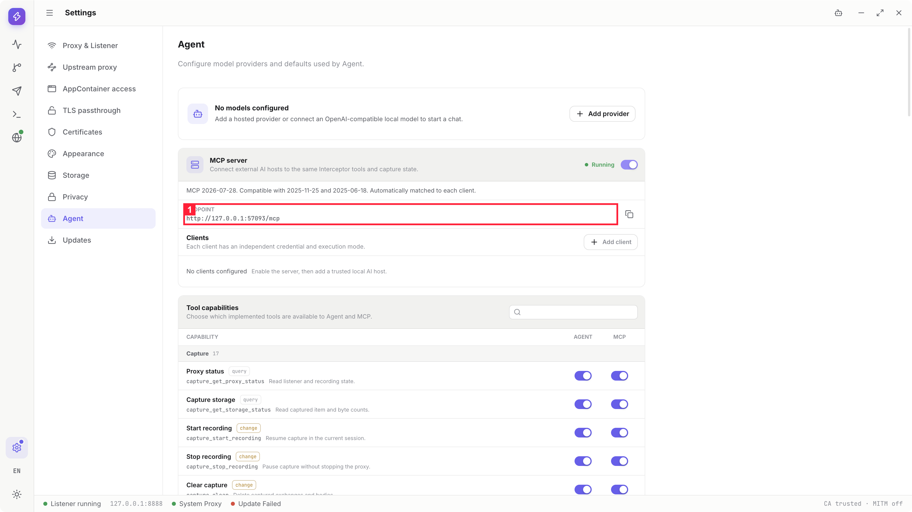

5. 如果暂时不需要 MCP，关闭 Server 并确认 Off。保存的地址仍可显示，不能只凭地址文字判断它正在监听。

   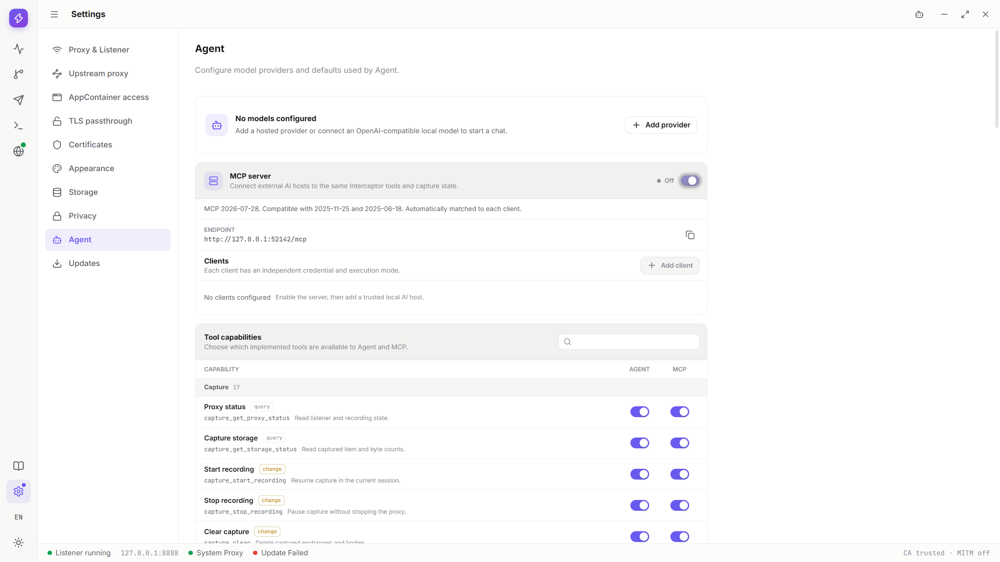

6. 另一种情况发生在正常重启后：上次保存为开启的 MCP 端口被占用，页面显示 Port unavailable，仍保留原地址和 Client。本例保留 `Endpoint recovery client`，不需要先删除或重建它。

   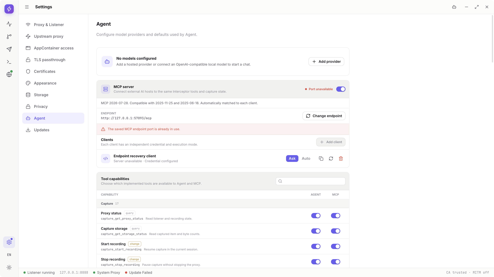

7. 确实需要改用空闲端口时，点击红框 1 的 Change endpoint。App 不会替你静默更换 Host 配置。

   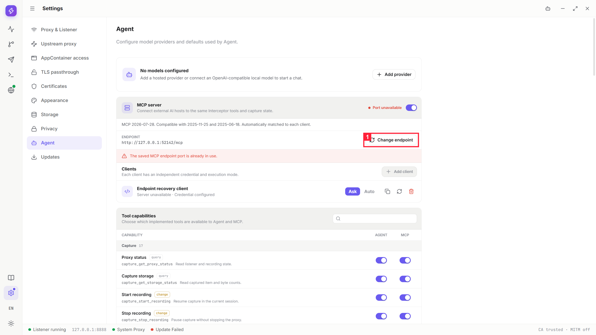

8. 等待 Running，读取红框 1 的新地址。本例为 `http://127.0.0.1:52166/mcp`，旧的 `52142` 不再是这个 Server 的接入地址。

   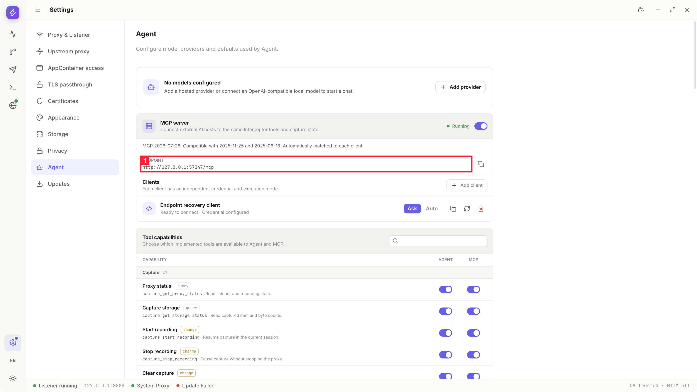

9. 点击原 Client 行红框 1 的复制按钮，在对应 Host 更新 endpoint 并保留认证字段。Change endpoint 本身不轮换 Client 凭据，不把复制的配置贴进聊天或公开项目。

   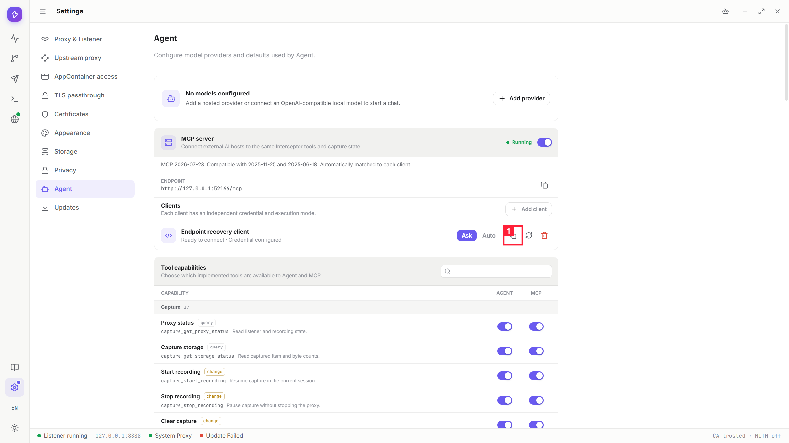

10. 让 Host 重新连接、刷新 Tool 列表，再调用 `capture_get_proxy_status` 并读取实际返回。App 保留同一 Client；仅看到复制成功提示还不能说明查询成功。

    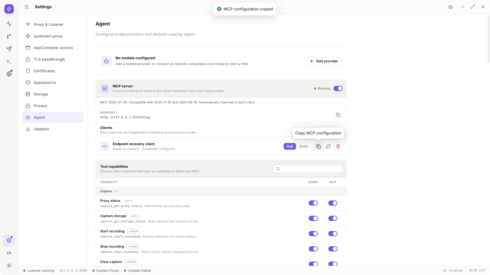

11. 结束接入时点击红框 1 关闭 Server，确认 Off。Client 配置可以保留；若不再信任该 Host，则按下一节单独撤销。

    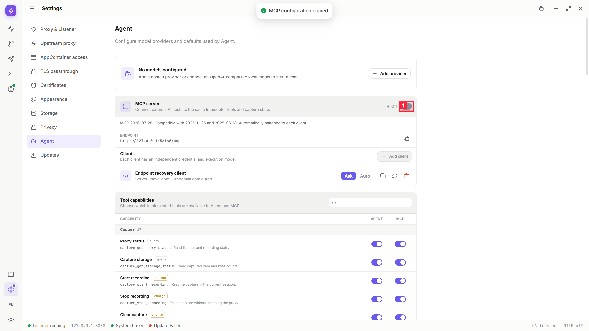

正常开关或重启不要求每次重建 Client；主动更换 endpoint 后，需要更新所有仍使用旧地址的 Host。

## 轮换凭据、撤销客户端和关闭服务

轮换凭据、撤销一个 Client、关闭 Server 是不同操作。先核对正在进行的调用和仍等待的业务，再选择对应操作。前五步使用 `MCP workflow client` 的轮换示例；最后三步接续前文 `Current copilot-cli` 的撤销与关闭。

1. 正常关闭并重启 App 后，已保存的 endpoint 和 Client 模式会回载。红框 1 的原 Client 仍为 Auto；普通重启不会自动轮换凭据。

   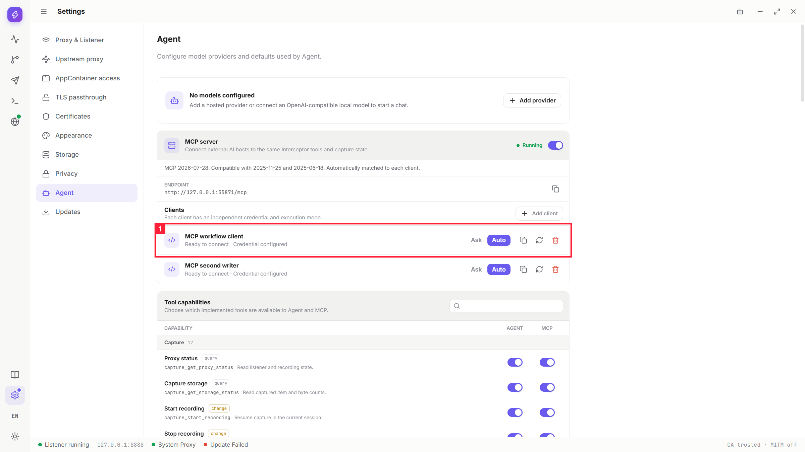

2. 需要再次审批时将 Client 改回 Ask。若 Host 在 Continue 等操作的审批期间断开，只取消该 Tool 调用；图中 HTTP 等待项仍在，不会因此自动放行。

   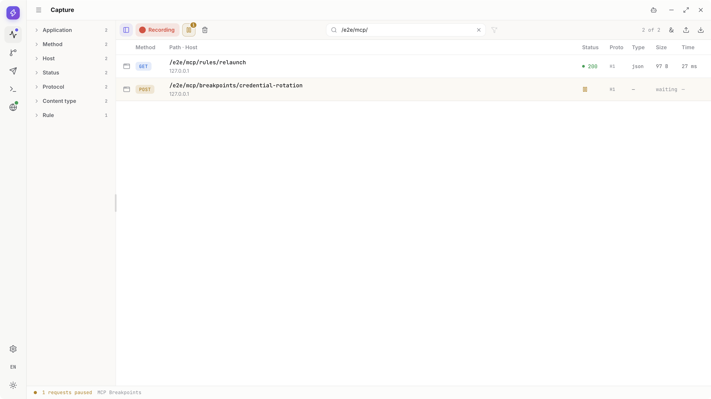

3. 点击 Client 的 Regenerate，先核对确认窗口。红框 1 的 Cancel 可放弃；红框 2 的 Regenerate credential 会立即使旧配置失效，不自动解除已有断点。

   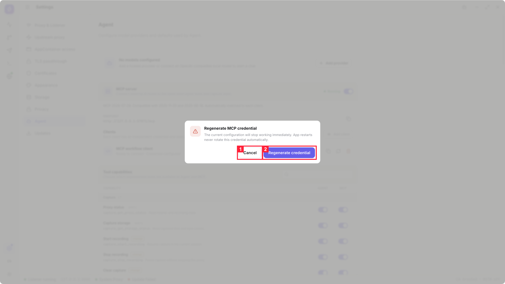

4. 轮换后点击红框 1 重新复制配置，更新对应 Host，再重新连接。endpoint 保持不变，但旧凭据不能继续使用；不要把新凭据放入聊天或项目。

   

5. 重新连接后仍需按当前权限处理原先等待的操作。确认需要继续时再 Allow，不把凭据轮换当作业务恢复。

   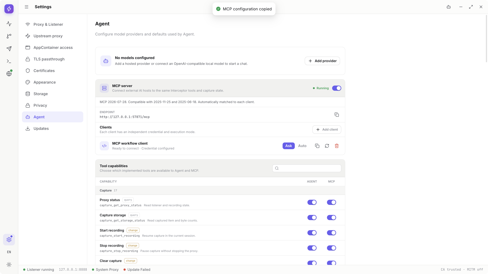

6. 不再信任或使用前文的 SDK Host 时，找到 `Current copilot-cli`，点击红框 1 的撤销按钮。先核对 Client 名称，不误撤销其他 Host。

   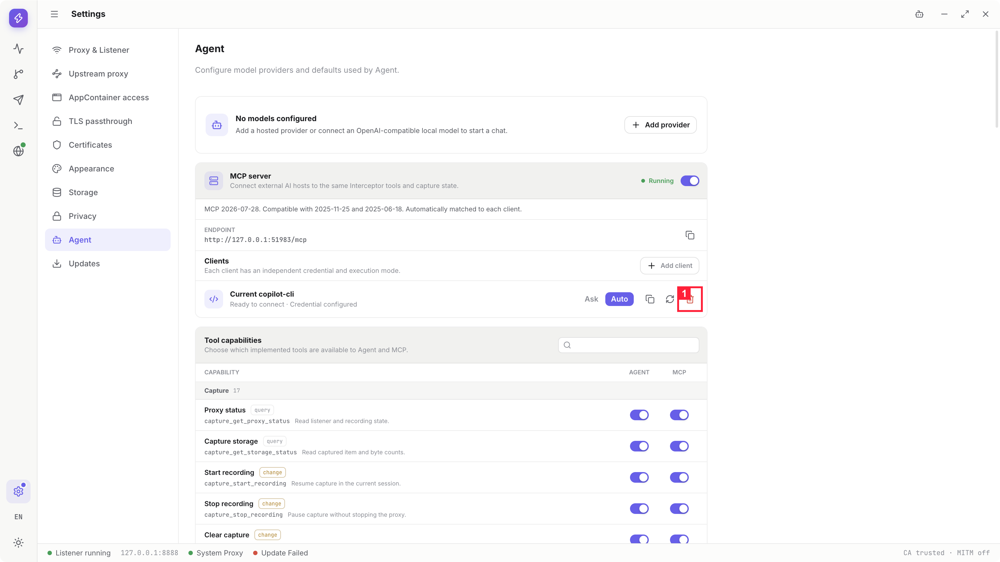

7. 在确认窗口再次核对名称，再点击红框 1 的 Revoke client；Cancel 可放弃。撤销后该 Client 行消失、旧配置失效，它正在执行的调用也会取消。撤销一个 Client 本身不会关闭 Server。

   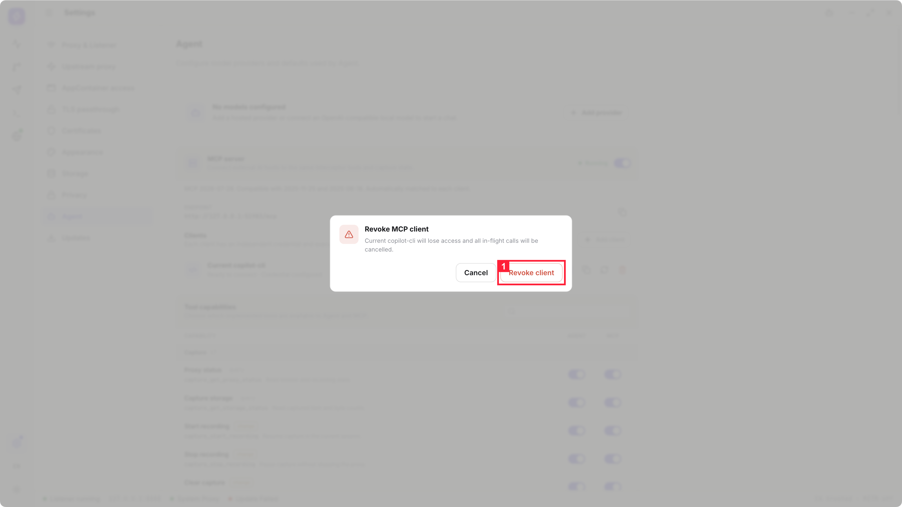

8. 确认本例 Client 已移除后，不再需要外部接入时才点击红框 1 关闭 MCP Server，确认 Off。再从对应 Host 的配置入口停止并移除这一项，不覆盖其他 Server。所有 Host 都无法继续连接已关闭的监听器；需要时再由用户明确开启。

   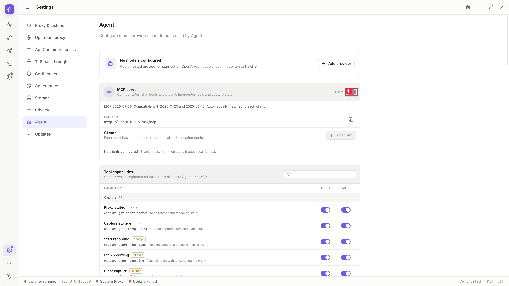

凭据泄露时立即轮换或撤销。只修改 Host 的显示名称不会使旧凭据失效。

## Browser Host 与兼容性排查

1. 确认 Browser 中的客户端在你自己的设备上运行，而不是由远端服务器代理连接。

   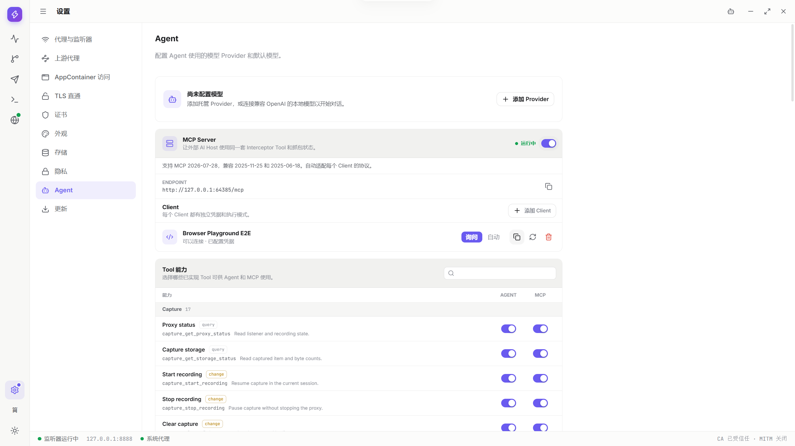

2. 使用自己明确授权的页面，并按要求提供 Client 凭据。

   

3. 如果工具列表为空，检查 Server、Client 身份、协议支持和 MCP 列权限。

   

   如果发现列表为空，先检查该 Client 的 Tool 权限，再重新连接并刷新列表。配置方法见[只读权限](tool-permissions.md#read-only)。

4. 查询成功但修改停住时，检查 App 审批、原生窗口和目标业务的前提。

   

   调用一直等待时，回到 App 检查 Tool 审批、文件选择和确认窗口；这些窗口需要实际确认或取消。

5. 升级 Host 后重新核对连接和一项实际操作，不只看“Server 已登记”。

   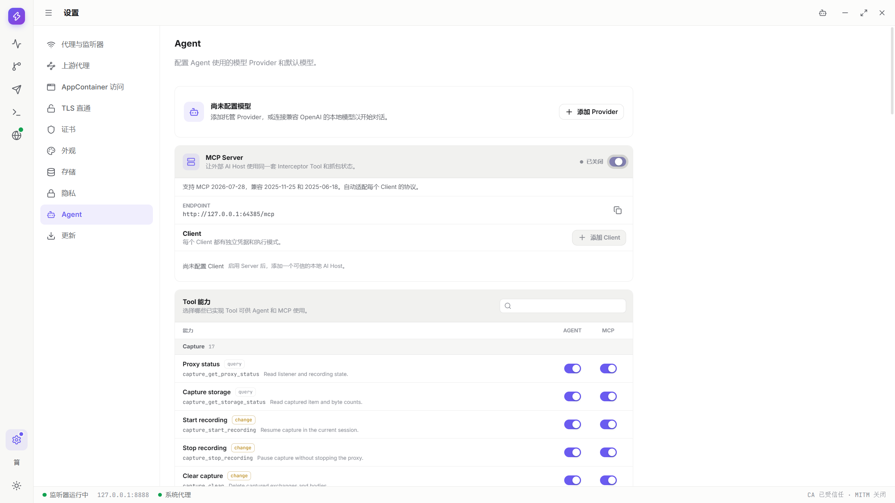

- 允许 Browser 跨 Origin 访问不意味着匿名调用，实际请求仍需有效认证。
- Tool 查询结果可能包含调试数据，不要把 Client 凭据交给任意第三方网页。

-
