# Settings：代理、证书、存储和更新

> 草稿，面向 `v0.1.1-alpha.1`；已配只读检查、安全草稿及已录操作，授权和平台缺口逐步标注，不代表全章或 item9 完成。原生授权须由有权限的用户完成，macOS 或测试结果不能替代 Windows 验收。

[教程目录](../README.md) · [快速上手](getting-started.md)

<!-- recorded-walkthrough:start -->

## 逐步骤实操：真实产品录制

以下图片和视频来自已发布的 <code>0.1.1-alpha.1</code>、macOS x64，App保持<code>zh-CN</code>。每个步骤都有对应原生窗口截图，可点击查看原尺寸。

本机地址、端口和生成ID来自这次真实录制，不是公开服务；使用时替换成自己的已授权测试环境。下面先列本次实际数据，再按相同顺序操作。未出现在本段录像中的进阶分支仍待逐步配图与验收。

> 本段展示已有CA、设置入口和可放弃的草稿。Manual和PAC示例没有Apply；视频不证明这些示例地址可用，也没有重新生成或卸载日常CA。

| 示例字段 | 录制中的实际值 |
| --- | --- |
| <code>manualHost</code> | <code>127.0.0.1</code> |
| <code>manualPort</code> | <code>7890</code> |
| <code>pacUrl</code> | <code>https://proxy.example.test/proxy.pac</code> |
| <code>exampleApplied</code> | <code>false</code> |

<video controls preload="metadata" playsinline lang="zh-CN" src="../media/v0.1.1-alpha.1/settings/settings.mp4" poster="../media/v0.1.1-alpha.1/settings/settings-01-open.png">
<track kind="captions" srclang="zh-CN" label="Steps / 步骤" src="../media/v0.1.1-alpha.1/settings/settings.vtt" default>
</video>

### 01 · 打开 Settings

[视频 00:00](../media/v0.1.1-alpha.1/settings/settings.mp4#t=0.388) · [返回本节视频](#walkthrough-video)

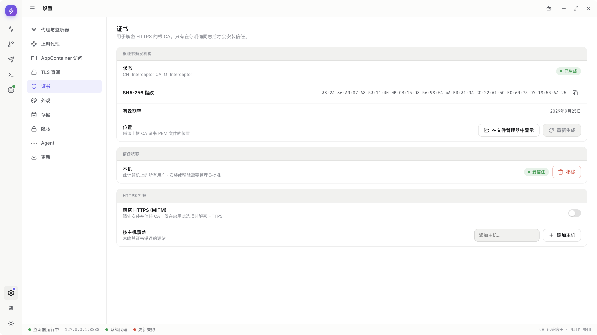

### 02 · 检查当前 CA 与信任

[视频 00:03](../media/v0.1.1-alpha.1/settings/settings.mp4#t=3.255) · [返回本节视频](#walkthrough-video)

### 03 · 检查 System proxy

[视频 00:06](../media/v0.1.1-alpha.1/settings/settings.mp4#t=6.104) · [返回本节视频](#walkthrough-video)

### 04 · 查看当前上游路线

[视频 00:08](../media/v0.1.1-alpha.1/settings/settings.mp4#t=8.958) · [返回本节视频](#walkthrough-video)

### 05 · 选择 Manual 草稿

[视频 00:11](../media/v0.1.1-alpha.1/settings/settings.mp4#t=11.854) · [返回本节视频](#walkthrough-video)

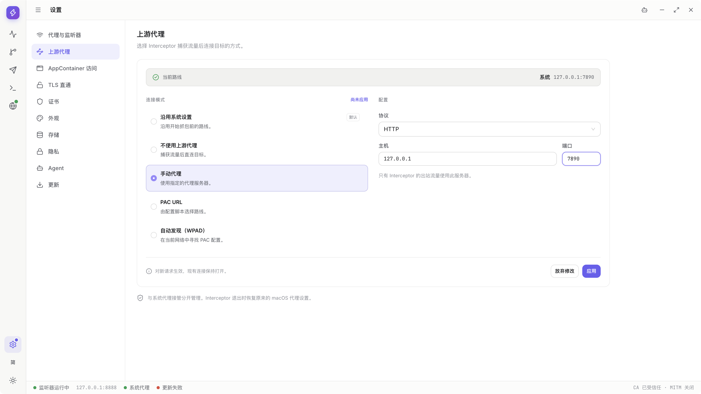

### 06 · Discard 不应用示例草稿

[视频 00:14](../media/v0.1.1-alpha.1/settings/settings.mp4#t=14.855) · [返回本节视频](#walkthrough-video)

### 07 · 查看 PAC 输入

[视频 00:17](../media/v0.1.1-alpha.1/settings/settings.mp4#t=17.703) · [返回本节视频](#walkthrough-video)

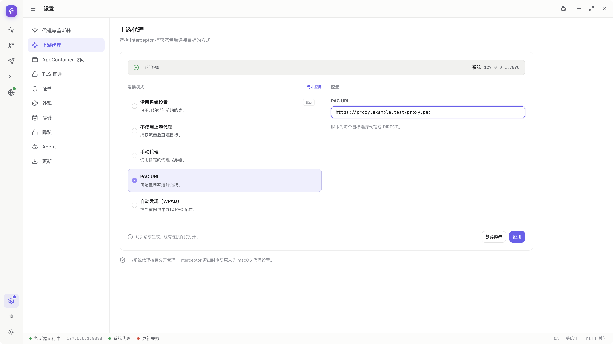

### 08 · 放弃未运行的 PAC 示例

[视频 00:20](../media/v0.1.1-alpha.1/settings/settings.mp4#t=20.608) · [返回本节视频](#walkthrough-video)

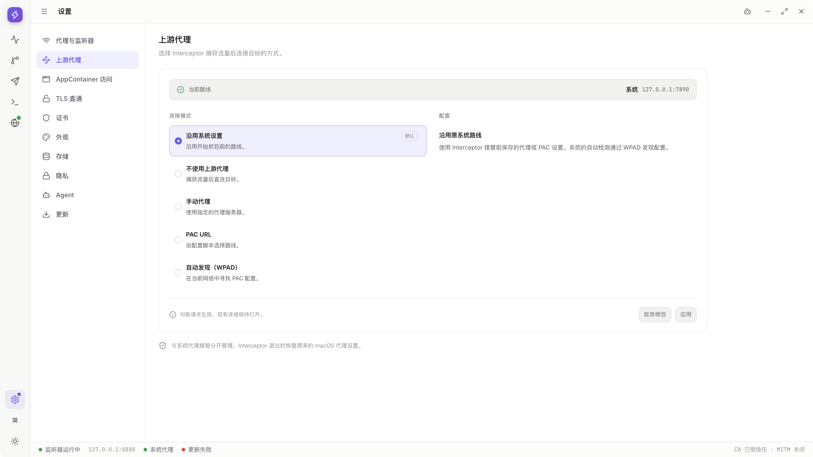

### 09 · 打开 TLS passthrough

[视频 00:23](../media/v0.1.1-alpha.1/settings/settings.mp4#t=23.457) · [返回本节视频](#walkthrough-video)

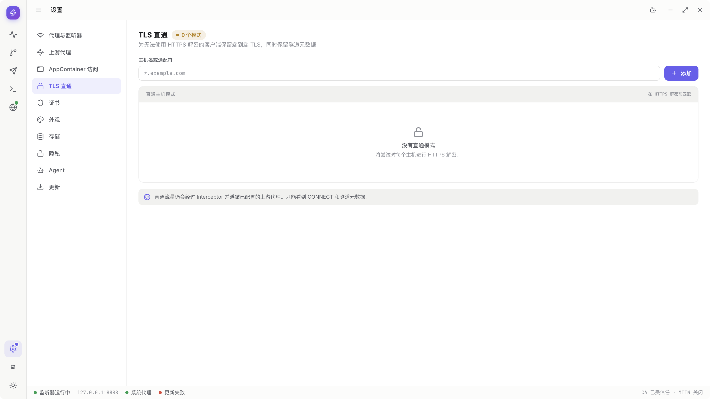

### 10 · 检查导出隐私默认值

[视频 00:26](../media/v0.1.1-alpha.1/settings/settings.mp4#t=26.313) · [返回本节视频](#walkthrough-video)

### 11 · 查看临时存储

[视频 00:29](../media/v0.1.1-alpha.1/settings/settings.mp4#t=29.204) · [返回本节视频](#walkthrough-video)

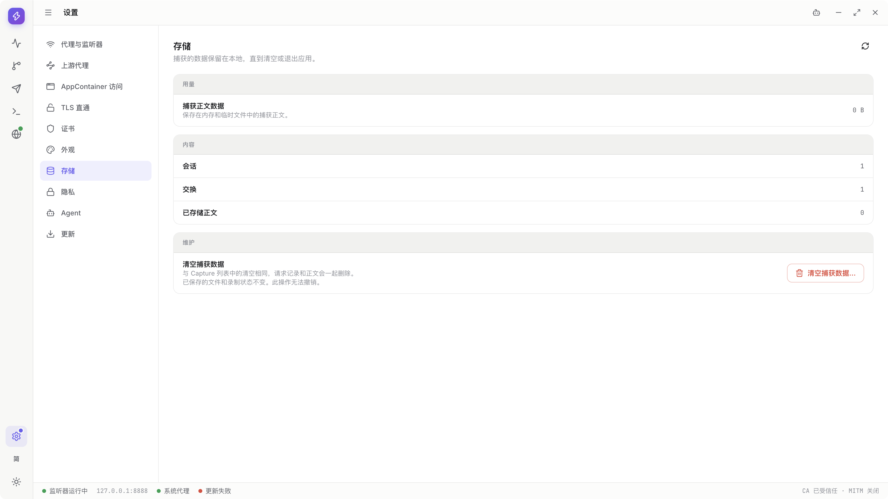

### 12 · 刷新用量

[视频 00:32](../media/v0.1.1-alpha.1/settings/settings.mp4#t=32.058) · [返回本节视频](#walkthrough-video)

### 13 · 查看清理确认

[视频 00:34](../media/v0.1.1-alpha.1/settings/settings.mp4#t=34.904) · [返回本节视频](#walkthrough-video)

### 14 · 取消清理

[视频 00:37](../media/v0.1.1-alpha.1/settings/settings.mp4#t=37.753) · [返回本节视频](#walkthrough-video)

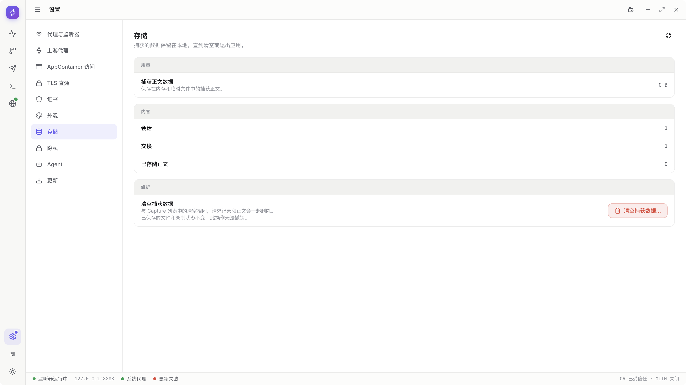

### 15 · 查看版本与更新状态

[视频 00:40](../media/v0.1.1-alpha.1/settings/settings.mp4#t=40.604) · [返回本节视频](#walkthrough-video)

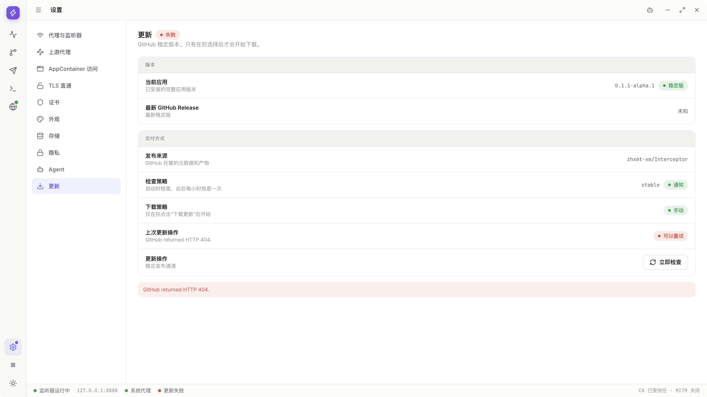

下面保留完整功能参考。只有已经附上真实步骤图、核对过变量和值的操作才能计入图文验收。
<!-- recorded-walkthrough:end -->

## 先找到对应设置

从侧栏进入 Settings。System proxy、Upstream proxy、App containers、TLS passthrough、Certificates、Appearance、Storage、Privacy、Agent、Updates 各自解决不同问题。

离开再返回会保留最后访问的分组；从代理就绪、TLS 提示或 Agent 配置入口跳转时，会定位到相应分组。

## 接管与恢复系统代理

**用途**：让遵循系统代理的应用把请求交给 Interceptor。

**步骤**

本段使用 `settings-proxy-routing`，录制机器已经有获授权的 helper。它展示实际 Restore/Enable，不是首次 helper 安装或系统授权；调用方是明确配置代理的本地演示客户端。

1. 检查当前系统代理已由 Interceptor 接管，监听地址为 `127.0.0.1:8888`。

   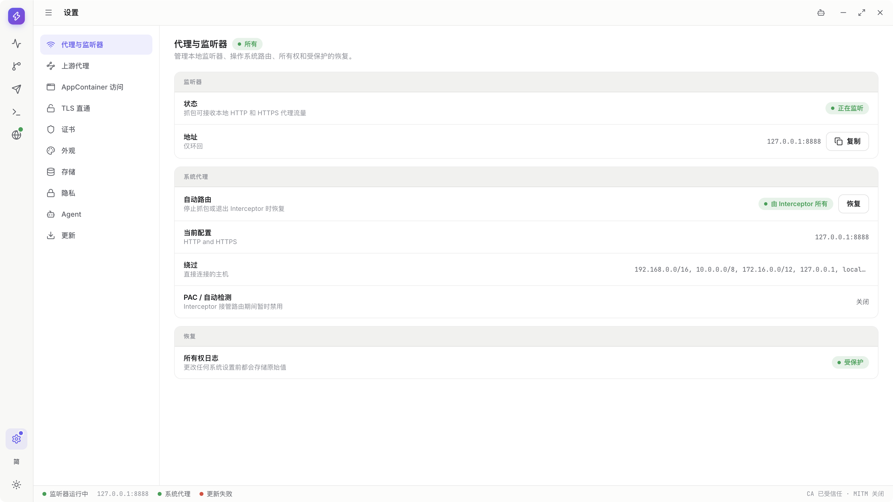

2. 点击 Restore，恢复本轮接管前的系统路由。

   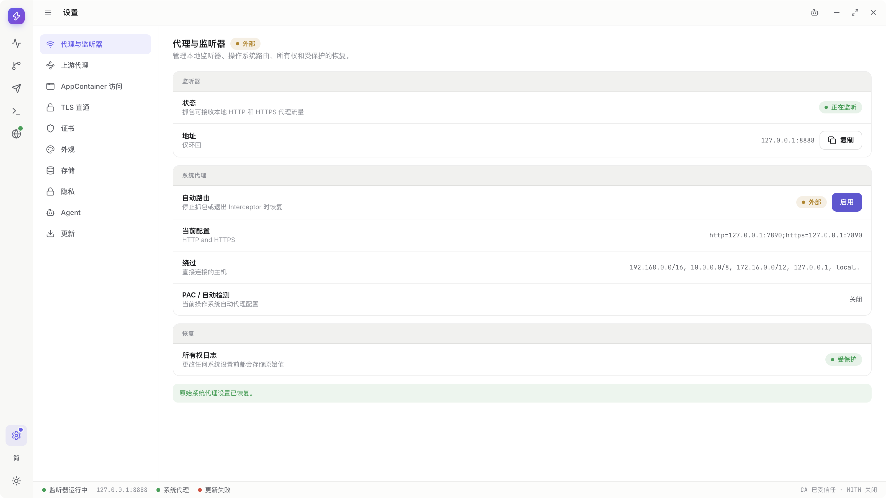

3. 核对监听器仍在运行。演示客户端显式通过 `http://127.0.0.1:8888` 访问 `http://127.0.0.1:59429/guide/system-proxy/explicit-client`；`59429` 是本次源站动态端口，不是代理端口。Restore 不等于关闭监听器，这个请求也不证明某个应用自动跟随系统代理。

   

4. 通过 Settings 再次 Enable，等待系统接管状态确认。本次复用已有授权 helper，没有首次授权弹窗。

   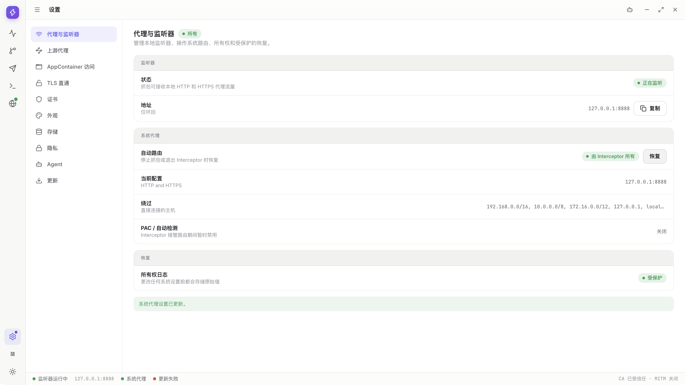

5. 返回 Capture，确认 Recording 当前开启；系统接管状态与录制状态分别检查。

   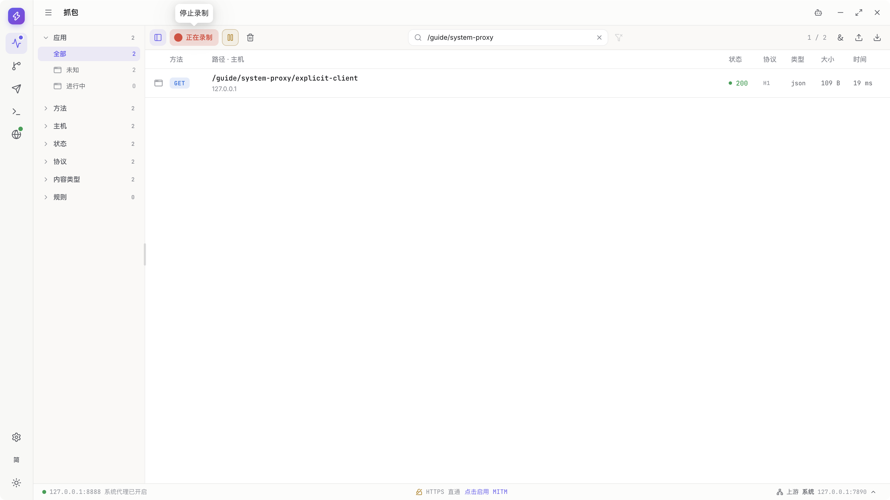

6. 暂停 Recording。

   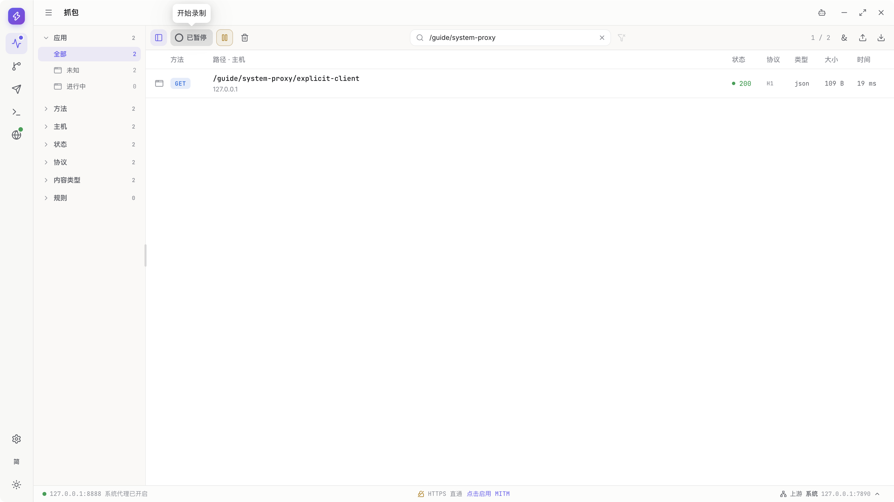

7. 返回 System proxy，确认仍由 Interceptor 接管：Pause 没有执行 Restore。

   

8. 结束本轮演示前，再 Restore 原系统路由；不要把关闭录制当作恢复代理。

   

9. 首次使用或 helper 尚未获授权时，仍须阅读并完成真实系统授权后再判断 Enable 成功。

   **待配图 / blocked**：此录制没有首次 helper、macOS 系统授权或 Windows UAC 的操作，已有授权下成功不能替代。

10. 要确认某个目标应用自动遵循系统代理，必须使用该应用自身发请求并检查 Capture。

    **待配图**：本例是显式代理客户端，不包含外部应用自动遵循系统代理的验证。

**预期结果**：系统代理的接管和恢复是明确的操作，不用 Recording 的状态代替判断。

**关键说明**

- Windows 主要接管 WinINet。WinHTTP、自带网络栈、Java、curl、容器或 WSL 不保证自动跟随。
- 客户端仍显式连接 `127.0.0.1:8888` 时，即使 Restore 了系统代理，它也可能继续经过监听器。
- 启用、恢复与原生授权正在进行时，不要反复点击或强制结束；冲突应按提示处理。
- App 不应覆盖另一软件在会话期间新写入的系统配置；已有代理环境见下一节。
- 正常关闭 App 也会走退出恢复流程，但本段以 Restore 收尾，不把它当作 Close 的实录；退出边界见 [Workspace](workspace.md#close)。

## 选择上游代理

**用途**：请求先经过 Interceptor，再按你选择的出口访问目标。它与客户端是否接入 Interceptor 是两个方向。

| 模式 | 含义 | 需要准备 |
| --- | --- | --- |
| System | 沿用 Interceptor 接管前的系统生效代理 | 已正确配置的原系统代理或自动配置 |
| Direct | Interceptor 直接连接目标 | 目标直接可达 |
| Manual | 明确指定另一个上游代理 | 协议、Host、端口 |
| PAC | 按 PAC 脚本为请求选择路线 | 可访问的 HTTP/HTTPS PAC URL |
| WPAD | 从当前网络发现 PAC | 网络实际提供所需的自动发现配置 |

**步骤**

实拍只展示安全草稿，`exampleApplied=false`。`127.0.0.1:7890` 没有作为已运行的上游验证，`https://proxy.example.test/proxy.pac` 也不是可用公共 PAC；不要为了与截图一致而 Apply。

1. 在 Settings 打开 Upstream proxy，查看当前路线。Capture 右下角快捷入口的打开过程仍待配图。

   

2. 选择 Manual 草稿，Host 填 `127.0.0.1`，端口填 `7890`。Host 不带协议、路径或凭据；本次端口是演示输入，不是自动分配的代理监听端口。

   

3. 点击 Discard，不应用没有实际上游服务的示例。

   

4. 选择 PAC，查看 `https://proxy.example.test/proxy.pac` 输入。实际使用时必须是自己的可访问 HTTP/HTTPS PAC，不是本地路径或含凭据的 URL。

   

5. 放弃该 PAC 草稿，保留原配置。

   

6. 只有准备好真实出口后才填写其字段并 Apply，成功后查看 Current route。

   **待配图 / blocked**：上述 Manual/PAC 都没有 Apply；真实上游往返、System/Direct 切换和 WPAD 发现仍缺各自环境与录制。

7. 发新请求，检查客户端结果与实际目标；长连接按需要重新建立。

   **待配图**：没有上述已应用路线的真实请求，普通 Capture 成功不能证明经过了上游。

8. 不想应用时使用 Cancel/Discard；在快捷入口中选择 Open in Settings 可继续检查同一份草稿。

   **待配图**：前面只覆盖 Settings 内的 Discard；快捷浮层 Cancel 与 Open in Settings 的草稿交接未录制。

**预期结果**：Apply 成功后改变后续请求的路线；失败时显示错误并保留之前已生效配置，而不是偷偷转成 Direct。

**关键说明**

- 选择 Direct 不等于停止 Capture，也不等于恢复操作系统代理。
- System 不能把 Interceptor 自己的 `8888` 当作原上游，否则会形成循环。
- 不要把 Manual 指向当前 Interceptor listener；另一个合法本地代理可以使用自己的端口。
- PAC/WPAD 可能对不同请求选择不同出口，不能只靠一个固定地址概括全部路线。
- WPAD 需要真实网络前提；不要为了读教程修改办公网络的 DHCP 或 DNS。发现失败先联系网络管理者。
- macOS 与 Windows 的网络发现、系统快照和授权不同，不以另一平台成功推断本机一定可用。
- 产品没有独立的上游账号/密码设置，不能把凭据拼进不接受它们的字段。

## 准备 CA 并启用 HTTPS 解密

**用途**：检查你有权调试的 HTTPS 请求头和正文，而不只是 TLS 隧道。

**步骤**

1. 打开 Certificates，检查 CA 是否存在、当前身份以及是否受信任。

   

2. App 首次准备通常会处理缺失的共享 CA；若需要手动操作，用产品提供的生成入口，而不是自己覆盖证书文件。

   **待配图 / blocked**：录制机器已有日常 CA，没有空共享 CA 环境，不为拍图删除它。

3. 未受信任时使用 Install/信任操作，阅读并完成真实系统授权。

   **待配图 / blocked**：首次 helper、钥匙串信任或 Windows UAC 未录制；已受信任状态不证明授权步骤。

4. 确认产品报告受信任，再开启 HTTPS decryption。

   下图引用 Capture 的受控协议演示，只说明已有可信 CA 时开启解密：

   

5. 让客户端建立一条新的 HTTPS 连接，在 Capture 中检查 HTTP 详情。

   本图是同次 `/playground/h2-json` 新连接；其 `localhost` 测试源站例外按[下一相关小节](#insecure-hosts)处理，不应推广到公网。

   

**预期结果**：只有 CA 可用、已信任且解密开启时，普通可代理 HTTPS 连接才按解密路径处理。

**关键说明**

- macOS 可能请求 helper、钥匙串或系统信任授权；Windows 使用对应的管理员授权。系统提示不是 GitHub 登录。
- CA 影响系统信任，不只是 App 内的一张图片；先确认来源和用途。
- 同一系统用户的不同 App 数据环境会复用共享 CA。正常退出或删除某份 profile 不表示 CA 已经删除。
- 证书固定、独立信任库或 TLS passthrough 可以阻止普通 MITM 解密；不建议为了看正文关闭全局证书验证。
- 关闭解密仅停止解密，不自动卸载 CA 信任。

## 查看、移除信任与删除 CA

**步骤**

1. 用 View 查看当前公开证书，按平台提供的方式核对身份；Reveal 用于定位相关材料。

   **待配图**：只读 Certificates 页已录制，但没有点击 View 或 Reveal，不能冒充原生证书/文件窗口。

2. 需要查看系统信任管理时，使用产品提供的系统证书管理入口，并遵守平台权限。

   **待配图 / blocked**：缺实际钥匙串或 Windows 管理员 MMC 操作。

3. 不再信任该 CA 时，用 Uninstall 撤销信任。

   **待配图 / blocked**：未对日常 CA 执行撤销信任，需独立安全环境。

4. 确实不再需要材料时，再使用 Delete；若仍有信任，按产品流程先撤销。

   **待配图 / blocked**：未执行删除，不用空列表或其他设置图代替。

5. 需要重新生成时，先核对当前 CA 与所有仍在使用它的测试客户端，再按产品提示处理。

   **待配图 / blocked**：未执行重新生成及客户端信任更新，不能宣称生命周期全部验收。

**预期结果**：查看、撤销信任、删除材料是可区分的操作。

**关键说明**

- Uninstall 保留 CA 材料，Delete 才删除；受信任时不能直接重新生成覆盖。
- 重新生成会改变证书身份，独立客户端的旧信任可能失效。
- 不为复现教程删除日常 CA，不复制私钥到工单或其他机器。
- Windows 管理员 MMC 专项仍有独立验收边界，不能把存在入口当作每个平台原生窗口均已验收。

## 对特定主机保持 TLS 透传

**用途**：让不适合解密的目标继续使用原始加密连接。

**步骤**

1. 打开 TLS passthrough，检查已有条目。

   

2. 添加需要透传的精确主机；只有确有需要时才扩大到受控的父域 wildcard。

   **待配图**：该片段只读，没有添加精确主机或 wildcard。

3. 保存后让客户端重新连接。

   **待配图**：没有名单编辑保存与重连的往返。

4. 在 Capture 核对 TLS tunnel，而不是期待看到解密后的正文。

   **待配图**：已录 HTTP/2 明文不是透传隧道，不能替代。

5. 不再需要时删除对应条目并保存，再用新连接验证。

   **待配图**：没有新增条目，也未录删除及新连接恢复。

**预期结果**：新连接按名单透传，在途连接不会被强制转换为另一种模式。

**关键说明**

- 精确主机与通配域名范围不同，默认选择最小范围。
- TLS 兼容性提示中的 Not now 不保存配置；勾选和保存才表示明确决定。
- 遇到多个失败主机时逐项检查，不把全部加入广泛通配名单作为默认修复。
- 从隧道跳转到 Settings 时，可以查看 App 定位的最具体匹配条目。

## 区分源站证书例外

**用途**：在受控测试环境里排查目标服务自身的证书问题，而不是处理客户端是否信任 Interceptor CA。

1. 先确认错误来自源站证书，核对域名、有效期和你管理的信任链。

   **待配图**：Capture 协议演示使用已知本机测试源站，没有录制证书报错、有效期与信任链的诊断过程。

2. 优先修复服务证书；仅在有授权的受控测试中，到 Certificates > Per-host overrides 添加精确主机。下图来自 Capture，实际值为 `localhost`，不是 TLS passthrough。

   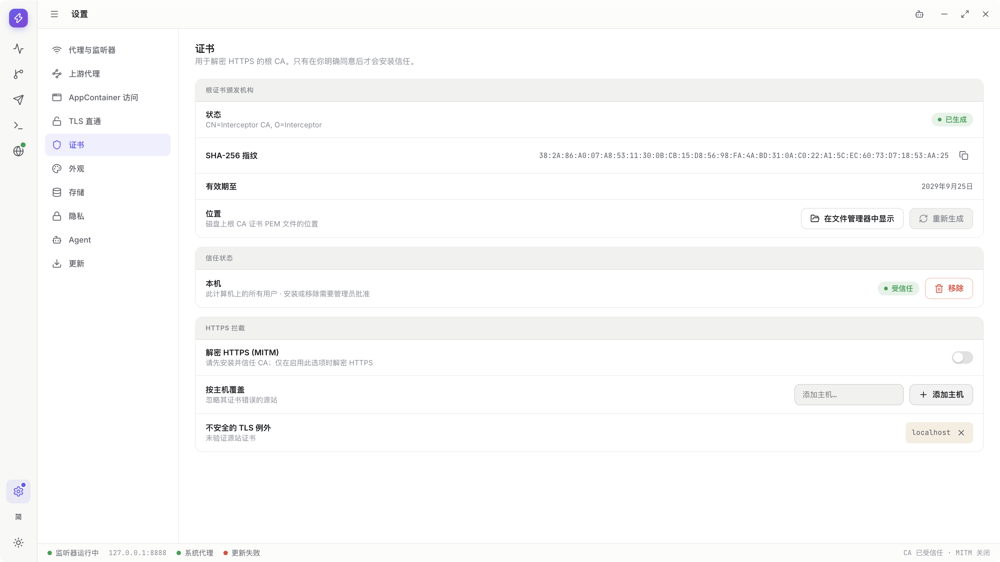

3. 建立新请求核对结果；本次为 `/playground/h2-json`。

   

4. 演示结束移除本轮添加的 `localhost` 条目。

   

**预期结果**：例外只作用于明确目标，不改变其他主机的校验策略。

**关键说明**：源站证书例外与 TLS passthrough 不同，不能互换。前者可能仍解密但放宽源站校验，后者保持加密透传。不要对不明来源的真实业务使用全局绕过。

## Windows AppContainer 的本地代理访问

**前提**：仅 Windows；目标应用确实受 AppContainer 网络隔离影响，且你有权修改相关系统设置。

**步骤**

1. 打开 App containers，搜索目标应用。

   **待配图 / blocked**：当前素材均为 macOS，没有 Windows AppContainer 列表及搜索。

2. 检查其 loopback access 是否启用，按需要使用单项开关并完成 UAC。

   **待配图 / blocked**：需要 Windows 目标应用与真实 UAC，macOS 截图不能替代。

3. 让该应用重新发起请求，检查是否到达本地代理。

   **待配图 / blocked**：缺受 AppContainer 隔离影响的真实应用流量。

4. 确实需要批量修改时使用 Enable all 或 Disable all，阅读目标数量、范围和后果后确认。

   **待配图 / blocked**：Windows 枚举与批量授权操作未录制。

5. 结束后撤销不再需要的例外，并核对系统实际状态。

   **待配图 / blocked**：没有 Windows 例外恢复与系统状态证据图。

**预期结果**：目标应用获准或被撤销访问本机 loopback 的例外；启用项稳定显示在列表前面。

**关键说明**：AppContainer 放行不能解决证书固定；TLS passthrough 也不能解决应用根本无法连接本地代理。批量操作只针对当前枚举目标，不等于任意修改所有系统网络隔离状态。macOS 不提供同一 Windows 功能。

## 语言和主题

通过 Appearance 或侧栏对应入口选择当前 App 提供的语言、主题，并核对保存状态。四个主题值为 `warm`、`light`、`ember`、`dark`；不添加不存在的 App System 主题。

切换只改变界面偏好，不翻译捕获内容、URL 或协议值；完整步骤见[工作区](workspace.md#appearance)。

## 查看用量并清理 Capture

**步骤**

本段使用 `settings-storage-privacy`。完整录制先完成[下一节](#privacy)的默认值/单次覆盖检查并取消导出，再执行 Storage 清理。清理前 Recording 已暂停；Clear 只处理本流程的公共临时记录和正文，不涉及其他人的流量。需要保留自己的记录时，先按 [Transfer](transfer.md#har)完成导出；本次已取消的 HAR 草稿没有生成备份文件。

1. 核对要清理的是本次 `http://127.0.0.1:52747/guide/storage/before-clear` 记录，正文 `{"orderId":"guide-storage-001","message":"public example"}`。`52747` 是本次动态源站端口；图为同次录制的清理前准备状态。

   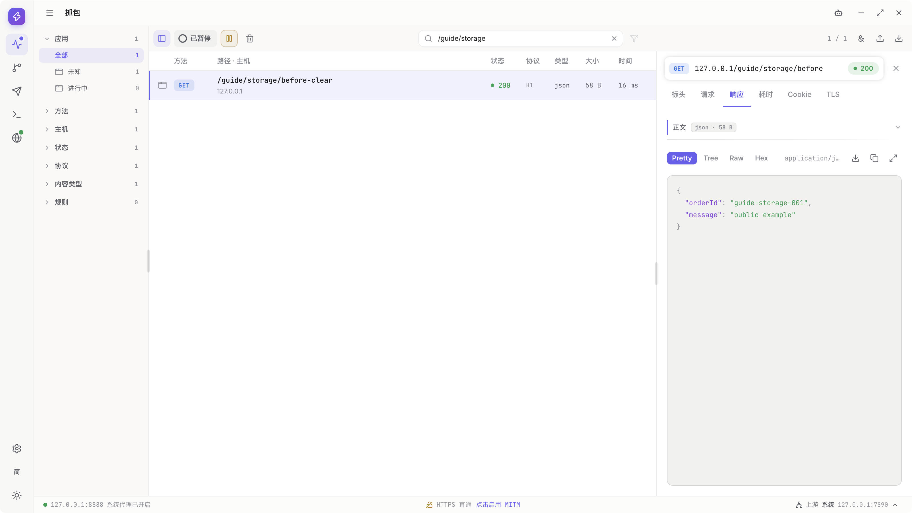

2. 打开 Storage，查看 Captured body data 和 Session、Exchange、Body 数量。

   

3. 点击 Refresh，核对统计更新而记录仍保留；Refresh 不是 Clear，也不是固定配额设置。

   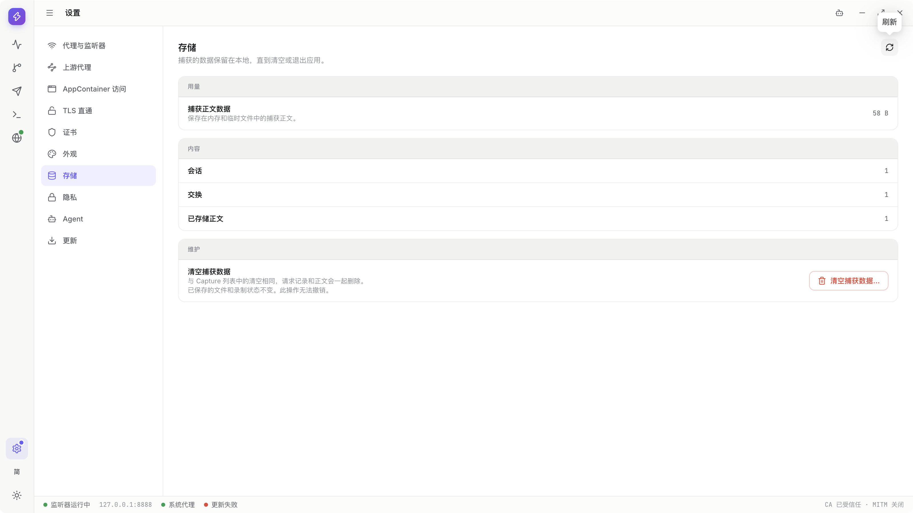

4. 打开 Clear capture 确认，先阅读清理影响。

   

5. 先 Cancel，核对临时数据没有被删除。

   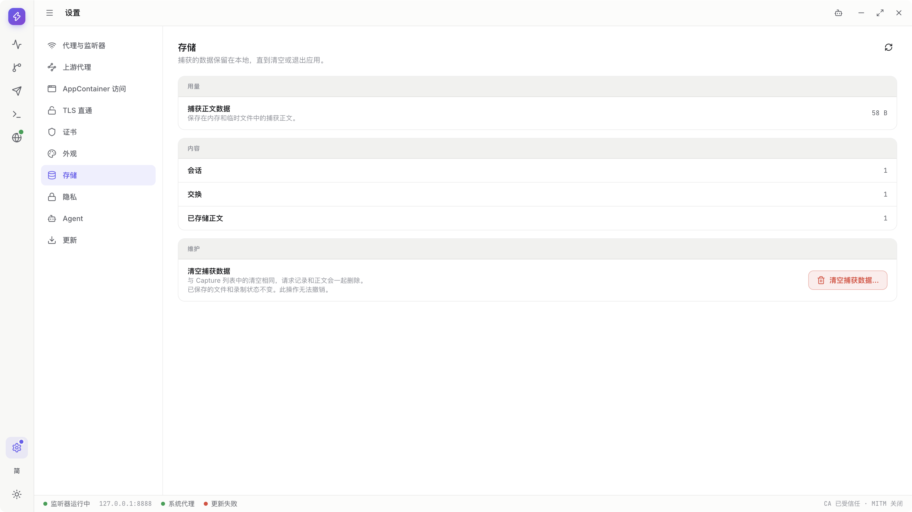

6. 再次执行 Clear 并确认，清理本轮演示记录及正文；不能把上一步取消的画面当作清理成功。

   

7. 回到 Capture，确认旧记录已清空，Recording 仍暂停。是保留了清理前的暂停状态，不是 Clear 自动暂停或恢复录制。

   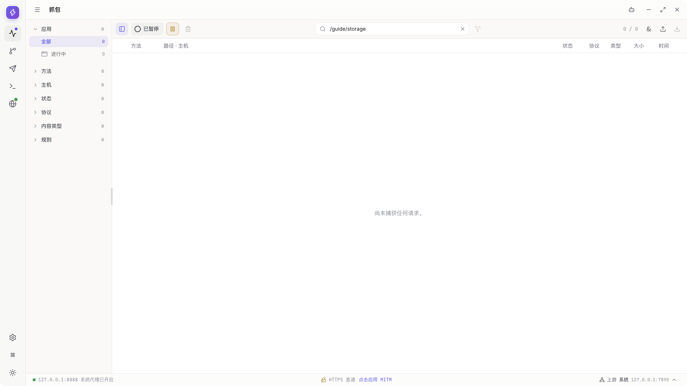

8. 明确恢复 Recording。

   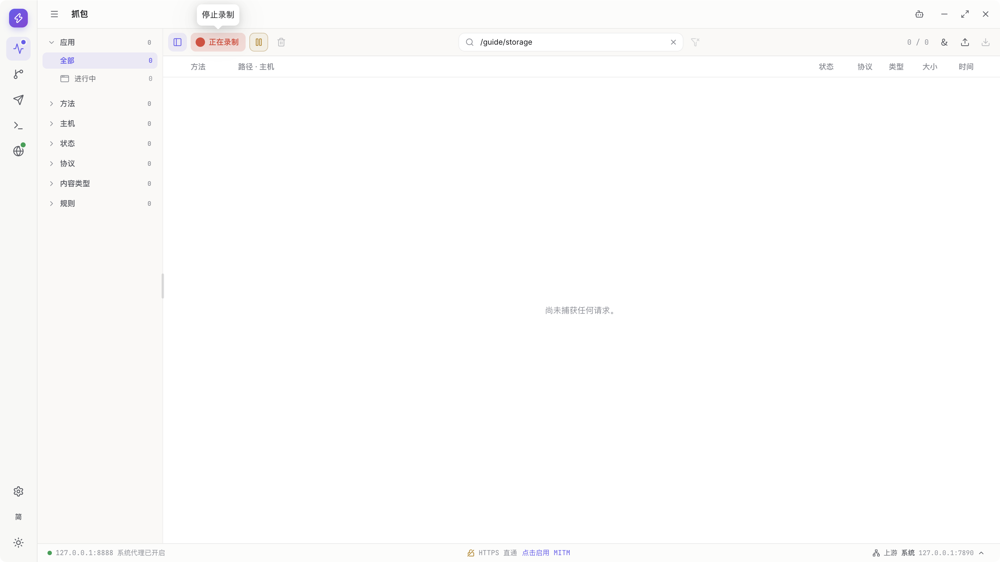

9. 经代理请求 `http://127.0.0.1:52747/guide/storage/after-clear`，核对新记录进入列表，不将旧记录回填当作新请求。

   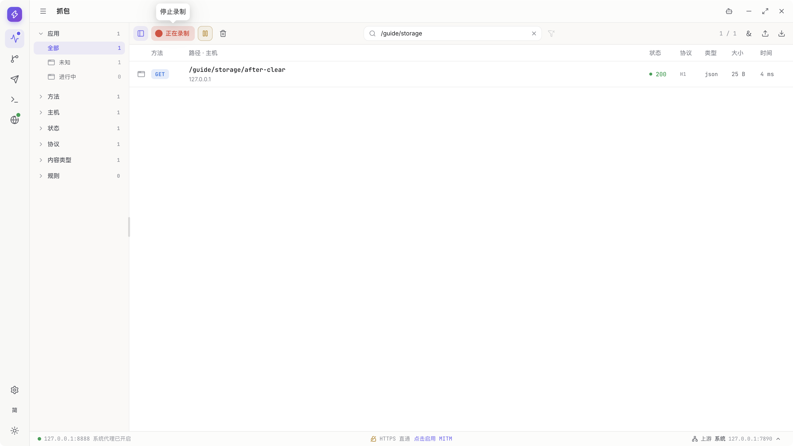

**预期结果**：与 Capture 的 Clear 清理同一份临时数据，不删除已导出的文件。

**关键说明**：正文用量不是进程 RSS，也不是整个硬盘使用量。这里没有自动保留天数或配额设置；Refresh 不是后台持续轮询。文件任务未结束时清理可能被拒绝。

**待配图**：存在运行中或取消清理中的文件任务时，Clear 被拒绝和等待收尾的分支未在这次普通清理中录制。

## 设置后续导出的隐私默认值

本节是 `settings-storage-privacy` 的前半段，实际发生在上节 Clear 之前。这里只演示 `maskCookies` 默认值与当前 HAR 草稿的覆盖关系，不声称所有隐私选项或已生成文件都完成了检查。

1. 选择本轮公共测试记录 `/guide/storage/before-clear`，其源站为 `http://127.0.0.1:52747`，端口仅属于录制环境。

   

2. 打开 Privacy。

   

3. 临时将 Cookie 遮罩默认值设为 `maskCookies=false`；这是对无凭据演示数据的检查，不是推荐公开未遮罩流量。

   

4. 新开 HAR 导出，核对新草稿继承 `maskCookies=false`。

   

5. 选择当前筛选结果范围，检查本次草稿的导出范围。

   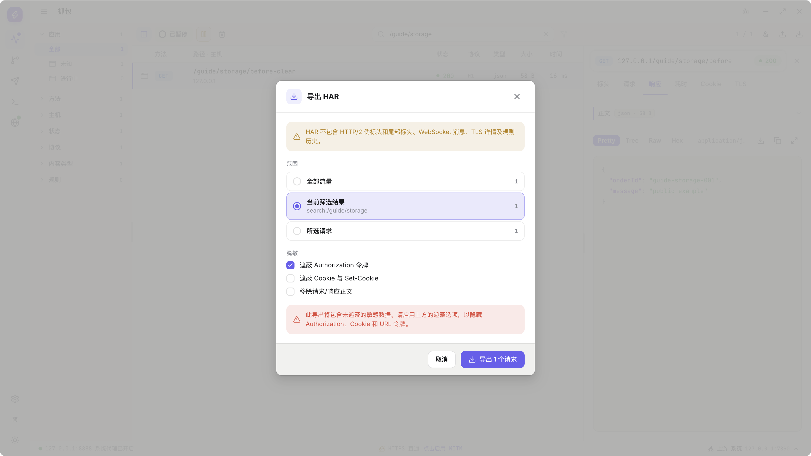

6. 再查看全部记录范围；本例全部记录仍仅是本流程公共数据，不代表日常全部流量都可以分享。

   

7. 仅在当前导出草稿把 Cookie 遮罩改成 `true`，与已保存默认值 `false` 区分。

   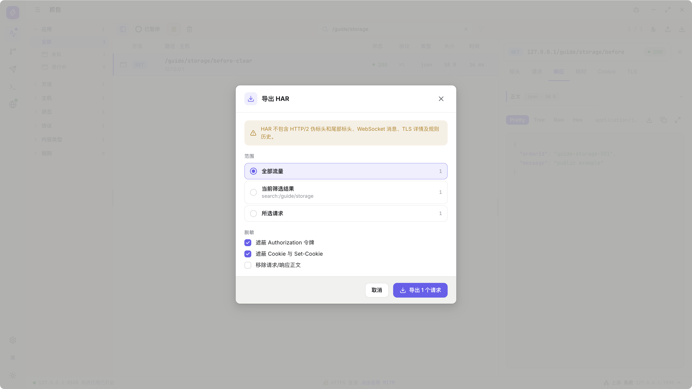

8. 取消本次导出。这是取消 HAR 草稿，没有保存文件，也不是取消已运行的文件任务。

   

9. 返回 Privacy，核对已保存默认值仍为 `false`，没有被单次覆盖改成 `true`。

   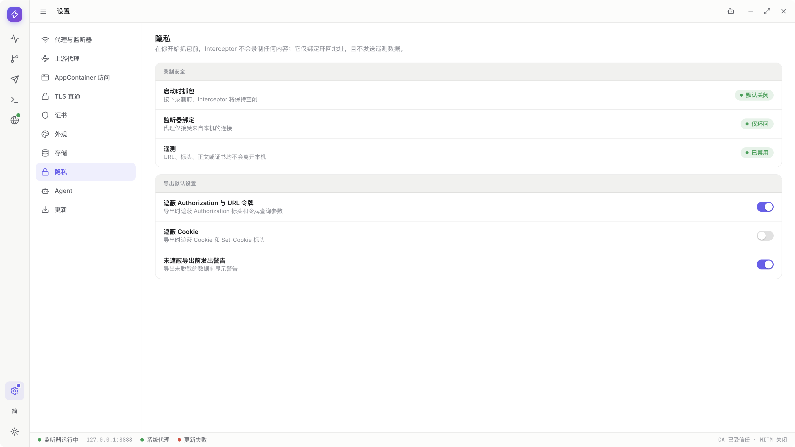

10. 将 Cookie 遮罩默认值恢复为 `true`，再继续 Storage 清理。

    

11. Authorization 遮罩和未遮罩导出警告仍按需要独立配置。

    **待配图**：本段只更改 Cookie 默认值，没有切换另外两项，也没有覆盖默认值改变时已打开草稿、运行中任务或既有文件的分支。

12. 分享前继续检查 URL、正文、自定义敏感字段和最终文件。

    **待配图**：本次取消了导出，未执行最终文件的逐字段隐私复核；不能仅凭开关状态声称所有数据已经脱敏。

**预期结果**：新开的 HAR 草稿继承当前默认值；本次草稿的覆盖不回写已保存默认值。默认值变化不修改已打开草稿、运行中任务或既有文件；本次实际配图只覆盖新草稿与单次覆盖的往返。

**关键说明**：原生归档仍按完整数据处理。默认遮罩不是全数据匿名化，详见[导出隐私](transfer.md#privacy)。

## 模型、Tool 和 MCP

- 在 Settings > Agent 添加和测试模型，详见 [Agent](agent.md#models)。
- Tool capabilities 的 Agent/MCP 两列分别配置，详见[权限与审批](tool-permissions.md)。
- MCP Server 的开启、客户端和 endpoint 见 [MCP](mcp.md)。

配置模型不自动开启 MCP，开启 MCP 也不要求为内置 Agent 配置模型；外部 Host 使用自己的模型配置。

## 检查、下载并打开更新

**前提**：实际打包的 Windows/macOS App。源码开发运行可能显示不支持更新。

**步骤**

1. 打开 Updates，查看当前版本和检查状态。

   

2. 点击 Check；失败时先检查网络和发布源，不把失败理解成“已经是最新版”。

   **待配图 / blocked**：本段只查看页面，未录独立 Check；私有发布源的匿名访问仍有限制。

3. 有可用版本时阅读说明，明确点击 Download。

   **待配图 / blocked**：缺更新器可获取的受支持版本及真实下载步骤。

4. 等待下载及完整性校验完成，再点击 Open installer。

   **待配图 / blocked**：未执行下载校验与打开安装器，当前版本页不能证明完成。

5. 在真实系统安装流程中完成必要操作；不要在文件尚未下载完成时自行运行临时文件。

   **待配图 / blocked**：缺 macOS/Windows 原生更新安装与授权录制。

**预期结果**：检查、下载、打开安装器是三个不同阶段，不会因为发现更新就自动开始下载。

**关键说明**

- 更新匿名访问固定 GitHub 来源，不使用 VS Code 登录，也没有让用户输入 GitHub PAT 的 App 页面。
- 当前私有发布源或没有可用稳定版本时，匿名检查可能失败；已发布 Alpha 不等于内置更新可获取。
- 内置更新只接受对应平台、架构和受支持的安装格式；macOS ZIP-only 分发不等于支持内置更新。
- 通知中的 Download/Open installer 与 Settings 对应同一状态，Dismiss 只是收起通知。
- 退出会收尾正在进行的检查或下载，不以打开旧临时文件跳过产品校验。

<!-- recorded-walkthrough:settings-storage-privacy:start -->

## 逐步骤实操：隐私默认值、存储取消与清理

以下图片和视频来自已发布的 <code>0.1.1-alpha.1</code>、macOS x64，App保持<code>zh-CN</code>。每个步骤都有对应原生窗口截图，可点击查看原尺寸。

本机地址、端口和生成ID来自这次真实录制，不是公开服务；使用时替换成自己的已授权测试环境。下面先列本次实际数据，再按相同顺序操作。未出现在本段录像中的进阶分支仍待逐步配图与验收。

> 本段展示已有CA、设置入口和可放弃的草稿。Manual和PAC示例没有Apply；视频不证明这些示例地址可用，也没有重新生成或卸载日常CA。

| 示例字段 | 录制中的实际值 |
| --- | --- |
| <code>firstUrl</code> | <code>http://127.0.0.1:52747/guide/storage/before-clear</code> |
| <code>secondUrl</code> | <code>http://127.0.0.1:52747/guide/storage/after-clear</code> |
| <code>body</code> | <code>{&quot;orderId&quot;:&quot;guide-storage-001&quot;,&quot;message&quot;:&quot;public example&quot;}</code> |
| <code>privacyOverride</code> | <code>maskCookies true for one cancelled export; saved default remained false then restored true</code> |
| <code>clearedData</code> | <code>only this workflow’s temporary records and bodies</code> |

<video controls preload="metadata" playsinline lang="zh-CN" src="../media/v0.1.1-alpha.1/settings-storage-privacy/settings-storage-privacy.mp4" poster="../media/v0.1.1-alpha.1/settings-storage-privacy/settings-storage-privacy-01-record.png">
<track kind="captions" srclang="zh-CN" label="Steps / 步骤" src="../media/v0.1.1-alpha.1/settings-storage-privacy/settings-storage-privacy.vtt" default>
</video>

### 01 · 选择本轮临时记录

[视频 00:00](../media/v0.1.1-alpha.1/settings-storage-privacy/settings-storage-privacy.mp4#t=0.381) · [返回本节视频](#walkthrough-settings-storage-privacy-video)

### 02 · 打开隐私默认值

[视频 00:03](../media/v0.1.1-alpha.1/settings-storage-privacy/settings-storage-privacy.mp4#t=3.734) · [返回本节视频](#walkthrough-settings-storage-privacy-video)

### 03 · 临时更改 Cookie 默认值

[视频 00:06](../media/v0.1.1-alpha.1/settings-storage-privacy/settings-storage-privacy.mp4#t=6.618) · [返回本节视频](#walkthrough-settings-storage-privacy-video)

### 04 · 打开新的 HAR 导出检查继承

[视频 00:09](../media/v0.1.1-alpha.1/settings-storage-privacy/settings-storage-privacy.mp4#t=9.431) · [返回本节视频](#walkthrough-settings-storage-privacy-video)

### 05 · 选择当前筛选范围

[视频 00:12](../media/v0.1.1-alpha.1/settings-storage-privacy/settings-storage-privacy.mp4#t=12.782) · [返回本节视频](#walkthrough-settings-storage-privacy-video)

### 06 · 查看全部记录范围

[视频 00:15](../media/v0.1.1-alpha.1/settings-storage-privacy/settings-storage-privacy.mp4#t=15.579) · [返回本节视频](#walkthrough-settings-storage-privacy-video)

### 07 · 只覆盖本次 Cookie 遮罩

[视频 00:18](../media/v0.1.1-alpha.1/settings-storage-privacy/settings-storage-privacy.mp4#t=18.364) · [返回本节视频](#walkthrough-settings-storage-privacy-video)

### 08 · 取消本次导出

[视频 00:21](../media/v0.1.1-alpha.1/settings-storage-privacy/settings-storage-privacy.mp4#t=21.177) · [返回本节视频](#walkthrough-settings-storage-privacy-video)

### 09 · 确认单次覆盖没有改默认值

[视频 00:23](../media/v0.1.1-alpha.1/settings-storage-privacy/settings-storage-privacy.mp4#t=23.983) · [返回本节视频](#walkthrough-settings-storage-privacy-video)

### 10 · 恢复 Cookie 遮罩默认值

[视频 00:26](../media/v0.1.1-alpha.1/settings-storage-privacy/settings-storage-privacy.mp4#t=26.874) · [返回本节视频](#walkthrough-settings-storage-privacy-video)

### 11 · 查看实际存储用量

[视频 00:29](../media/v0.1.1-alpha.1/settings-storage-privacy/settings-storage-privacy.mp4#t=29.684) · [返回本节视频](#walkthrough-settings-storage-privacy-video)

### 12 · Refresh 只刷新统计

[视频 00:32](../media/v0.1.1-alpha.1/settings-storage-privacy/settings-storage-privacy.mp4#t=32.552) · [返回本节视频](#walkthrough-settings-storage-privacy-video)

### 13 · 检查 Clear 影响

[视频 00:35](../media/v0.1.1-alpha.1/settings-storage-privacy/settings-storage-privacy.mp4#t=35.358) · [返回本节视频](#walkthrough-settings-storage-privacy-video)

### 14 · 取消 Clear 不删除记录

[视频 00:38](../media/v0.1.1-alpha.1/settings-storage-privacy/settings-storage-privacy.mp4#t=38.152) · [返回本节视频](#walkthrough-settings-storage-privacy-video)

### 15 · 确认清理本轮记录和正文

[视频 00:40](../media/v0.1.1-alpha.1/settings-storage-privacy/settings-storage-privacy.mp4#t=40.955) · [返回本节视频](#walkthrough-settings-storage-privacy-video)

### 16 · Capture 同步变空且仍暂停

[视频 00:43](../media/v0.1.1-alpha.1/settings-storage-privacy/settings-storage-privacy.mp4#t=43.823) · [返回本节视频](#walkthrough-settings-storage-privacy-video)

### 17 · Clear 后显式恢复录制

[视频 00:46](../media/v0.1.1-alpha.1/settings-storage-privacy/settings-storage-privacy.mp4#t=46.684) · [返回本节视频](#walkthrough-settings-storage-privacy-video)

### 18 · Clear 后捕获新请求

[视频 00:49](../media/v0.1.1-alpha.1/settings-storage-privacy/settings-storage-privacy.mp4#t=49.547) · [返回本节视频](#walkthrough-settings-storage-privacy-video)

下面保留完整功能参考。只有已经附上真实步骤图、核对过变量和值的操作才能计入图文验收。
<!-- recorded-walkthrough:settings-storage-privacy:end -->

<!-- recorded-walkthrough:settings-proxy-routing:start -->

## 逐步骤实操：系统代理恢复与 Recording 的边界

以下图片和视频来自已发布的 <code>0.1.1-alpha.1</code>、macOS x64，App保持<code>zh-CN</code>。每个步骤都有对应原生窗口截图，可点击查看原尺寸。

本机地址、端口和生成ID来自这次真实录制，不是公开服务；使用时替换成自己的已授权测试环境。下面先列本次实际数据，再按相同顺序操作。未出现在本段录像中的进阶分支仍待逐步配图与验收。

> 本段展示已有CA、设置入口和可放弃的草稿。Manual和PAC示例没有Apply；视频不证明这些示例地址可用，也没有重新生成或卸载日常CA。

| 示例字段 | 录制中的实际值 |
| --- | --- |
| <code>listener</code> | <code>127.0.0.1:8888</code> |
| <code>explicitClientUrl</code> | <code>http://127.0.0.1:59429/guide/system-proxy/explicit-client</code> |
| <code>purpose</code> | <code>System proxy routing and Recording are separate; Restore retains the listener</code> |
| <code>authorizationScope</code> | <code>existing authorized helper; this is not first-time OS authorization footage</code> |

<video controls preload="metadata" playsinline lang="zh-CN" src="../media/v0.1.1-alpha.1/settings-proxy-routing/settings-proxy-routing.mp4" poster="../media/v0.1.1-alpha.1/settings-proxy-routing/settings-proxy-routing-01-owned.png">
<track kind="captions" srclang="zh-CN" label="Steps / 步骤" src="../media/v0.1.1-alpha.1/settings-proxy-routing/settings-proxy-routing.vtt" default>
</video>

### 01 · 查看系统代理接管状态

[视频 00:00](../media/v0.1.1-alpha.1/settings-proxy-routing/settings-proxy-routing.mp4#t=0.405) · [返回本节视频](#walkthrough-settings-proxy-routing-video)

### 02 · Restore 恢复原路由

[视频 00:03](../media/v0.1.1-alpha.1/settings-proxy-routing/settings-proxy-routing.mp4#t=3.368) · [返回本节视频](#walkthrough-settings-proxy-routing-video)

### 03 · 确认监听器没有因此停止

[视频 00:09](../media/v0.1.1-alpha.1/settings-proxy-routing/settings-proxy-routing.mp4#t=9.619) · [返回本节视频](#walkthrough-settings-proxy-routing-video)

### 04 · 通过 Settings 重新 Enable

[视频 00:12](../media/v0.1.1-alpha.1/settings-proxy-routing/settings-proxy-routing.mp4#t=12.416) · [返回本节视频](#walkthrough-settings-proxy-routing-video)

### 05 · 返回 Capture 确认录制开启

[视频 00:19](../media/v0.1.1-alpha.1/settings-proxy-routing/settings-proxy-routing.mp4#t=19.118) · [返回本节视频](#walkthrough-settings-proxy-routing-video)

### 06 · 暂停 Recording

[视频 00:22](../media/v0.1.1-alpha.1/settings-proxy-routing/settings-proxy-routing.mp4#t=22.119) · [返回本节视频](#walkthrough-settings-proxy-routing-video)

### 07 · 暂停不等于 Restore

[视频 00:24](../media/v0.1.1-alpha.1/settings-proxy-routing/settings-proxy-routing.mp4#t=24.970) · [返回本节视频](#walkthrough-settings-proxy-routing-video)

### 08 · 结束演示前恢复原路由

[视频 00:27](../media/v0.1.1-alpha.1/settings-proxy-routing/settings-proxy-routing.mp4#t=27.870) · [返回本节视频](#walkthrough-settings-proxy-routing-video)

下面保留完整功能参考。只有已经附上真实步骤图、核对过变量和值的操作才能计入图文验收。
<!-- recorded-walkthrough:settings-proxy-routing:end -->
