# Tool 权限与审批

[教程目录](../README.md) · [Agent](agent.md) · [MCP](mcp.md) · [Tool 速查](tool-reference.md)

## 分别配置 Agent 与 MCP

Tool capabilities 决定内置 Agent 和外部 MCP 分别可以使用哪些能力。修改开关不会立即执行对应 Tool，也不需要先配置模型。

1. 打开 Settings → Agent，向下找到 Tool capabilities。先检查实际开关，不把新配置的默认开启当作适合自己的权限范围。

   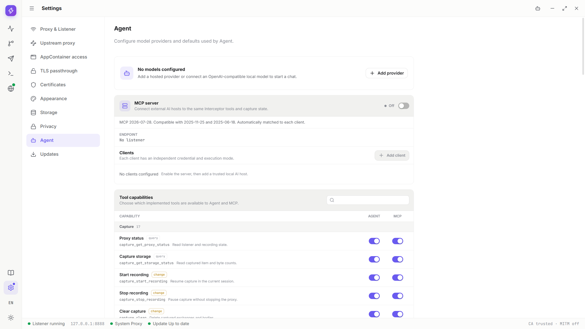

2. 在红框 1 搜索 `capture_get_proxy_status`。同一行的红框 2 是 Agent 权限，红框 3 是 MCP 权限；这是查询能力，也可以分别限制。

   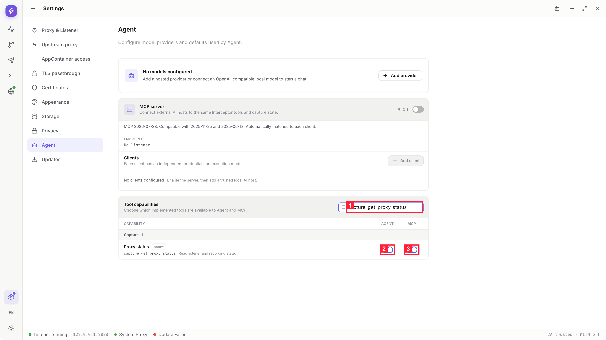

3. 关闭红框 1 的 Agent 开关。红框 2 的 MCP 开关仍开启，不会跟着改变。

   

4. 再搜索 `rules_replace_tree`。如果不允许外部 Host 替换规则，关闭红框 2 的 MCP 开关；红框 1 的 Agent 开关独立保留，需要时也应单独关闭。

   

5. 在红框 1 输入 `diagnostics`，可以缩小到四个 Diagnostics Tool。搜索只筛选显示内容，不批量改变权限。

   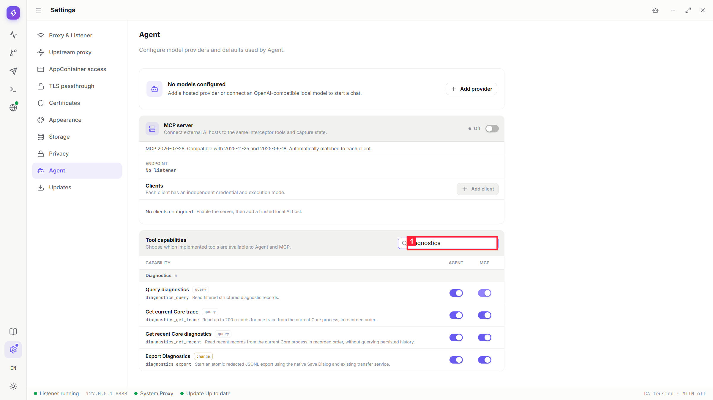

6. 清空搜索，再滚动检查其他分组。看不到的行不等于已关闭；完整只读配置按下一节逐组处理。

   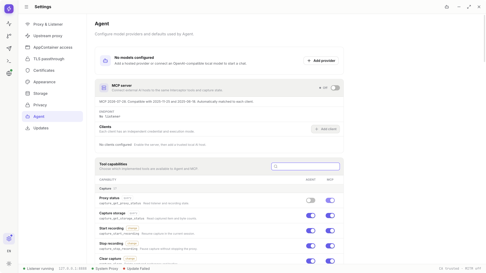

7. 正常关闭并重新打开 App 后再次搜索。第一张图红框 1 的 Agent 状态查询仍关闭；第二张图红框 1 的 MCP 规则替换也仍关闭。

   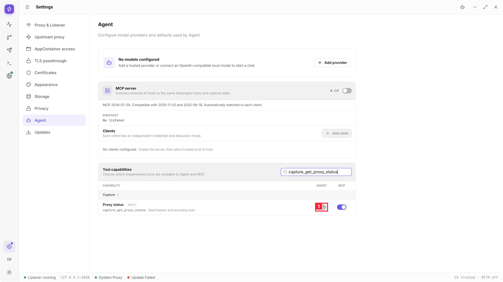

   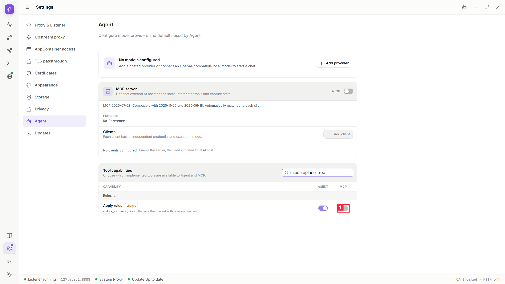

8. 确实需要状态查询时，重新打开红框 1 的 Agent 开关。恢复权限不会重放之前失败或拒绝的调用。

   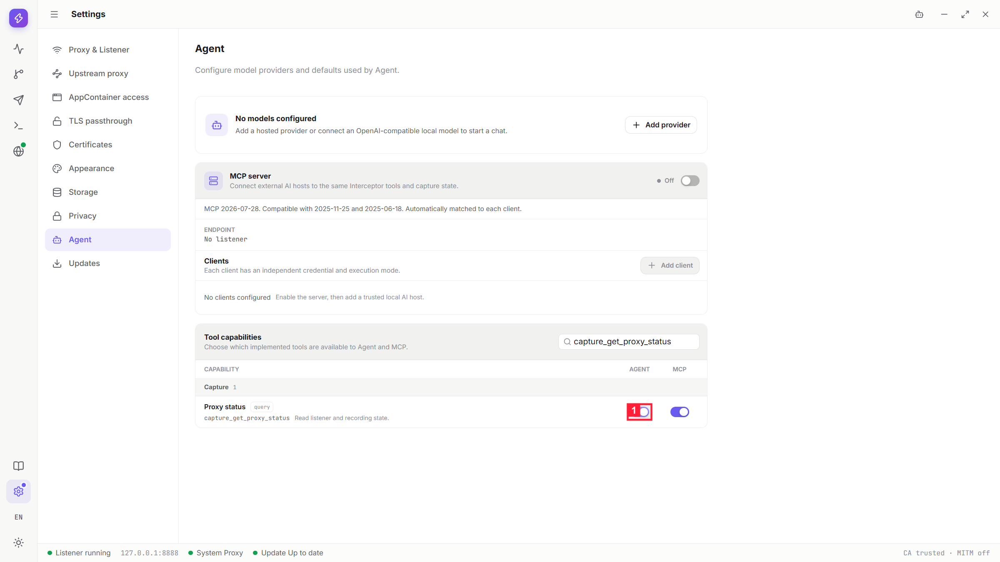

9. 只有接受外部 Host 替换规则时，才打开红框 1 的 MCP 开关。它会允许之后的新调用进入对应审批流程，不代表现在就修改了规则。

   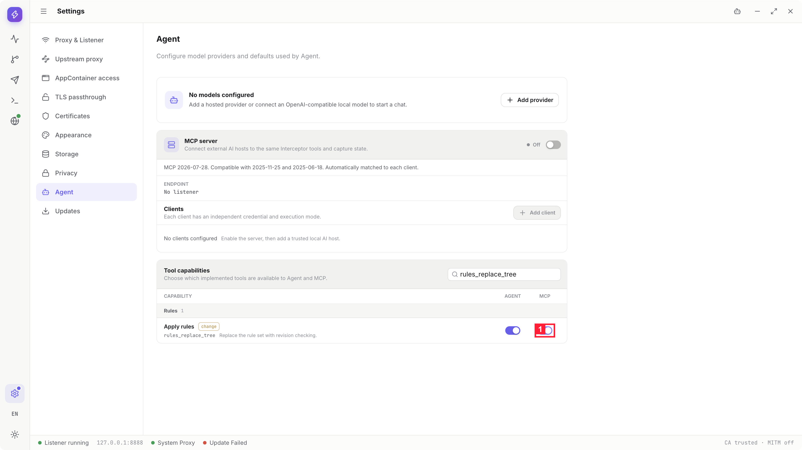

关闭 Tool 后，调用方应重新发现当前能力。旧对话如果仍请求被关闭的操作，会被拒绝；不要因为 `unknown_tool` 自动恢复权限。内置 Agent 的拒绝与实际 Recording 状态可按 [Agent 操作示例](agent.md#walkthrough-18-ask)检查。

## 配置“只能查看”

只读配置要关闭所有不需要的 change Tool，而不只是 Clear。query 也可能读取敏感信息，仅保留分析所需的数据；Ask 不是只读模式。

1. 在 Tool capabilities 搜索 `capture_clear`，先关闭红框 1 的 Agent 权限。红框 2 的 MCP 权限此时仍开启，需要独立处理。

   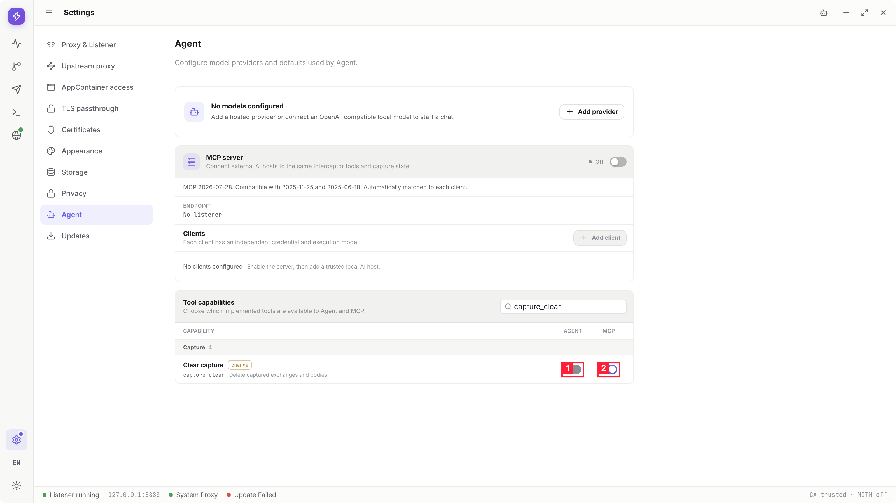

2. 再关闭红框 2 的 MCP 权限，确认红框 1 的 Agent 也保持关闭。不要实际执行 Clear 来试开关，更不要拿日常流量练习清理。

   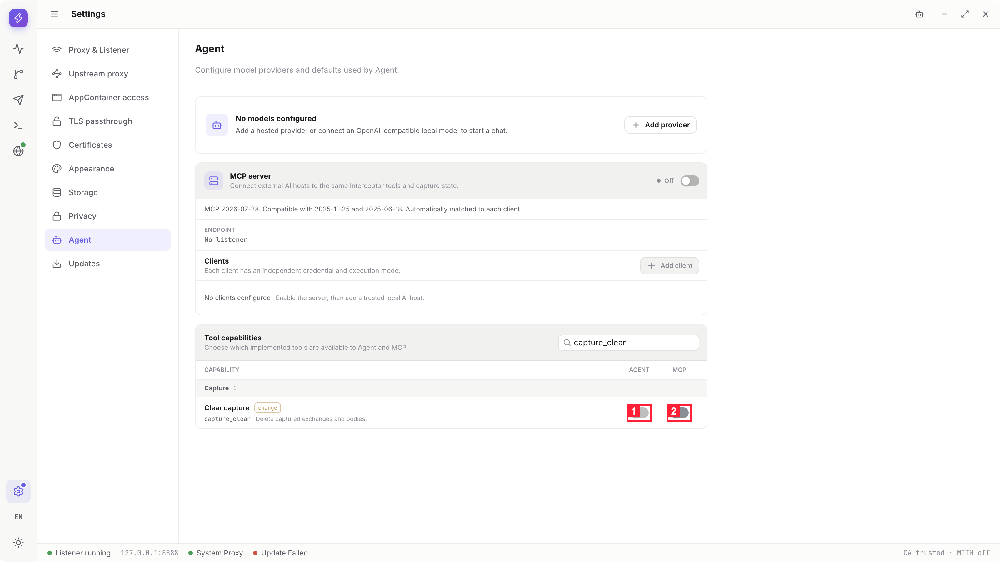

3. 继续检查 Capture、Rules、Composer、Breakpoints、Diagnostics、Settings。逐项关闭标为 change 的两列开关，保留需要的 query。配置完成后再连接要使用的模型或 Host；MCP Client 的创建与连接按 [MCP](mcp.md)操作。

   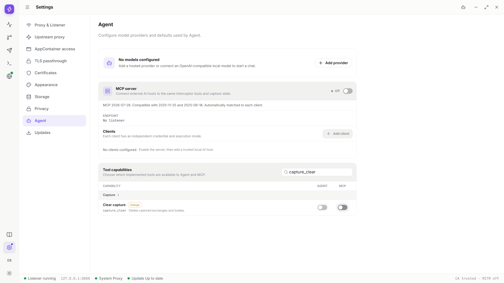

4. 完成后逐组复查。在红框 1 搜索 `capture_`，滚动核对 Start/Stop recording、Clear、导入导出和取消文件任务等 change 均已关闭；只保留需要的状态、记录、正文和消息查询。图中 Client 为 `Read-only verification client`。

   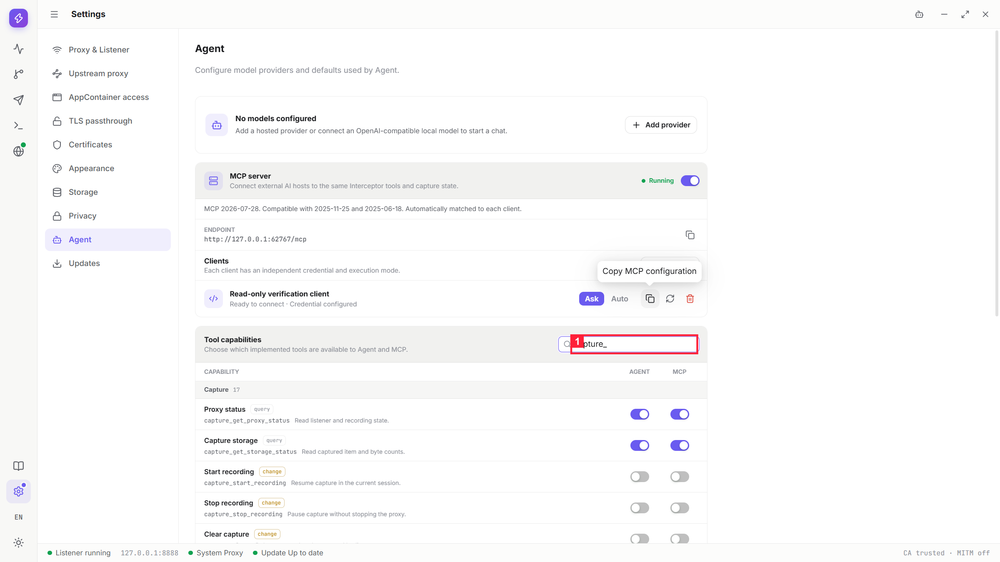

5. 在红框 1 搜索 `rules_`。只读时关闭 Apply rules、Export Rules、Import Rules；Rule set 和 Rule hits 是否保留按需要决定。

   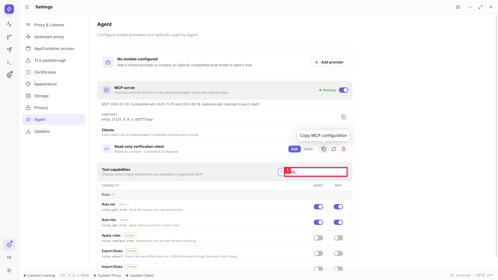

6. 在红框 1 搜索 `composer_`，关闭 Send request、Probe connection、替换集合、导入和导出。Probe connection 会发起网络活动，不是只读查询。

   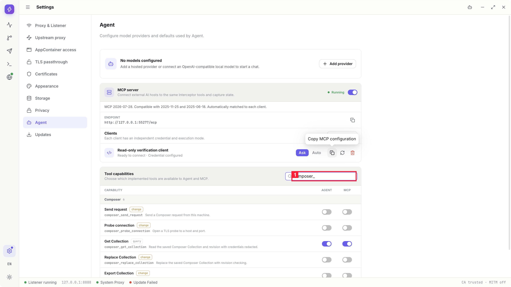

7. 在红框 1 搜索 `breakpoints_`，滚动检查启用、停用、Continue、Forward edited、Drop 及批量操作均关闭；只有确需查看等待项时才保留 Pending breakpoints。

   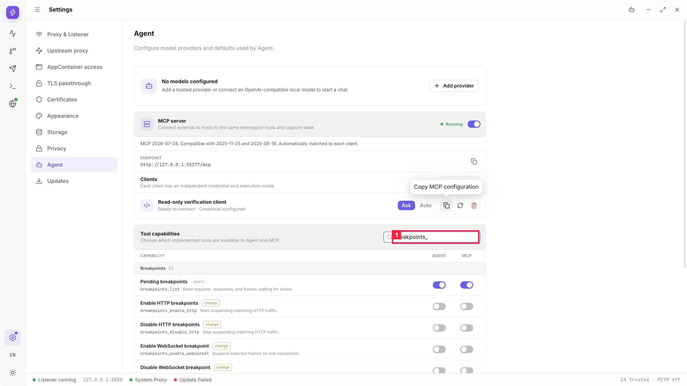

8. 在红框 1 搜索 `diagnostics_`。Export diagnostics 会写文件，要关闭；其余查询也按所需记录范围决定是否保留。

   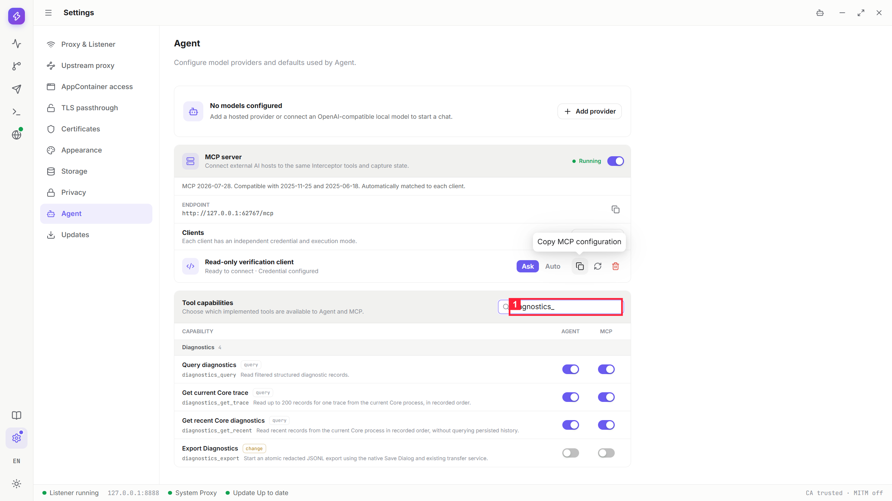

9. 在红框 1 搜索 `settings_`，滚动核对全部行。证书操作、系统代理、TLS 名单、AppContainer、语言、主题和导出隐私设置都不是只读查询，不能因为当前没有原生窗口就保留这些 change。

   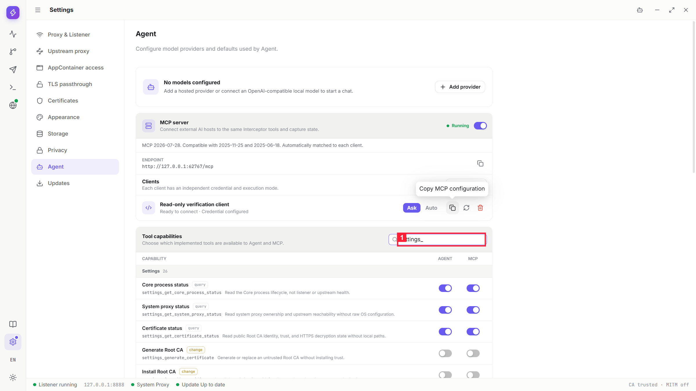

10. 最后搜索实际需要的 query。本例 `capture_get_proxy_status` 的红框 1 是 Agent，红框 2 是 MCP，两列均保留；不需要的入口仍可关闭。

    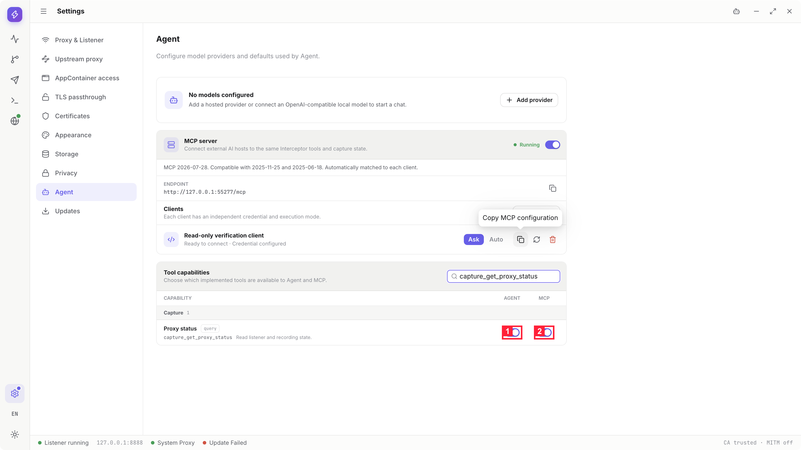

11. 在 Host 刷新 Tool 列表，确认只出现保留的 query，再查询代理状态并读取实际返回。被关闭的操作不可调用；若 Host 仍显示旧目录，先刷新或重新连接，不为消除错误重新开启 change。

    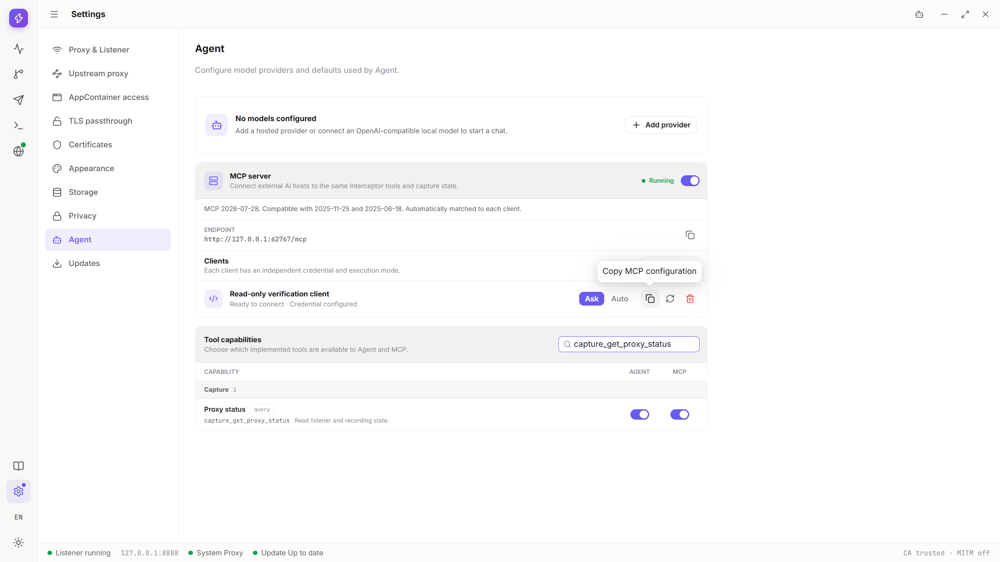

12. 正常重启后再次核对。图中 `capture_clear` 的红框 1 和红框 2 仍分别关闭 Agent、MCP；也要复查其他分组和 Host 当前目录，不能只凭这一行判断完整只读。

    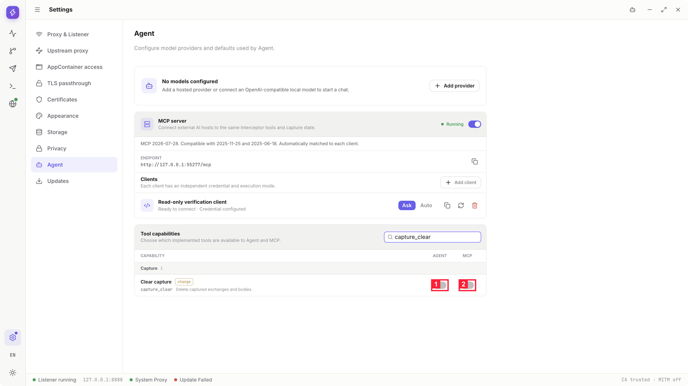

只读不等于不会向模型传送数据。查询结果也可能包含请求正文、响应、消息或日志；先限定允许访问的数据，再开始分析。

## 理解 Ask 与 Auto

| 行为 | Ask | Auto |
| --- | --- | --- |
| 已开启的 query Tool | 直接查询 | 直接查询 |
| 已开启的 change Tool | App 请求明确审批 | 自动执行 |
| 已关闭的 Tool | 不允许执行 | 不允许执行 |
| 系统文件窗口与原生权限 | 仍需正常完成 | 仍需正常完成 |

首次使用或操作范围较广时保持 Ask。执行模式决定审批方式，不改变 Tool 权限、系统授权或业务前提。

1. 在当前 Agent Chat 点击红框 1 的 Ask。change Tool 需要你在审批卡中决定是否允许。

   

2. 只有明确接受自动执行时，才点击红框 1 的 Auto。它只影响这个 Chat，不会修改其他 Chat 或 MCP Client。

   

3. 如果审批已经出现，再切 Auto 不会替你同意旧请求。第一张图红框 1 是 Auto，第二张图红框 1 是仍在等待的审批；回到原卡片选择 Allow 或 Deny。

   

   

4. 结束自动操作后，可以点击红框 1 把当前 Chat 恢复为 Ask。切换模式不是取消调用，也不会撤销已经完成的操作。

   

5. 外部 Host 使用独立的 MCP Client 模式。在 Settings → Agent 的 Clients 区找到对应行；本例 `MCP workflow client` 创建后为 Ask。

   

6. 确实需要时，点击该 Client 红框 1 的 Auto。只改变这一客户端的审批方式，不拿 Agent Chat 的模式代替。

   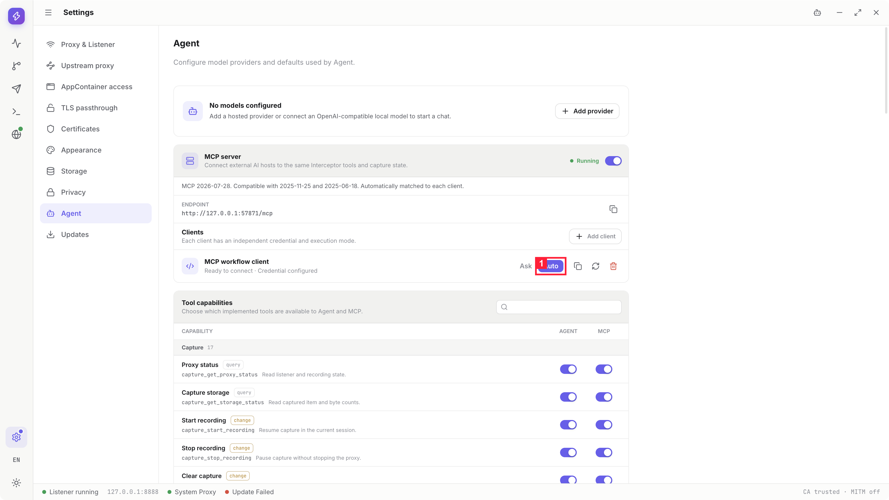

7. 不再需要自动执行时，在同一 Client 行选择 Ask。已有审批仍在原弹窗处理，或者由 Host 取消对应调用；检查 Recording、文件任务或断点是否还在运行。

   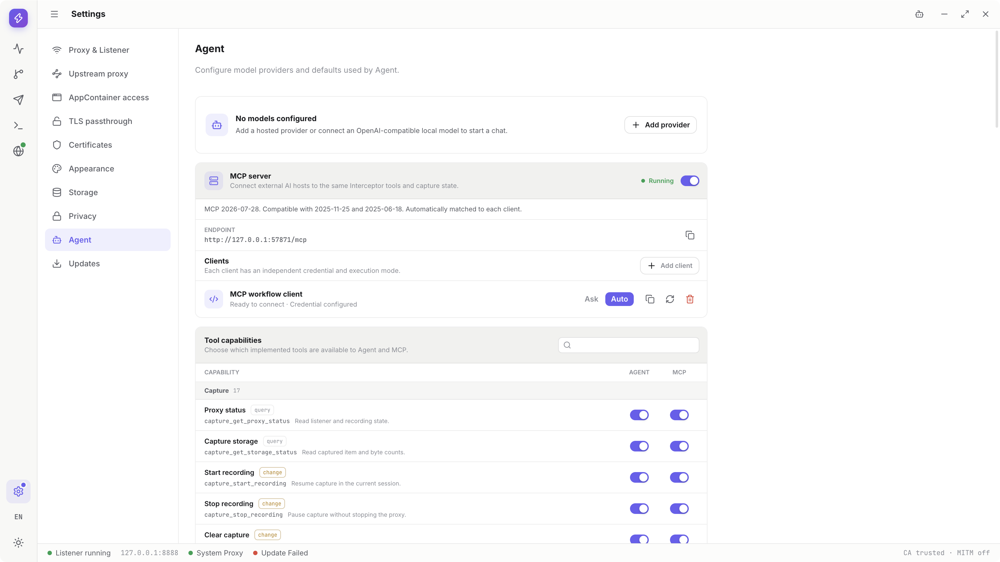

## 审批时检查什么

先配置可用模型，并确认当前 Chat 为 Ask。下面先拒绝、再允许 `capture_stop_recording`：它只暂停新录制，不清空 Capture，也不恢复系统代理。

1. 在红框 1 输入 `Pause recording after asking for my approval.`，点击红框 2 的 Send。

   

2. 核对调用方、Tool 名称、目标与影响。红框 1 的 Deny Tool 拒绝执行，红框 2 的 Allow Tool 允许本次操作；先选择 Deny Tool。

   

3. 拒绝后，红框 2 保留 Denied 结果，红框 1 的 Recording 仍开启。不要把模型回复或审批卡的出现当作已经执行。

   

4. 确实要暂停时，在红框 1 重新输入 `Pause capture after explicit approval.`，点击红框 2 的 Send。重新请求需要新的审批。

   

5. 再次检查 Tool 和影响，再点击红框 1 的 Allow Tool。前一次 Deny 不会自动决定这一次调用。

   

6. 红框 2 显示本次结果，红框 1 变为 Paused。需要继续采集时通过 Capture 的录制按钮恢复，核对实际状态后再继续。

   

7. 其他 Tool 要按自己的参数重新审阅。例如图中 Client `Diagnostics transfer MCP` 请求 `diagnostics_export`，检查 process `core`、level `info`、outcome `success` 和文件写入影响，再决定是否点击红框 1 的 Allow Tool call。

   

Allow 后仍可能出现文件选择、导入预览或系统授权。完成这些操作，再检查任务终态和实际文件；不要绕过确认，也不要把“任务已启动”当作“已经完成”。

## 旧状态、冲突与取消

- Rules 和 Collection 替换要基于最新保存版本。旧版本冲突时先重新读取，不以重复提交强行覆盖。
- Breakpoint 必须仍然存在于当前 Core 代际。已消失的目标不能自动替换成另一条。
- 文件任务“已启动”不是“已完成”，用任务查询或产品进度确认。
- Stop、取消、撤权或关闭客户端不会撤销已经完成的业务副作用。
- 原生窗口尚未完成时回到窗口处理，不用隐藏 API 代替选择文件或授权。

**推荐顺序**：先查询当前状态，再执行一个小范围操作，最后在实际工作区核对。

## 把 Tool 结果当成数据

查询结果、响应正文、网页和日志可能含他人提供的文字。它们不能替你授权模型修改规则、读取更多数据或上传内容。

只提供本次任务需要的信息，不在 Prompt 中粘贴真实 Key、Client 凭据或 CA 私钥。需要限制数据暴露时先关闭相关查询能力，而不是只把执行模式改成 Ask。

## 哪些操作仍由产品界面管理

模型配置与凭据、Chat 管理、MCP Server 和 Client 接入控制、窗口导航以及应用更新不是任意开放的业务 Tool。

需要添加模型、轮换 MCP 凭据或下载更新时，使用对应正式界面，不要求模型通过一个不存在的“通用 IPC/文件命令”代做。
