# 导入导出：保留和分享调试数据

[教程目录](../README.md) · [Capture](capture.md) · [隐私设置](settings.md#privacy)

## 先选对格式

| 想保存什么 | 使用什么 | 不能代替什么 |
| --- | --- | --- |
| 与其他抓包工具交换 HTTP 请求/响应 | HAR | 不是 Interceptor 所有协议信息的完整备份 |
| 保存更多当前流量细节，稍后在 Interceptor 中打开 | Native Archive | 不代替 Rules、Collection 或整个 App 配置备份 |
| 一份请求、响应或消息的正文 | Save body | 不包含完整会话的其他信息 |
| 规则树 | Rules Export 的 JSON | 不包含本次 Capture 的请求记录 |
| 请求集合 | Composer Export collection 的 JSON | 不等于发送历史或抓包归档 |
| App 的运行错误与操作记录 | Diagnostics 的 JSONL | 不等于请求正文或网络协议抓包 |

先确定需要保留的内容，再选格式。扩展名相似或同样使用 JSON，不代表文件可以互相导入。

## 导出 HAR

Capture 已有需要保留的记录。下面共有四条：两条 `/e2e/har-tools/text`、两条 `/e2e/har-tools/binary`；同一批数据的 All、Current filter 和 Selected request 分别为四、二、一条。实际操作按自己的记录与筛选核对，不照抄数量。

1. 先暂停新录制，打开 Capture 的 Export 菜单，点击红框 1 的 Export HAR。

   

2. 选择红框 1 的 All traffic，核对四条记录。检查授权、Cookie 遮罩与是否保留正文，再点击红框 2 的 Export 4 requests。

   

3. 在系统 Save 窗口选择自己的位置，保存为 `ui.har`。若取消，这次操作不会生成文件。

   

4. 等待文件保存后回到 Capture。红框 1 是可再次打开的 Export，红框 2 显示仍为 Paused；确认文件存在后再继续。

   

5. 在红框 1 的 Keyword 输入 `/e2e/har-tools/text`，筛选到两条文本记录，并点击红框 2 的其中一条。筛选范围与选中范围不是同一回事。

   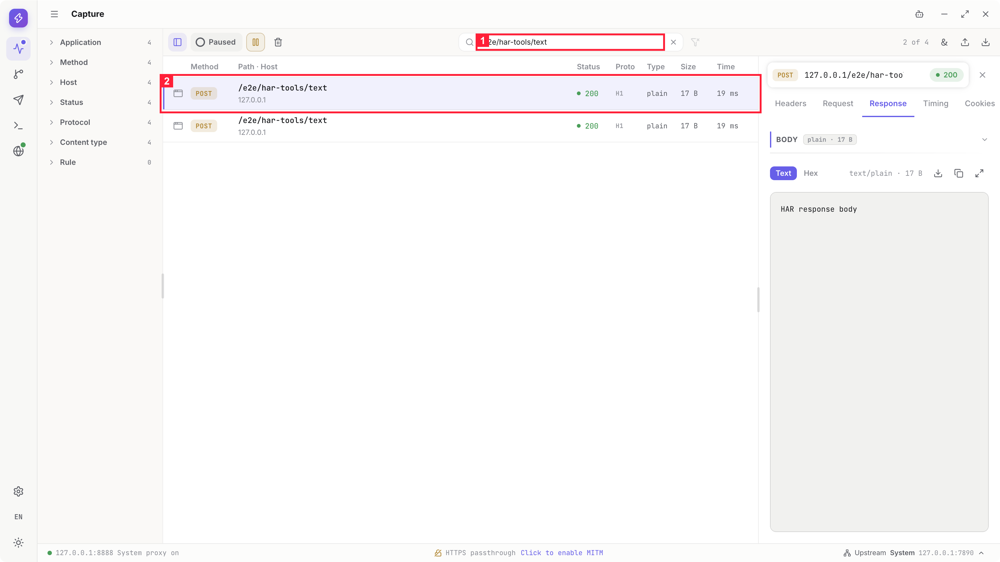

6. 再次打开 Export HAR，选择红框 1 的 Current filter，再点击红框 2 的 Export 2 requests。它包含筛选出的两条，不只包含选中行。

   

7. 在 Save 窗口另存 `ui-filter.har`，避免无意覆盖刚才的全部记录文件。

   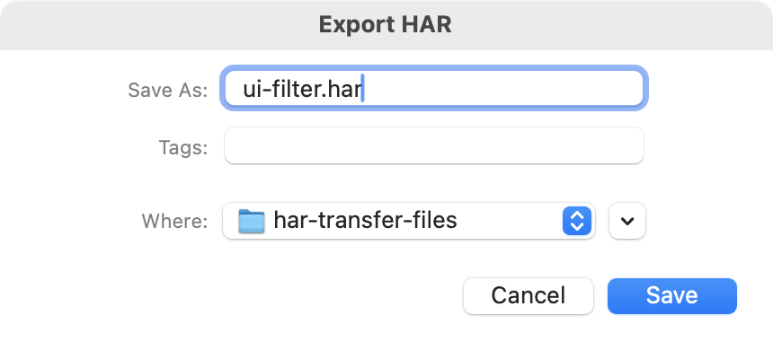

8. 等待保存完成，再从红框 1 的 Export 进入下一次导出。列表筛选仍保留，不会因为导出而删除原记录。

   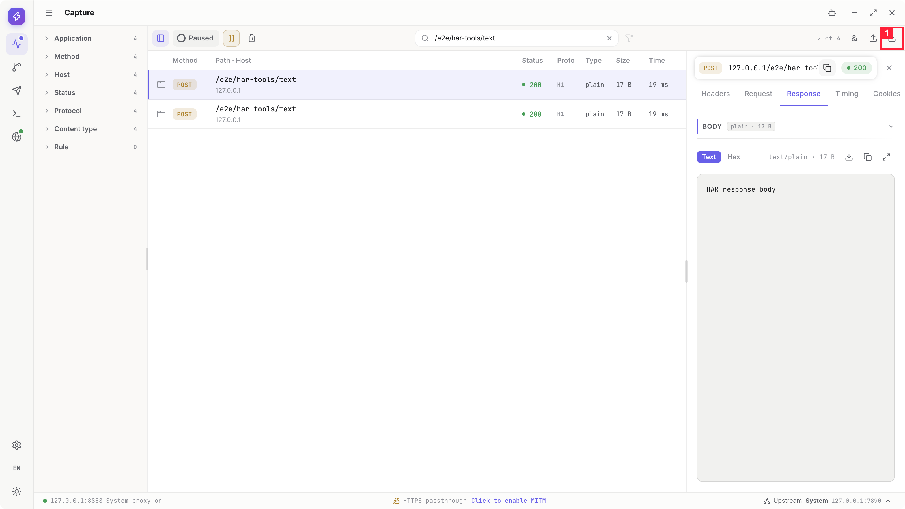

9. 选择红框 1 的 Selected request，确认只有一条，再点击红框 2 的 Export 1 request。没有选中记录时不能把这个范围当作全部记录。

   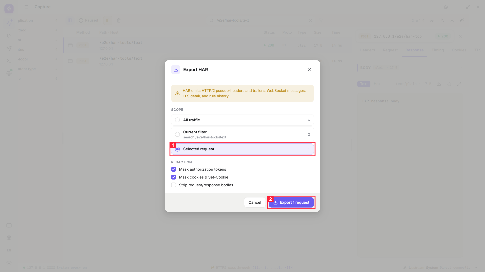

10. 另存 `ui-selected.har`，按用途分别保留全部、筛选和单条文件。

    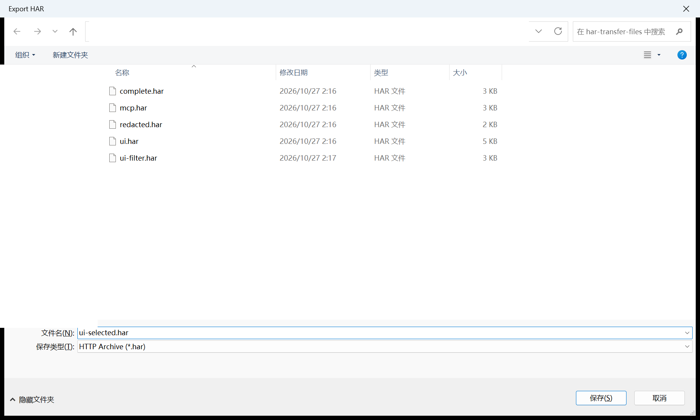

11. 保存后仍可使用红框 1 的 Export。分享前检查最终文件中的记录数、正文与敏感字段，不只检查界面选择。

    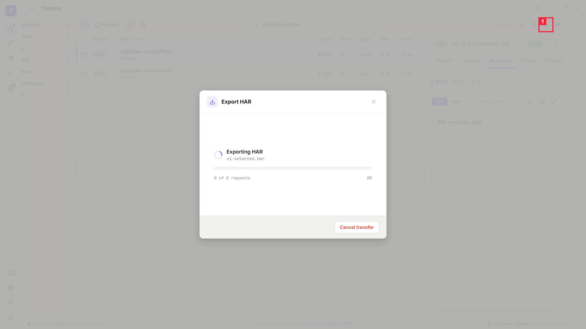

12. 需要重新查看时，按[导入步骤](#import)打开自己刚保存的文件。导入追加文件中的记录，不重发请求，也不会自动去重。

- HAR 不能无损表达 HTTP/2 pseudo-header、trailers、WebSocket 消息、TLS 详情和完整规则历史。
- 压缩响应可能按 HAR 要求保存解码内容，不能仅比较文件正文大小判断线上字节是否丢失。
- 大正文会增加导出内存需求；没有固定文件大小限制不代表任意规模都低内存。
- 导出是开始时的快照，不默认包含之后新到的流量。

## 保存 Native Archive

Native Archive 保存当前 Capture 的完整快照，只能由 Interceptor 打开。下面的独立例子有八条记录，包含 `/e2e/archive-tools/http` 的 HTTP 请求和 `/e2e/archive-tools/websocket` 的消息连接；操作时核对自己的数据，不默认套用 HAR 遮罩。

1. 在 Capture 核对要保留的记录，打开 Export，点击红框 1 的 Save Capture（`.iarchive`）。如果响应仍在接收，先决定是否要等完整内容。

   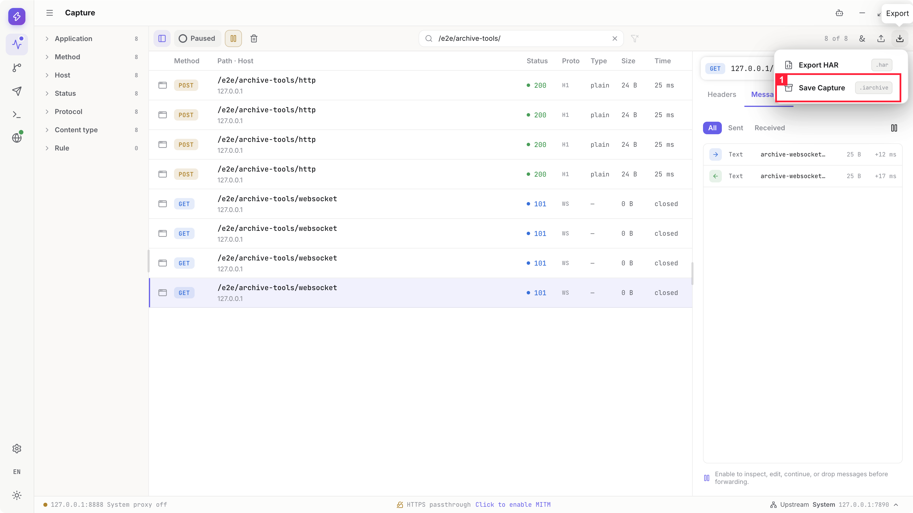

2. 阅读完整快照与敏感数据提示。尚未准备好分享时，点击红框 1 的 Cancel；取消此确认不会保存归档。

   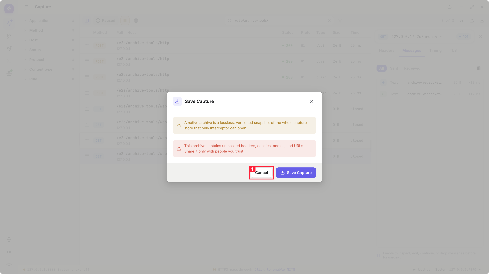

3. 确认需要保存时，再次从 Export 打开该操作，点击红框 1 的 Save Capture。

   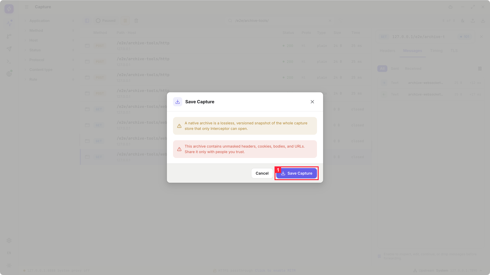

4. 在系统 Save 窗口选择自己的目录，保存为 `ui.iarchive`，不要把它改成 Rules 或 Collection 的 JSON 文件。

   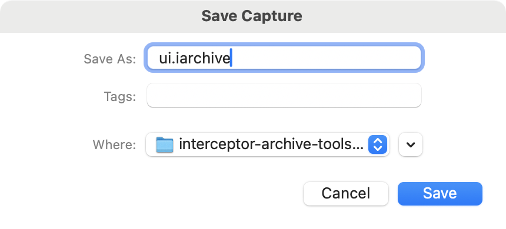

5. 等待保存完成再保留或分享文件。返回 Capture 不会自动清空原记录；记录仍在可以继续检查。

   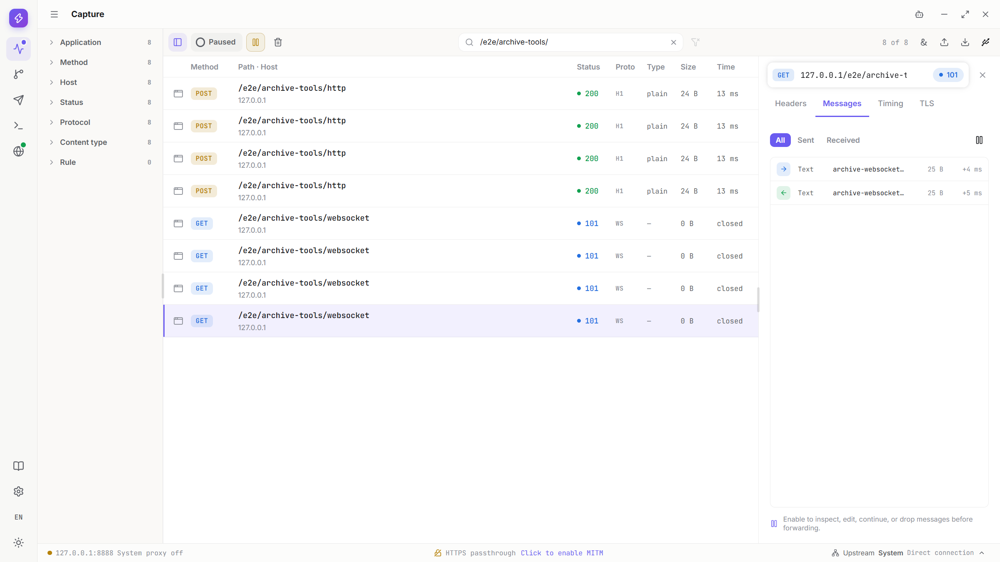

- 归档包含未遮罩的原始数据，分享前单独检查。
- 规则命中关联不等于完整 Rules 配置备份。
- 不承诺任意旧版或未来版本迁移兼容；当前格式不支持 ZIP64。
- 长连接尚未结束时的快照不包含未来才到达的字节。

## 重新打开 HAR 或原生归档

使用自己已通过产品 Export 保存的可信文件。HAR 与 Archive 下面分别演示，按各自当前列表和文件记录数核对；导入会追加，不会重新向源站发送请求，也不要求先 Clear。

1. 导入 HAR 时，在 Capture 打开 Import，点击红框 1 的 Import HAR。

   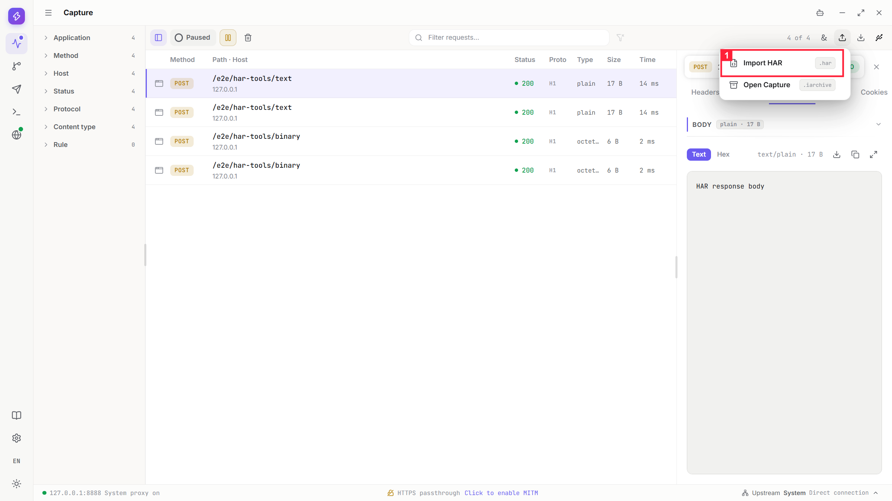

2. 点击红框 1 的 Import HAR，在系统 Open 窗口选择上节保存的 `ui.har`，不要选择 `.iarchive` 或配置 JSON。

   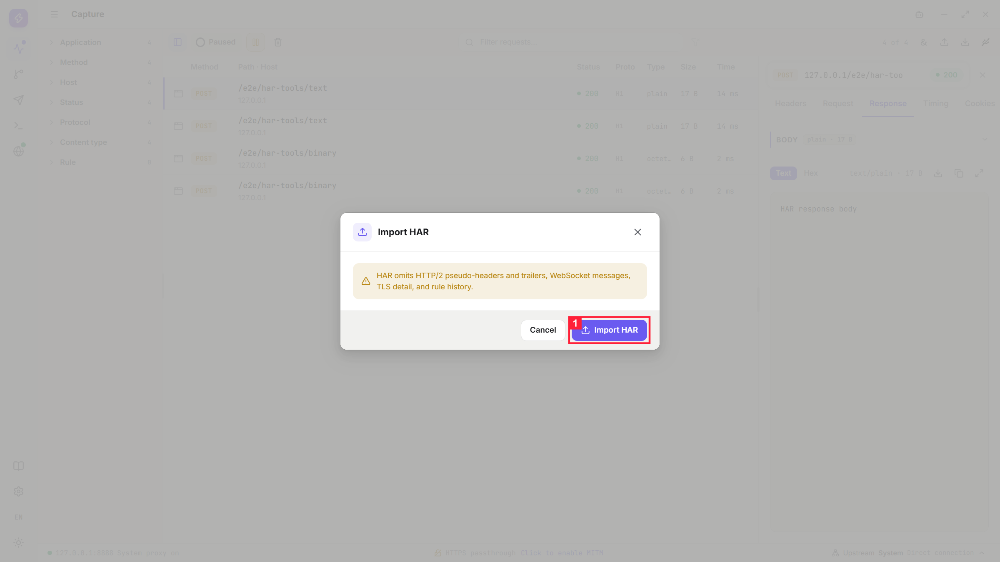

3. 等待导入完成。本例原有四条，`ui.har` 的四条追加后共八条；红框 1 是新增的 binary 记录，但还未选中，右侧仍是先前的 text 内容。不要把旧详情误认为新导入行的正文。

   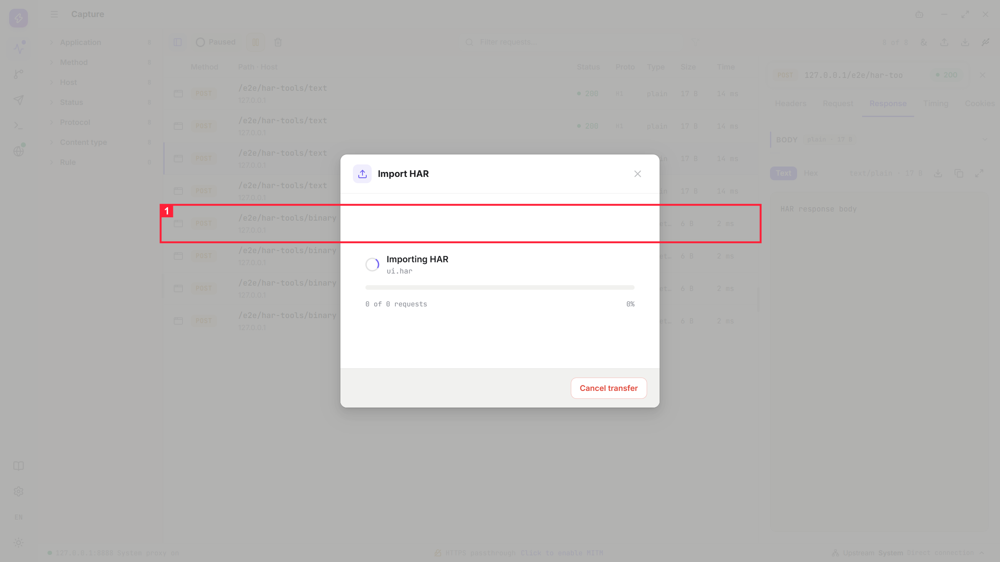

4. 选中新增的 `/e2e/har-tools/binary`，打开 Request，点击红框 1 的 Copy 核对完整 `HAR request body`，共 `16 B`。路径叫 binary 不代表请求正文也是二进制。

   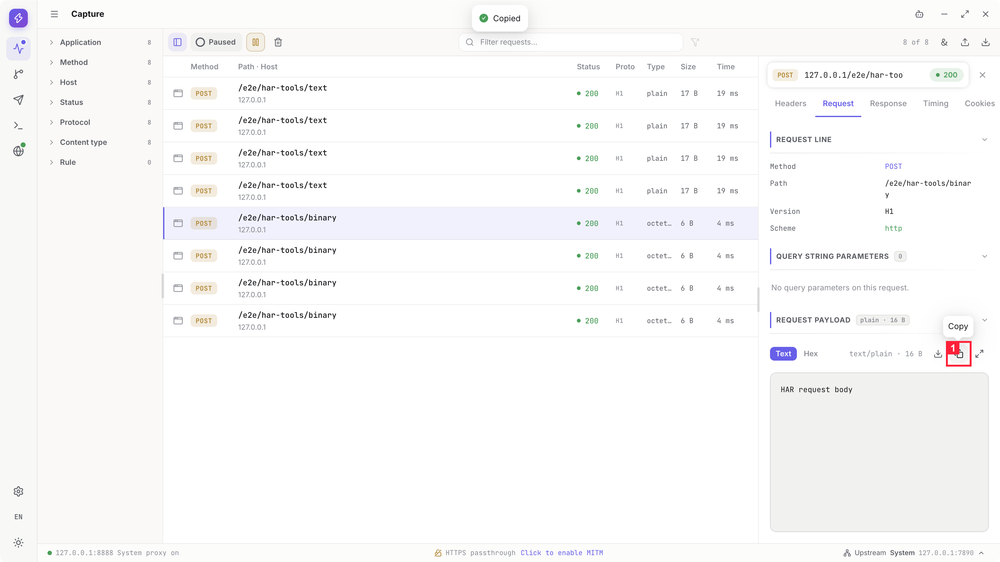

5. 切到同一记录的 Response，用 Hex 核对六个字节 `00 01 7f 80 fe ff`；红框 1 的 Copy 复制当前正文显示。它与上一张图的请求是两个不同方向。

   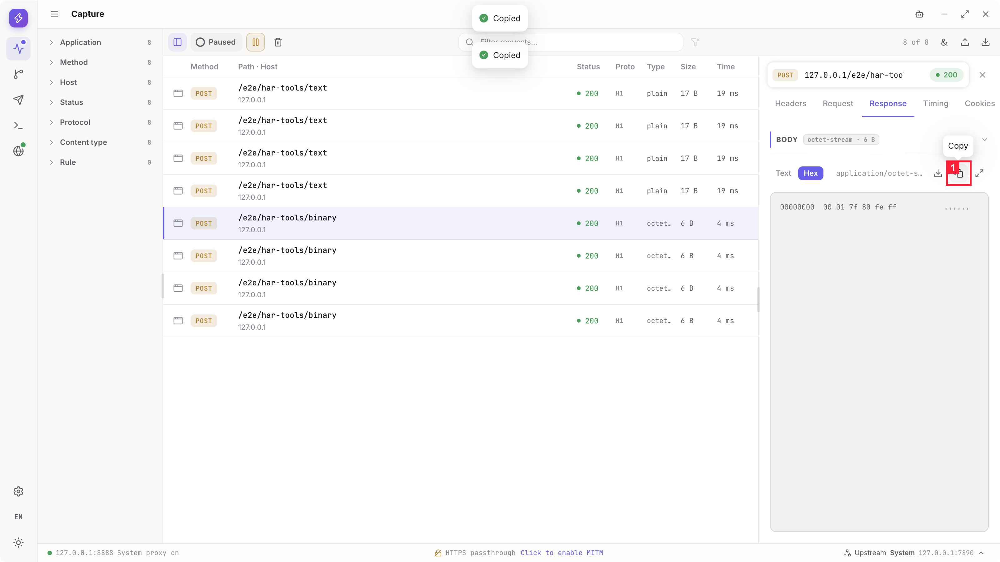

6. 再选新增的 `/e2e/har-tools/text`。第一张图红框 1 的 Request Copy 对应 `HAR request body`（`16 B`）；第二张图红框 1 的 Response Copy 对应 `HAR response body`（`17 B`），分别核对，不仅比较记录数量。

   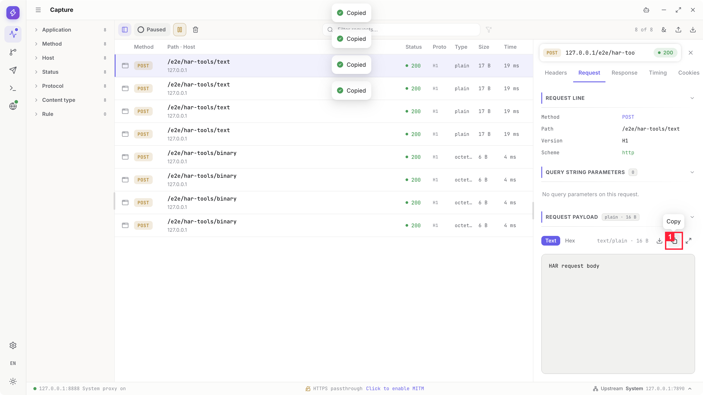

   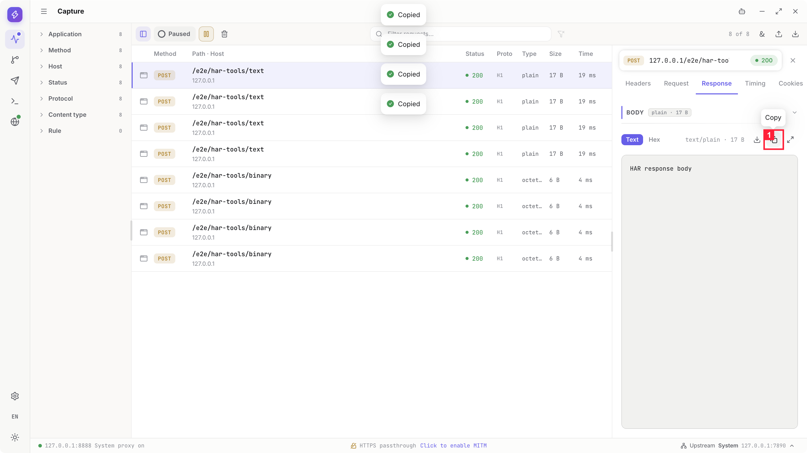

7. 阅读导入警告。文件中没有的协议细节或已经移除的正文不会凭空恢复；有失败或取消时，不把部分进度当作完整导入。

8. 导入不需要空列表。若想从空 Capture 打开归档，先保存仍需保留的记录，再通过 Capture Clear 清理，并等待清理完成。

9. 下面独立打开刚保存的 `ui.iarchive`。当前列表仍有八条原记录；从 Import 点击红框 1 的 Open Capture（`.iarchive`）。

   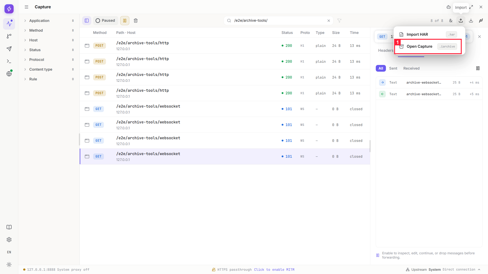

10. 阅读提示，点击红框 1 的 Open Capture，在系统窗口选择同一个 `ui.iarchive` 并确认 Open。

    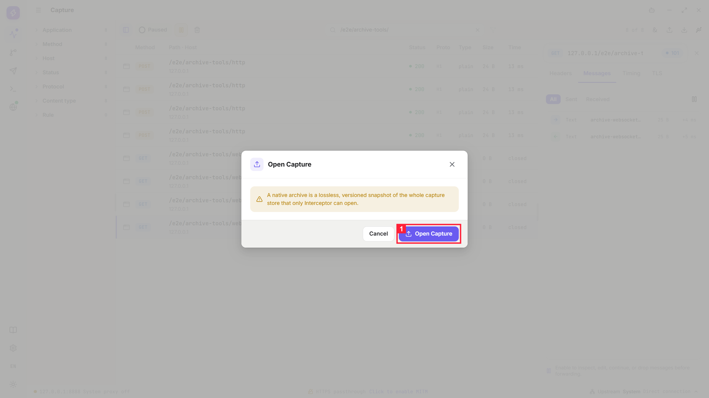

11. 等待完成。八条归档记录追加到原来的八条之后，本例共十六条；原记录不被同名内容覆盖。

    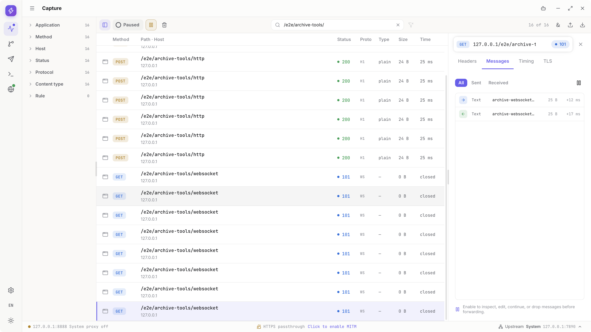

12. 选中导入的 HTTP 记录，打开红框 1 的 Response，核对完整 `archive-response-payload`。它是文本响应，不是前面其他例子的 JSON。

    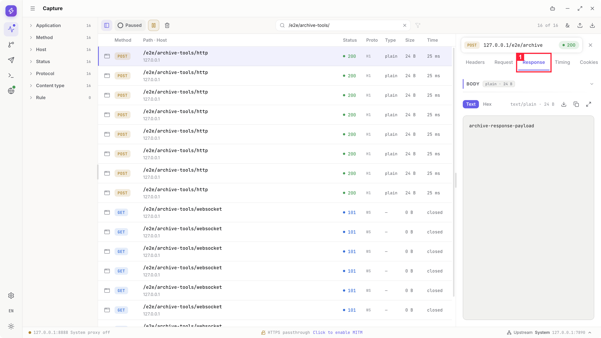

13. 再打开导入的 WebSocket 记录，选择红框 1 的消息，核对 `archive-websocket-payload` 与发送方向。打开归档只恢复可查看的历史，不重新建立那条连接。

    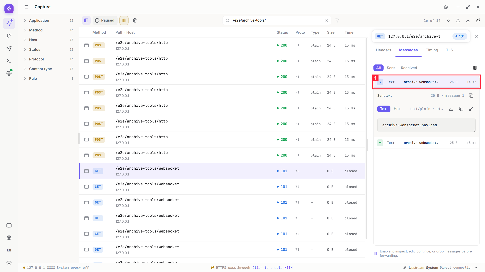

重复导入同一文件可能继续产生副本，不是增量同步。未知来源文件可能很大或包含敏感数据；先确认来源，不为试一下而自动打开或解压。读取文件与 Recording 是不同操作。

## 单独保存正文

Save body 保存已捕获的完整存储字节，不以屏幕上的只读预览替代文件。本例是 GET `/e2e/body-preview/four-byte` 的 UTF-8 响应，总长 `2097166` 字节，即 `2 MiB + 14`；它不是前面的 HAR 或归档文件。

1. 在 Capture 选中自己的记录并打开 Request、Response 或对应消息正文。本例保存 Response，先确认不是在保存另一方向或另一条记录。

2. 存在 Original/Final 时，先选要保留的版本。本例没有双版本对照；规则改写后的独立保存步骤见[原始与最终正文](rules.md#effects)。

3. 点击正文工具栏的 Save，在系统窗口选择目录并保存为 `utf8-full-body.txt`。文件名和位置由你选择，不把 Copy 当作保存完整正文。

   

4. 等待保存完成，再用适合该格式的工具检查文件。本例完整文件为 `2097166` 字节，末尾仍有 `🙂after-preview`，即使屏幕预览已经截断。下图是关闭详情后回到 Capture，不是正文内容或永久完成标志。

   

- 网络中断前未收到的字节不能靠导出恢复。
- 存储内容可能仍包含线上编码；保存文件不保证是可直接阅读的明文。
- 音视频、未知二进制或超限图片可以只显示元信息与 Save，不代表 App 会内部播放。
- Copy 可能只复制预览或格式化显示；完整数据使用 Save body。

## 进度、取消与退出

大任务通常有可观察的进度；小文件可能很快完成。取消运行中的任务与取消尚未开始的 Save 窗口不是同一操作。本例使用一条 `128 MiB` 二进制响应，不含个人流量。

1. 在 Capture 确认红框 1 的 `/e2e/transfer-jobs/large-source` 已收完。只选择你允许保存和删除的测试数据。

   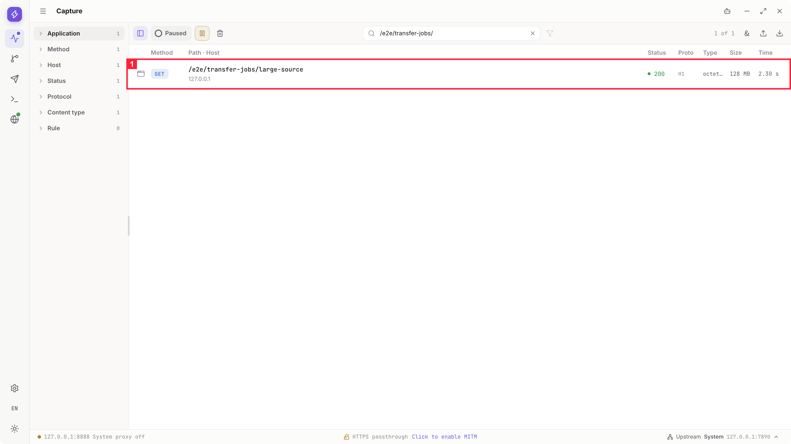

2. 打开 Export，选择红框 1 的 Save Capture，开始原生归档流程。

   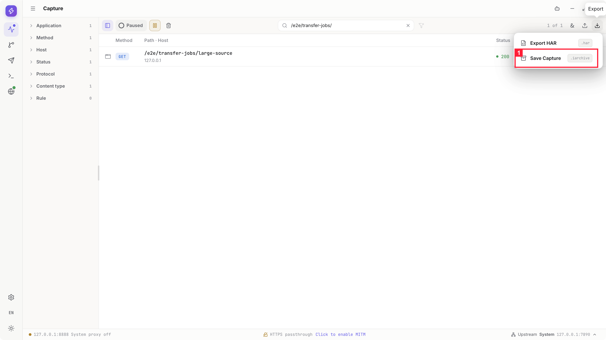

3. 阅读提示，点击红框 1 的 Save Capture，在系统窗口保存为 `cancel-ui.iarchive`。系统窗口中的 Cancel 只取消选文件阶段，不是下面的运行中任务取消。

   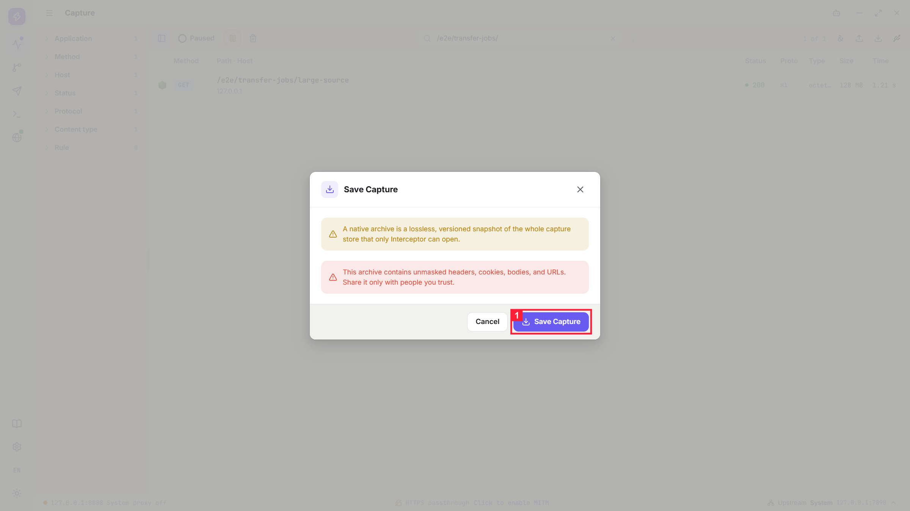

   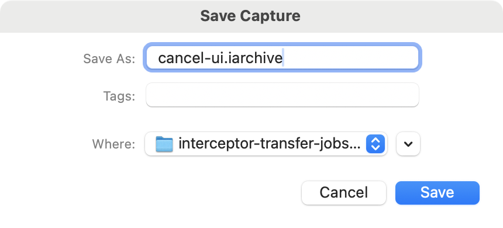

4. 任务显示 Exporting archive 且仍在运行时，点击红框 1 的 Cancel transfer。进度里的 `1 of 2 files` 是归档处理进度，不是两条 Capture 记录。

   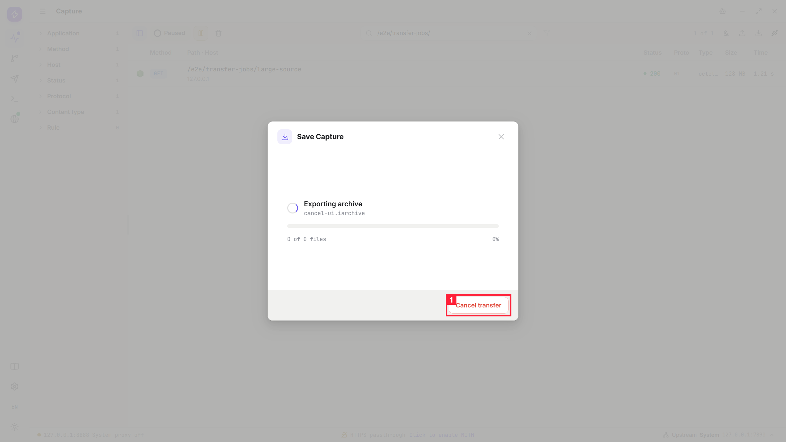

5. 等待取消与临时文件清理完成；UI 取消会关闭进度窗口，原 Capture 记录仍在。红框 1 的 Clear 是后续独立清理入口，不能用它代替 Cancel transfer。

   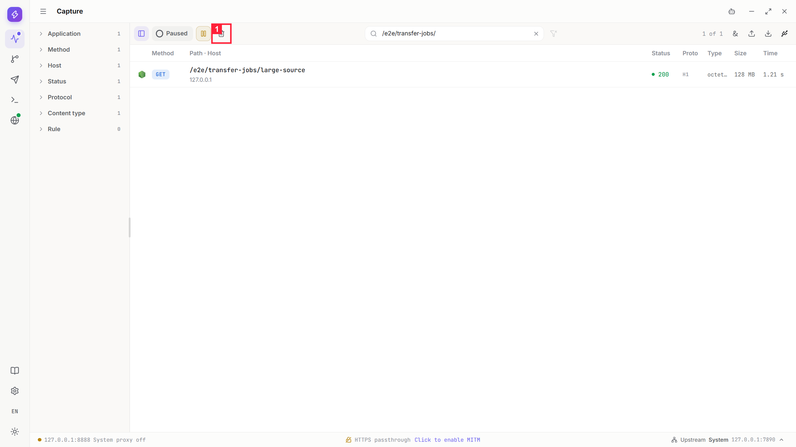

6. 确认不再需要这条记录后才 Clear，检查列表清空。需要继续保留记录时不执行这一步；正常退出前同样先等待任务清理。

   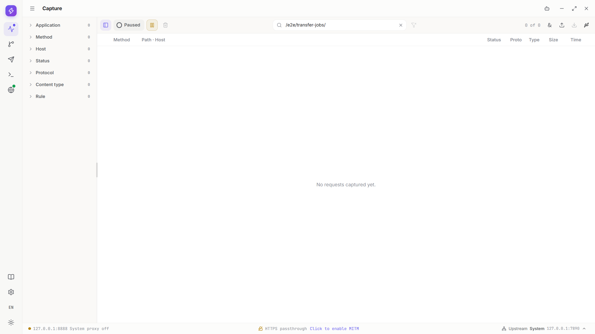

- 任务已经完成时，迟到的 Cancel 不是撤销，不应删除正式保存的文件。
- Capture Clear 不会替你取消其他文件任务，也不删除已导出文件。
- 任务运行或清理期间 Clear 可能被拒绝；不要强制调用禁用操作。
- Agent/MCP 返回已启动只表示任务被接受，继续查询终态；Stop 对话不自动取消已经启动的文件任务。

## 交换 Rules 和 Collection

Rules 与 Collection 是两种不同的 JSON 文件。下面分别使用 `rules-roundtrip.json` 和 `collection-roundtrip.json`，均先从对应功能 Export，再由同一功能 Import，不混用入口。

1. 在 Rules 检查自己的树后点击 Export rules，保存 `rules-roundtrip.json`。本例两条规则、一个目录，其中一条规则启用；导出不会替你应用未保存的编辑。

   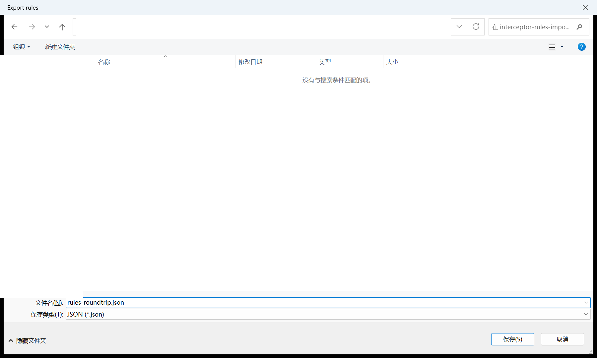

2. 在 Composer 通过 Collection 工具栏 Export，另存 `collection-roundtrip.json`。本例有两个请求和一个目录；导出不会发送这些请求。

   

3. 回到 Rules 点击 Import rules，选择刚保存的规则文件。核对 Rules `2`、Folders `1`、Enabled `1`、Skipped `0`。红框 1 的 Cancel 取消导入，红框 2 的 Import 2 rules 会追加并保存，其中启用规则可能立即影响后续流量。

   

4. 先点击 Cancel，确认原规则树没有增加节点。取消的是预览，不会删除已经导出的文件。

   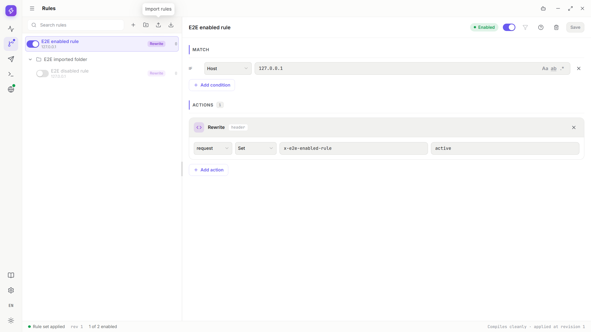

5. 再次 Import 同一个规则文件，确认后检查新增节点追加在原树之后，不按名称覆盖。本例变为四条规则、两个目录和两条启用规则；不需要再点一次 Save。

   

6. 到 Composer 的 Collection 点击 Import，选择 `collection-roundtrip.json`。红框 1 是待导入内容，红框 2 是 Cancel；核对请求、目录和警告，不把规则文件交给这个入口。

   

7. 点击 Cancel 后核对原 Collection 和当前打开请求仍保持原样。取消不追加，也不触发 Send。

   

8. 再次选择同一集合文件，检查红框 1 的预览，再点击红框 2 的确认按钮。

   

9. 展开红框 1 的新目录，核对原集合仍在，新内容追加而非覆盖。

   

10. 选择红框 1 的导入请求，核对红框 2 的 URL 以及 Header、Query、Body、Auth。只有明确点击 Send 才发送，不把导入成功当作请求已经执行。

    

Rules UI 导出当前编辑树，Rules Tool 导出已保存配置；按需要先 Save。重复导入会继续追加，启用规则可能重复命中。两种文件都可能包含凭据、地址、正文或路径，分享前检查。完整流程见[Rules](rules.md#import-export)和[Composer](composer.md#导出和导入-collection)。

## 分享前的隐私检查

只分享复现问题所需的数据，不因为选择了某个导出格式就假定已经匿名化。

1. 先缩小范围。图中红框 1 选择当前一条记录，红框 2 是 Export 1 request；不要无意导出整个会话。

   

2. 按需要遮罩 Authorization、Cookie/Set-Cookie，并选择是否移除正文。确认选项后才点击红框 1 的 Export；这里展示授权和 Cookie 遮罩及 Strip bodies 都开启的导出。

   

3. 另行检查 URL query、用户名、业务标识、自定义 Header、本地路径及文件内容。默认规则不能识别全部业务敏感字段。

4. 检查将要发送的最终文件，而不只检查 App 的选项。原生归档及集合配置尤其应按敏感文件管理。

5. 反馈中写清 App 版本、系统、协议、操作步骤和实际错误；不发送 CA 私钥、模型凭据或 Client 凭据。无法确认可公开时，重新产生无凭据的最小测试数据。
