# 导入导出：保留和分享调试数据

> 草稿，面向 `v0.1.1-alpha.1`；已配真实 Save/Open 面板和文件往返，取消、错误及其他未录分支仍有缺口，不代表全章或 item9 完成。文件可能含敏感信息，导出成功不等于可以直接公开。

[教程目录](../README.md) · [Capture](capture.md) · [隐私设置](settings.md#privacy)

<!-- recorded-walkthrough:start -->

## 逐步骤实操：真实产品录制

以下图片和视频来自已发布的 <code>0.1.1-alpha.1</code>、macOS x64，App保持<code>zh-CN</code>。每个步骤都有对应原生窗口截图，可点击查看原尺寸。

本机地址、端口和生成ID来自这次真实录制，不是公开服务；使用时替换成自己的已授权测试环境。下面先列本次实际数据，再按相同顺序操作。未出现在本段录像中的进阶分支仍待逐步配图与验收。

| 示例字段 | 录制中的实际值 |
| --- | --- |
| <code>url</code> | <code>http://127.0.0.1:55059/guide/transfer/order</code> |
| <code>har</code> | <code>guide-recording.har</code> |
| <code>archive</code> | <code>guide-recording.iarchive</code> |
| <code>bodyFile</code> | <code>guide-response.json</code> |
| <code>body</code> | <code>{&quot;orderId&quot;:&quot;guide-001&quot;,&quot;message&quot;:&quot;Hello Interceptor&quot;}</code> |

<video controls preload="metadata" playsinline lang="zh-CN" src="../media/v0.1.1-alpha.1/transfer/transfer.mp4" poster="../media/v0.1.1-alpha.1/transfer/transfer-01-export-menu.png">
<track kind="captions" srclang="zh-CN" label="Steps / 步骤" src="../media/v0.1.1-alpha.1/transfer/transfer.vtt" default>
</video>

### 01 · 打开 Export

[视频 00:00](../media/v0.1.1-alpha.1/transfer/transfer.mp4#t=0.203) · [返回本节视频](#walkthrough-video)

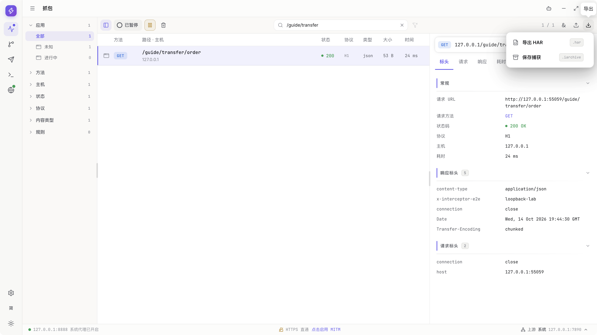

### 02 · 选择 HAR

[视频 00:03](../media/v0.1.1-alpha.1/transfer/transfer.mp4#t=3.084) · [返回本节视频](#walkthrough-video)

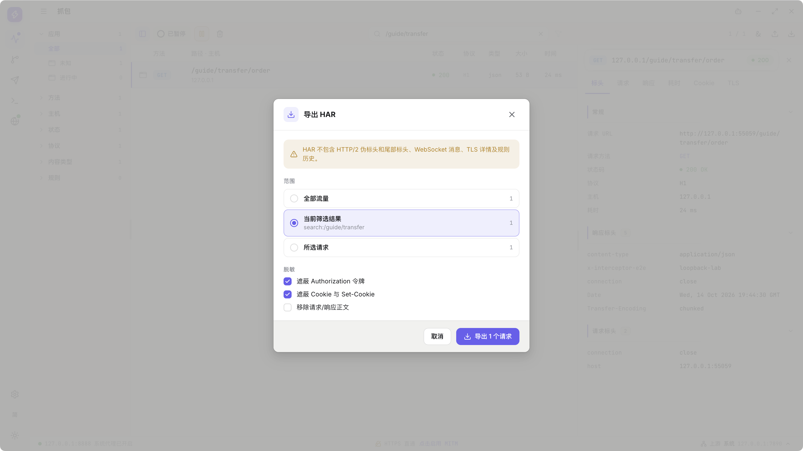

### 03 · 选择当前请求

[视频 00:06](../media/v0.1.1-alpha.1/transfer/transfer.mp4#t=6.033) · [返回本节视频](#walkthrough-video)

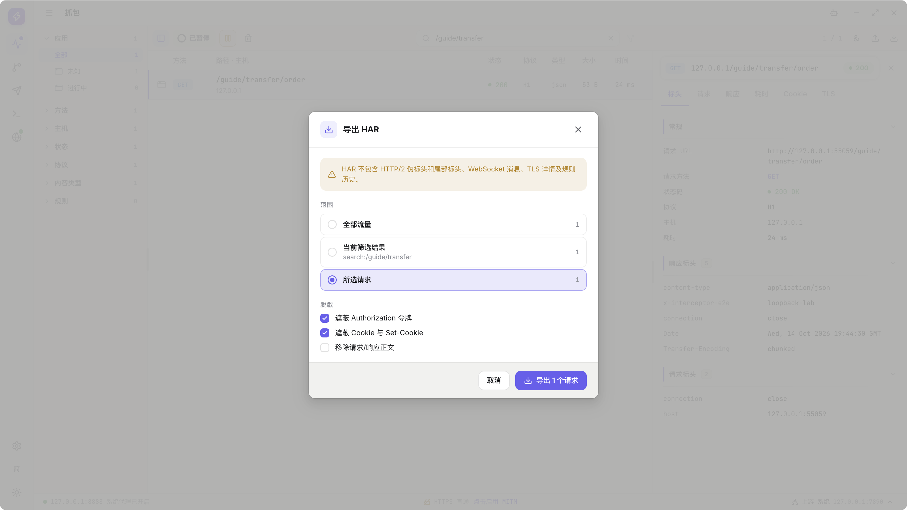

### 04 · 核对隐私选项

[视频 00:08](../media/v0.1.1-alpha.1/transfer/transfer.mp4#t=8.933) · [返回本节视频](#walkthrough-video)

### 05 · 保存为 guide-recording.har

[视频 00:30](../media/v0.1.1-alpha.1/transfer/transfer.mp4#t=30.729) · [返回本节视频](#walkthrough-video)

### 06 · 确认 HAR 保存完成

[视频 00:35](../media/v0.1.1-alpha.1/transfer/transfer.mp4#t=35.598) · [返回本节视频](#walkthrough-video)

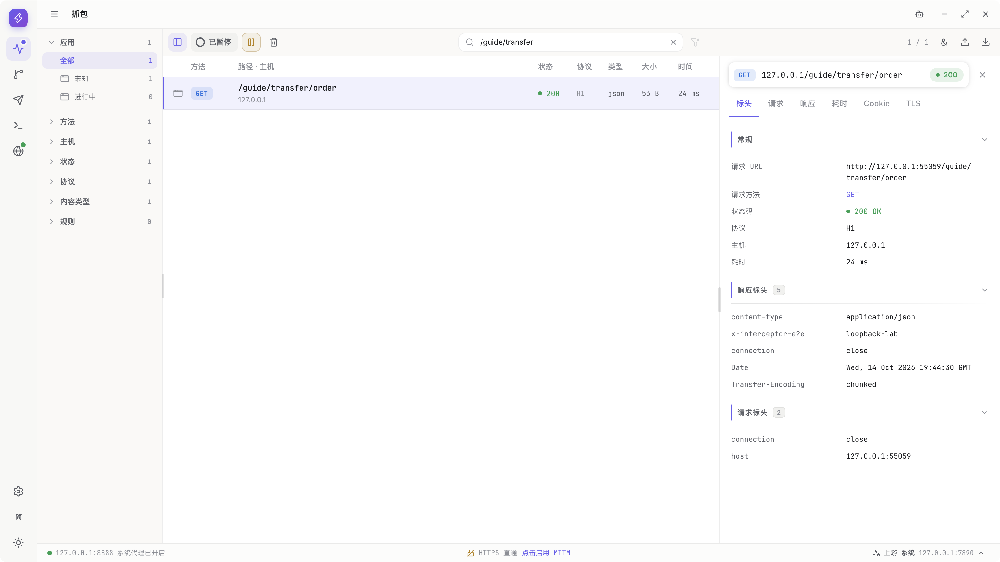

### 07 · 打开 Import

[视频 00:38](../media/v0.1.1-alpha.1/transfer/transfer.mp4#t=38.882) · [返回本节视频](#walkthrough-video)

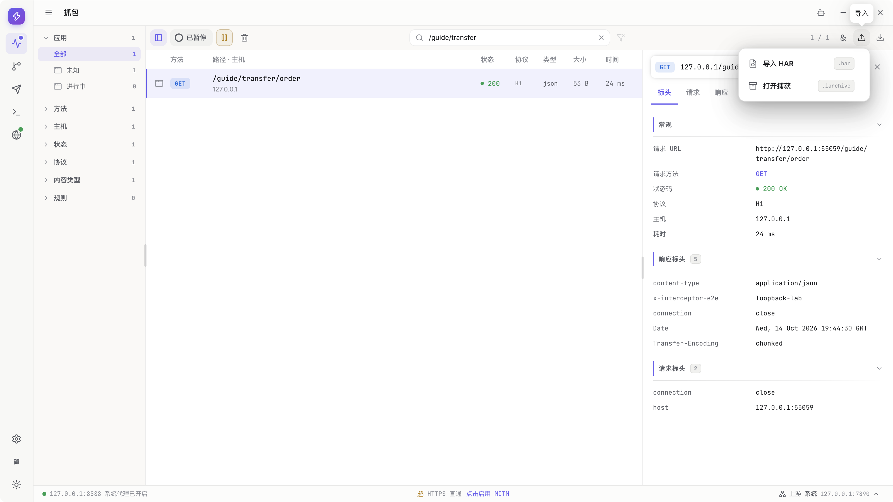

### 08 · 选择 HAR 导入

[视频 00:41](../media/v0.1.1-alpha.1/transfer/transfer.mp4#t=41.690) · [返回本节视频](#walkthrough-video)

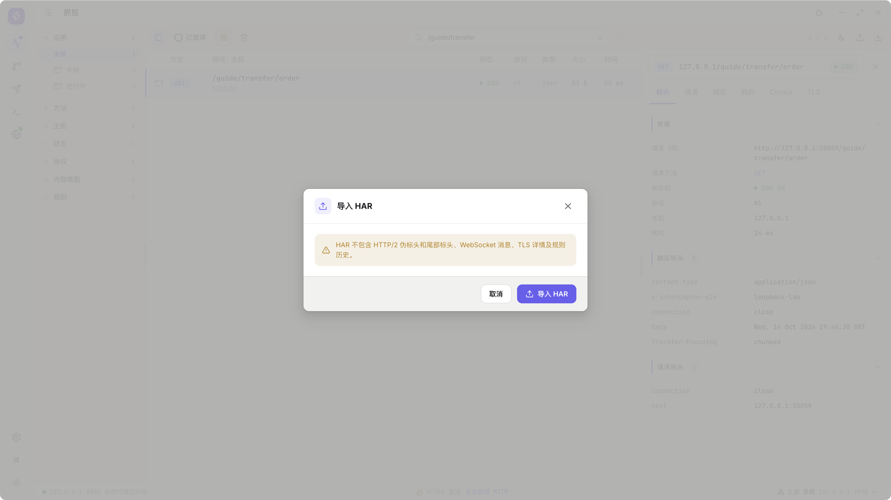

### 09 · 打开同一个 HAR

[视频 00:57](../media/v0.1.1-alpha.1/transfer/transfer.mp4#t=57.739) · [返回本节视频](#walkthrough-video)

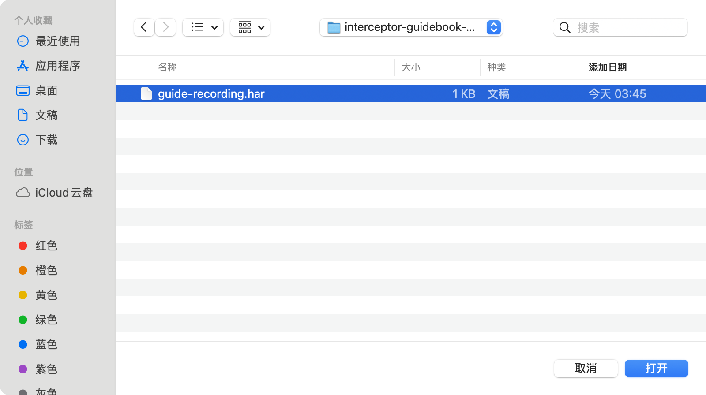

### 10 · 核对记录追加

[视频 01:03](../media/v0.1.1-alpha.1/transfer/transfer.mp4#t=63.035) · [返回本节视频](#walkthrough-video)

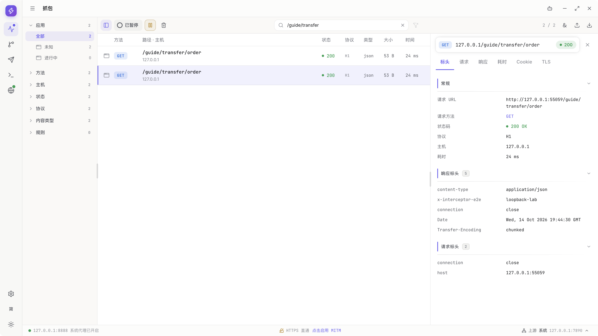

### 11 · 选择 Native Archive

[视频 01:06](../media/v0.1.1-alpha.1/transfer/transfer.mp4#t=66.780) · [返回本节视频](#walkthrough-video)

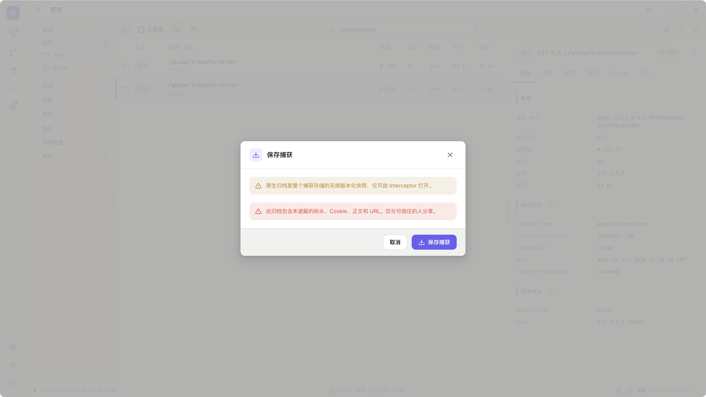

### 12 · 保存 guide-recording.iarchive

[视频 01:28](../media/v0.1.1-alpha.1/transfer/transfer.mp4#t=88.748) · [返回本节视频](#walkthrough-video)

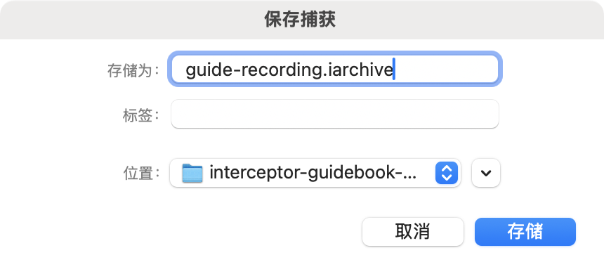

### 13 · 核对归档保存

[视频 01:33](../media/v0.1.1-alpha.1/transfer/transfer.mp4#t=93.692) · [返回本节视频](#walkthrough-video)

### 14 · 清空已导出的演示记录

[视频 01:36](../media/v0.1.1-alpha.1/transfer/transfer.mp4#t=96.933) · [返回本节视频](#walkthrough-video)

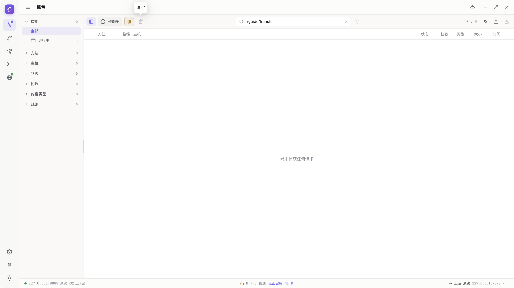

### 15 · 选择打开 Native Archive

[视频 01:39](../media/v0.1.1-alpha.1/transfer/transfer.mp4#t=99.783) · [返回本节视频](#walkthrough-video)

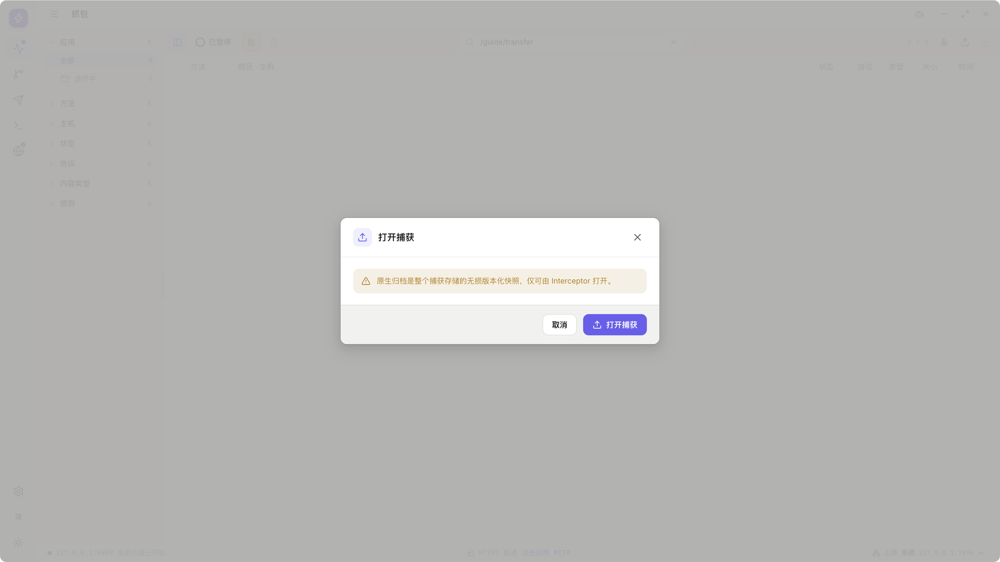

### 16 · 选择刚保存的归档

[视频 01:56](../media/v0.1.1-alpha.1/transfer/transfer.mp4#t=116.550) · [返回本节视频](#walkthrough-video)

### 17 · 核对恢复的请求和正文

[视频 02:01](../media/v0.1.1-alpha.1/transfer/transfer.mp4#t=121.537) · [返回本节视频](#walkthrough-video)

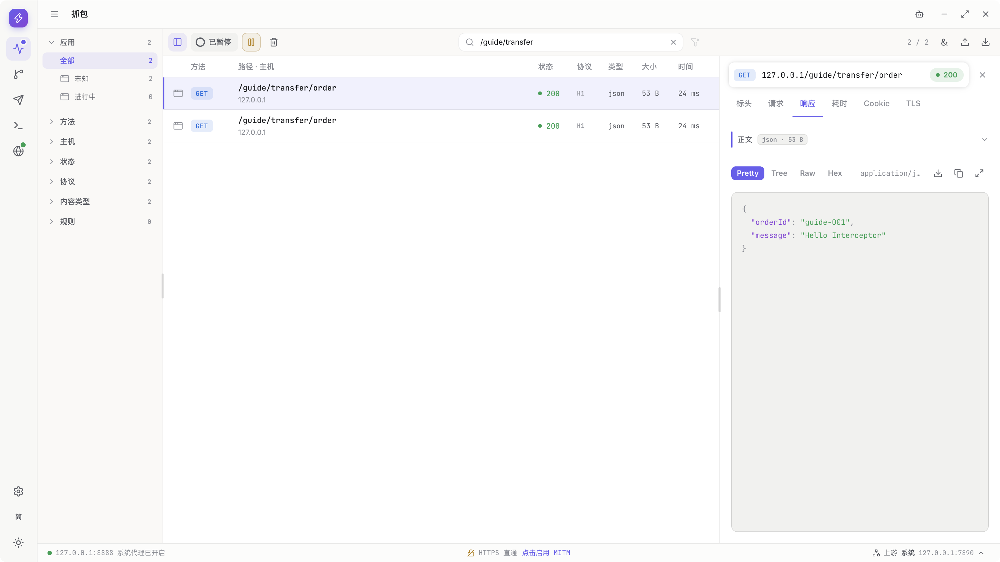

### 18 · 保存单独正文

[视频 02:15](../media/v0.1.1-alpha.1/transfer/transfer.mp4#t=135.124) · [返回本节视频](#walkthrough-video)

### 19 · 核对完整正文

[视频 02:19](../media/v0.1.1-alpha.1/transfer/transfer.mp4#t=139.247) · [返回本节视频](#walkthrough-video)

下面保留完整功能参考。只有已经附上真实步骤图、核对过变量和值的操作才能计入图文验收。
<!-- recorded-walkthrough:end -->

## 先选对格式

| 想保存什么 | 使用什么 | 不能代替什么 |
| --- | --- | --- |
| 与其他抓包工具交换 HTTP 请求/响应 | HAR | 不是 Interceptor 所有协议信息的完整备份 |
| 保存更多当前流量细节，稍后在 Interceptor 中打开 | Native Archive | 不代替 Rules、Collection 或整个 App 配置备份 |
| 一份请求、响应或消息的正文 | Save body | 不包含完整会话的其他信息 |
| 规则树 | Rules Export 的 JSON | 不包含本次 Capture 的请求记录 |
| 请求集合 | Composer Export collection 的 JSON | 不等于发送历史或抓包归档 |
| App 的运行错误与操作记录 | Diagnostics 的 JSONL | 不等于请求正文或网络协议抓包 |

**原则**：先确定需要保留的事实，再选格式。扩展名相似或同样使用 JSON，不代表文件可以互相导入。

## 导出 HAR

**前提**：Capture 中已有需要保留的请求；选择范围前先核对当前筛选与选中项。

**步骤**

本段实际请求为 `http://127.0.0.1:55059/guide/transfer/order`，正文为 `{"orderId":"guide-001","message":"Hello Interceptor"}`。`55059` 仅为录制环境动态端口，实际使用自己的测试服务。

1. 打开 Capture 的 Export 菜单。

   

2. 选择 HAR。

   

3. 本次选择当前请求。全部记录或当前筛选结果也可按界面选择，但这些切换分支仍待配图。

   

4. 核对是否保留正文、Authorization/Cookie 遮罩，并阅读格式损失与敏感数据提示，不假设遮罩会处理所有字段。

   

5. 确认导出，在真实系统保存窗口保存 `guide-recording.har`。

   

6. 等待完成，再检查本次文件；取消或失败不能当作完成。

   

**预期结果**：得到可与支持 HAR 1.2 的工具交换的 HTTP 数据。

**关键说明**

- HAR 无法无损表达 HTTP/2 pseudo-header、trailer、WebSocket 消息、TLS 详情和规则历史等信息。
- 压缩响应在 HAR 中可能按格式要求转成解码后的内容；不能只比较文件中正文大小就断定线上字节丢失。
- 大正文 HAR 会消耗额外内存；没有文件大小限制不等于任何规模都能低内存处理。
- 导出是当时的快照，不把导出过程中新增的流量默认视为已包含。

## 保存 Native Archive

**步骤**

1. 确认要保存的流量已出现。此图来自本次先完成 HAR 导入后的状态，仍是 `/guide/transfer/order`，不是重新发送的请求；长流等待结束的分支仍待配图。

   

2. 打开 Export，选择 Native Archive，阅读保存内容和隐私提示。

   

3. 在真实系统保存窗口保存 `guide-recording.iarchive`。

   

4. 等待归档任务完成，再保留或分享。

   

**预期结果**：保存 Interceptor 的原生流量记录及引用的正文，包括 HAR 无法完整表达的部分信息。

**关键说明**

- 原生归档包含敏感原始数据，不默认套用 HAR 的遮罩选项。
- 它可以保留规则命中关联，但不是完整 Rules 配置或历史规则定义的备份。
- 格式使用当前实现的归档结构，不承诺所有旧版或未来版本之间迁移兼容。
- 当前归档不支持 ZIP64；文件很大时不能以“压缩容器可打开”推断产品一定支持。
- 保存时的流量尚未完整结束，就不要把快照当作未来所有字节的备份。

## 重新打开 HAR 或原生归档

**前提**：使用可信文件。第一次练习，先通过上面的产品 Export 生成自己的示例文件。

**步骤**

1. 保留当前需要的数据；导入不要求先 Clear。

   本次 HAR 输入就是上面产品刚导出的 `guide-recording.har`，先确认保存完成：

   

2. 打开 Import 菜单。

   

3. 选择 HAR 导入，不拿 Rules/Collection JSON 混用。

   

4. 在真实系统打开窗口选择同一个 `guide-recording.har`。

   

5. 阅读实际进度、警告及产品提供的确认，再等成功，检查记录追加。不要预设每种格式都有 Rules 式预览；错误、取消或有损警告分支仍待配图。

   

6. 若要按本次录像练习归档恢复，先完成上节 Native Archive 保存，再 Clear 不需保留的演示记录。此清空只为展示恢复，不是导入前提。

   

7. 选择 Import Native Archive。

   

8. 在真实打开窗口选择刚导出的 `guide-recording.iarchive`。

   

9. 等待成功后，选中恢复记录并打开正文，核对 `guide-001` 与 `Hello Interceptor`。

   

**预期结果**：记录追加到当前 Capture，导入本身不把这些请求重新发送到网络。

**关键说明**

- 同一文件重复导入不是增量同步，可能得到多份记录。
- HAR 缺失的协议信息不会在导入时凭空恢复。
- 失败或取消时，不能用部分进度推断已经完整导入；以最终结果和列表为准。
- 只导入文件不要求用隐藏的录制状态制造新流量；暂停或取消代理就绪与文件阅读是不同事情。
- 未知来源的归档可能非常大，不自动解压或打开不可信材料来“试一下”。

## 单独保存正文

**步骤**

1. 选中本次恢复的 `/guide/transfer/order`，打开 Response；本段是 JSON 响应，不是 WebSocket/gRPC 消息导出。

   

2. 若有 Original/Final 选择，先确定要保存哪一份。

   **待配图**：本次没有在规则改写的双版本正文间切换，不用普通 JSON 图冒充版本选择。

3. 使用 Save body，在真实保存窗口填写 `guide-response.json`。

   

4. 等待完成，用适合 JSON 的工具核对 `{"orderId":"guide-001","message":"Hello Interceptor"}`。

   

**预期结果**：保存该正文实际捕获的完整存储字节，不以 `2 MiB` 只读预览代替整个文件。

**关键说明**

- 网络中断前没有收到的字节无法靠导出恢复。
- 存储字节可能仍包含线上内容编码；文件不是必然可直接按明文阅读的“屏幕文本”。
- 音视频和超限图片可以只显示元信息与保存入口，不代表产品会在内部播放它们。
- Copy 与 Save body 不同，前者可能只复制当前预览或格式化显示。

## 进度、取消与退出

**步骤**

1. 导入或导出后观察任务状态，不以弹窗已打开或开始计数作为成功。

   下图是本次 HAR 的完成状态，不是任务仍在进行：

   

2. 不再需要时使用任务的 Cancel，等待最终状态。

   **待配图**：现有文件往返未执行运行中的 Cancel；原生面板取消或 Rules 预览取消是不同操作。

3. 若任务已经完成，不把迟到的取消当作撤销；自行按需要管理已保存文件。

   **待配图**：迟到取消竞态与已保存文件管理没有单独录制。

4. 需要 Clear 或关闭 App 时，先等待有关任务及取消清理完成。

   本图是已完成归档后的 Clear，运行中拒绝 Clear、取消清理与退出等待仍待配图。

   

**预期结果**：取消过程显式结束，失败保持为失败，已经提交成功的保存保持为完成。

**关键说明**

- Capture 文件任务运行或清理期间可能拒绝 Clear，避免删除仍被读取的数据。
- Clear 不会帮你取消另一个文件任务，也不删除已导出的文件。
- 取消不是瞬间回滚；任务跨过最终保存点后，不应因稍晚的 Cancel 删除正式文件。
- Agent/MCP 返回“已启动”只代表任务被接受。继续用任务查询确认完成；停止一轮 AI 对话不等于取消一个已经启动的文件任务。

## 交换 Rules 和 Collection

这里引用两次独立录制，不把一种文件交给另一功能：Rules 使用 `guide-rules.json`，Composer 使用 `guide-collection.json`。

1. 在对应功能 Export，通过其真实保存面板生成文件。

   

   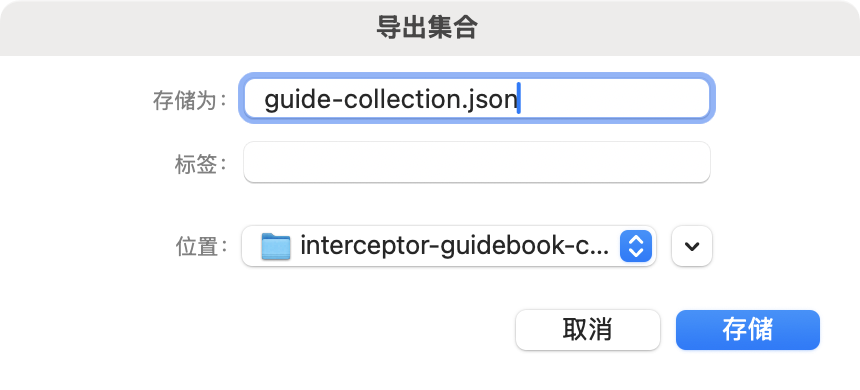

2. 用同一功能 Import，在真实打开面板选择刚生成的同一个文件。

   

   

3. 阅读各自预览的数量、跳过项和影响；Rules 额外注意已启用规则。

   

   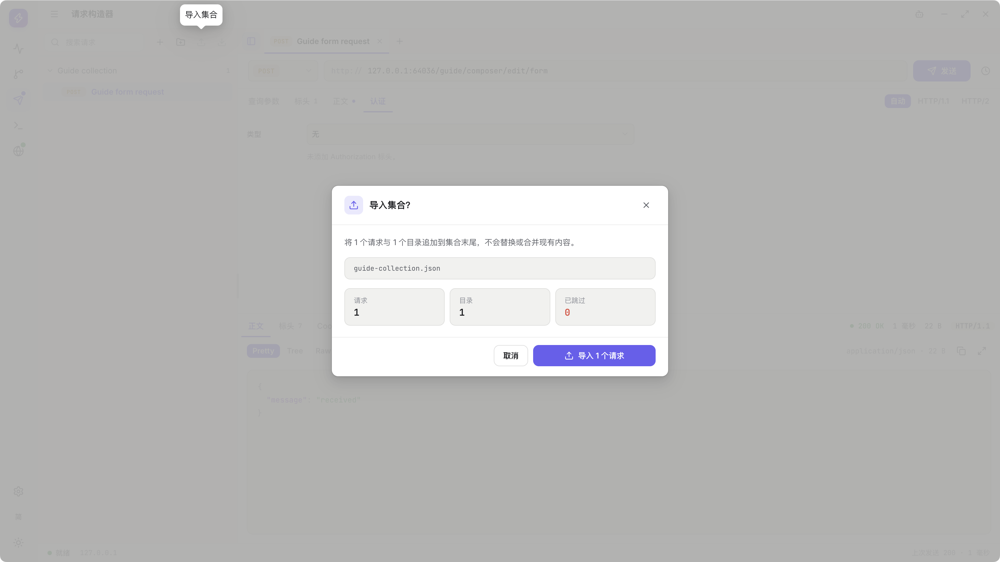

4. 不接受时取消。Rules 实拍先取消并保留原树；Collection 取消分支仍待配图。

   

5. Rules 练习若继续，重新选择同一个 `guide-rules.json`；Collection 实拍则直接从其预览继续。

   

6. 确认后分别检查追加结果，不覆盖原项目。

   

   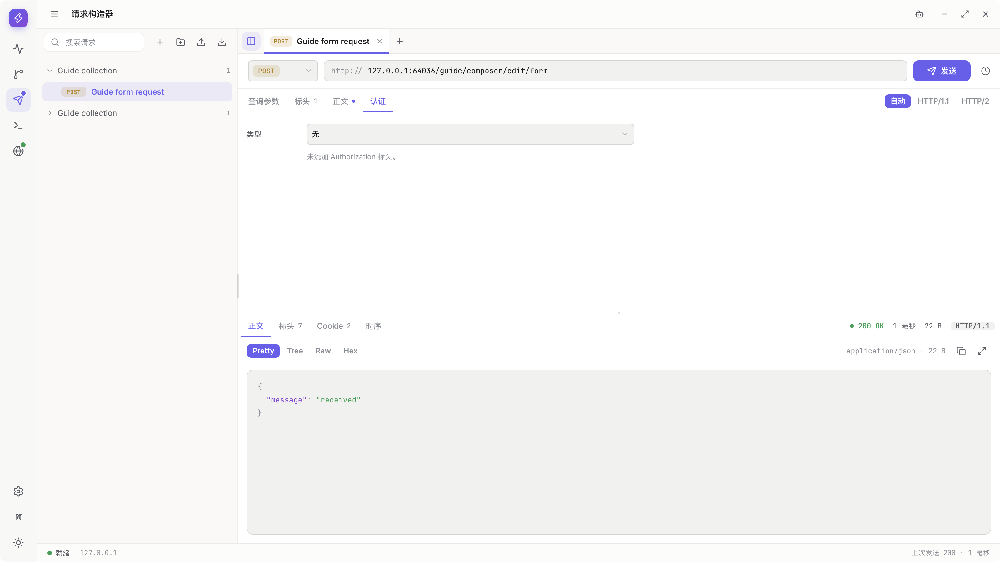

**预期结果**：以新的本地身份追加内容，不按名称覆盖已有项目。

**关键说明**

- Rules 导入保留文件中的启用状态，确认后启用规则可能立即作用于后续流量。
- Collection 导入不自动 Send。
- Rules UI 导出当前草稿，Rules Tool 导出已保存配置；先确认是否需要 Apply。
- 两种文件都可能有认证、目标地址、正文或本地路径，分享前检查。详见 [Rules](rules.md#import-export) 与 [Composer](composer.md#导出和导入-collection)。

## 分享前的隐私检查

**步骤**

1. 缩小导出范围，只保留复现问题所需的记录。

   

2. HAR 按需要遮罩 Authorization、Cookie，或移除正文。

   

3. 另外检查 URL query、用户名、业务标识、其他 Header、文件内容和本地路径。

   **待配图**：没有逐字段隐私复核的步骤图；本次公开测试数据不代表任意实际流量都安全。

4. 对要发送的最终文件再检查一次，不只检查导出设置。

   **待配图**：保存完成与格式正确不等于隐私检查通过，没有独立录制最终文件的完整隐私检查。

5. 在工单中说明 App 版本、系统、协议、复现步骤和实际错误，不发送 CA 私钥或模型凭据。

   **待配图**：没有创建或提交工单的录制，也不会为了截图公开凭据。

**预期结果**：分享的是最小、可公开的复现资料。

**关键说明**：遮罩不是对任意业务字段的完整匿名化。原生归档和集合配置尤其应按敏感文件管理；无法确认可公开时，用重新产生的无凭据测试数据替代。
