# 常见问题与恢复

> 草稿，面向 `v0.1.1-alpha.1`；已引用实际检查位置与代表结果，未录故障逐步标注，不代表全部排查场景或 item9 完成。先保留记录并缩小范围，不默认重装、清目录或关闭系统保护。

[教程目录](../README.md) · [Diagnostics](diagnostics.md) · [Settings](settings.md)

下图按各章真实操作说明检查位置；正常状态图不表示复现了故障。不同录制的请求、规则与 Client 名称不可混用，图中的端口也只是各自录制环境的分配值。

## Capture 没有请求

1. 确认 App 启动完成，Recording 已开启，没有未处理的代理就绪提示。

   下图引用 Capture 的 Recording 开启状态；首次就绪提示及授权仍待配图。

   

2. 清空搜索与筛选，而不是 Clear 记录。

   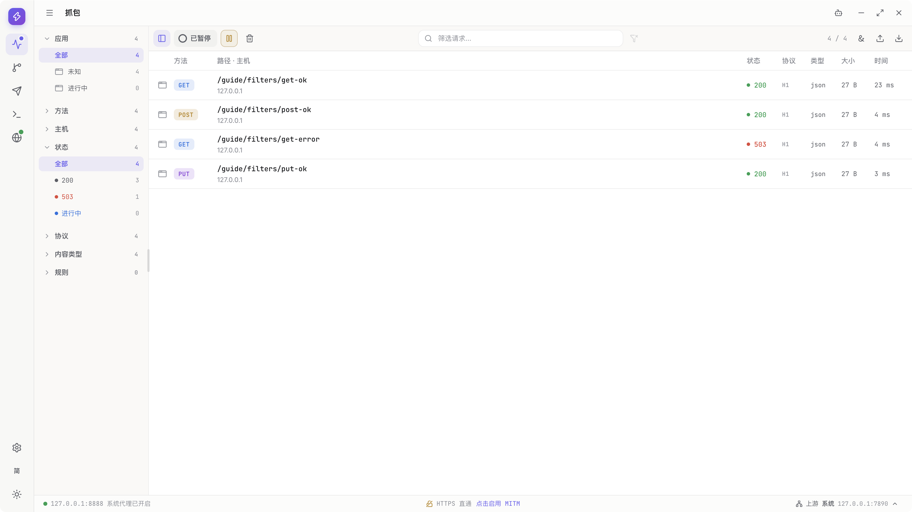

3. 让客户端再发一条明确的测试请求，检查客户端是否报 DNS 或连接错误。

   图中是Capture的`/guide/capture/orders`成功到达。连接失败另见[Composer自有端点关闭连接](diagnostics.md#walkthrough-diagnostics-lifecycle-04-send-failed)；它不是DNS故障，不混称错误类型。

   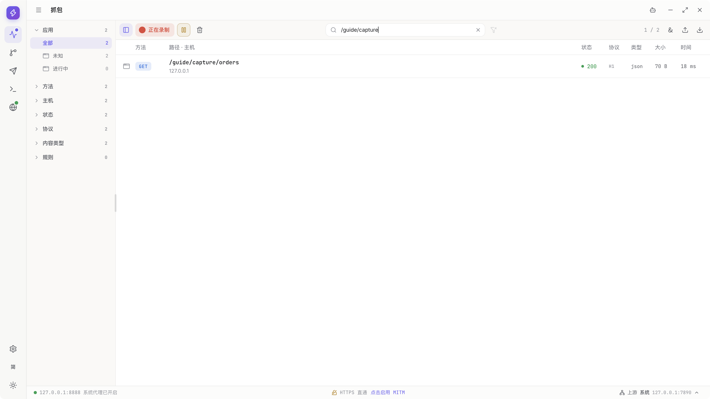

4. 核对客户端是否真的经过 `127.0.0.1:8888`；不遵循系统代理的客户端需要单独配置。

   **待配图**：没有各客户端代理配置窗口，不以 App 的监听状态替代客户端设置。

5. Windows AppContainer 应用检查 [loopback 访问](settings.md#app-containers)；其他网络栈不保证受 WinINet 控制。

   **待配图 / blocked**：需要 Windows AppContainer 环境，现有素材为 macOS。

6. 若请求由 Composer 发出，到 Composer 检查其响应；不在 Capture 出现是设计边界，不是 Recording 故障。本图来自 Composer 的 `/guide/composer`，不是上面的 orders。

   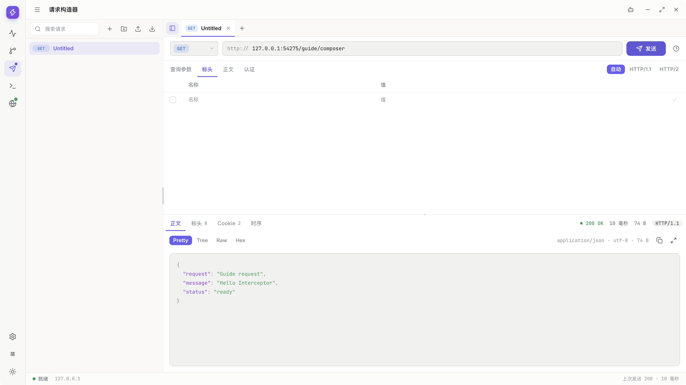

**判断**：先区分“没发请求”“没经过代理”“经过但没录制”“被筛选隐藏”。

## HTTPS 只显示 TLS tunnel 或客户端报证书错误

1. 能看到 tunnel，说明连接可能已经经过代理，不等于已经解密。

   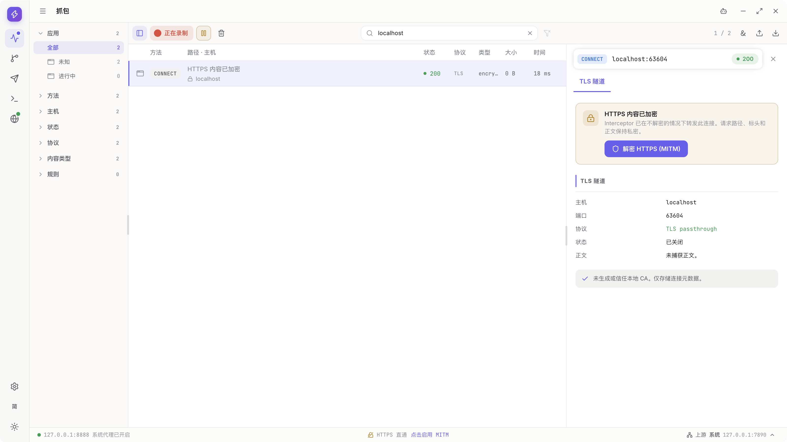

2. 检查 CA、信任和 HTTPS decryption 的实际状态。

   下图来自 Settings 的已有受信任 CA 检查，不是错误机器的信任修复；解密开关操作见 [Settings](settings.md#https-decryption)。

   

3. 检查目标是否在 TLS passthrough，或是否使用证书固定、独立信任库。

   

   **待配图**：客户端证书固定及独立信任库检查未录制。

4. 设置后让客户端新建连接；不要用仍在复用的旧连接判断新配置。

   下图引用 Capture 解密就绪后的新 `/playground/h2-json` 连接，不证明所有 TLS 错误都已解决。

   

5. 明确区分客户端不信任 Interceptor CA 与源站证书有问题。

   **待配图**：两种证书错误的诊断对照未录制，添加 localhost 测试例外也不是错误诊断本身。

**处理**：按 [HTTPS 解密](settings.md#https-decryption)或 [TLS passthrough](settings.md#tls-passthrough)选择适合目标的路径，不全局关闭证书校验。

## 规则不生效或影响范围过大

1. 检查是否仍是未应用草稿，规则是否开启，字段是否完整。

   以下为`Guide test header`的启用与Apply两个真实状态；字段不完整时的检查另见[规则树与校验](rules.md#walkthrough-rules-tree)。

   

   

2. 核对所有 matcher，因为一条规则里的条件是 AND。

   本图来自另一条 `Guide matchers`：POST 不满足 Method `GET`，不是 Header 示例突然失效。

   

3. 使用一笔新的外部代理请求，而不是已完成的历史请求或 Composer 请求。

   

4. 检查其他规则是否后写覆盖、模拟响应或阻断了流程。

   下图引用 `Guide first` / `Guide second` 排序实拍，`x-guide-order` 从后写的 `second` 变成 `first`；模拟响应和 Block 的独立例见 [Rules](rules.md#block-delay)。

   

   

5. 范围过大时先停用并 Apply，再缩小 Host、Path 或 Query 条件。

   本图是 `Guide test header` 实际停用；“先出错再缩小条件”未录制，不能称为故障修复演示。

   

6. Apply 冲突时先保留需要的编辑，显式 Reload 获取最新树后重新编辑；Reload 会放弃当前草稿，不盲目点它。

   

   按[冲突恢复](rules.md#walkthrough-rules-conflict)重新编辑最新版本并用新请求核对，不重复提交旧草稿。

**判断**：规则命中与真实 Header/Body 效果不同，结合[命中检查](rules.md#effects)确认。

## 请求一直等待

1. 检查 Capture 是否存在 pending breakpoint，必要时解除筛选。

   本图引用`Guide request breakpoint`的实际等待项；解除筛选可按[取消分组与清空搜索](capture.md#walkthrough-capture-filters-09-remove-status)操作，清空搜索不是Clear。

   

2. 查看队首与 Queued，不把排队状态当作网络加载动画。

   [队列实录](breakpoints.md#walkthrough-breakpoints-queue)同时挂起多条请求，展示队首、后续Queued、草稿与批量范围；不是把几次单项操作拼称同一队列。

3. 原样放行或丢弃不再需要的等待项；批量操作先确认队列或规则范围。

   下图分别属于两条不同请求，不是对同一已处理目标操作两次；[队列与批量实录](breakpoints.md#walkthrough-breakpoints-queue)另有完整范围检查。

   

   

4. 没有断点时检查目标、上游代理以及客户端自身的超时。

   

   **待配图**：目标超时与客户端自身错误未录制，此图只展示检查入口。

5. 客户端已经断开时重新查询，不向已消失的等待项反复提交。

   [管理器实录](breakpoints.md#walkthrough-breakpoints-manager)包含客户端实际取消后等待项消失。已经消失的项不要再提交旧内容；实操不通过内部API强行复用旧ID。

**关键说明**：人工断点没有固定超时自动继续；停用规则也不能代替核对已有等待项是否解决。

## 正文显示不全、不能格式化或无法预览

1. 区分只读预览上限、仍在接收、真实中断和解码失败。

   本图为损坏gzip的解码失败；[HTTP/2过程](capture.md#walkthrough-capture-http2)另行展示接收中、错误GOAWAY后的部分正文与新请求恢复，[大正文](capture.md#walkthrough-capture-body-limits)展示预览上限。不要把这些状态混成一个错误。

   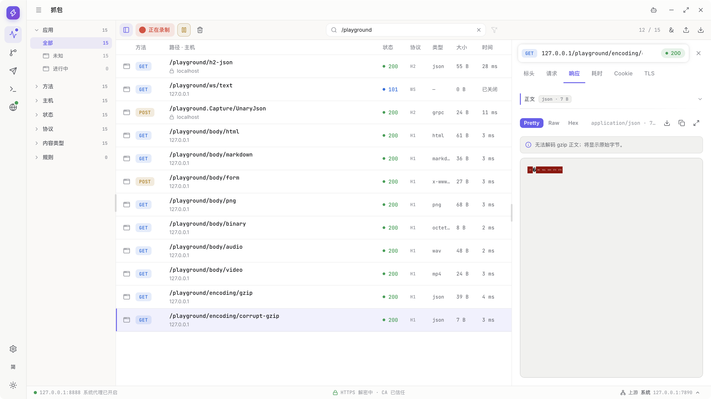

2. 文本预览超过 `2 MiB` 不表示捕获只保存了这些字节。

   [大正文实录](capture.md#walkthrough-capture-body-limits)展示超过2MiB的JSON预览限制与完整`guide-full-response.json`保存，不能把预览或Copy当成完整文件。

3. 完整正文在 `1–2 MiB` 时用手动 Format；截断或不完整正文不能格式化。

   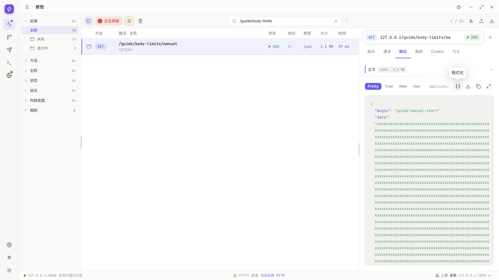

   同段还检查超限预览的操作状态；未完成正文不假装已经完整接收。

4. 图片、未知二进制、音视频可能只有元信息与保存入口。

   下图来自 Capture 的音频、视频元信息；超限图片与未知二进制的仅元信息分支仍待配图。

   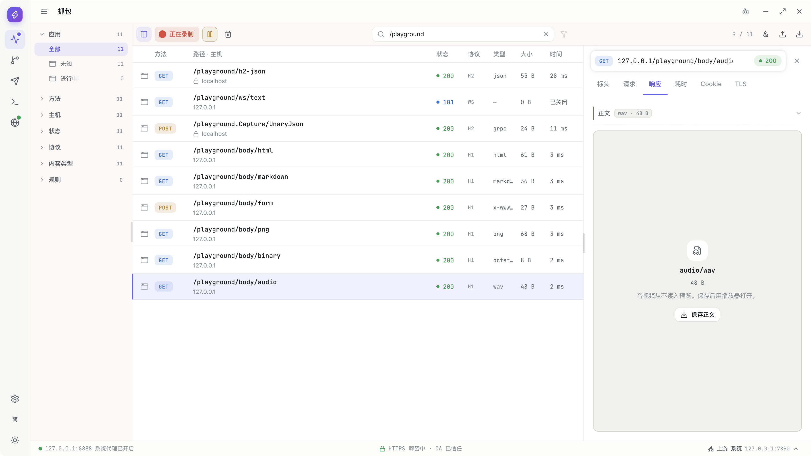

   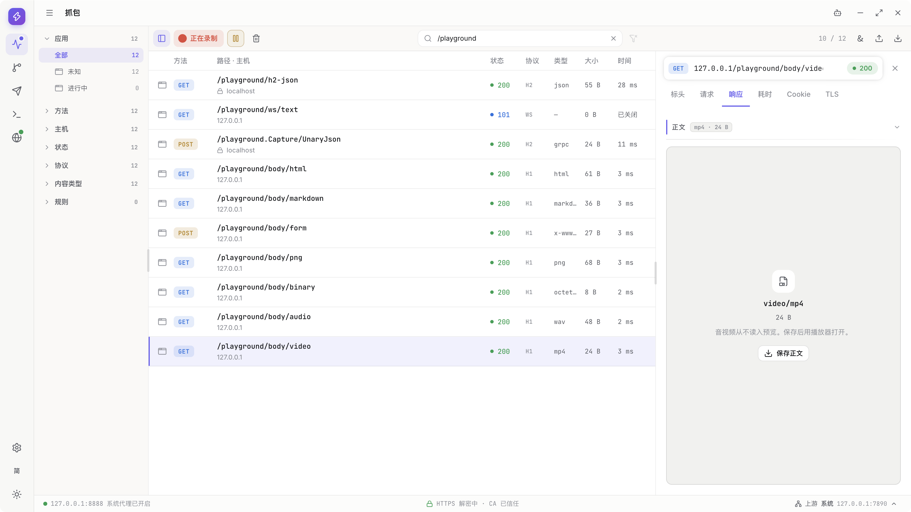

5. 使用 Save body 保存实际捕获的完整内容；不要用 Copy 拼凑大文件。

   下图引用 Transfer 保存小 JSON 为 `guide-response.json` 的真实原生面板与完成结果，只演示保存动作，不证明大文件边界。

   

   

6. 若数据从 HAR 导入，检查是否本来就被移除了正文或无法表示相关协议内容。

   [移除正文的HAR往返](settings.md#walkthrough-settings-privacy-export-18-strip-bodies)由同一流程先Export再Import，真实核对正文已移除；它不凭空补回HAR没有的协议数据。

**判断**：保存完整数据、读取预览和网络完整接收是不同事实，详见 [Capture](capture.md#选择正文查看方式)。

## 文件导入、导出或 Clear 失败

1. 核对使用的是 HAR、原生归档、Rules JSON 还是 Collection JSON 的正确入口。

   本图引用 Capture 的 Export 菜单；Rules/Collection 应到各自功能，完整原生面板见[文件格式步骤](transfer.md#config-files)。

   

2. 检查原生文件窗口是否仍在等待，是否被用户取消。

   下图是等待确认`guide-recording.har`的真实Save面板。[Agent的JSONL Save取消](agent.md#walkthrough-agent-tool-lifecycle-11-native-cancel-panel)和[MCP的Save取消](mcp.md#walkthrough-mcp-tool-lifecycle-11-native-panel)另有独立实录，文件名与操作不混用。

   

3. 查看错误、跳过项和任务终态，不把进度数字当作成功。

   这里引用 Rules 正常导入预览中的数量与启用警告检查位置；损坏文件错误、实际跳过项及任务失败仍待配图。

   

4. 确认文件存在、可读，目标位置可写，空间足够。

   **待配图**：系统文件权限和磁盘空间排查未录制。

5. Capture 文件任务或取消清理仍在进行时，等待完成后再 Clear。

   [运行中Archive取消](transfer.md#walkthrough-transfer-cancel)先等待取消清理结束，再Clear。不要强行调用禁用操作；看到任务开始也不等于完成。

6. 部分导入或身份变化按对应格式说明理解；重复导入不是覆盖更新。

   下图准确引用 `guide-rules.json` 的追加结果；它不是修复了非法文件。

   

**处理**：保留原文件，不手动删除正在使用的存储目录，也不因取消请求已经发出就强杀 App。

## 模型连接、对话或 Tool 失败

1. 连接测试失败：检查 Base URL、Model ID、凭据、服务可达性和服务商余额/权限。

   下图仅是 Agent 本地演示的实际字段位置，不是失败结果；收费服务凭据、余额和授权检查待配图 / blocked。

   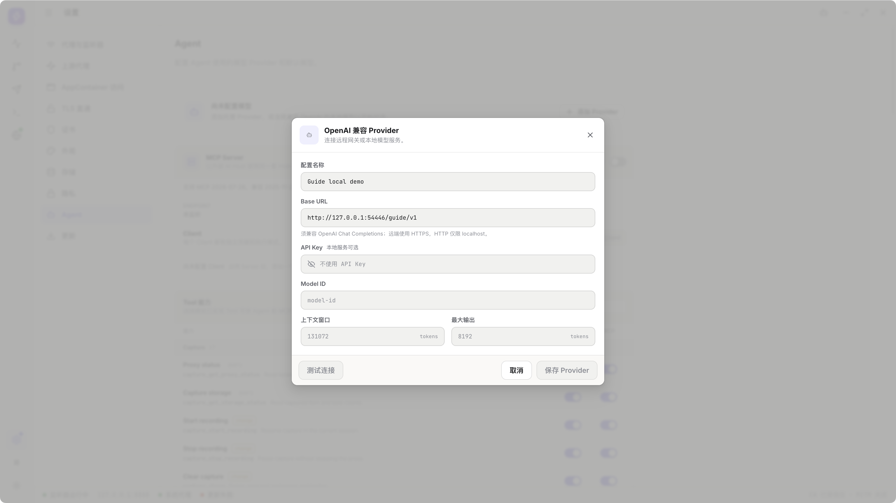

   

2. 修改配置后无法保存：重新 Test，旧的验证结果不能保存另一份配置。

   现有实录把`Guide model two`的Model ID改为`guide-two-edited`，先确认Save失效，再重新Test并保存。下列三步各有真实画面；它们不冒充Base URL或凭据变更。

   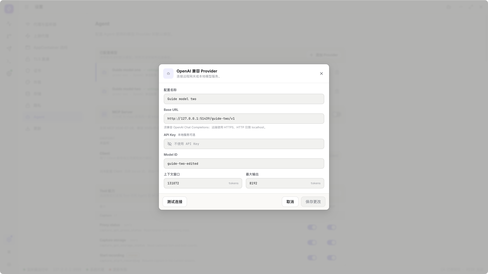

   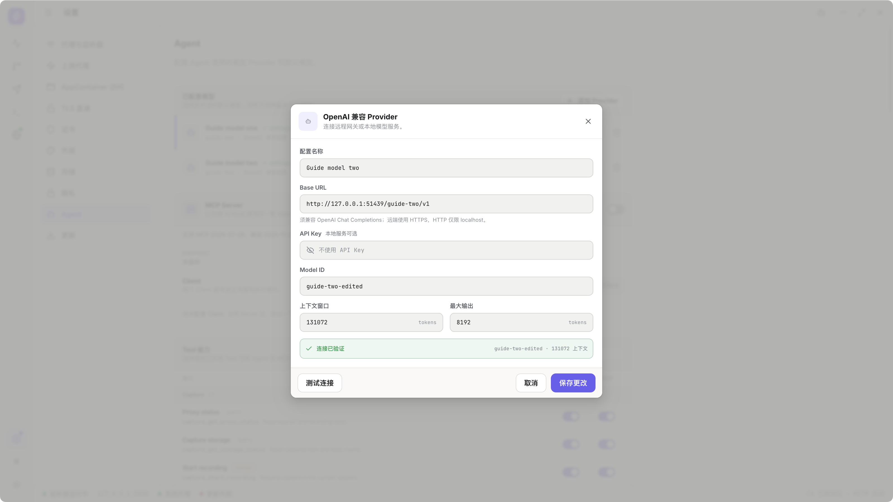

   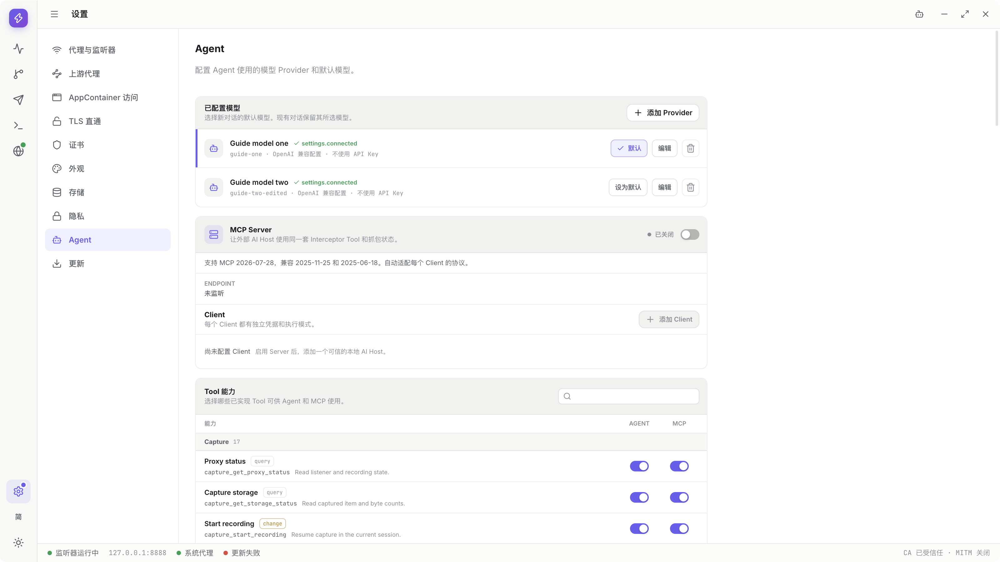

3. 对话停在等待：检查 App Tool 审批、系统授权或文件窗口。

   这里是`Pause recording after asking me.`的正常Ask等待，不是模型卡死；[Agent导出](agent.md#walkthrough-agent-tool-lifecycle-10-export-request)另行展示审批后真实Save的等待、取消与保存。Windows原生授权仍缺相应平台。

   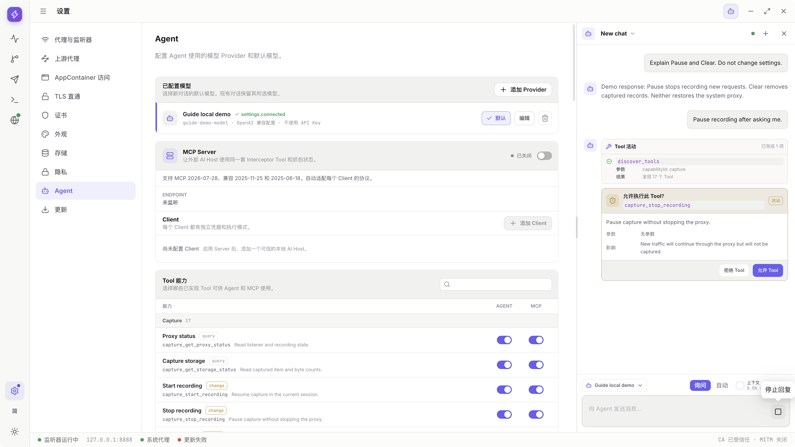

4. Tool 不可用：检查正确的 Agent 列，而不是 MCP 列；清空搜索查看完整开关。

   下图定位Agent的独立开关。[完整只读实录](tool-permissions.md#walkthrough-tool-permissions-readonly)另有清空搜索、逐项配置、实际拒绝调用和记录保留，重启后继续核对。

   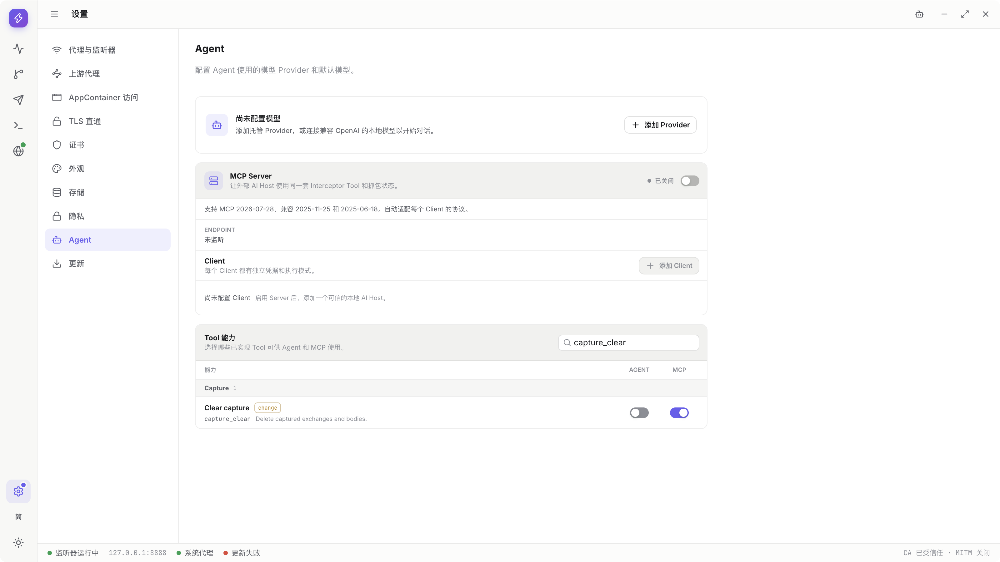

5. 已发送请求或写配置的结果不确定：先回产品查状态，再决定 Retry。

   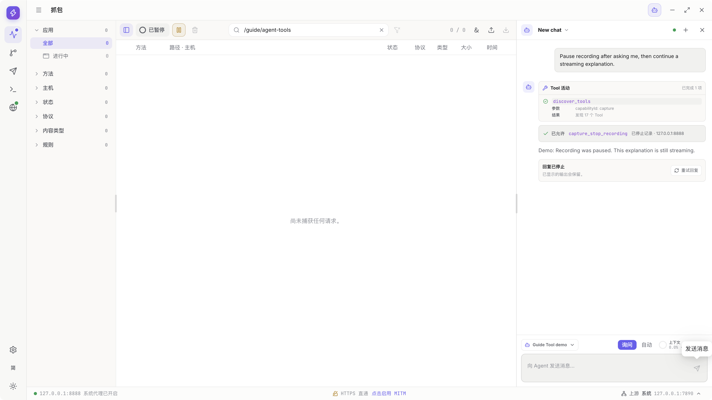

   [完整Tool实录](agent.md#walkthrough-agent-tool-lifecycle)随后重新限定只读查询，再区分导出任务开始和完成；重试前先查实际状态。

6. 历史中的请求 ID 失效：重新查询当前 Capture，不猜新 ID。

   **待配图**：Core 重启后历史 ID 失效与重新查询未录制。

**关键说明**：在 VS Code 登录 GitHub 不等于内置模型已配置；Stop 也不撤销已经完成的副作用。

## 外部 Host 连不上 MCP

1. 确认 App 和 Server 都运行，endpoint 不是 `8888`。

   本图来自 MCP 的实际 `http://127.0.0.1:65443/mcp`；`65443` 只是该次录制端口。运行期 `EADDRINUSE` 与重启 `endpoint-conflict` 的独立操作见 [MCP](mcp.md#endpoint)。

   

2. 核对 Host 能从本机连接 loopback，不是从云端发起访问。

   **待配图 / blocked**：本次只用本地 SDK，没有实际商业/云端 Host 的部署与可达性页面。

3. 检查复制的是当前 Client 的配置；轮换凭据或更换 endpoint 后，Host 需要更新。

   下面是`Guide local client`轮换后重连。[新endpoint实录](mcp.md#walkthrough-mcp-endpoint-reconnect)另有更换地址、复制新配置及SDK实际查询；外部商业Host配置仍缺自己的环境，不用SDK画面代替。

   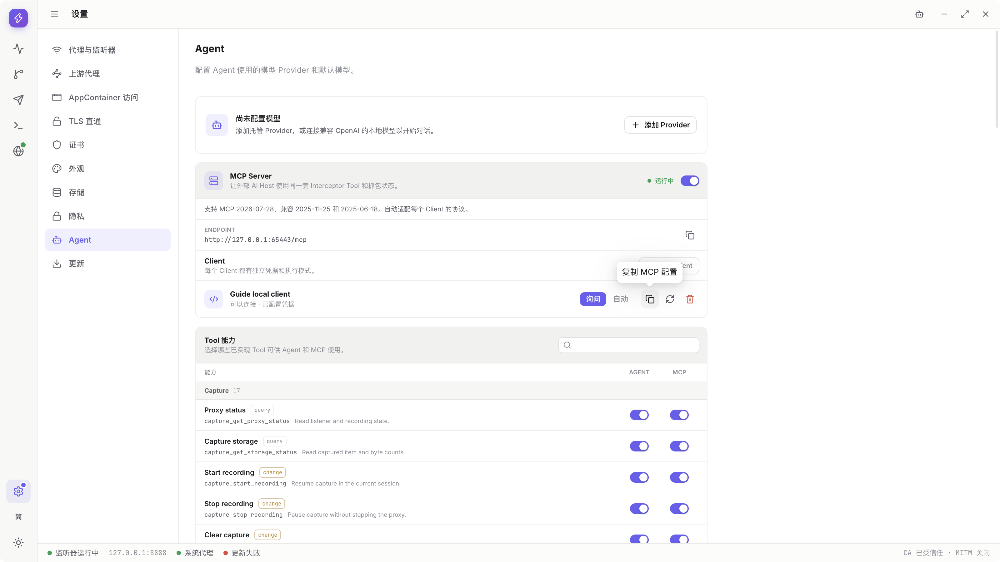

4. 检查 Host 支持的 transport 和协议，不把 stdio 或旧式 SSE 配置套过来。

   下图展示 App 的协议说明入口；外部 Host 的 transport 配置仍待配图。

   

5. 能连接但没有 Tool 时，检查 MCP 列授权和 Host 的工具发现状态。

   下图定位MCP列。实际禁用后的调用拒绝与重启后的仅query发现见[只读权限](tool-permissions.md#walkthrough-tool-permissions-readonly)，不把开关图片冒充外部Host的空列表。

   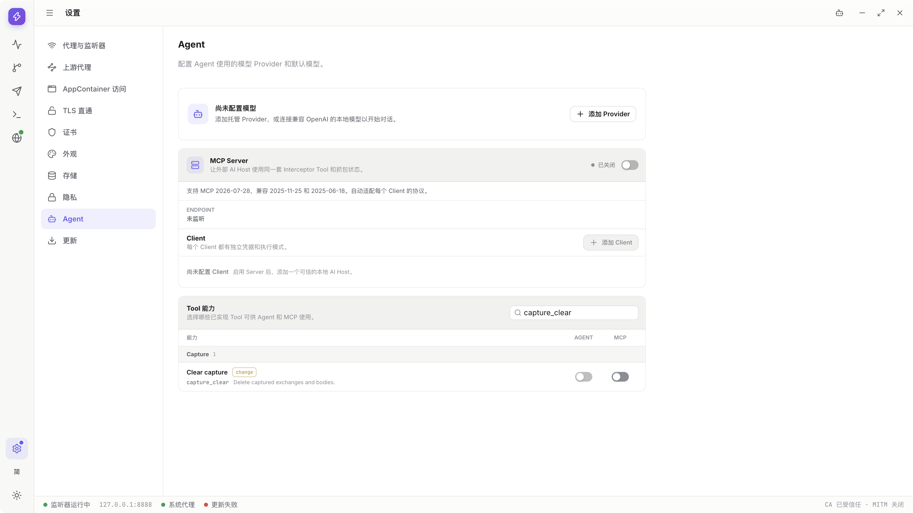

6. 有修改请求但无结果时，回 App 检查审批和原生窗口。

   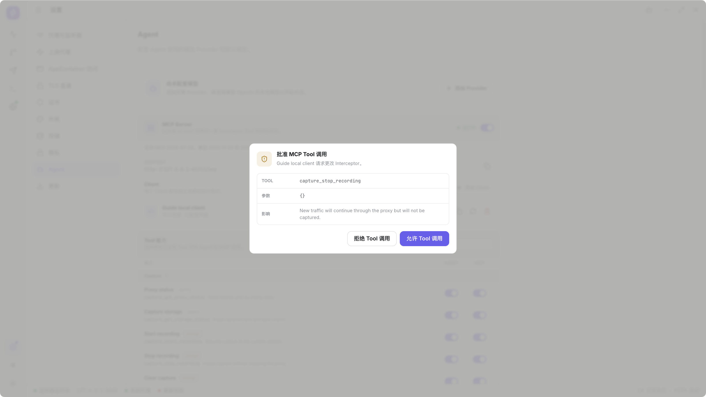

   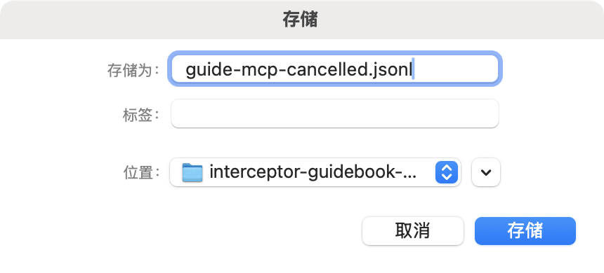

   本地SDK的Save取消和再次保存已有独立步骤；Windows UAC仍需要相应平台，不混称。

**处理**：按 [MCP](mcp.md)逐层区分网络、认证、协议、权限与业务错误；不把凭据公开到工单。

## 无法检查或下载更新

1. 确认运行的是支持更新的打包 App，而不是源码开发进程。

   

2. 检查实际状态是否为 failed，而不是把失败解读成 up-to-date。

   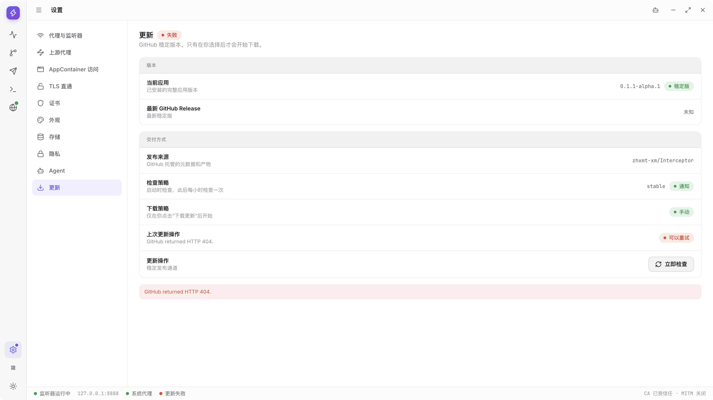

   这是实际失败，不是`up-to-date`，也没有伪造另一种结果作对照。

3. 当前更新源需要匿名可读的合适稳定版本；私有仓库、仅有预发布或网络受限都可能影响结果。

   **待配图 / blocked**：缺可匿名访问的受支持稳定更新来源，未录源状态排查。

4. 从可信 Release 页按实际附件获取适合系统与架构的产物，不把源码包当安装器。

   **待配图 / blocked**：没有实际 Release 下载操作，且私有仓库需要访问权限。

5. 下载或校验失败时不运行临时文件；解决原因后用产品入口重试。

   **待配图 / blocked**：下载失败、校验失败及恢复重试未录制，不能用版本页代替。

**关键说明**：不需要向 App 输入 GitHub PAT；App 没有这样的更新认证功能。

## 退出后网络异常或系统代理尚未恢复

1. 先确认 App 是最小化、仍在收尾，还是确实已退出；不要同时启动多个实例。

   [窗口控件](workspace.md#walkthrough-workspace-window-controls)展示真实最大化/还原与最小化，窗口状态另行核对；[持等待正常Close](breakpoints.md#walkthrough-breakpoints-mixed-queues)验证实际取消与进程退出。关闭Agent面板仍不是退出，不用桌面图片冒充App的结束状态。

2. 若上一个实例异常退出，确认它已经结束后再正常启动 Interceptor，读取正式恢复状态。

   **待配图 / blocked**：没有异常退出后的恢复录制，不故意强杀来制造素材。

3. 在 System proxy 使用 Restore，或在恢复完成后正常关闭。

   

   [代理控制实录](settings.md#walkthrough-settings-proxy-routing)分别检查Restore、Recording和重新Enable，不把暂停录制当作恢复系统代理。

4. 如果会话期间别的软件修改了代理，核对双方当前配置；不要要求 Interceptor 覆盖对方的新设置。

   **待配图 / blocked**：缺受控的双写入者系统代理环境，不修改他人的网络设置拍图。

5. 仍不能恢复时，记录当前状态、操作错误、系统和 App 版本，交给有权限的人按事先记录的网络配置处理。

   **待配图**：没有实际代理恢复故障及管理员处理过程，普通成功 Diagnostics 不能冒充故障日志。

6. 不盲目清空所有代理、删除 journal、关闭防护或反复强杀；这些操作可能丢失恢复所需信息。

   **待配图说明**：这是安全约束，不提供危险操作示范；完整正规恢复仍缺前述步骤图。

**预期结果**：恢复已明确接管的设置，保留其他软件的新配置，不用“网络暂时能访问”掩盖错误的系统状态。

## 准备可复现的反馈

- 记录 App 版本、操作系统、架构与运行来源。
- 用自己的无凭据测试数据写清准备、操作、预期和实际结果。
- 附必要的脱敏 Diagnostics，按问题选择最小 HAR 或归档。
- 说明是否启用了 Rules、Breakpoints、HTTPS 解密及上游代理。
- 排除 API Key、Cookie、Client 配置、CA 私钥和个人流量。

反馈入口：[GitHub Issues](https://github.com/zhxmt-xm/Interceptor/issues)。当前私有仓库需要对应访问权限，官网出现链接不代表已经匿名可用。
