# 常见问题与恢复

[教程目录](../README.md) · [Diagnostics](diagnostics.md) · [Settings](settings.md)

按症状检查对应设置。示例地址、请求名和端口需要替换成自己的数据，不要直接清空记录或重装 App。

## Capture 没有请求

1. 确认 App 启动完成，没有未处理的代理就绪提示。检查红框 1 的录制控件是否显示 Recording；若是 Paused，点击它恢复录制。恢复后只记录新流量，不补录暂停期间的请求。

   

2. 清空 Keyword，再分别取消不需要的分组筛选，不要使用 Capture 的 Clear。红框 1 是已经清空的搜索框，不是清空按钮；Method 的 `GET`、`POST` 和 Status 的 `200` 仍选中，所以图中显示 `4 of 5`。Clear search 只移除关键词，不会取消分组或改变 Recording 状态。

   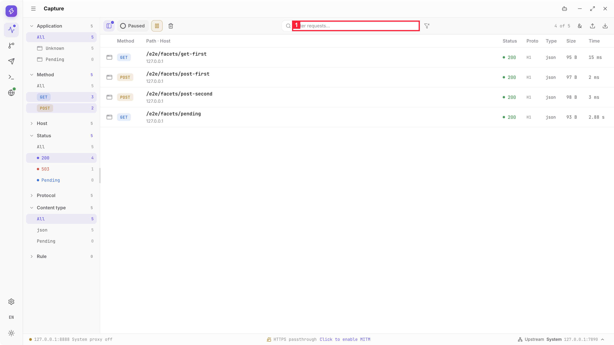

   继续取消 Status 的 `200`，再取消 Method 的 `POST` 和 `GET`，检查完整列表；不要把被筛选隐藏的请求当作没有捕获，也不要为显示它们而删除录制。

3. 让客户端经代理发送一条容易识别的测试请求。图中的新请求是 POST `http://127.0.0.1:59696/playground/body/json`，使用 `Content-Type: application/json` 和正文 `{"ready":true}`；红框 1 为进入 Capture 的 `200` 记录行。把地址替换为自己的服务，不使用示例端口寻找不存在的服务。

   

   若没有记录，先读客户端的 DNS、连接或 TLS 错误，再到 [Diagnostics](diagnostics.md#records)按同一时间查找相关操作。连接关闭不等于 DNS 失败；一条成功请求也不能说明其他目标已经恢复。

4. 核对客户端是否真的经过 `127.0.0.1:8888`；不遵循系统代理的客户端需要单独配置。

5. Windows AppContainer 应用检查 [loopback 访问](settings.md#app-containers)；其他网络栈不保证受 WinINet 控制。

6. 若请求由 Composer 发出，到 Composer 自身的响应区查看结果。图中是另一条 GET `http://127.0.0.1:58053/e2e/composer/response-section-collapse`，返回 `200`，JSON 包含 `message: response-sections` 和 `items`。Composer 直接连接目标，不受 Recording、代理 Rules 或 Breakpoints 控制；没有出现在 Capture 不等于录制故障。

   

先区分请求没有发出、没有经过代理、没有录制和被筛选隐藏，再修改对应设置。

## HTTPS 只显示 TLS tunnel 或客户端报证书错误

1. 选中红框 1 的 CONNECT，图中目标为 `localhost:52139`。TLS tunnel 显示 HTTPS content is encrypted：连接经过代理，但路径、Header 和正文没有解密。即使显示 MITM active，命中透传名单的连接仍会透传。点击红框 2 的 View passthrough pattern 可定位对应配置，不能把 `0 B` 当作源站返回了空正文。

   

2. 打开 Settings → Certificates，分别检查 CA 的 Status、Trust status 和 Decrypt HTTPS (MITM)。若像下图这样，CA 已 Generated、Local machine 已 Trusted，但解密开关仍关闭，也无法检查 HTTPS 正文；信任 CA 不会自动启用解密。需要检查时，按 [HTTPS 解密](settings.md#https-decryption)完成信任和启用，不为排查而随意重新生成 CA。

   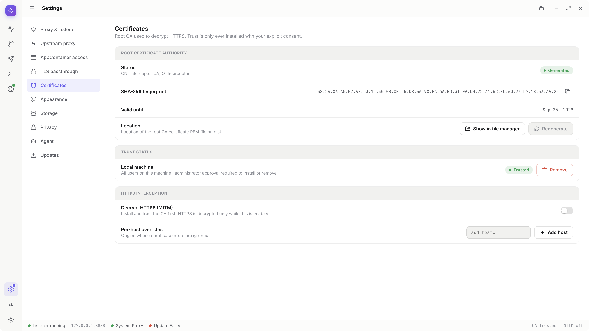

3. 在 Settings → TLS passthrough 核对命中的主机。图中的 `localhost` 条目使该主机透传；红框 1 是这条配置的删除按钮。只有在目标允许 HTTPS 检查、且你确实希望恢复解密时才移除它，不删除其他人的配置。使用证书固定或独立信任库的客户端可能仍需要透传；透传仍经过代理和已配置的上游。

   

4. 调整配置后，让客户端新建连接，不用仍在复用的旧连接判断结果。此例移除 `localhost` 透传条目后，重新 GET `https://localhost:52139/e2e/passthrough/http`，再选择新记录，打开红框 1 的 Response。图中是 `200`、`42 B` 的 HTTP/1.1 响应，完整 JSON 的 `mode` 为 `https-h1`、`secure` 为 `true`，不是 HTTP/2。

   

   原来的 CONNECT 不会变成这条 GET，也不会补出历史正文；不要只看旧记录等待它更新。

5. 区分客户端不信任 Interceptor CA 与源站自身的证书错误。前者需要检查客户端信任，后者应先修复源站证书。上面的自有 `localhost` 示例配置了单独的源站证书例外，不代表其他目标的证书问题也已解决；需要例外时只限定自己控制的具体主机。

按 [HTTPS 解密](settings.md#https-decryption)或 [TLS passthrough](settings.md#tls-passthrough)选择适合目标的路径，不全局关闭证书校验。

## 规则不生效或影响范围过大

1. 打开 Rules，检查字段是否完整、规则是否开启、底部是否仍显示 Unsaved changes。图中 `E2E action variants` 的红框 1 是启用开关；即使已显示 Enabled，也需要保存后才会影响后续请求。字段缺失时按[规则校验](rules.md#walkthrough-rules-tree-10-invalid)补齐，不能直接启用。

   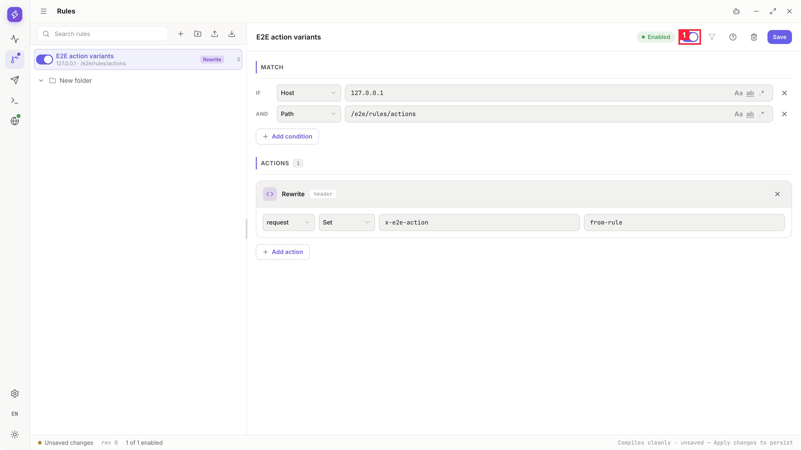

2. 点击右上角 Save，等待红框 1 的状态变为 Rule set applied，再发送新请求。编辑器里看得到修改，不等于它已经生效。

   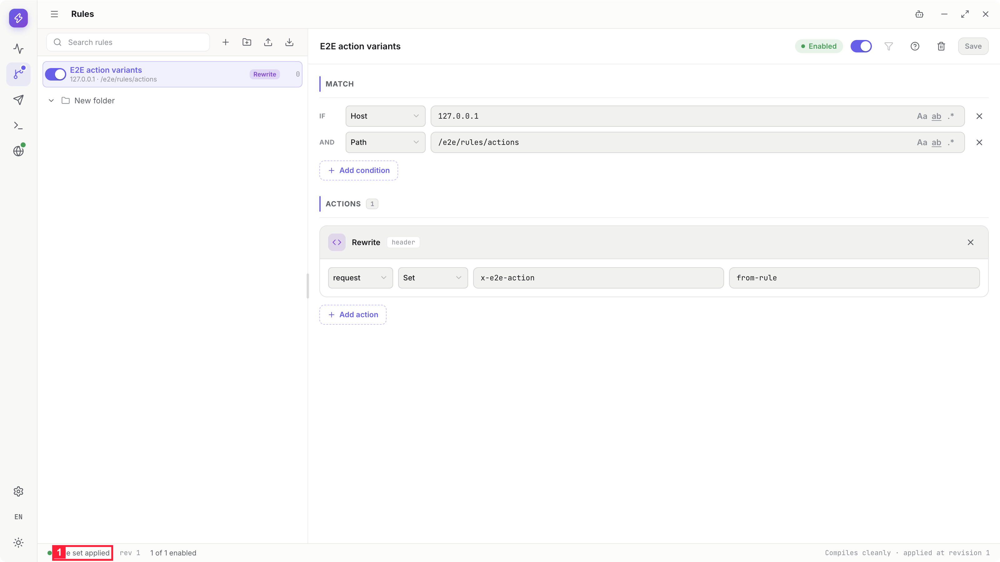

3. 核对全部匹配条件：一条规则内的条件是 AND。另一条 `E2E hierarchy rule` 要求 Method 为 `GET`；请求 `http://127.0.0.1:53161/e2e/rules/all-conditions?case=and` 时，改用 `POST` 就不满足条件。选择这条新 POST，检查红框 1 的 Response Headers：即使响应为 `200`，也没有规则的 `x-rules-e2e: active`。详见[匹配条件](rules.md#matchers)。

   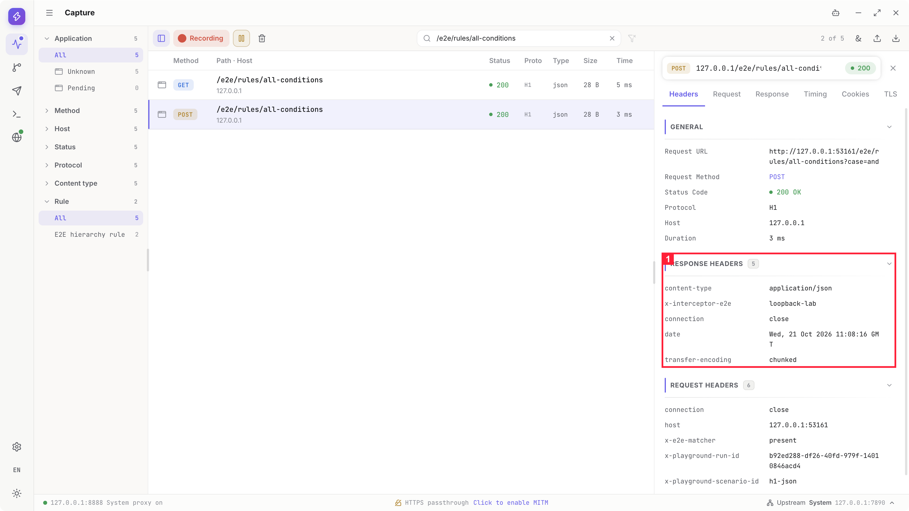

4. 用外部客户端经代理发送一笔新请求，不使用已完成的历史记录或 Composer 请求。对前面的 `E2E action variants`，示例为 GET `http://127.0.0.1:62029/e2e/rules/actions/request-set`，原始 Header 是 `x-e2e-action: original`。选中新记录后检查红框 1 的 Request Headers：最终值应为 `from-rule`，原值 `original` 带删除线和 Rule replaced，不能只看命中计数。

   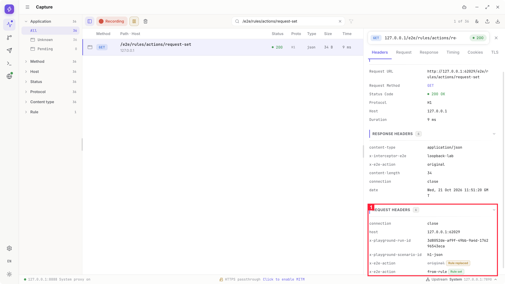

5. 检查后续规则是否覆盖前面的值，或通过模拟响应、Block 提前结束转发。以下两张图的红框 1 都是 Request Headers：`/e2e/rules/priority/before-drag` 最终得到 `x-rules-e2e: root`，因为 `E2E root priority` 后执行，覆盖了 `E2E hierarchy rule` 写入的 `nested`。

   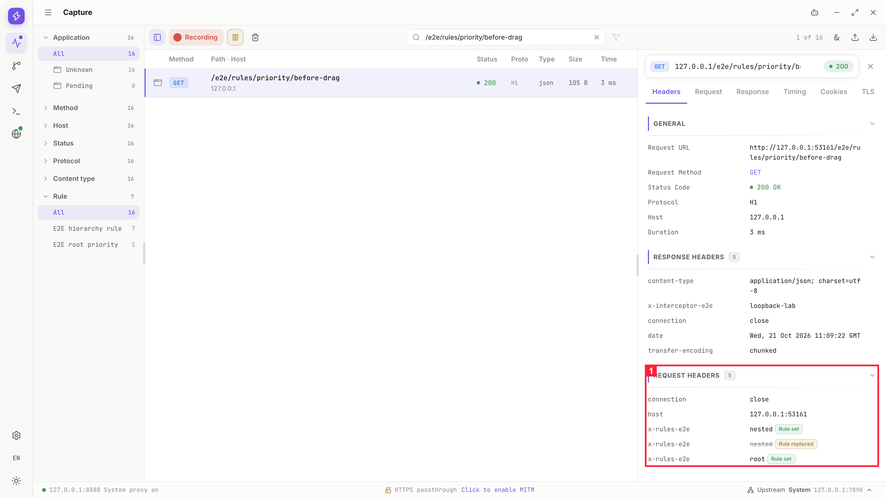

   把 `E2E root priority` 拖到 `E2E hierarchy rule` 之前并 Save，再发送 `/e2e/rules/priority/after-drag`。这条新请求的最终值变为 `nested`，历史请求不会随之改写。按[规则顺序](rules.md#order)核对实际顺序与字段来源。

   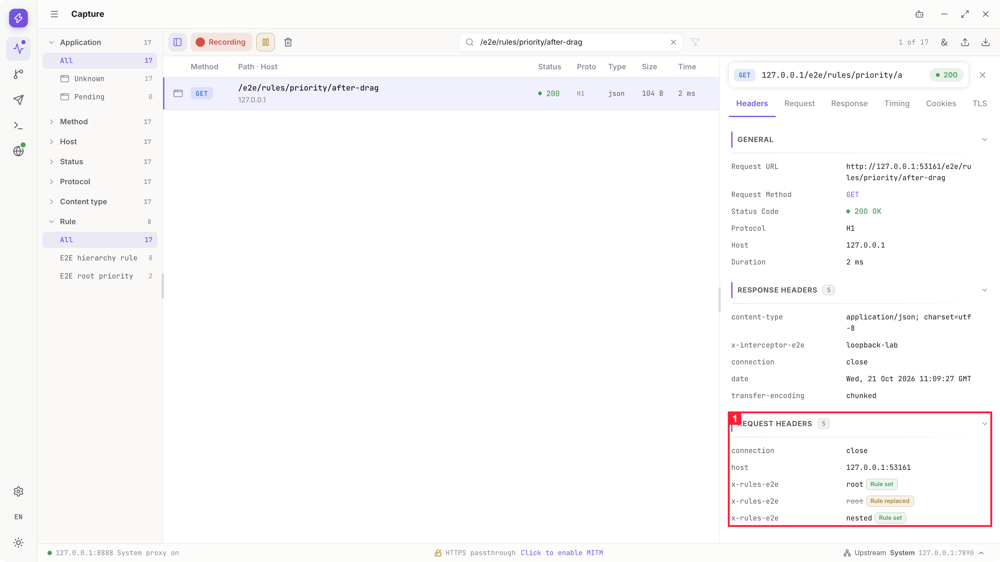

6. 范围过大时，先关闭目标规则并 Save。确认顶部显示 Disabled、红框 1 显示 Rule set applied，再缩小 Host、Path 或 Query，检查后重新启用和保存。图中的 `E2E action variants` 已配置响应 Header 和 Body；停用整条规则会停止这些动作，而不是仅关闭一个字段。

   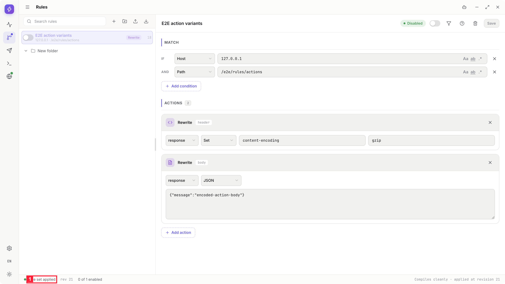

   最后一条规则也应保留并停用、Save；删除最后一条后，空树没有可用的 Save，不能靠空白列表确认停止生效。已有断点等待项仍需单独处理。

7. 出现 Changed elsewhere · draft kept 或保存冲突时，先记下要保留的编辑，再点击红框 1 的 Reload。图中的本地 `MCP local draft` 与 `unapplied-local-value` 会被放弃，重新读取已经保存的规则，不会自动合并。

   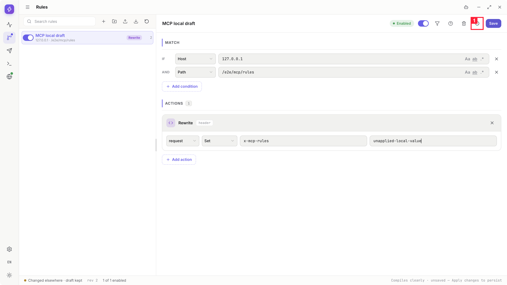

   按[冲突恢复](rules.md#walkthrough-rules-conflict)检查最新名称、值和 revision，在最新树上重新编辑、Save，再用新请求核对；不要反复提交旧草稿覆盖其他调用方的修改。

规则命中计数与实际 Header、Body 效果分别检查，不能互相代替。正文改写还需核对 [Original/Final](rules.md#body-status)。

## 请求一直等待

1. 在 Capture 顶部打开断点管理器，检查红框 1 中的等待项；必要时[取消筛选和清空搜索](capture.md#walkthrough-capture-filters-13-clear-search)，不要 Clear 记录。图中两个 POST 和一个 PUT 都在同一 HTTP 队列内，第一条为 Head，后两条为 Queued。

   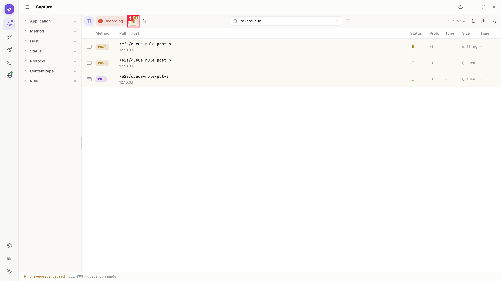

2. 选择红框 1 的 POST `/e2e/queue-rule-post-b` 查看详情。Queued 是等待前面的请求处理，详情只读，不是普通网络加载动画，也不能在这里编辑另一个 Head。该队列示例服务为 `http://127.0.0.1:57756`，检查自己的客户端是否仍在等待。

   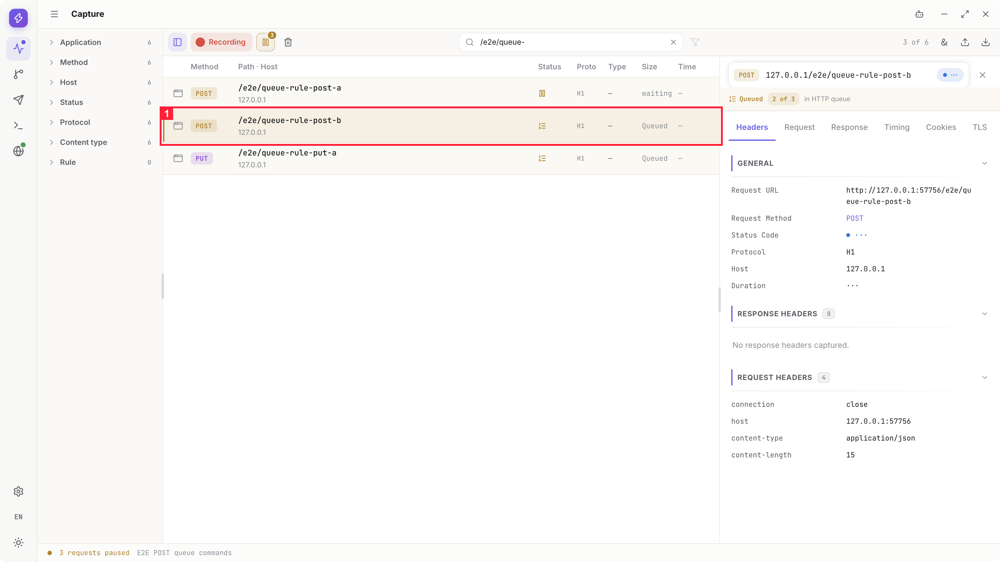

3. 只处理一条时，先选中当前 Head 并确认请求与阶段。下面的单条示例为 POST `http://127.0.0.1:65282/e2e/queue-stepping-a`：点击红框 1 的 Continue 原样放行，不提交替换正文草稿；若不再需要这条请求，使用左下角 Drop 终止它，而不是期待成功响应。操作后重新查看当前等待项，不向已解决的目标再次提交。

   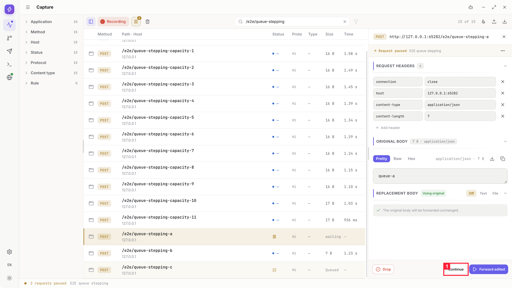

4. 需要批量处理时，先检查 Queue actions 的范围。回到 POST/PUT 队列示例：红框 1 的 Continue all from this rule 只放行当前 Rule 的等待项；红框 2 的 Continue all 放行当前 HTTP 队列；红框 3 的 Drop all 丢弃当前 HTTP 队列。它们不是对当前选中一条执行同一个操作，也不包含未来请求。

   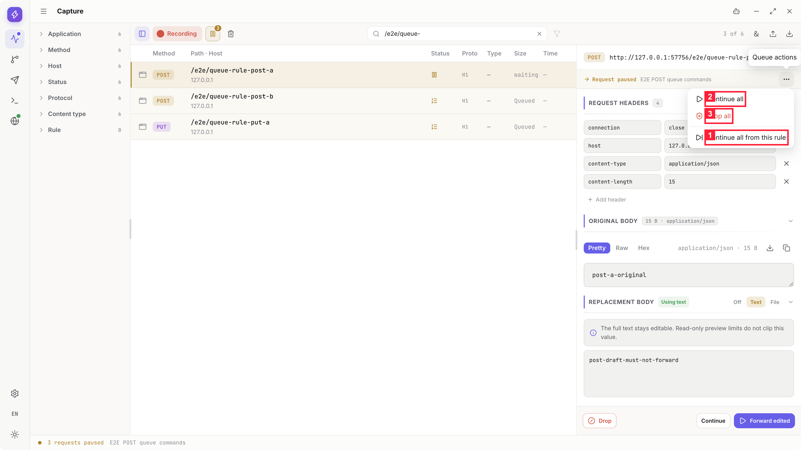

5. 若只放行 POST Rule，原有 PUT 会继续等待；图中另一条 PUT `/e2e/queue-drop-put-b` 也已排到它后面。确认这两条 PUT 都不需要后，再用红框 1 的 Drop all 丢弃当前 HTTP 队列；检查等待项已移除以及客户端的结束或错误结果。不要把这个批量丢弃当作前面单条 Continue 的结果。

   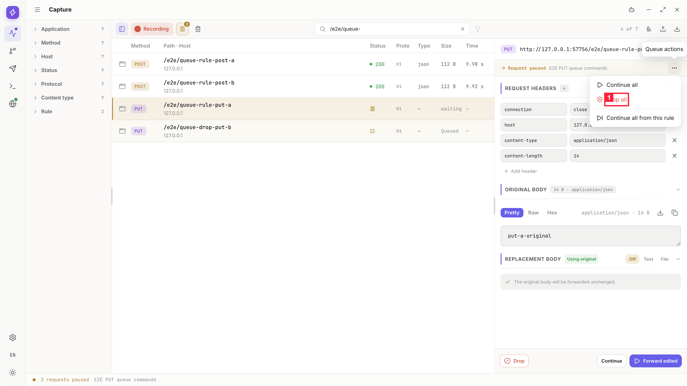

6. 没有断点时，检查目标、上游代理和客户端自身的超时。打开 Settings → Upstream proxy，先看 Current route；图中当前为 System，不是尚未 Apply 的草稿。核对自己的上游服务是否可达，不为排查盲目应用一个不存在的代理。

   

7. 客户端已经断开时，重新查看队列，不向已消失的等待项反复提交旧编辑。需要继续调试时，让客户端重新发送请求，再选择新等待项；不要把旧草稿套到下一条请求上。

人工断点没有固定超时自动继续。HTTP 请求和响应共用 HTTP 队列，已建立的 WebSocket 连接有各自的消息队列；不要把 HTTP 批量范围套到 WebSocket。停用规则不等于解决已有等待项。

## 正文显示不全、不能格式化或无法预览

1. 先读正文区域的提示，区分预览上限、仍在接收、网络中断和解码失败。图中 GET `/e2e/rules/actions/header-only` 的规则只把响应 Header 改为 `Content-Encoding: gzip`，正文仍是未压缩的 `{"message":"original-action-body"}`，因此显示 `Failed to decode gzip body; showing raw bytes.`。红框 1 的 Copy 可复制当前显示的文本，但不会修复编码。

   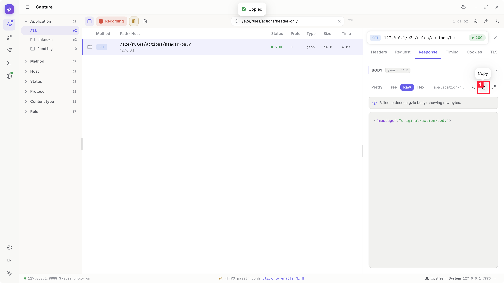

   这与收到损坏的 gzip 压缩流原因不同，都应先核对 Content-Encoding 与实际字节。[HTTP/2 中断](capture.md#walkthrough-capture-http2)和[预览上限](capture.md#walkthrough-capture-body-limits)另行检查，不能仅凭正文不全认定解码失败。

2. 文本预览最多显示 `2 MiB`；只看到这部分不表示捕获只保存了这些字节。

   正文超过 `2 MiB` 时，预览和 Copy 可能不完整。需要完整数据时，按[大正文保存](capture.md#walkthrough-capture-body-limits)使用 Save body。

3. 可格式化的完整正文超过 `1 MiB`、但未超过 `2 MiB` 预览范围时，使用手动 Format。图中 GET `/e2e/body-limits/manual` 的 JSON 约 `1.25 MiB`；点击红框 1 的 Format 为显示内容添加缩进和换行，不重发请求，也不改写已捕获的响应。

   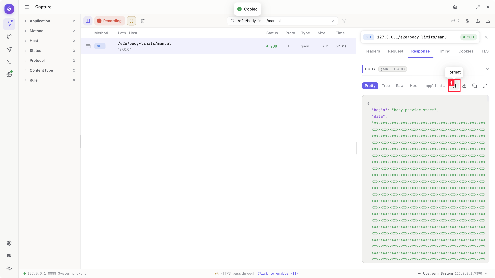

   截断预览或未完整收到的正文不能格式化；检查提示和按钮状态，不把折行或视觉缩进当作接收完成。

4. 按内容类型检查可用视图；图片和未知二进制也要以实际提供的预览、Hex 或保存入口为准。音频示例选中 GET `/playground/body/audio` 并打开 Response，元信息为 `audio/wav`、`48 B`。需要文件时，点击红框 1 的 Save body，在保存窗口选择位置并使用文件名 `body-audio.wav`。App 不加载音频播放器，也不解析时长或 codec。

   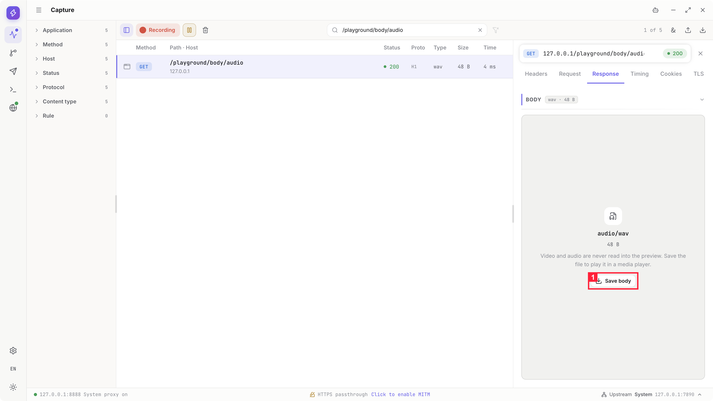

   视频示例选中 GET `/playground/body/video` 的 Response，元信息为 `video/mp4`、`24 B`。下图红框 1 的 Save body 保存这条响应的原始字节，可在保存窗口使用 `body-video.mp4`；它不是播放按钮。没有播放器不等于没有捕获，MIME 和大小也不能证明文件可以播放。

   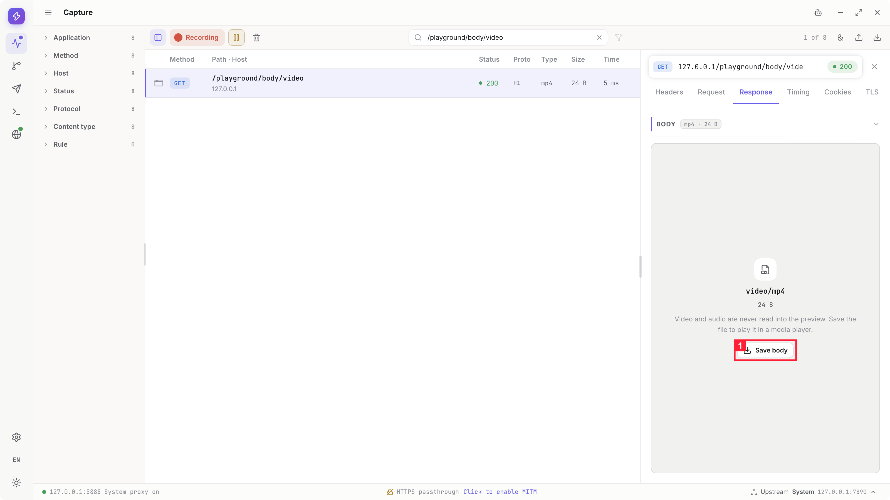

5. 需要完整文件时使用正文工具栏的 Save body，不用 Copy 拼凑大文件。这里保存的是另一条 GET `/e2e/body-preview/four-byte` 的响应，类型为 `text/javascript; charset=utf-8`，共 `2097166` 字节（`2 MiB + 14`），不是前面的 `1.25 MiB` JSON。在原生 Save body 窗口选择位置，文件名为 `utf8-full-body.txt`，然后点击 Save。

   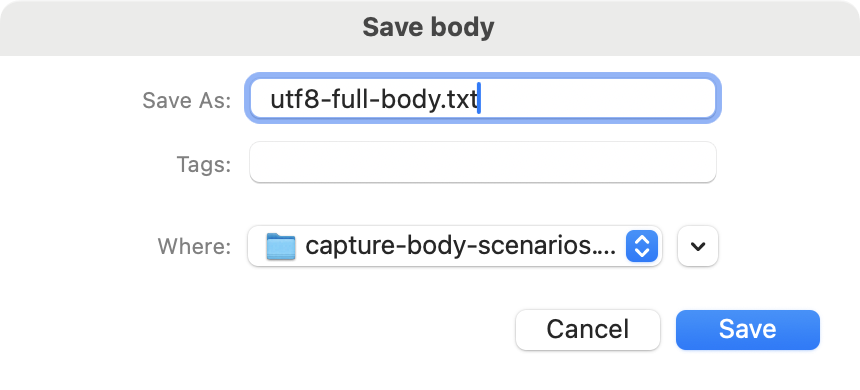

   保存后可以关闭 Inspector 返回列表；下图仍保留这条 GET，并不是文件完成状态。到所选位置检查实际文件：本例应为 `2097166` 字节，末尾保留完整的 `🙂after-preview`，不能只得到预览内容。Save body 保存已捕获的字节，不能补回网络中断时从未收到的数据。

   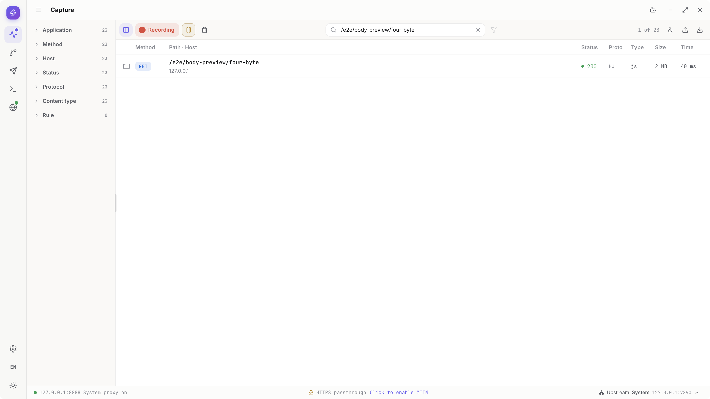

6. 若数据从 HAR 导入，检查是否本来就被移除了正文或无法表示相关协议内容。

   按[导出时移除正文](settings.md#walkthrough-settings-privacy-export-18-strip-bodies)检查导出选项与原文件。导入不会补回已移除的正文，也不能补回 HAR 没有保存的协议数据。

保存已捕获的数据、读取预览和网络完整接收是不同状态，详见 [Capture](capture.md#选择正文查看方式)。

## 文件导入、导出或 Clear 失败

1. 先核对文件格式和入口。Capture 的 Export 菜单中，红框 1 为 Export HAR；原生归档使用 Export Archive。Rules JSON 到 Rules 工具栏操作，Collection JSON 到 Composer 操作，不互换格式或入口。

   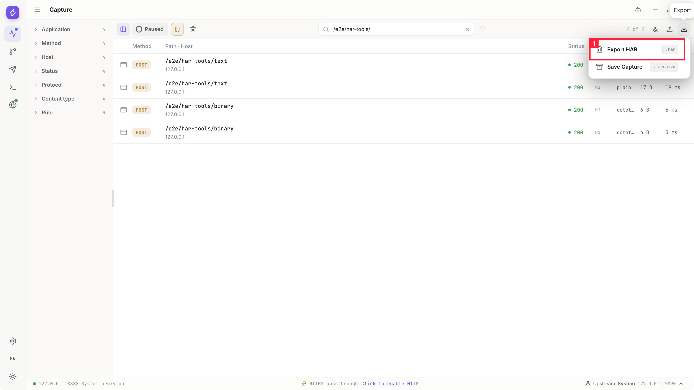

2. 检查原生文件窗口是否还在等待，或者已经被取消。这里的 HAR 保存名为 `ui.har`；选择位置并点击 Save 才会开始保存，Cancel 不会生成文件。导入时也需在正确的 Open 窗口选择文件并确认，不能仅点击 Import 后就等待数据出现。

   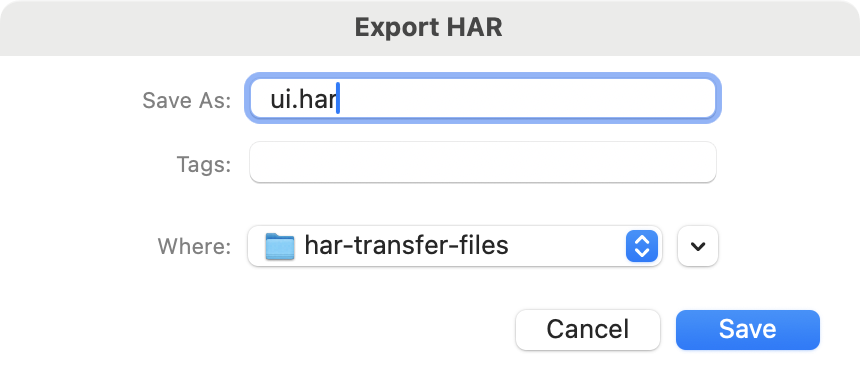

3. 查看错误、跳过项和任务终态，不把进度数字当作成功。Rules 的 `rules-roundtrip.json` 预览显示 Rules `2`、Folders `1`、Enabled `1`、Skipped `0`；红框 1 的 Cancel 放弃导入，红框 2 的 Import 2 rules 会追加并保存，其中一条立即启用。数量、跳过项或启用范围不符合预期时先取消，不盲目确认。

   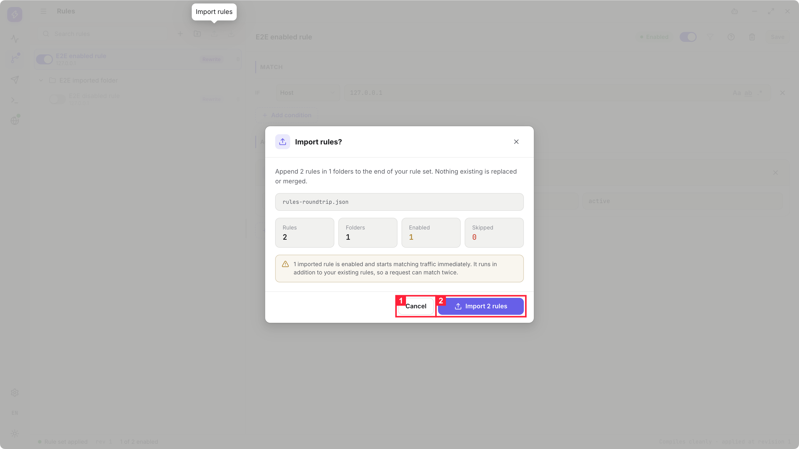

4. 确认源文件存在且可读，目标位置可写，并有足够的磁盘空间；必要时到 Settings → Storage 检查用量。不要为腾出空间手动删除 App 正在使用的目录。

5. Capture 文件任务或取消清理仍在进行时，等待它结束后再 Clear。按[取消归档任务](transfer.md#walkthrough-transfer-cancel)检查取消结果；取消请求已发出不等于清理完成，也不能强行操作仍禁用的 Clear。

6. 按所属格式检查追加和身份变化。Rules 确认导入 `rules-roundtrip.json` 后，新节点追加到根级末尾，不替换同名规则；图中从两条规则、一个目录、一条启用，变为四条规则、两个目录、两条启用。再次导入会继续追加，不是覆盖更新，也不会修复损坏的原文件。

   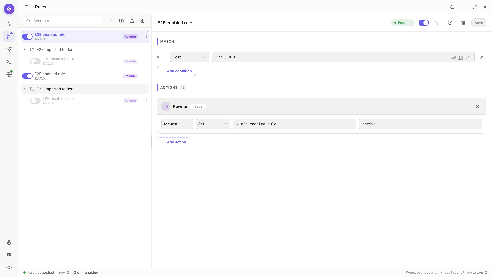

保留原文件，按[文件格式说明](transfer.md#config-files)处理部分导入；不因等待或取消就强杀 App。

## 模型连接、对话或 Tool 失败

1. 打开 Settings → Agent，编辑需要检查的模型。核对红框 1 的 Base URL；图中的 `Keyed lab` 使用本机服务 `http://127.0.0.1:64325/keyed/v1`，App 不会创建这个服务。使用自己的服务地址，不向示例地址发送真实凭据。

   

2. 核对红框 1 的 Model ID，图中为 `keyed-model`，不是配置名称 `Keyed lab`。同时检查 API key、服务可达性及服务商余额和权限；需要密钥时只在配置窗口内填写。

   

3. 修改连接字段后，旧的连接测试结果不再适用。这里把红框 1 的 Model ID 改为 `keyed-model-v2`，红框 2 的 Save provider 随即不可用；不要把它当作保存按钮失灵。

   

4. 点击红框 1 的 Test connection，等待当前配置的测试结果。失败时按显示的错误修正地址、模型或凭据，再重新测试。

   

5. 出现 Connection verified 后，点击红框 1 的 Save provider，再检查 Configured models 中保存的名称与 Model ID。仅填写字段或关闭窗口都不等于保存。

   

6. 对话停在等待时，先看 Tool 审批卡片。图中的 `Pause recording after asking for my approval.` 请求调用 `capture_stop_recording`；核对操作和影响后，点击红框 1 的 Deny Tool 拒绝，或红框 2 的 Allow Tool 同意。等待审批不是模型连接失败。

   

   同意后仍需完成相应的文件窗口或系统授权。例如 [Agent 导出](agent.md#walkthrough-agent-tool-lifecycle-10-export-request)需要选择保存位置；App 审批不会代替 Save 或 Windows UAC。

7. Tool 不可用时，到 Settings → Agent 的 Tool capabilities 检查 Agent 列。图中 `capture_get_proxy_status` 的红框 1 为已关闭的 Agent 开关，红框 2 的 MCP 开关仍开启；MCP 权限不能代替 Agent 权限。需要完整检查或配置[只读权限](tool-permissions.md#read-only)时，先清空搜索，再逐项核对，不能把被隐藏的行当作已关闭。

   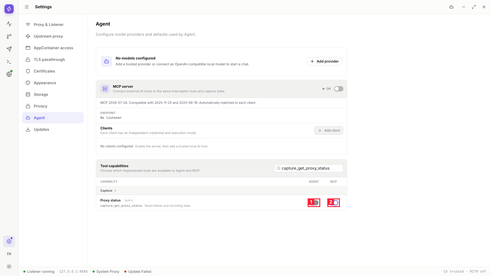

8. 已发送请求、导出文件或写入配置的结果不确定时，先回产品检查状态，再决定是否 Retry。这里红框 1 已显示 Paused，红框 2 的 Stop 只停止仍在生成的回复；出现 Response stopped 后，Recording 仍暂停，已经执行的 `capture_stop_recording` 不会撤销。

   

   

   导出任务已经开始不等于文件已经保存完成。先检查任务终态和实际文件，不因回复等待或失败就重复发送、导出或写配置。

9. 历史中的请求 ID 失效时，重新查询当前 Capture，再选择仍存在的请求，不猜新 ID，也不反复提交旧目标。

在 VS Code 登录 GitHub 不等于内置模型已配置。Stop 不撤销已完成的操作，也不能代替断点的 Continue。

## 外部 Host 连不上 MCP

1. 打开 Settings → Agent，检查 MCP server。红框 1 的开关应开启并显示 Running；红框 2 是当前 endpoint，图中为 `http://127.0.0.1:57871/mcp`。使用自己 App 显示的完整地址，不把 Capture 的 `8888` 当作 MCP 端口。

   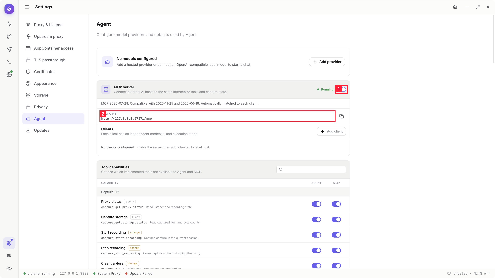

   遇到 `EADDRINUSE` 或 Port unavailable 时按 [MCP 端口冲突](mcp.md#endpoint)处理。先查明端口所属者，不停止未知进程；保存的地址仍显示在页面上，不代表 Server 正在监听。

2. 核对 Host 是否从这台电脑连接本机 loopback。云端 connector 无法通过它自己的 `127.0.0.1` 访问你的 App；开启 MCP 不会把服务发布到局域网或公网。

3. 核对 Host 使用的是对应 Client 的当前配置。图中的 `MCP workflow client` 轮换凭据后，点击红框 1 的复制按钮，更新 Host 配置并重连；旧凭据立即失效。若还更换了 endpoint，同时更新地址，不必仅因地址变化而重建 Client。

   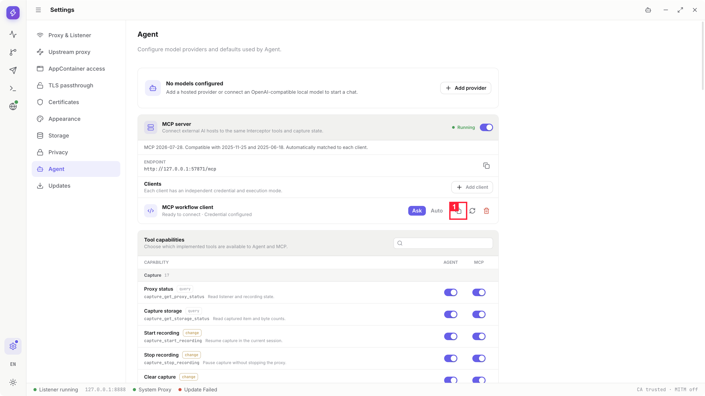

   复制成功不等于已连通。重连后刷新 Host 的 Tool 列表，先调用只读 `capture_get_proxy_status` 并查看返回值；不要把含凭据的配置贴到聊天或项目中。

4. 核对红框 1 的协议说明及 Host 的连接方式。Interceptor 使用 Streamable HTTP，支持 `2026-07-28`、`2025-11-25`、`2025-06-18`；不要套用 `stdio` 或旧式 HTTP+SSE 配置。协议说明在 Server 为 Off 时仍可查看，不代表服务已经启动。

   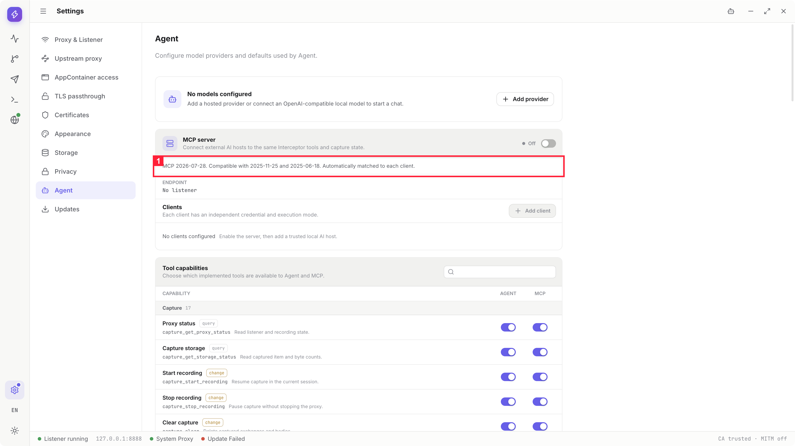

5. 已连接但找不到目标 Tool 时，检查 Tool capabilities 的 MCP 列，再让 Host 刷新 Tool 列表。图中 `rules_replace_tree` 的红框 2 为已关闭的 MCP 开关，红框 1 的 Agent 开关仍开启；Agent 能调用不代表 MCP 也能调用。按需要恢复目标权限，不为排查而开启全部修改能力。

   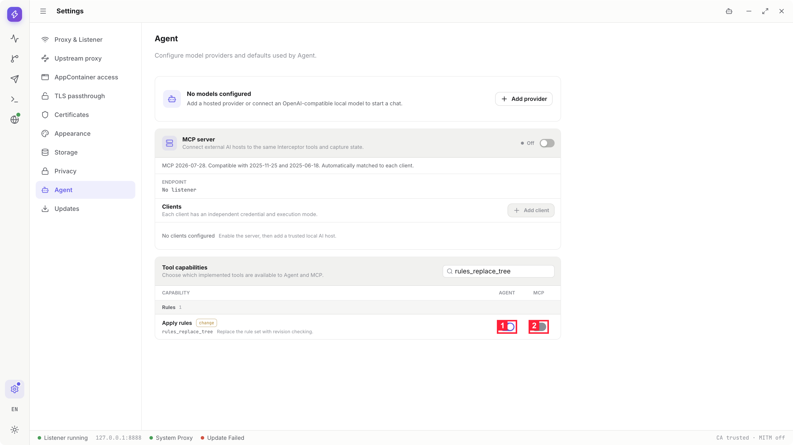

6. 修改请求一直等待时，回 App 查看 MCP 审批。图中是 `capture_stop_recording` 的暂停录制请求；核对 Client、参数和影响后，点击红框 1 的 Deny Tool call 拒绝，或红框 2 的 Allow Tool call 同意。拒绝不会暂停 Recording。

   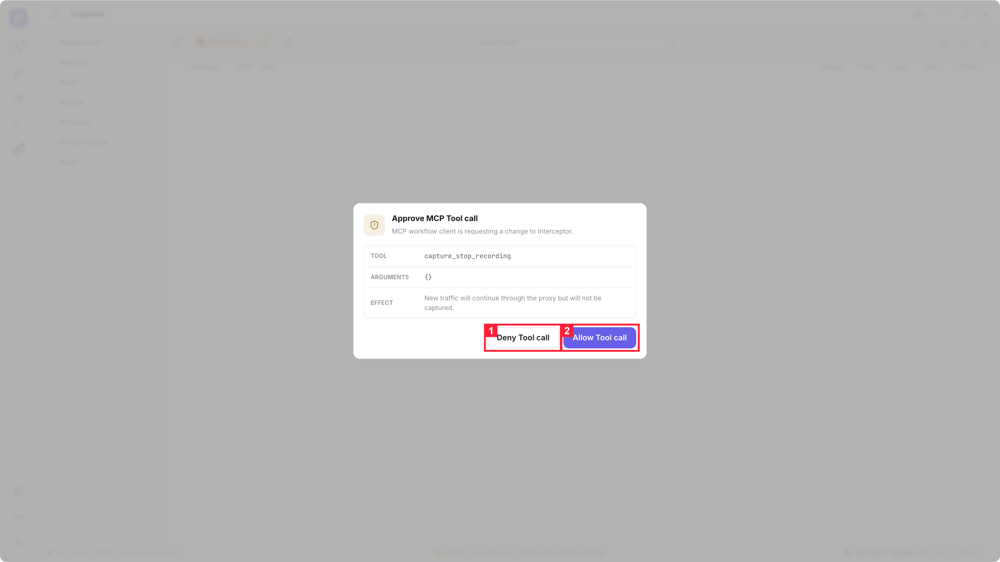

7. 文件 Tool 获准后仍需处理原生文件窗口。下图是另一项操作：`Diagnostics transfer MCP` Client 的 `diagnostics_export` 保存 `mcp.jsonl`。选择位置并 Save 才会开始导出；Cancel 不会启动导出。随后回 App 检查任务终态，并在所选位置确认文件，不把等待文件选择当作连接中断。

   

   Host 自身的审批、App 审批、Save 和 Windows UAC 是不同环节，Auto 不会代替文件选择或系统授权。

按 [MCP](mcp.md)逐层检查网络、认证、协议、权限与业务错误，不把 Client 凭据公开到反馈中。

## 无法检查或下载更新

1. 确认运行的是支持更新的已安装 App，而不是源码开发进程。打开 Settings → Updates，分别检查 Current application、Latest GitHub release 和 Last update action；当前安装版本不等于可下载的新版本。

   

2. 点击 Check now 并等待结果。图中显示 Failed 与 `GitHub returned HTTP 404`，表示更新源不可用，不是 up-to-date，也没有下载或安装更新。

   

3. 检查网络、更新源地址与访问条件。更新源需要匿名可读的合适稳定版本及受支持的安装包；私有仓库、仅有预发布或网络受限都可能影响结果。解决原因后，再通过 Check now 重试。

4. 从可信 Release 页获取适合系统与架构的附件，不把源码包当安装器。只有 App 显示可用更新时，才在阅读说明后选择 Download，再等待下载与完整性检查。

5. 下载或校验失败时，不运行未完成的临时文件。解决错误后通过产品入口重试；下载和校验完成后才能选择 Open installer，再完成系统安装。

不需要向 App 输入 GitHub PAT；App 没有这样的更新认证功能。

## 退出后网络异常或系统代理尚未恢复

1. 先确认 App 是最小化、仍在收尾，还是确实已退出；不要同时启动多个实例。

   最小化窗口或关闭 Agent 面板都不会退出 App。结束使用时保存需要的数据，再正常关闭 App，检查等待项和系统代理已恢复。

2. 若上一个实例异常退出，确认它已经结束后再正常启动 Interceptor，读取正式恢复状态。

3. 打开 Settings → Proxy & Listener。若 System proxy 仍显示 Owned by Interceptor，点击红框 1 的 Restore；若出现系统授权，完成授权并等待结果，不反复点击或强杀。

   

   检查恢复提示和 Current configuration。图中出现 `Original system proxy settings restored.`，状态变为 External，原有的 `7890` 代理配置仍保留；Restore 不是清空所有代理。核对自己的原配置，不能仅凭 External 就认定网络故障已解决。

   

   Listener 仍为 Listening，显式使用 `127.0.0.1:8888` 的客户端仍可经过 Interceptor。Recording 只控制录制，Pause 不会恢复系统代理；Enable 则重新接管系统路由。结束使用时，在恢复完成后正常关闭 App，不需要先重新 Enable。

4. 如果会话期间别的软件修改了代理，核对双方当前配置；不要要求 Interceptor 覆盖对方的新设置。

5. 仍不能恢复时，记录当前状态、操作错误、系统和 App 版本，交给有权限的人按事先记录的网络配置处理。

6. 不盲目清空所有代理、删除 journal、关闭防护或反复强杀；这些操作可能丢失恢复所需信息。

## 准备可复现的反馈

- 记录 App 版本、操作系统、架构与运行来源。
- 用自己的无凭据测试数据写清准备、操作、预期和实际结果。
- 附必要的脱敏 Diagnostics，按问题选择最小 HAR 或归档。
- 说明是否启用了 Rules、Breakpoints、HTTPS 解密及上游代理。
- 排除 API Key、Cookie、Client 配置、CA 私钥和个人流量。

反馈入口：[GitHub Issues](https://github.com/zhxmt-xm/Interceptor/issues)。当前私有仓库需要对应访问权限，官网出现链接不代表已经匿名可用。
