# 工作区与基本操作

> 草稿，面向 `v0.1.1-alpha.1`；导航、四主题、语言菜单和面板已有实拍，布局、语言切换与退出等缺口仍保留，不代表全章或 item9 完成。以下描述桌面 App，不套用官网的布局或 System 主题。

[教程目录](../README.md) · [快速上手](getting-started.md)

<!-- recorded-walkthrough:start -->

## 逐步骤实操：真实产品录制

以下图片和视频来自已发布的 <code>0.1.1-alpha.1</code>、macOS x64，App保持<code>zh-CN</code>。每个步骤都有对应原生窗口截图，可点击查看原尺寸。

本机地址、端口和生成ID来自这次真实录制，不是公开服务；使用时替换成自己的已授权测试环境。下面先列本次实际数据，再按相同顺序操作。未出现在本段录像中的进阶分支仍待逐步配图与验收。

| 示例字段 | 录制中的实际值 |
| --- | --- |
| <code>initialTheme</code> | <code>light</code> |
| <code>appLanguage</code> | <code>zh-CN</code> |
| <code>languageChanged</code> | <code>false</code> |

<video controls preload="metadata" playsinline lang="zh-CN" src="../media/v0.1.1-alpha.1/workspace/workspace.mp4" poster="../media/v0.1.1-alpha.1/workspace/workspace-01-sidebar.png">
<track kind="captions" srclang="zh-CN" label="Steps / 步骤" src="../media/v0.1.1-alpha.1/workspace/workspace.vtt" default>
</video>

### 01 · 展开侧栏名称

[视频 00:00](../media/v0.1.1-alpha.1/workspace/workspace.mp4#t=0.396) · [返回本节视频](#walkthrough-video)

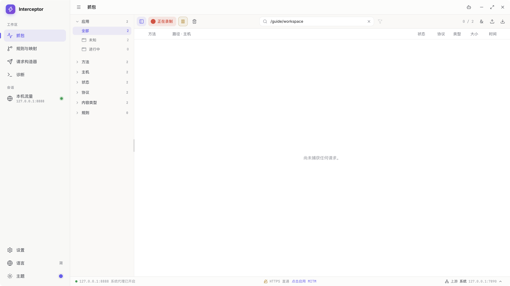

### 02 · 进入 Capture

[视频 00:03](../media/v0.1.1-alpha.1/workspace/workspace.mp4#t=3.229) · [返回本节视频](#walkthrough-video)

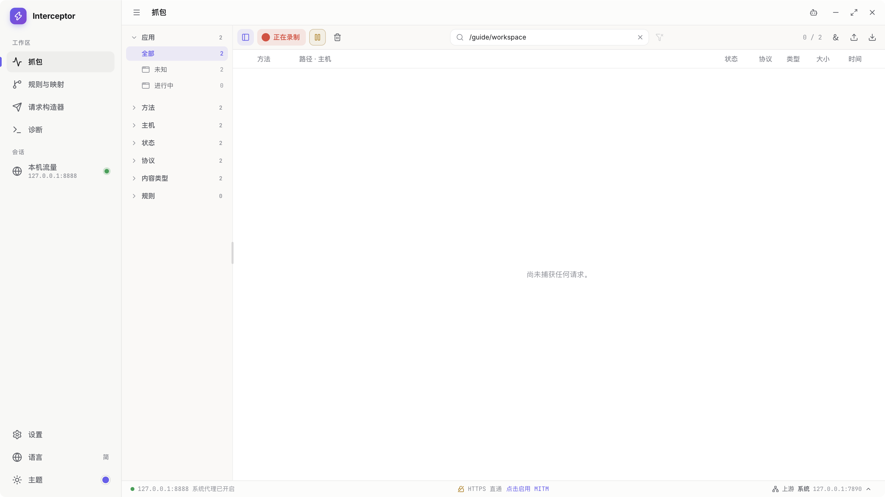

### 03 · 进入 Rules

[视频 00:06](../media/v0.1.1-alpha.1/workspace/workspace.mp4#t=6.078) · [返回本节视频](#walkthrough-video)

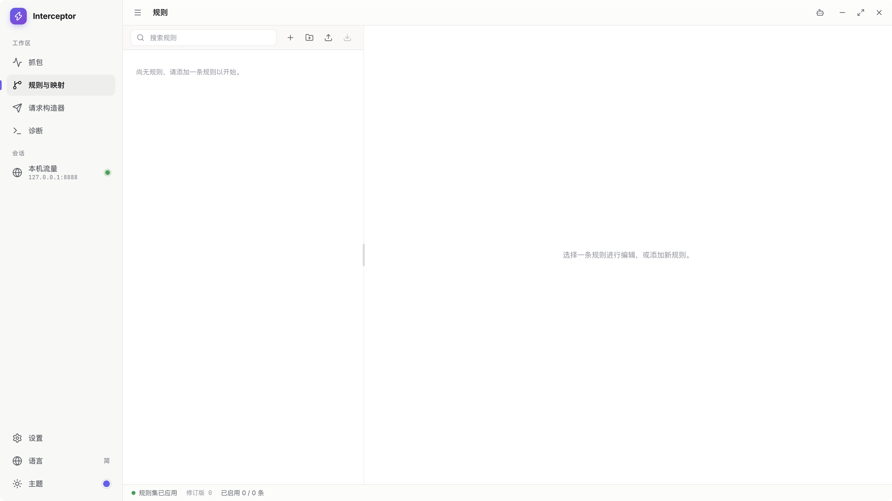

### 04 · 进入 Composer

[视频 00:08](../media/v0.1.1-alpha.1/workspace/workspace.mp4#t=8.929) · [返回本节视频](#walkthrough-video)

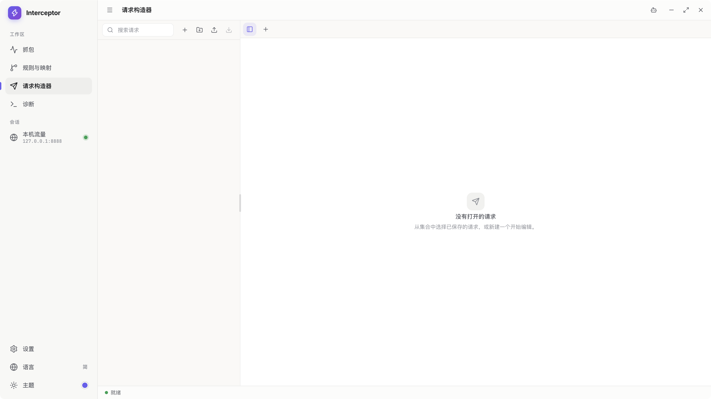

### 05 · 进入 Diagnostics

[视频 00:11](../media/v0.1.1-alpha.1/workspace/workspace.mp4#t=11.778) · [返回本节视频](#walkthrough-video)

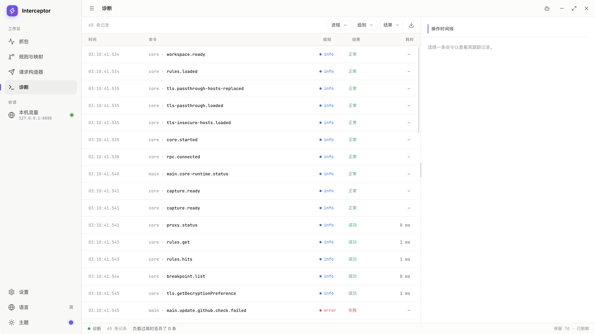

### 06 · 进入 Settings

[视频 00:14](../media/v0.1.1-alpha.1/workspace/workspace.mp4#t=14.678) · [返回本节视频](#walkthrough-video)

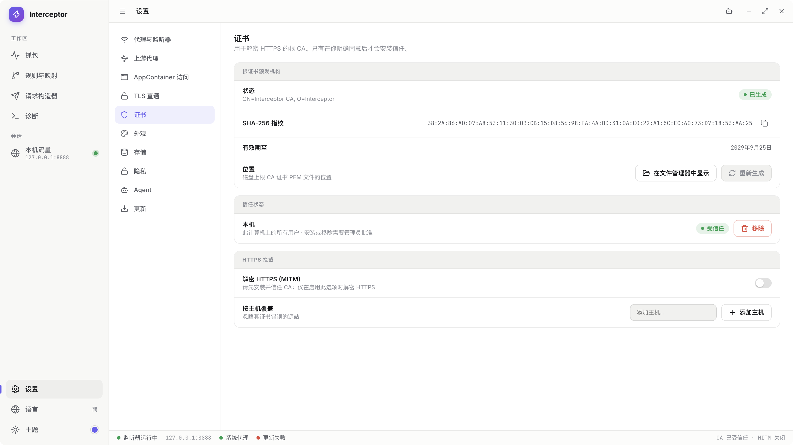

### 07 · 选择 warm 主题

[视频 00:17](../media/v0.1.1-alpha.1/workspace/workspace.mp4#t=17.578) · [返回本节视频](#walkthrough-video)

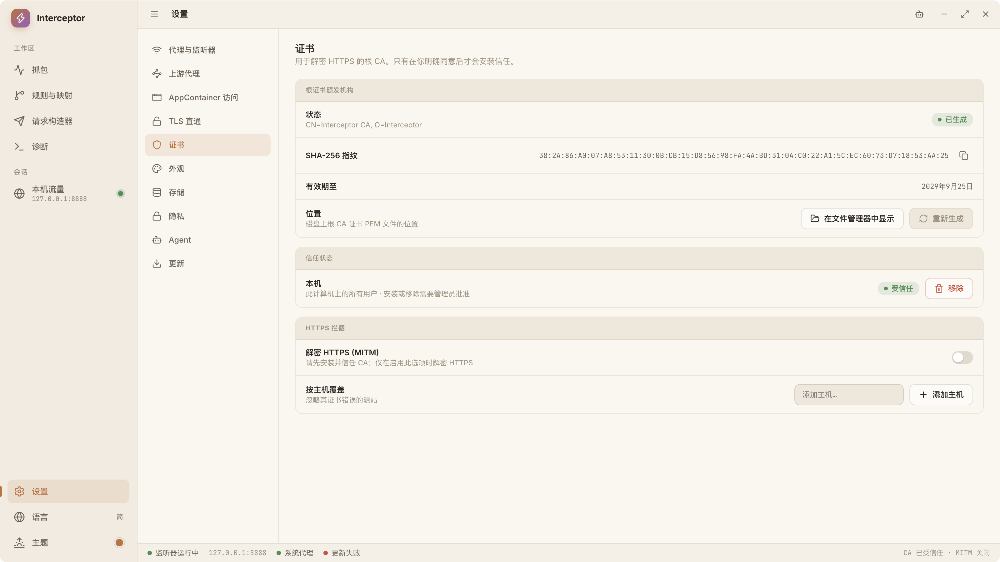

### 08 · 选择 light 主题

[视频 00:20](../media/v0.1.1-alpha.1/workspace/workspace.mp4#t=20.828) · [返回本节视频](#walkthrough-video)

### 09 · 选择 ember 主题

[视频 00:24](../media/v0.1.1-alpha.1/workspace/workspace.mp4#t=24.078) · [返回本节视频](#walkthrough-video)

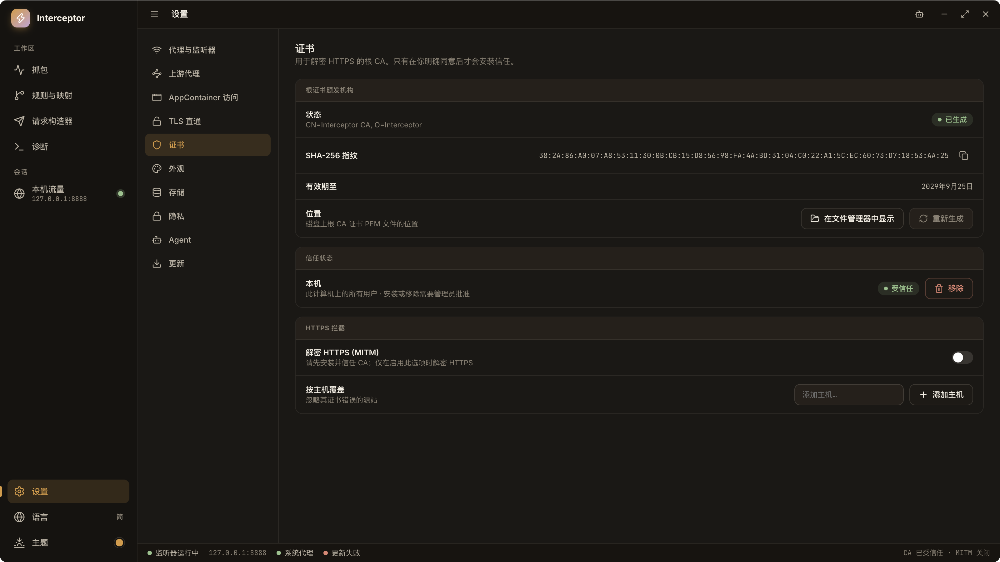

### 10 · 选择 dark 主题

[视频 00:27](../media/v0.1.1-alpha.1/workspace/workspace.mp4#t=27.378) · [返回本节视频](#walkthrough-video)

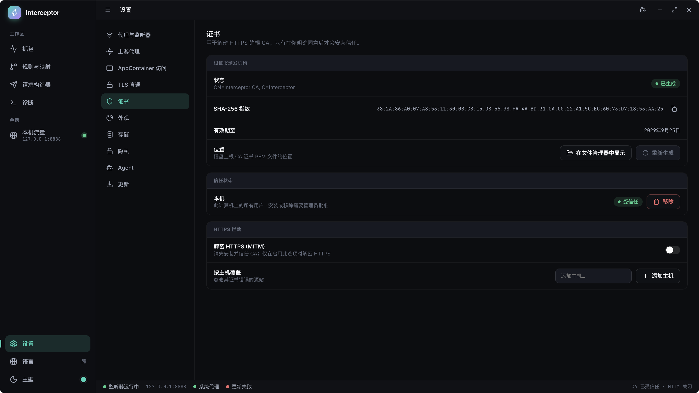

### 11 · 恢复原主题

[视频 00:30](../media/v0.1.1-alpha.1/workspace/workspace.mp4#t=30.578) · [返回本节视频](#walkthrough-video)

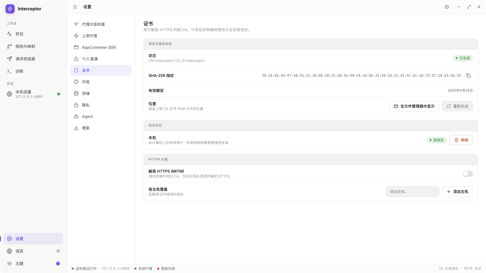

### 12 · 查看语言菜单，不切换

[视频 00:33](../media/v0.1.1-alpha.1/workspace/workspace.mp4#t=33.829) · [返回本节视频](#walkthrough-video)

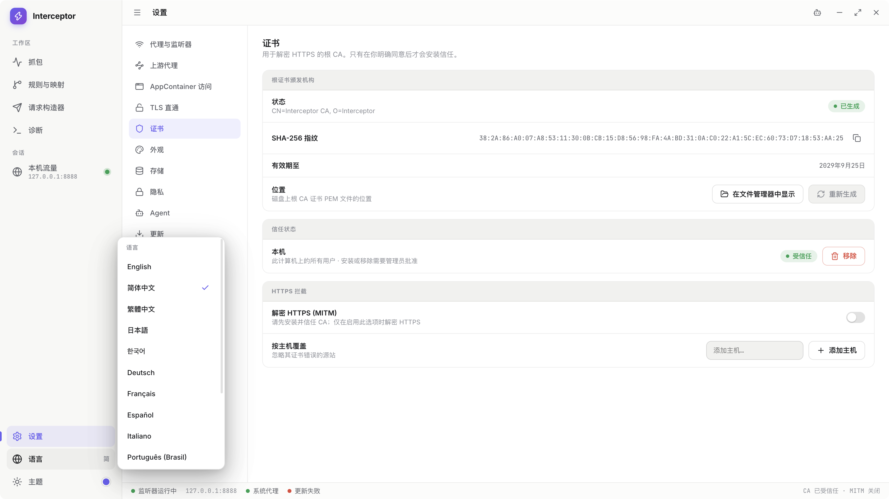

### 13 · 打开可选 Agent 面板

[视频 00:36](../media/v0.1.1-alpha.1/workspace/workspace.mp4#t=36.792) · [返回本节视频](#walkthrough-video)

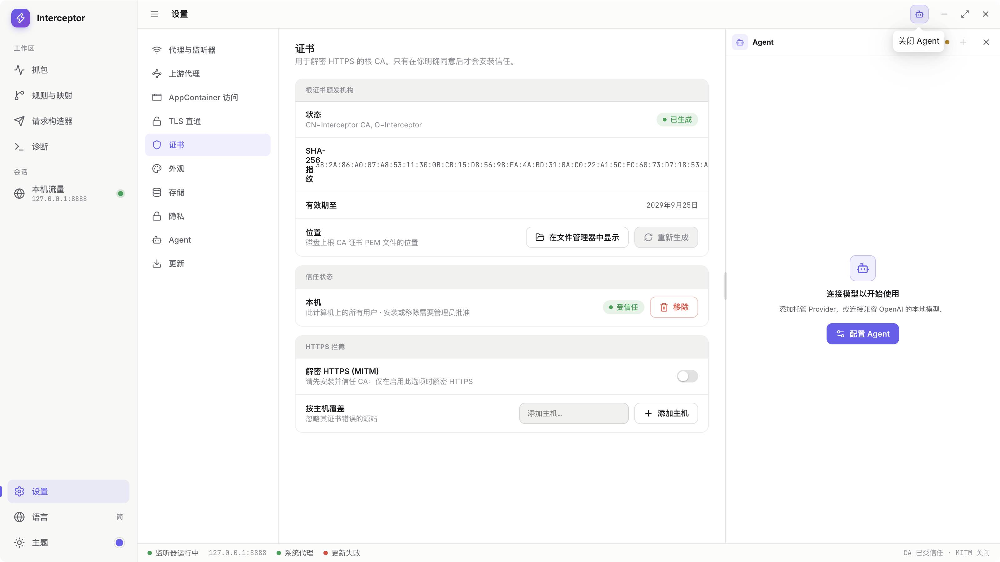

### 14 · 关闭面板但不退出 App

[视频 00:39](../media/v0.1.1-alpha.1/workspace/workspace.mp4#t=39.678) · [返回本节视频](#walkthrough-video)

下面保留完整功能参考。只有已经附上真实步骤图、核对过变量和值的操作才能计入图文验收。
<!-- recorded-walkthrough:end -->

## 找到需要的工具

**用途与前提**：App 已完成启动准备，从左侧导航进入对应任务。

| 入口 | 用来做什么 |
| --- | --- |
| Capture | 观察经过代理的请求、正文和消息；处理挂起的断点 |
| Rules & Map | 按条件改变后续经过代理的流量 |
| Composer | 独立构造和发送请求，管理 Collection |
| Diagnostics | 查询 App 运行记录和失败原因 |
| Settings | 管理代理、证书、偏好、模型、MCP 与更新 |
| 窗口右上角 Agent 按钮 | 打开或关闭当前工作区旁的 AI 对话面板 |

**步骤**

1. 用窗口标题左边的菜单按钮展开侧栏，查看功能名称。

   

2. 点击 Capture 进入流量工作区。

   

3. 点击 Rules & Map 进入规则。

   

4. 点击 Composer 进入请求构造器。

   

5. 点击 Diagnostics 查看运行记录。

   

6. 点击 Settings，再选择所需分组。

   

7. 离开 Settings 后再返回，核对保留的最后访问分组。

   **待配图**：本次只录进入 Settings，没有离开再返回的分组保留检查。

8. 通过特定提示跳转 Settings 时，核对定位的分组，例如 TLS passthrough。

   **待配图**：直接打开分组与从提示深链跳转不同，现有设置图不替代该路径。

**预期结果**：窗口标题和主内容随选择变化；导航本身不会重发请求。

**关键说明**：Breakpoints 在 Capture 内，不是另一套独立导航。进入 Composer 或 Settings 不等于暂停 Capture；后台流量仍取决于 Recording、代理和规则状态。

## 调整分栏、窗口和滚动

**步骤**

1. 拖动 Capture 的筛选、列表与详情之间的分隔条，按任务分配宽度。

   **待配图**：没有分栏拖动的前后画面，静态 Capture 全景不能代替。

2. Composer 中分别调整 Collection 宽度、请求区和响应区高度。

   **待配图**：Composer 录制操作请求字段，未调整这些分栏。

3. 使用窗口右上角的最小化、最大化或恢复控件；需要时拖动窗口边缘调整大小。

   **待配图**：现有素材没有窗口尺寸和最小化/恢复过程，不能把不同章节截图当成一次调整。

4. 使用滚轮、触控板或键盘阅读溢出内容；正文内部滚到边界后继续滚动外层。

   **待配图**：没有真实内外层滚动过程，静态全屏不能证明滚动交接。

5. 较长正文可以使用相应全屏入口，结束后回到原工作区。

   下面准确引用 Capture 的 orders JSON 全屏与 Escape 返回；它展示操作，不是超长正文的滚动测试。

   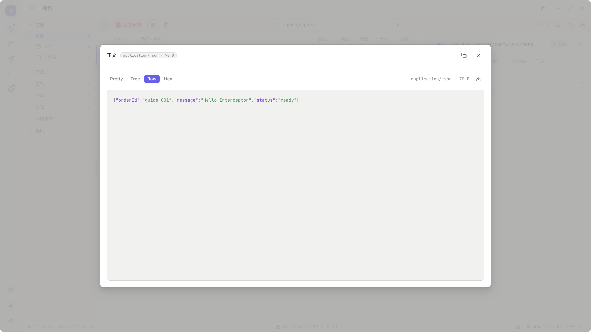

   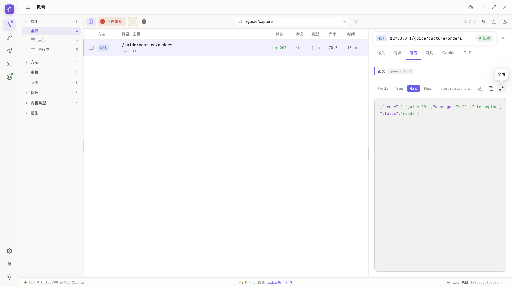

**预期结果**：分栏随可用空间调整，不通过截掉正文来“适应”窗口。

**关键说明**：最小化不是退出，代理和录制可能继续运行。全屏正文只扩大查看范围，不解除预览字节上限，也不重新获取未被捕获的数据。

## 选择主题与语言

**步骤**

1. 在侧栏底部打开 Theme。

   **待配图**：没有只展开 Theme、尚未选择主题的独立中间态；下面各图是实际选择后的状态。

2. 本次先选择 `warm`。

   

3. 选择 `light`。

   

4. 选择 `ember`。

   

5. 选择 `dark`。

   

6. 演示结束恢复录制前的 `light`，不是 App 的 System 主题。

   

7. 打开 Language 查看可选语言；本次保持 `zh-CN`。

   

8. 需要更改时选择所需语言，再核对界面变化。

   **待配图**：本次 `languageChanged=false`，菜单图不能证明已切换为英文或其他语言。

9. 正常重启后核对语言和主题偏好保持。

   新的 `workspace-restart` 实拍确认两代启动仍保持 `zh-CN`，没有为了录制切换语言：

   

   **待配图**：这不是更改语言/主题后重启的流程，仍不能证明切换后偏好的完整往返。

**预期结果**：主题改变颜色而不改变功能；语言改变界面文案，不翻译 URL、协议、请求内容和 Tool 名称。

**关键说明**：App 提供四套时段主题和 15 种界面语言，但不代表教程已有 15 个语言版本。官网的 System/Light/Dark 与 App 的四主题不是同一个设置。

## 在工作区旁使用 Agent

**步骤**

1. 点击窗口右上角的 Agent 按钮。

   

2. 未配置模型时，从面板的配置入口进入 Settings > Agent。

   **待配图**：直接在侧栏打开 Agent 设置已有录制，但未录面板空态中的配置跳转。

3. 已配置时选择或创建 Chat；需要操作其他工具时直接切换工作区。

   下面引用独立的 `agent-management`，已有 `Guide model one`、`Guide model two`：先新建第二个 Chat，再通过选择器切回 `Guide chat one`。不是本段空面板自动完成了模型配置。

   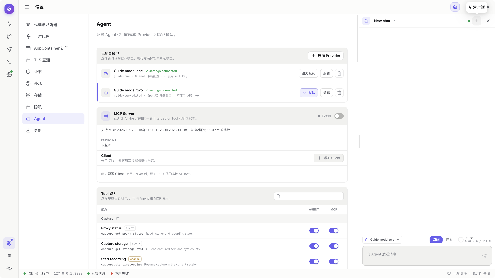

   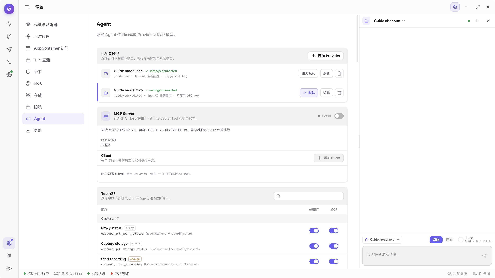

   **待配图**：开着面板跨工作区导航的操作仍未录制；Chat 选择不是工作区切换。

4. 不需要面板时，再点 Agent 按钮或面板内的关闭按钮。

   

   **待配图**：本图只覆盖本次关闭动作，两个入口分别操作的对照未录制。

**预期结果**：面板位于主内容旁边，主内容缩窄而不是被遮盖；切换工作区或进入设置不自动关闭面板。

**关键说明**：当前选中的请求不会仅因打开面板就自动加入模型上下文。与模型交换的数据边界见 [Agent](agent.md#privacy)。

## 哪些内容会保存

| 内容 | 需要记住的规则 |
| --- | --- |
| 当前 Capture 请求与正文 | 临时记录，Core 退出或重启会释放；重要数据先导出 |
| Rules | 编辑后需要 Apply；文件导入的确认流程会直接保存追加结果 |
| Composer Collection | 编辑自动保存；Recent sends 是另一份内存记录 |
| 代理、TLS 和其他偏好 | 按各自 Apply 或设置操作保存，不由 Capture Clear 清除 |
| Agent 配置和会话 | 在本地保存；模型调用及 Tool 结果仍可能发送到模型服务 |
| 导出的文件 | 保存在用户选择的位置；Clear 不会代你删除这些文件 |

**实际保存与重启核对**

下面按 `workspace-close` → `workspace-restart` 的真实顺序阅读，使用同一 profile 的两代 App 启动。请求名为 `Guide retained request`，URL 为 `http://127.0.0.1:63009/guide/restart/request`；`63009` 是这次录制的动态服务端口。

1. 打开 Composer。

   

2. 填写上述测试 URL，等待自动保存。

   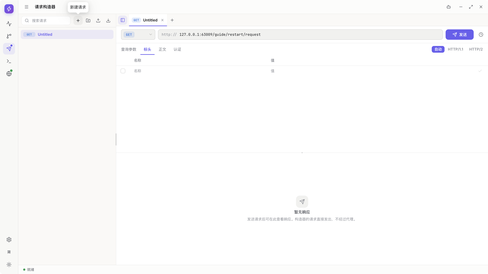

3. 将请求命名为 `Guide retained request`。

   

4. 在该 profile 的 Privacy 中将 `maskCookies` 临时设为 `false`，用于检查偏好持久化；此处不导出或分享个人数据，后面会恢复遮罩。

   

5. 通过代理产生一条临时 Capture 演示记录，与 Collection 中保存的请求定义区分。

   

6. 确认保存后正常 Close。本次真实 Close 由 driver 执行，下图拍于动作之前，不是点击瞬间，也不展示 App 已退出后的桌面。

   

   **待配图**：Close 点击瞬间、忙状态拒绝及系统代理/进程收尾的独立画面不在此图中；已有真实 Close 不等于这些分支全部配图。

7. 重新启动同一 profile，在新一代 App 的 Collection 找到 `Guide retained request`，核对保存的 URL。

   

8. 到 Privacy 核对 `maskCookies` 仍为 `false`，不是只凭旧窗口还开着判断保存。

   

9. 恢复 Cookie 遮罩默认值，不保留为演示临时关闭的状态。

   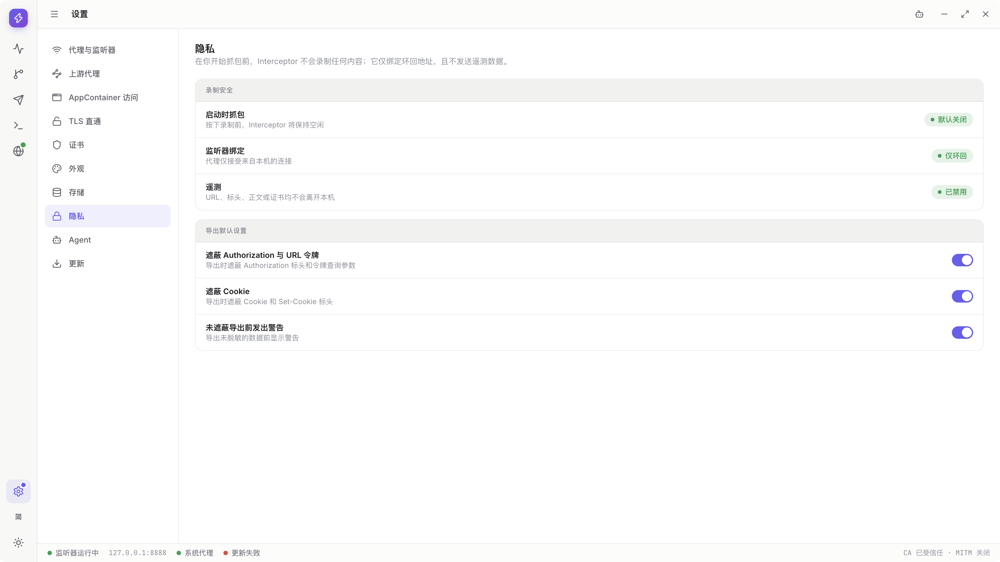

10. 回到 Capture，核对上一代的临时记录已不在；这与 Collection 请求仍保留是两件事。

    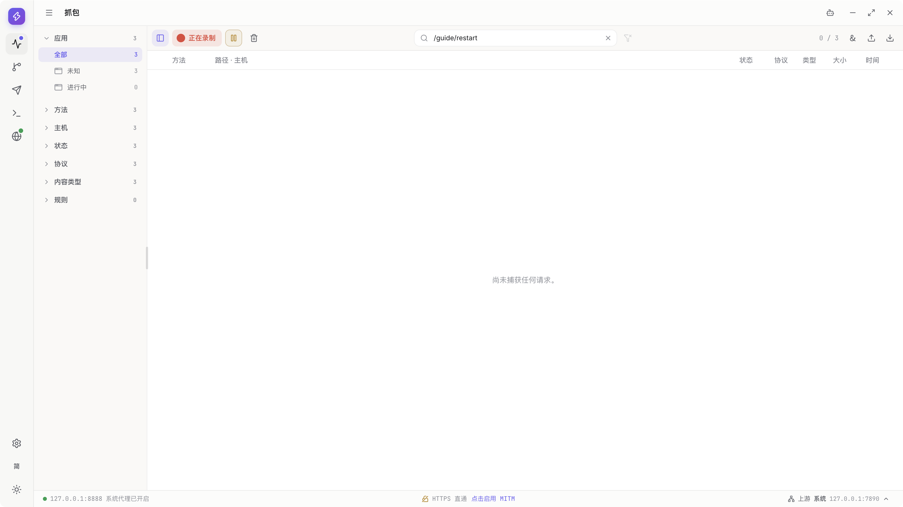

11. 核对当前语言仍为 `zh-CN`，录制没有修改它。

    

**范围说明**：本次只核对 Collection 的请求名称/URL、Privacy 和临时 Capture，不证明 Agent 历史或所有偏好都完成了重启检查。Collection 更深目录、排序、预览取消、删除的补充流程仍因 macOS 锁屏 blocked，未启动 App；不能使用以上图片代替。

**操作建议**：退出前先完成导出、Apply 或正在进行的保存；不要仅凭屏幕还显示着数据就判断已经持久化。

不同系统账号或独立 App 数据环境之间不应假设集合和会话自动同步；当前系统用户的 CA 和代理恢复信息另有共享生命周期，不能通过随意删除 App 数据目录来重置它们。

## 正常结束一次使用

1. 处理或明确放弃仍挂起的断点，避免客户端一直等待。

   下图分别引用 Breakpoints 的单项原样放行和新 HTTP 队列中 POST-C/PUT-C 的批量放行，不冒充当前所有连接的全局状态；混合多个队列的全部清理仍待配图。

   

   

2. 导出需要保留的流量，等待文件任务完成。

   下图引用 Transfer 的 `guide-recording.iarchive` 完成检查点；不是自动保存整个工作区。

   

3. 确认没有尚未处理的原生授权或文件窗口。

   **待配图**：没有退出前所有原生窗口状态的独立检查；有 Save 面板图不等于所有窗口都已处理。

4. 使用 App 的 Close 正常退出；若操作忙而拒绝退出，等待完成后再关闭。

   [上节](#saved-data)已经记录 driver 执行的真实 Close 与随后真实重启。下图是关闭前状态，不能标为点击 Close 或系统恢复完成。

   

   **待配图**：Close 点击瞬间、忙状态拒绝、退出时原生窗口等待及系统代理/进程收尾画面仍缺；不再把真实 Close 说成未执行，也不把这张关闭前图扩展成完整退出验收。

**预期结果**：App 完成代理恢复和进程退出，不把最小化或强制结束当作正常关闭。

**关键说明**：退出不卸载 CA，不自动删除导出文件，也不保证覆盖其他软件在会话中修改的代理设置。异常时见[恢复指南](troubleshooting.md#proxy-recovery)。

<!-- recorded-walkthrough:workspace-close:start -->

## 逐步骤实操：保存与正常关闭

以下图片和视频来自已发布的 <code>0.1.1-alpha.1</code>、macOS x64，App保持<code>zh-CN</code>。每个步骤都有对应原生窗口截图，可点击查看原尺寸。

本机地址、端口和生成ID来自这次真实录制，不是公开服务；使用时替换成自己的已授权测试环境。下面先列本次实际数据，再按相同顺序操作。未出现在本段录像中的进阶分支仍待逐步配图与验收。

| 示例字段 | 录制中的实际值 |
| --- | --- |
| <code>requestName</code> | <code>Guide retained request</code> |
| <code>url</code> | <code>http://127.0.0.1:63009/guide/restart/request</code> |
| <code>maskCookies</code> | <code>false</code> |
| <code>closeImage</code> | <code>before the actual Close action; shutdown is verified by the driver</code> |

<video controls preload="metadata" playsinline lang="zh-CN" src="../media/v0.1.1-alpha.1/workspace-close/workspace-close.mp4" poster="../media/v0.1.1-alpha.1/workspace-close/workspace-close-01-composer.png">
<track kind="captions" srclang="zh-CN" label="Steps / 步骤" src="../media/v0.1.1-alpha.1/workspace-close/workspace-close.vtt" default>
</video>

### 01 · 打开 Composer

[视频 00:00](../media/v0.1.1-alpha.1/workspace-close/workspace-close.mp4#t=0.346) · [返回本节视频](#walkthrough-workspace-close-video)

### 02 · 保存演示 URL

[视频 00:03](../media/v0.1.1-alpha.1/workspace-close/workspace-close.mp4#t=3.329) · [返回本节视频](#walkthrough-workspace-close-video)

### 03 · 命名 Guide retained request

[视频 00:06](../media/v0.1.1-alpha.1/workspace-close/workspace-close.mp4#t=6.177) · [返回本节视频](#walkthrough-workspace-close-video)

### 04 · 设置本profile导出偏好

[视频 00:10](../media/v0.1.1-alpha.1/workspace-close/workspace-close.mp4#t=10.277) · [返回本节视频](#walkthrough-workspace-close-video)

### 05 · 产生临时 Capture 记录

[视频 00:13](../media/v0.1.1-alpha.1/workspace-close/workspace-close.mp4#t=13.284) · [返回本节视频](#walkthrough-workspace-close-video)

### 06 · 确认保存后正常关闭

[视频 00:16](../media/v0.1.1-alpha.1/workspace-close/workspace-close.mp4#t=16.276) · [返回本节视频](#walkthrough-workspace-close-video)

下面保留完整功能参考。只有已经附上真实步骤图、核对过变量和值的操作才能计入图文验收。
<!-- recorded-walkthrough:workspace-close:end -->

<!-- recorded-walkthrough:workspace-restart:start -->

## 逐步骤实操：重开后的持久与临时数据

以下图片和视频来自已发布的 <code>0.1.1-alpha.1</code>、macOS x64，App保持<code>zh-CN</code>。每个步骤都有对应原生窗口截图，可点击查看原尺寸。

本机地址、端口和生成ID来自这次真实录制，不是公开服务；使用时替换成自己的已授权测试环境。下面先列本次实际数据，再按相同顺序操作。未出现在本段录像中的进阶分支仍待逐步配图与验收。

| 示例字段 | 录制中的实际值 |
| --- | --- |
| <code>requestName</code> | <code>Guide retained request</code> |
| <code>url</code> | <code>http://127.0.0.1:63009/guide/restart/request</code> |
| <code>persisted</code> | <code>Collection and privacy preference</code> |
| <code>temporary</code> | <code>Capture records</code> |
| <code>appLanguage</code> | <code>zh-CN</code> |

<video controls preload="metadata" playsinline lang="zh-CN" src="../media/v0.1.1-alpha.1/workspace-restart/workspace-restart.mp4" poster="../media/v0.1.1-alpha.1/workspace-restart/workspace-restart-01-collection.png">
<track kind="captions" srclang="zh-CN" label="Steps / 步骤" src="../media/v0.1.1-alpha.1/workspace-restart/workspace-restart.vtt" default>
</video>

### 01 · 重开后找到已保存请求

[视频 00:00](../media/v0.1.1-alpha.1/workspace-restart/workspace-restart.mp4#t=0.365) · [返回本节视频](#walkthrough-workspace-restart-video)

### 02 · 确认偏好持久化

[视频 00:03](../media/v0.1.1-alpha.1/workspace-restart/workspace-restart.mp4#t=3.395) · [返回本节视频](#walkthrough-workspace-restart-video)

### 03 · 恢复遮罩默认值

[视频 00:06](../media/v0.1.1-alpha.1/workspace-restart/workspace-restart.mp4#t=6.305) · [返回本节视频](#walkthrough-workspace-restart-video)

### 04 · 确认旧 Capture 不会保留

[视频 00:09](../media/v0.1.1-alpha.1/workspace-restart/workspace-restart.mp4#t=9.146) · [返回本节视频](#walkthrough-workspace-restart-video)

### 05 · 确认语言没有被录制修改

[视频 00:12](../media/v0.1.1-alpha.1/workspace-restart/workspace-restart.mp4#t=12.103) · [返回本节视频](#walkthrough-workspace-restart-video)

下面保留完整功能参考。只有已经附上真实步骤图、核对过变量和值的操作才能计入图文验收。
<!-- recorded-walkthrough:workspace-restart:end -->
