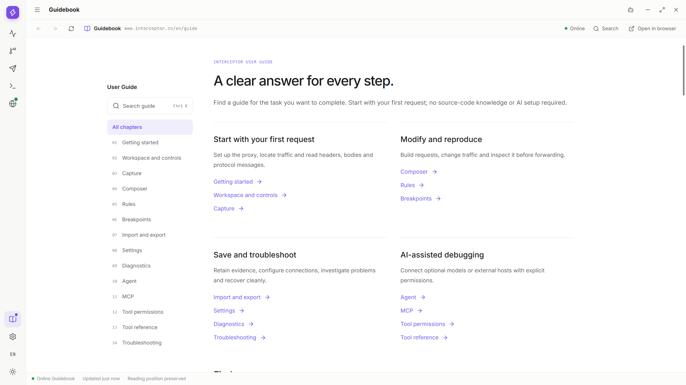
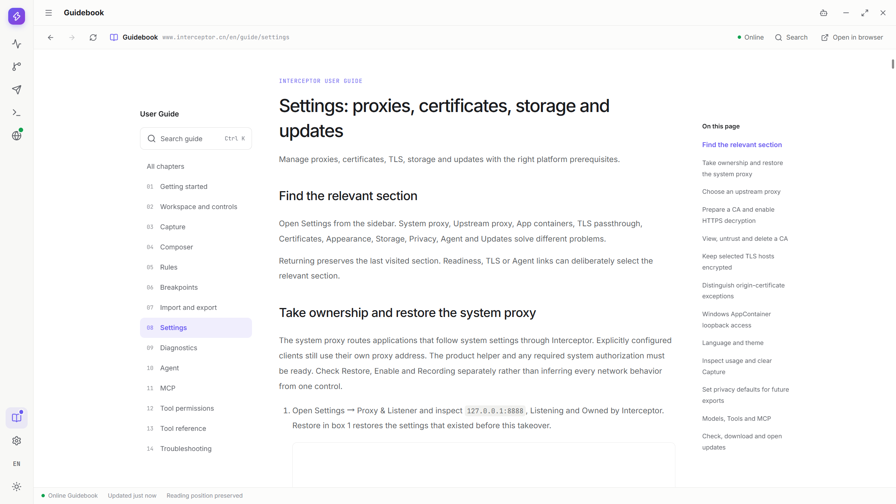
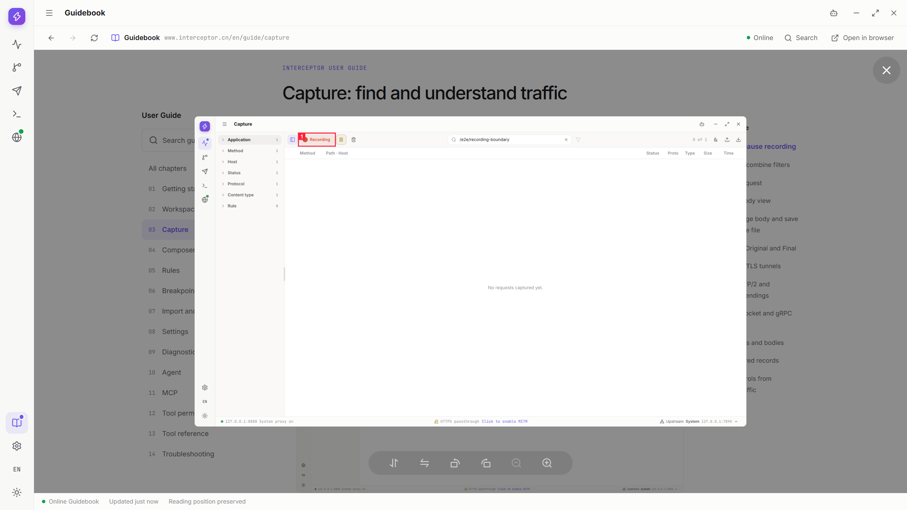
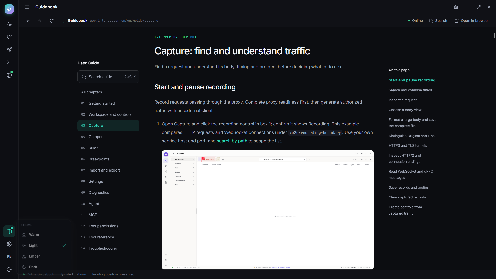
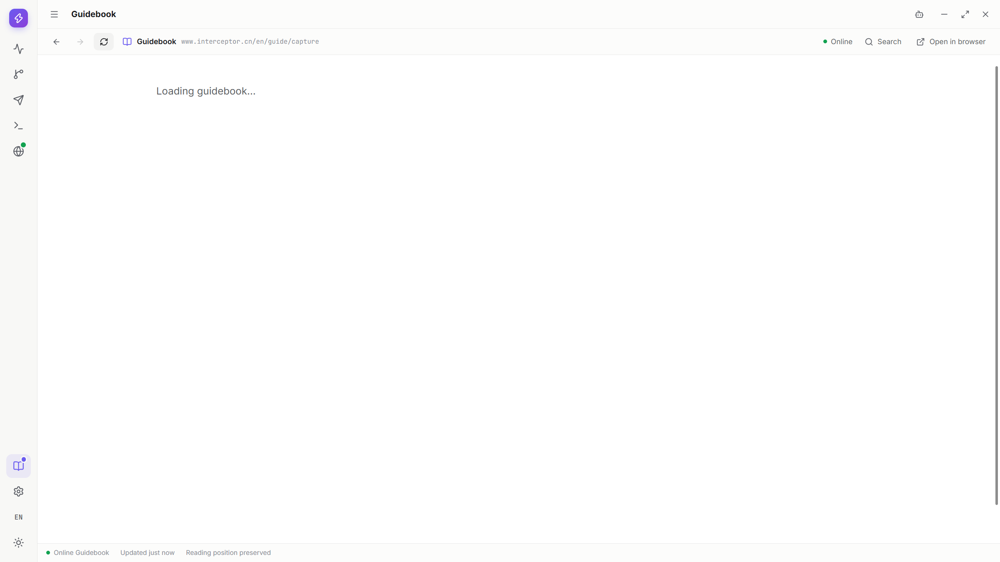
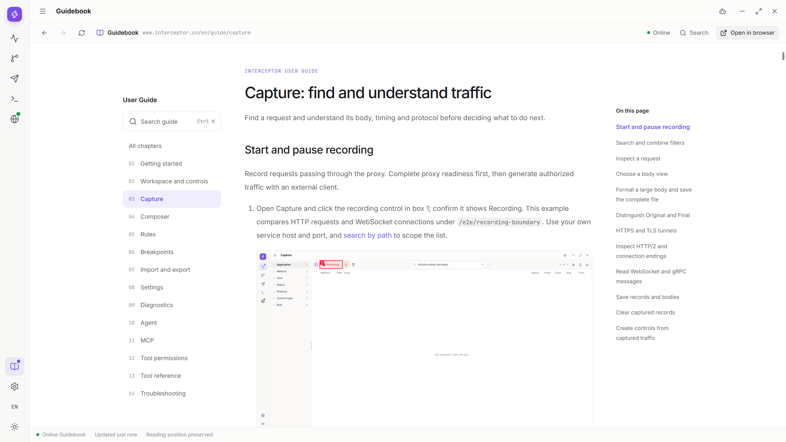
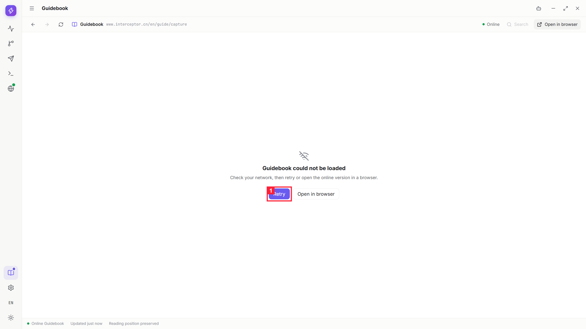
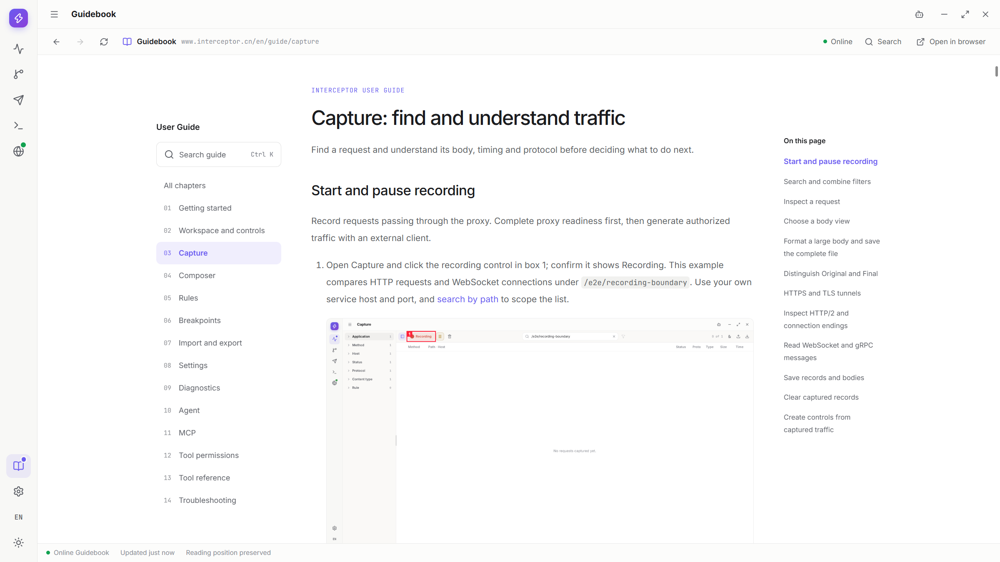

# 工作区与基本操作

[教程目录](../README.md) · [快速上手](getting-started.md)

## 找到需要的工具

App 启动完成后，通过左侧导航进入需要的工具。Breakpoints 在 Capture 内处理，不是独立工作区。

1. 点击窗口标题左侧的菜单按钮，展开侧栏查看各个工具名称。再次点击可收起，只改变显示宽度，不离开当前页面。

   

2. 点击红框 1 的 Capture 查看经过代理的请求。示例已限定测试路径，因此列表可以为空；空列表不等于代理未启动。

   

3. 点击红框 1 的 Rules & Map，创建和管理改变后续流量的规则。已经结束的历史请求不会被重新改写。

   

4. 点击红框 1 的 Composer，独立构造请求和管理 Collection。Composer 直接发送，不自动进入 Capture，也不应用代理 Rules。

   

5. 点击红框 1 的 Diagnostics，按时间和类别检查 App 运行记录。它用于排查 App 操作，不是完整的网络帧分析器。

   

6. 进入 Settings 后选择对应分组，例如 Certificates、App Containers 或 TLS passthrough。离开再返回时保留上次访问的分组；通过特定功能的设置入口跳转时，则定位到它指定的分组。

   

   

   

导航本身不会发送请求，也不会自动暂停 Recording。后台转发取决于代理、规则和录制的各自状态。

## 在 App 内阅读 Guidebook

1. 点击侧栏中 Settings 上方的 Guidebook，等待在线教程加载完成，再从目录选择章节。教程需要联网。

   

2. 点击 App 的 Guidebook 工具栏中的 Search，输入关键词并选择结果。对应章节与小节在 App 内打开。

   

3. 点击步骤图查看大图，按 Escape 关闭预览并继续阅读。

   

4. 在窗口标题栏切换 App 主题，教程会同步。App 使用简体中文时显示中文教程，其他 App 语言统一显示英文教程；切换语言会重新加载对应的教程入口。

   

5. 点击 Guidebook 工具栏中的 Refresh，重新加载当前章节。

   

6. 点击工具栏中的浏览器按钮，在系统浏览器打开官网教程。

   

7. 断网后 App 显示 Error，Search 暂时不可用。恢复网络后，点击红框 1 的 Retry；仅恢复网络不会重新加载章节。

   

8. 等待 Ready 再继续阅读。Retry 重新加载同一章节，并保留 App 的语言与主题。

   

## 调整分栏、窗口和滚动

1. 拖动 Capture 的筛选、列表与详情之间的分隔条，按任务分配宽度。红框 1 是列表与 Inspector 之间的轨道，向左拖可扩大详情；需要时再向右拖回，当前请求与 Query 内容保持。

   

   

2. Composer 中分别调整 Collection 宽度、请求区和响应区高度。

   

   

3. 需要任意尺寸时，拖动窗口边缘或角落调整大小；分栏随可用空间变化。使用顶栏的最大化、还原或最小化按钮时，继续按下一节的[窗口操作图文](#walkthrough-workspace-window-controls)执行；最小化不会停止代理。

   

4. 使用滚轮、触控板或键盘阅读溢出内容。下图选择了 `/e2e/detail-body-fill` 的长 Request 正文；红框 1 是 Inspector 滚动区域，其中正文有自己的滚动条。先在正文内滚动，需要时拖动正文滚动条到下边界；到达 `entry-199` 后继续滚动，会滚动外层 Inspector，而不是困在内层。

   

   

   

5. 在 Capture 的正文中点击全屏入口，放大查看内容。图中为 `/e2e/fullscreen-json` 的 JSON 响应，红框 1 是全屏中的 Raw 模式。

   

6. 需要检查字节时，在全屏中切换 Hex。红框 1 标出当前 Hex 模式，正文仍是同一条响应。

   

7. 按 Escape 返回原详情。红框 1 显示 Hex 仍被选中，不必重新选择请求或查看模式。

   

最小化不是退出，代理和录制可能继续运行。全屏正文只扩大查看范围，不解除预览字节上限，也不重新获取未被捕获的数据。

## 最大化、还原和最小化窗口

窗口控件在顶栏右侧。改变窗口大小或最小化，不会退出 App 或停止代理。

1. 点击最大化按钮，让当前工作区使用可用屏幕空间。当前设置分组和编辑内容仍保留。

   

2. 再次点击同一位置的还原按钮，恢复普通窗口。需要不同尺寸时拖动窗口边缘。

   

3. 红框 1 是最小化按钮，点击可暂时收起窗口。它不是关闭按钮，App 和代理仍可能继续运行。

   

4. 恢复窗口后继续原来的操作。结束使用时应正常关闭 App，而不是把最小化当作退出。

   

## 选择主题与语言

主题改变颜色，不改变功能。界面语言不会翻译请求 URL、正文、协议值或 Tool 名称。

1. 点击侧栏底部红框 1 的 Theme 入口，打开四套主题选项。

   

2. 选择 warm，界面切换为暖色。当前页面、请求和设置内容不变。

   

3. 选择 light 切回浅色。如果这就是之前的主题，可以保留它继续操作。

   

4. 选择 ember，使用暖色的深色界面。

   

5. 选择 dark，使用深色界面。需要恢复时，再从相同菜单选择原主题。

   

6. 打开 Language 选择需要的界面语言。本例选择 English；语言菜单中的名称以各语言自己的写法显示。关闭菜单后继续当前页面，不需要重新发送请求。

   

App 提供四套主题和 15 种界面语言。官网的 System/Light/Dark 是网页偏好，与 App 的主题选择分开。

## 在工作区旁使用 Agent

Agent 是可选的右侧面板。打开它不会自动发送当前请求，也不会自动把当前页面内容交给模型。

1. 点击顶栏的 Agent 按钮打开右栏。尚未配置模型时，红框 1 显示配置入口，不能直接开始对话。

   

   

2. 点击配置入口，进入 Settings → Agent。面板仍保持打开；模型配置方法见 [Agent](agent.md)。

   

3. 依次切换 Rules、Composer、Diagnostics 或 Capture，Agent 仍留在当前工作区旁。配置模型后，可在面板创建或选择自己的 Chat；具体会话操作见 [Agent](agent.md#sessions)。

   

   

   

   

   

4. 红框 1 是面板内的关闭按钮。点击它，或再次点击顶栏 Agent，都只关闭面板；工作区和 App 继续运行，不会删除已有会话。

   

   

   

## 哪些内容会保存

| 内容 | 保存方式 |
| --- | --- |
| Capture 请求和正文 | 当前 Core 的临时数据；退出或重启前先导出重要记录 |
| Rules | 编辑后 Save；导入确认会保存追加结果 |
| Composer Collection | 编辑自动保存；Recent sends 是另一份临时发送记录 |
| 代理、TLS 和偏好 | 按各自设置操作保存，不由 Capture Clear 清除 |
| Agent 配置和会话 | 保存在本地；模型调用仍可能发送上下文到模型服务 |
| 导出的文件 | 保存在所选位置，Capture Clear 不删除它们 |

下面分别检查同一次正常关闭前后的 Collection、Privacy 和临时 Capture，不自动发送保存的请求。

1. 打开 Composer，点击红框 1 新建 Collection 请求。

   

2. 在红框 1 填自己的 URL。本例为 `http://127.0.0.1:52971/e2e/preferences/retained-request`，只保存定义，不点击 Send；实际使用时换成自己的地址。

   

3. 在请求行右键菜单选择 Rename，在红框 1 输入 `Workspace retained request`，按 Enter 提交名称。

   

4. 记下 Privacy 当前设置。本例红框 1 的授权遮罩关闭、红框 2 的 Cookie 遮罩开启、红框 3 的警告关闭；它们是此前选择的默认值，不是要求你关闭保护。

   

5. 查看 Capture 中红框 1 的 `/e2e/preferences/export-defaults` 临时记录。它与 Collection 的请求定义不同；需要保留时先导出。

   

6. 等待保存和文件任务结束，再点击窗口红框 1 的 Close 正常退出。不要以强制结束代替关闭。

   

7. 重新启动 App，打开 Composer。红框 1 中仍有 `Workspace retained request`，红框 2 的地址仍是原值；协议前缀与地址输入分开显示。没有点击 Send，不应产生该请求。

   

8. 回到 Privacy，检查红框 1 的授权遮罩、红框 2 的 Cookie 遮罩和红框 3 的警告与关闭前一致。不要通过删除 App 数据或 CA 来模拟重启。

   

9. 回到 Capture，原来的临时记录已不在；同时核对界面仍使用先前选择的语言。这不影响 Collection 定义和已保存偏好。

   

10. 若为测试临时修改了保护设置，最后开启红框 1 的授权遮罩、红框 2 的 Cookie 遮罩和红框 3 的未遮罩警告；按需要恢复原主题。

    

退出前完成导出、Rules Save 或正在进行的保存，不仅凭画面还显示数据判断持久化。完整请求字段见[Composer](composer.md#walkthrough-composer-persistence-save)，对话历史见[Agent](agent.md#walkthrough-agent-session-restart)。不同系统账号或独立 App 数据环境不自动同步集合和会话；共享 CA 与代理恢复信息另有生命周期，不随意删除。

## 正常结束一次使用

退出前先处理你需要保留的数据和仍在等待的操作。

1. 处理仍需继续的断点。图中红框 1 的 Continue 只原样放行当前 HTTP 队首；有多个等待项时先确认队列范围，再按[批量处理](breakpoints.md#batch)操作。

   

2. 导出需要保留的流量并等待完成。图中红框 1 的 All traffic 包含四条记录，红框 2 的 Export 4 requests 打开保存窗口；确认文件已保存，不把选择了位置当作任务已完成。需要更多协议信息时使用[Native Archive](transfer.md#archive)。

   

   

3. 逐个完成或取消自己发起的系统授权和文件窗口。取消正在运行的任务后，等清理结束再 Clear 或退出。

   

4. 最后点击红框 1 的 Close。若当前系统操作仍在进行而拒绝退出，等待该操作结束再关闭，不反复点击或强杀。

   

最小化或关闭 Agent 面板不会退出 App。正常退出会结束 Main/Core 并恢复本轮接管的系统代理；共享 CA 不因此卸载。退出后仍有网络问题时，按[系统代理恢复](troubleshooting.md#proxy-recovery)检查，不盲目清空全部网络设置。
